<div align="center">

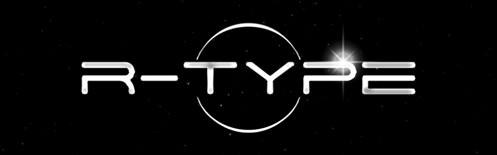

### A networked remake of the classic horizontal shoot'em up, built on our own C++ game engine

Up to four pilots against the Bydo empire, in 3D, online or offline, with voice chat, accounts, a web
administration panel, and a VR cockpit.

[](https://github.com/Akinator31/Rtype/actions/workflows/build.yml)
[](https://github.com/Akinator31/Rtype/actions/workflows/sanitizers.yml)
[](https://github.com/Akinator31/Rtype/actions/workflows/tsan.yml)
[](https://github.com/Akinator31/Rtype/actions/workflows/docker.yml)
[](https://akinator31.github.io/Rtype/)
<br>
[](https://github.com/Akinator31/Rtype/releases)
[](https://en.cppreference.com/w/cpp/20)
[](https://cmake.org/)
[](#-getting-started)
[](https://www.raylib.com/)
[](https://www.lua.org/)
[](https://www.khronos.org/openxr/)

[**Documentation**](https://akinator31.github.io/Rtype/) ·
[**Download**](https://github.com/Akinator31/Rtype/releases) ·
[**Network protocol**](https://akinator31.github.io/Rtype/protocol/) ·
[**Technical decisions**](https://akinator31.github.io/Rtype/decisions/)

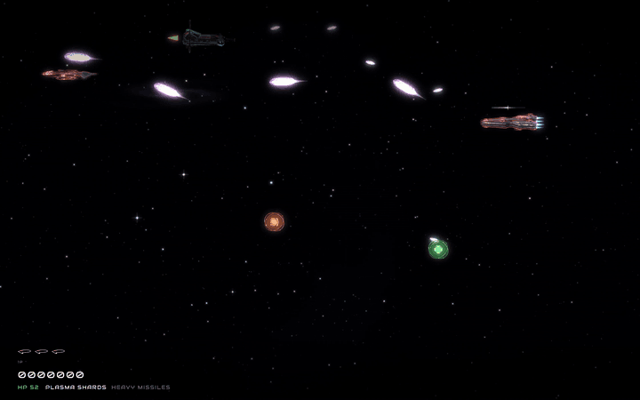

</div>

---

## Table of contents

- [Overview](#-overview)
- [Features](#-features)
  - [Gameplay](#gameplay)
  - [Ships, weapons and progression](#ships-weapons-and-progression)
  - [The Bydos and the final boss](#the-bydos-and-the-final-boss)
  - [Main menu, story and quests](#main-menu-story-and-quests)
  - [Multiplayer](#multiplayer)
  - [Accounts and Discord](#accounts-and-discord)
  - [Voice chat](#voice-chat)
  - [Virtual reality](#virtual-reality)
  - [Settings and accessibility](#settings-and-accessibility)
  - [Server and administration](#server-and-administration)
  - [Modding with Lua](#modding-with-lua)
  - [Developer tools](#developer-tools)
  - [Orbit Breaker](#orbit-breaker)
- [Getting started](#-getting-started)
- [Controls](#-controls)
- [Architecture](#-architecture)
- [Tech stack](#-tech-stack)
- [Project layout](#-project-layout)
- [Tests and continuous integration](#-tests-and-continuous-integration)
- [Documentation](#-documentation)
- [Contributing](#-contributing)
- [Team](#-team)

---

## 🚀 Overview

R-Type is the Epitech **RType** project: a remake of the 1987 arcade shoot'em up, played over the network
by up to four players. Everything below the game is our own: an **ECS engine**, a **physics engine**, a
**networking layer** (Asio, TLS and encrypted UDP), an **interface toolkit** whose menus are entities, and a
**renderer** over raylib that draws the world in 3D.

The project ships three programs:

| Program | Role |
|---|---|
| `r-type_client` | The game: rendering in 3D, input, audio, voice, VR, offline and online play |
| `r-type_server` | The authoritative server: a **master** runs the lobby, the accounts and the web panel, and starts **one process per game** |
| `orbit_breaker` | A brick breaker made with the same engine, to show that the engine knows no game |

The server decides everything (spawns, hits, deaths, score); the clients send their inputs and draw what
the server tells them, with prediction and interpolation so that the game stays smooth on a real network.

---

## ✨ Features

### Gameplay

<table>
<tr>
<td width="50%">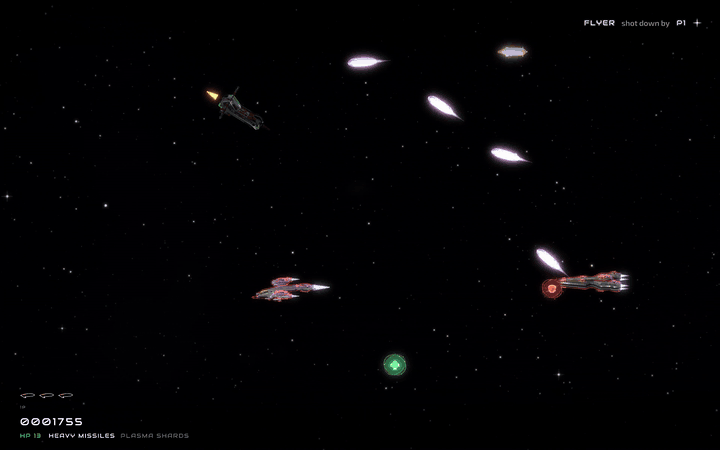</td>
<td width="50%">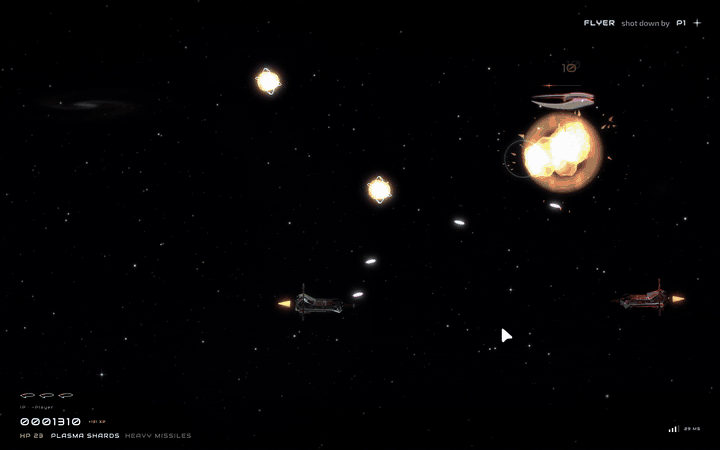</td>
</tr>
<tr>
<td align="center"><sub>Bydo lasers, plasma and missiles</sub></td>
<td align="center"><sub>Death screen with lives left and respawn countdown</sub></td>
</tr>
</table>

- **Horizontal shoot'em up in 3D**: 3D models seen from the side, a scrolling sky made of layers, lights,
  glow, vignette and antialiasing.
- **Up to four players** in the same game, each with their own slot and colour.
- **Fire and aim**: hold Fire to shoot, turn the ship 30° up or down (Q / E) to fire diagonally.
- **Two weapons per ship**, a primary and a secondary, swapped in flight with Left Shift; the HUD names both.
- **Four firing mechanics**: bullets go straight, missiles accelerate, lasers pierce the screen, plasma
  zigzags. Each weapon has its own rate, range, magazine, reload time and damage.
- **Power-ups** drift across the screen: repair kit, extra life, rapid fire, shield, and a Bydo mine that is a
  trap.
- **Waves on the music**: a wave can place its enemies on the beats of its track, found by analysing the
  audio file in three frequency bands (`libs/beat`).
- **Game feel**: impacts and explosions, damage numbers above the Bydos hit, health bars, ship flames and roll,
  coloured **auras** that tell your ship, your allies and the enemies apart at a glance.
- **HUD** from our Figma design: lives, score, weapons, the other players with their score and ping, and a
  feed of the kills in the corner.
- **Lives and respawn**: three lives, a death screen with a countdown, a short invulnerability when you come
  back.
- **Pause menu** offline and online.

### Ships, weapons and progression

<table>
<tr>
<td width="50%">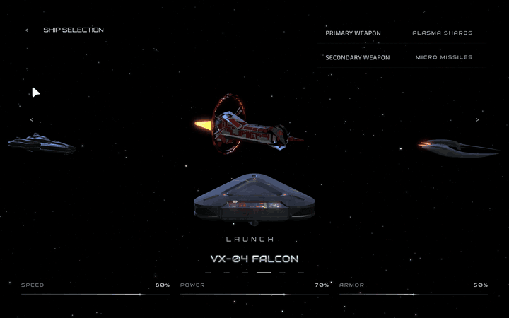</td>
<td width="50%">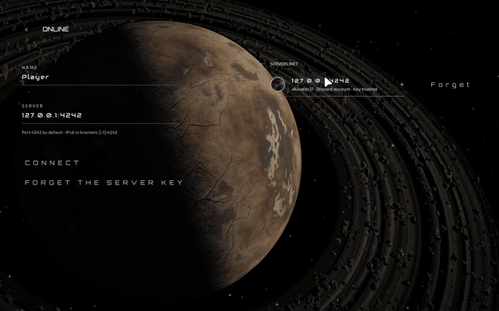</td>
</tr>
<tr>
<td align="center"><sub>The hangar: six ships, two weapons</sub></td>
<td align="center"><sub>Online: sign in, choose a ship, join a game</sub></td>
</tr>
</table>

- **The hangar**: six ships (VX-01 to VX-06), each a 3D model on a turntable with its speed, power and armour.
- **26 weapons** in Lua, from the player cannon to the charge beam, of which 11 can be equipped by the
  players.
- **Experience and levels**: online, every wave cleared earns experience, multiplied by a streak bonus. The
  account levels up, and each level unlocks ships and weapons (`config/hangar.lua`).
- **Results screen** at the end of an online game: waves cleared, Bydos shot down, best streak, score,
  experience counted up, and a level bar with *LEVEL UP*.

### The Bydos and the final boss

<table>
<tr>
<td width="50%">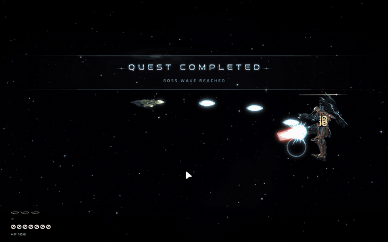</td>
<td width="50%">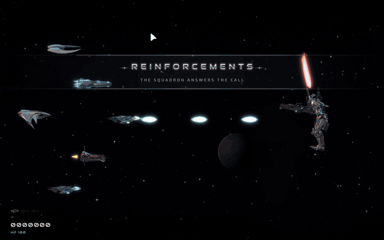</td>
</tr>
<tr>
<td align="center"><sub>The Shogun, the final boss</sub></td>
<td align="center"><sub>The rescue and the combined attack</sub></td>
</tr>
</table>

- **20 kinds of Bydos**: scouts, mosquitoes, gunners, snipers, sporecasters, carriers, phalanxes, siege
  ships... each with its own 3D model, health, speed, weapon and score.
- **Behaviours scripted in Lua**: waving, firing in bursts, following the nearest player, guarding, chaining
  phases. Each script runs in a sandbox.
- **Five difficulties of waves** offline, then the final boss; online, **endless waves** drawn at random until
  every player is out of lives.
- **The Shogun**, the final boss: several phases, blade dashes across the screen, its own theme music.
- **The rescue**: offline, losing your last life against the Shogun calls the squadron for help. A radio
  voice, a cinematic camera, then a *combined attack* on Space.

### Main menu, story and quests

<table>
<tr>
<td width="50%">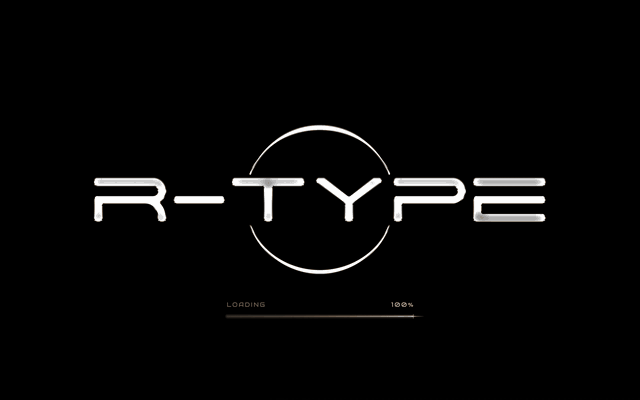</td>
<td width="50%">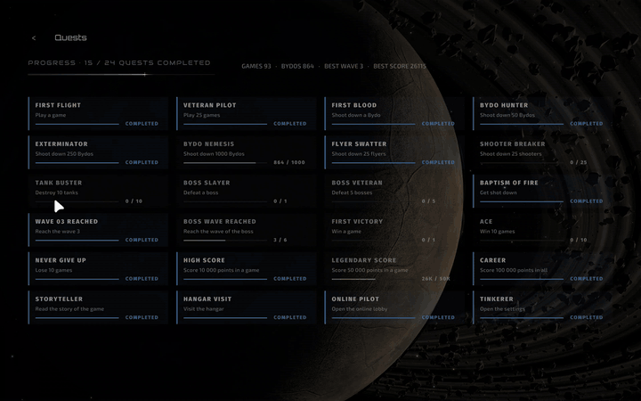</td>
</tr>
<tr>
<td align="center"><sub>Cinematic intro and main menu</sub></td>
<td align="center"><sub>24 quests and the stats of the player</sub></td>
</tr>
<tr>
<td width="50%">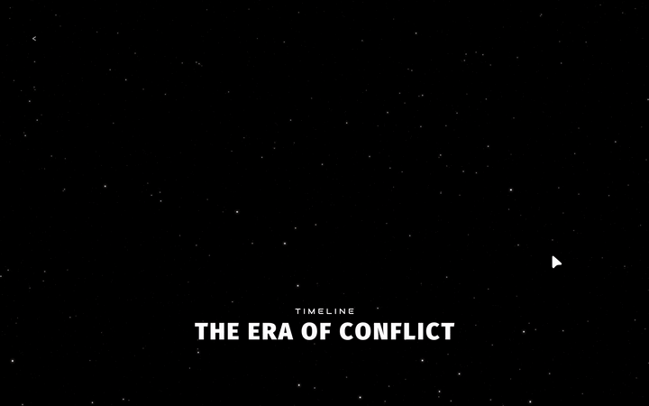</td>
<td width="50%">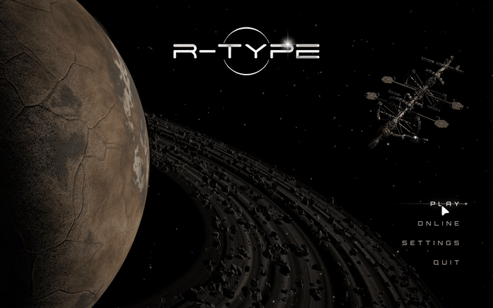</td>
</tr>
<tr>
<td align="center"><sub>The story of the game</sub></td>
<td align="center"><sub>The settings page</sub></td>
</tr>
</table>

- **Cinematic intro**: asset loading with a progress bar, the logo and its flare, then a camera flight over a
  ringed planet, its asteroid belt and a space station with ships flying around it.
- **Animated menus** with transitions between the submenus, usable with the keyboard, a gamepad or the mouse.
- **The story** (*Story*): a text crawl with its own music, in English and French.
- **24 quests** (*Quests*): first flight, Bydo hunter, boss slayer, high score... with progress bars and the
  stats kept from one run to the next. A toast pops when one is completed.

### Multiplayer

<div align="center">
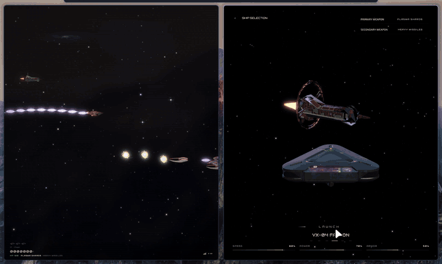
<br><sub>Two clients in the same online game</sub>
</div>

- **Lobby**: list, create and join games on a server, by its address, with the servers you already used
  remembered.
- **Secure by default**: the lobby is **TLS 1.3 over TCP**, and the game traffic is **encrypted UDP**. The
  server key is trusted on first use, like SSH, and can be forgotten from the menu.
- **One UDP port** for every game: the master relays each datagram to its game, so a server needs only one
  TCP and one UDP port open.
- **Smooth on a real network**: client-side **prediction** of the ship and of its shots, **interpolation** of
  the others, inputs stamped ahead of the server according to the measured delay, and destructions sent again
  until received.
- **Reliable when needed**: an acknowledgement layer over UDP for the messages that must arrive.
- **One process per game**: a crashing game never takes the lobby or the other games down.

### Accounts and Discord

<table>
<tr>
<td width="55%">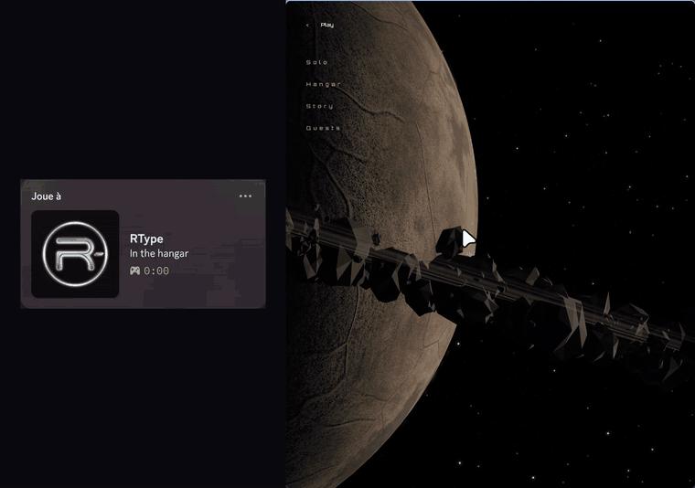</td>
<td width="45%">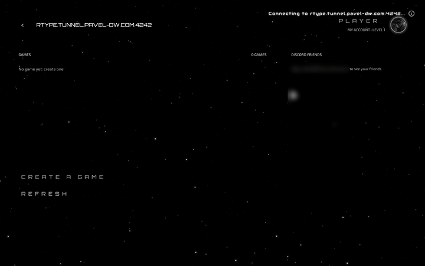</td>
</tr>
<tr>
<td align="center"><sub>Rich Presence follows the game live</sub></td>
<td align="center"><sub>Discord friends in the lobby, ready to invite</sub></td>
</tr>
</table>

- **Accounts** kept by the server: username, email and password (hashed with **Argon2**), email verification
  and password reset by **codes sent by mail**, sessions remembered by the client, account deletion.
- **Play as a guest** without an account; the experience is only kept signed in.
- **Sign in with Discord**, or link a Discord account to an existing one.
- **Discord Rich Presence**: your Discord profile shows what you do in the game (menu, wave, boss, online or
  offline, the players), and your friends can **join you** from it.
- **Discord friends** in the lobby, with their avatars: those playing R-Type, online and offline, and the
  invitations received.
- **The account of each server remembered**, with its Discord picture, so you see who will be signed in
  before connecting.

### Voice chat

- **Voice in game**, carried by the game itself or by **Discord**, and both in the same game: each player
  hears the others whatever their backend.
- **Opus** codec, a **jitter buffer**, and **WebRTC audio processing**: echo cancellation, noise suppression
  and automatic gain control.
- **Three talk modes**: push-to-talk (the default), voice activity with an adjustable threshold, or off.
  Mute and deafen keys.
- **Who is talking** is shown in the HUD and in the pause menu.
- **Moderation**: the server can turn the voice off, and administrators can mute a player or an account.

### Virtual reality

- **Play in a VR headset** through **OpenXR** (Quest through WiVRn, ALVR or Link, Index, Vive, SteamVR,
  Monado), with the loader built into the client: start it with `--xr`, or turn VR on in the settings.
- **Seated in a cockpit**, with the game board outside the canopy, drawn **in relief** for each eye.
- **The HUD on the screens of the cockpit** (radar included), and the menus on a **holographic panel**.
- **The controllers** as a gamepad and a pointer, with **haptics** on hits and shots.
- **Recentring and turning**, a cockpit that comes alive, and an **arrival sequence** before the game.
- A **VR page** in the settings: VR on or off, recentre, snap turn (30°, 45°, 90°), and what the window shows
  (the left eye, the flat game, or nothing).

### Settings and accessibility

- **Languages**: English and French, switched at once.
- **Audio**: music and sound effect volumes.
- **Display**: screen, fullscreen or window size, frame rate limit (60 to unlimited), VSync.
- **Rebindable controls**: every action on the keyboard and the gamepad, with conflict detection; keys shown
  as printed on your keyboard (QWERTY, AZERTY...).
- **Colour filters** for protanopia, deuteranopia and tritanopia, and a **high-contrast** mode.
- **Aura colours** chosen by the player, or none.
- **Menus fully usable** with the keyboard only, a gamepad only, or the mouse; the focus is shown by a frame,
  a colour *and* a size.
- Everything is saved from one run to the next.

See [Accessibility](https://akinator31.github.io/Rtype/accessibility/).

### Server and administration

- **Master and instances**: the master runs the lobby, the accounts and the panel, and starts one process per
  game, up to a configurable limit.
- **A settings file** (TOML) for the ports, the accounts, the mail server, Discord and the administrators; the
  secrets in files of their own, never logged.
- **SQLite or PostgreSQL** for the accounts, the bans and the actions of the administrators, with migrations.
- **A web administration panel** (React, served by the master over HTTP): the live state of the server, the
  games and the players through a WebSocket, and actions: kick, end a game, send a message, ban an address
  or an account, mute a voice, change a role, delete an account. Every action is recorded.
- **A Docker image** for `linux/amd64` and `linux/arm64`: `ghcr.io/akinator31/rtype`, ready for Docker
  Compose or Dokploy.
- **`--check`** to validate a configuration without starting, and clear exit codes.

### Modding with Lua

The whole content of the game is data, in **Lua 5.4** files under [`config/`](config/), read by the client
and the server alike:

| Folder | What it defines |
|---|---|
| `config/projectiles/` | The projectiles: model, mechanic, hitbox |
| `config/weapons/` | The weapons: projectile, speed, rate, range, magazine, reload, damage |
| `config/ships/` | The ships: model, sounds, hitbox |
| `config/enemies/` | The Bydos: ship, health, speed, weapon, score, phases, **scripted behaviour** |
| `config/waves/` | The waves: difficulty, placement (manual, random or on the music), items |
| `config/items/` | The power-ups and their effects |
| `config/player.lua`, `hangar.lua`, `progression.lua` | The players, the unlocks of the hangar, the experience |

A mistake in a file stops the server with the file and the field. See
[Configure enemies and weapons](https://akinator31.github.io/Rtype/guides/configure-enemies-and-weapons/) and
[Script enemy behaviors](https://akinator31.github.io/Rtype/guides/script-enemy-behaviors/).

### Developer tools

An in-game **console** opens with **F8**:

| Command | What it does |
|---|---|
| `boss` | Starts a solo game that goes straight to the final boss |
| `hitboxes [on\|off]` | Shows the colliders and the collision grid (also **F3**) |
| `fps [on\|off]` | Shows the frame rate |
| `profile [on\|off]` | Logs how long each part of the frame takes |
| `scene <name>` | Opens a scene by its name |
| `toast <type> <text>` | Shows a notification |
| `quit` | Quits |

Logs have levels and subsystems (`--log-level`, `RTYPE_LOG_LEVEL`), and the server checks its whole
configuration at start.

### Orbit Breaker

<div align="center">
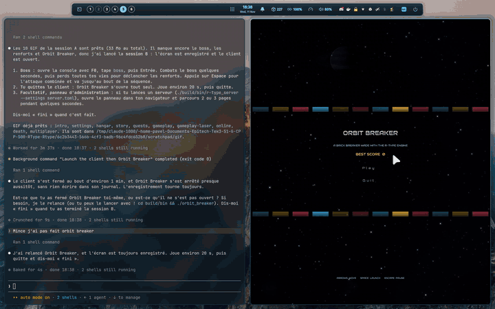
</div>

A brick breaker built with the same engine (ECS, physics, rendering, interface, audio), and nothing of the
R-Type: the proof that the engine is a reusable engine. Levels, a best score kept from one run to the next,
and the same look as the menus of the game.

---

## 🏁 Getting started

### Download

Prebuilt client and server for **Linux** and **Windows** are on the
[Releases page](https://github.com/Akinator31/Rtype/releases).

### Build from source

**Requirements**: CMake ≥ 3.25 and a C++20 compiler (GCC or Clang on Linux, Visual Studio 2022 on Windows).
Every other library is downloaded and built by [CPM.cmake](https://github.com/cpm-cmake/CPM.cmake) on the
first configure: nothing to install system-wide on Windows.

On Linux, a few system packages are needed:

```sh
# Debian / Ubuntu
sudo apt install build-essential cmake \
    libx11-dev libxrandr-dev libxinerama-dev libxcursor-dev libxi-dev libgl1-mesa-dev libssl-dev libpq-dev \
    libpulse0 libasound2t64

# Arch Linux
sudo pacman -S base-devel cmake libx11 libxrandr libxinerama libxcursor libxi mesa openssl postgresql-libs \
    libpulse alsa-lib
```

Then:

```sh
cmake -S . -B build -DCMAKE_BUILD_TYPE=Release
cmake --build build --parallel
```

Binaries are written to `build/bin/` (`build\bin\Release\` with Visual Studio). Set
`CPM_SOURCE_CACHE=$HOME/.cache/CPM` to download the dependencies only once for every build directory.

| CMake option | Default | Effect |
|---|---|---|
| `RTYPE_OPENXR` | `ON` | Builds the client with VR |
| `RTYPE_WITH_POSTGRESQL` | `AUTO`: on Linux when libpq is found | Lets the server use PostgreSQL besides SQLite (`ON`, `OFF`, `AUTO`) |
| `RTYPE_ADMIN_PANEL_DIR` | — | The built web panel (`web/admin/dist`) shipped with the server |
| `RTYPE_DISCORD_APPLICATION_ID` | the official application | The Discord application of the Rich Presence |

See [Building the project](https://akinator31.github.io/Rtype/getting-started/build/) for the details and the
troubleshooting.

### Play

**Solo**: start the client, then *Play → Solo*.

```sh
./build/bin/r-type_client
```

**Online**: start a server, then *Online* in each client, and connect to its address (port 4242).

```sh
./build/bin/r-type_server --key keys/server.key     # TCP 4242 (lobby) and UDP 4242 (games)
./build/bin/r-type_client
```

**In VR**: start the runtime of your headset (WiVRn, SteamVR, Monado, Link), then:

```sh
./build/bin/r-type_client --xr
```

**Orbit Breaker**:

```sh
./build/bin/orbit_breaker
```

### Host a server with Docker

```sh
docker run -d --name rtype \
    -p 4242:4242/tcp -p 4242:4242/udp \
    -v rtype-data:/data \
    ghcr.io/akinator31/rtype:latest
```

The key, the SQLite database and the address of the panel (`admin-url.txt`, with its token) are kept in the
`/data` volume. See
[Run a server](https://akinator31.github.io/Rtype/guides/run-a-server/),
[Configure a server](https://akinator31.github.io/Rtype/guides/configure-a-server/),
[Set up accounts](https://akinator31.github.io/Rtype/guides/set-up-accounts/) and
[Deploy with Docker](https://akinator31.github.io/Rtype/guides/deploy-with-docker/).

### Package

```sh
cd build && cpack -C Release
```

One archive per program: `.tar.gz` on Linux, `.zip` on Windows.

---

## 🎮 Controls

| Action | Keyboard | Gamepad |
|---|---|---|
| Move | Arrows or WASD (ZQSD on AZERTY) | Left stick, D-pad |
| Fire | Space | South button, right trigger |
| Aim up / down (30°) | Q / E (A / E on AZERTY) | Left / right bumper |
| Swap weapon | Left Shift | West button (X) |
| Pause | Escape | Start |
| Fullscreen | F11 | — |
| Push to talk | chosen on the Voice page | — |
| Console | F8 | — |

Every key can be changed on *Settings → Controls*. In VR, the controllers act as a gamepad and a pointer.

---

## 🏗️ Architecture

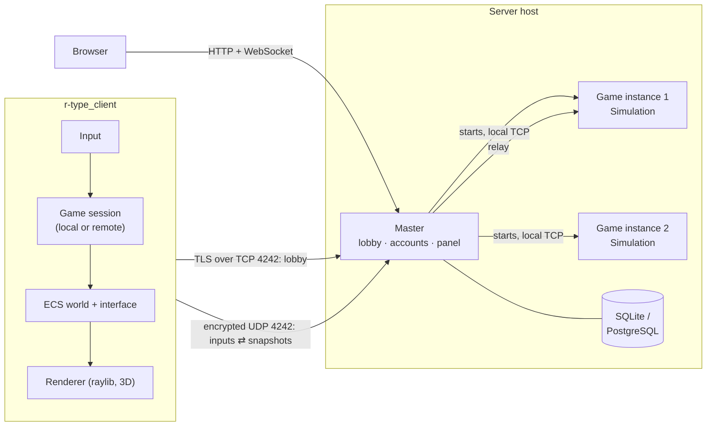

- **Authoritative server**: a game is a deterministic `Simulation` (`libs/game`) stepped 60 times per second.
  The same code runs in the server instance online and in the client offline.
- **Everything is an entity**: the world, the HUD and the menus are entities of our ECS, drawn in layers by a
  single renderer. Phases of the game are **scenes**.
- **Decoupled libraries**: no raylib type in any public header; the server links none of the graphics.

| Library | Role |
|---|---|
| `libs/ecs` | Entities, components, systems, hierarchy |
| `libs/physics` | Movement and collisions on the ECS |
| `libs/game` | The rules of the R-Type: the `Simulation` and its Lua configuration |
| `libs/scripting` | Lua 5.4 and LuaBridge3 in a sandbox |
| `libs/network` | Asio sockets, TCP framing, TLS, encrypted datagrams, reliability, serialization |
| `libs/lobby` | The messages between a client and the master |
| `libs/database` | SQLite and PostgreSQL through SOCI, migrations |
| `libs/render` | Window, resources, 3D drawing, shaders, colour filters |
| `libs/shaders` | GLSL shaders embedded at build time |
| `libs/input` | Keyboard, mouse, gamepads, rebindable actions, text entry |
| `libs/engine` | Scenes, menus as entities, animations, navigation, threads |
| `libs/audio` | Sound effects, streamed music, voices |
| `libs/beat` | Beat detection in the music, for the waves |
| `libs/localization` | The translations of the interface |
| `libs/voice` | Opus, WebRTC audio processing, jitter buffer, microphone |
| `libs/discord` | The Discord Social SDK behind interfaces |
| `libs/xr` | VR headsets through OpenXR |
| `libs/log` | Levelled, coloured logs per subsystem |
| `libs/core` | Resource handles and caches |

Read more in the [architecture documentation](https://akinator31.github.io/Rtype/architecture/) and the
[39 decision records](https://akinator31.github.io/Rtype/decisions/).

---

## 🧰 Tech stack

| Domain | Tools |
|---|---|
| Language and build | C++20, CMake, [CPM.cmake](https://github.com/cpm-cmake/CPM.cmake) |
| Graphics, input, audio | [raylib](https://www.raylib.com/) 6.0, GLSL shaders, glTF models |
| Networking | [Asio](https://think-async.com/Asio/), [Mbed TLS](https://www.trustedfirmware.org/projects/mbed-tls/), [libcurl](https://curl.se/) |
| Scripting | [Lua](https://www.lua.org/) 5.4, [LuaBridge3](https://github.com/kunitoki/LuaBridge3) |
| Server | [Crow](https://crowcpp.org/) (HTTP, WebSocket), [toml++](https://marzer.github.io/tomlplusplus/), [reproc](https://github.com/DaanDeMeyer/reproc), [Argon2](https://github.com/P-H-C/phc-winner-argon2) |
| Database | [SOCI](https://soci.sourceforge.net/), SQLite, PostgreSQL |
| Voice | [Opus](https://opus-codec.org/), [webrtc-audio-processing](https://gitlab.freedesktop.org/pulseaudio/webrtc-audio-processing), miniaudio |
| Social | [Discord Social SDK](https://discord.com/developers/docs/discord-social-sdk/overview) |
| VR | [OpenXR](https://www.khronos.org/openxr/) |
| Admin panel | React, Vite |
| Tests | [Catch2](https://github.com/catchorg/Catch2), CTest, ASan, UBSan, TSan |
| Documentation | [Zensical](https://zensical.org), Doxygen, Mermaid |

---

## 📁 Project layout

```
apps/        the programs
  client/    r-type_client, and its assets (models, sounds, fonts, translations)
  server/    r-type_server: master and game instances
  minigame/  orbit_breaker
libs/        the engine and the shared libraries (see Architecture)
config/      the Lua configuration of the game, shared by the client and the server
web/admin/   the administration panel (React)
tests/       unit, integration and smoke tests (Catch2)
docs/        the documentation (Zensical)
doxygen/     the API reference configuration
cmake/       CMake helpers
scripts/     developer and CI scripts
.github/     CI workflows
```

---

## 🧪 Tests and continuous integration

```sh
ctest --test-dir build -C Release --output-on-failure
```

Unit and integration tests with [Catch2](https://github.com/catchorg/Catch2), from the ECS to the network
protocol, the prediction of the client and the accounts. See the
[testing policy](https://akinator31.github.io/Rtype/contributing/testing/).

| Workflow | What it does |
|---|---|
| [Build](.github/workflows/build.yml) | Builds and tests on Linux and Windows (MSVC) on every push and pull request, and uploads the binaries |
| [Sanitizers](.github/workflows/sanitizers.yml) | Runs the tests under AddressSanitizer and UndefinedBehaviorSanitizer |
| [Thread sanitizer](.github/workflows/tsan.yml) | Runs the tests under ThreadSanitizer |
| [Format](.github/workflows/format.yml) | Formats the C++ with clang-format; a bot commits the fixes on pull requests |
| [Documentation](.github/workflows/docs.yml) | Builds the documentation, checks the links and the navigation, deploys it to GitHub Pages |
| [Docker](.github/workflows/docker.yml) | Builds and tests the server image, publishes it for amd64 and arm64 |
| [Release](.github/workflows/release.yml) | Publishes the client and the server for Linux and Windows when a `vX.Y.Z` tag is pushed |

---

## 📚 Documentation

The full documentation is published at **<https://akinator31.github.io/Rtype/>**:

- [Getting started](https://akinator31.github.io/Rtype/getting-started/): build, run and play
- [Play the game](https://akinator31.github.io/Rtype/getting-started/play/): the controls, the modes and every
  feature, with recordings
- [Architecture](https://akinator31.github.io/Rtype/architecture/): every subsystem, with diagrams
- [Guides](https://akinator31.github.io/Rtype/guides/): add a menu, a network message, an enemy; run, configure
  and administer a server; play online and in VR
- [Network protocol](https://akinator31.github.io/Rtype/protocol/): the lobby, the game and the admin API,
  precise enough to write another client
- [Technical decisions](https://akinator31.github.io/Rtype/decisions/): why each library and design was chosen
- [API reference](https://akinator31.github.io/Rtype/reference/): generated by Doxygen

To preview it locally:

```sh
pip install -r requirements-docs.txt
zensical serve
```

---

## 🤝 Contributing

One branch per feature or fix, named after its purpose (`feat/…`, `fix/…`, `refactor/…`, `docs/…`); pull
requests target `main`, pass the CI and are reviewed. The code is formatted with clang-format. See the
[contributing guide](https://akinator31.github.io/Rtype/contributing/).

---

## 👥 Team

<table align="center">
<tr>
<td align="center"><a href="https://github.com/Akinator31"><br><sub><b>Akinator31</b></sub></a></td>
<td align="center"><a href="https://github.com/Nogo4"><br><sub><b>Nogo4</b></sub></a></td>
<td align="center"><a href="https://github.com/AlexyLegrand"><br><sub><b>AlexyLegrand</b></sub></a></td>
</tr>
</table>

<div align="center">
<sub>Made at <b>Epitech</b> for the RType project.</sub>
</div>
