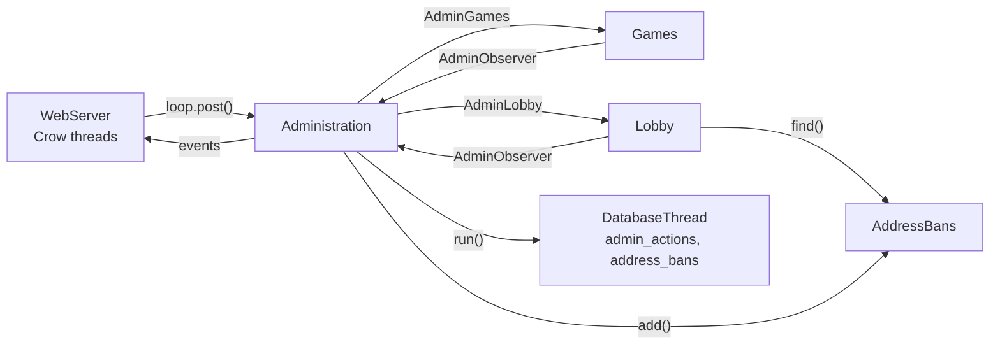

# Administration

Everything an administrator sees of a server and does to it ([ADR 0025](../decisions/0025-server-administration.md)):
the games, the players of the lobby, live, the accounts, and the actions on them, each one recorded. It lives in the master,
on its event loop, independent of what shows it: the web server serves it as the
[administration API](../protocol/admin-api.md), and the panel is its first client ([The panel](panel.md)).

| | |
|---|---|
| Code | `Master/Administration.{hpp,cpp}` (what it shows and does), `Master/AdminModel.hpp` (its view of the games and the lobby, and their interfaces), `Master/AddressBans.{hpp,cpp}` (the bans in memory), `Master/VoiceMutes.{hpp,cpp}` (the mutes of the voice in memory), `Master/AdminStore.{hpp,cpp}` (its tables), `Web/AdminJson.{hpp,cpp}` (its JSON) |
| Thread | The event loop of the master; its records on the database thread |
| Tables | `admin_actions`, `address_bans`, `voice_mutes` (migrations 1, 2 and 9 of `ServerMigrations`) |
| Tests | `tests/server_admin.cpp`, tag `[admin]`; the accounts in `tests/server_panel_accounts.cpp`, tag `[panel]`; `tests/client_online.cpp` for what the client shows |

## The pieces



*Administration reads and acts through two small interfaces, and hears what happens through a third.*

- **`AdminGames`** (implemented by `Games`): the running games with their players and their last status;
  `kick(player)` takes a player out of its game, `end(game)` ends a game, `muteVoice(player, muted)` mutes a
  player for the rest of its game, `accountVoiceChanged(account)` tells its games that the mute of an account
  changed.
- **`AdminLobby`** (implemented by `Lobby`): the welcomed players, with their address and their game;
  `disconnect(player, code)` sends `ERROR (KICKED)` or `ERROR (BANNED)` then closes the connection;
  `sendMessage(player, text)` sends `SERVER_MESSAGE`.
- **`AdminObserver`** (implemented by `Administration`): `Games` and `Lobby` call it as things happen, with an
  id only: a player joined, changed game or left; a game started, changed or ended, with why. `Administration`
  reads the rest through the two interfaces, already up to date.

The tests give `Administration` fakes of the first two, and call the third themselves: no instance, no socket.

`runMaster()` puts it together once the games and the lobby exist, and takes the observers away before they
are destroyed:

```cpp
AddressBans bans(loadAddressBans(database, now));           // before the database thread takes it
Lobby lobby(loop, std::move(listener), identity, games);
lobby.setBans(&bans);
Administration administration(loop, games, lobby, bans, &databaseThread, settings);
games.setObserver(&administration);
lobby.setObserver(&administration);
web.setAdministration(&administration);
```

## What it shows

`server()`, `games()`, `game(id)`, `players()` and `bans()` read the state of the master when they are called;
`actions()` reads the record on the database thread, its answer coming back on the loop. A game is shown once
its instance said `READY`, until it ends: `Games::adminGames()` leaves out the games that start or end.

**Live events**: `subscribe()` calls its subscriber at once with a snapshot (the server, the games, the
players), then with each event, in order, on the loop. The web server subscribes each WebSocket of
`/api/events`.

| Event | Sent when | By |
|---|---|---|
| `PlayerJoined` | `HELLO` welcomed | `Lobby::hello()` |
| `PlayerUpdated` | `GAME_JOINED`, `LEFT_GAME` | `Lobby` |
| `PlayerLeft` | its connection closed, whatever the reason | `Lobby::forget()` |
| `GameStarted` | `READY` | `Games::ready()` |
| `GameUpdated` | a player added or removed, a `GAME_STATUS` (every second) | `Games` |
| `GameEnded` | a running game leaves that state: empty, over, crashed, ended by an administrator, master stopping | `Games` |
| `ActionRecorded` | an action is in `admin_actions`, with its id | `Administration` |

## What it does

| Action | Through | The player sees |
|---|---|---|
| `kick(player, reason, actor)` | `AdminGames::kick()`: `REMOVE_PLAYER (KICKED)` to its instance; then `AdminLobby::disconnect(KICKED)` | `LEFT_GAME (KICKED)` if in a game, then `ERROR (KICKED)`, and the connection closes |
| `endGame(game, reason, actor)` | `AdminGames::end()`: `SHUTDOWN (ENDED_BY_ADMIN)` to its instance | `LEFT_GAME (ENDED_BY_ADMIN)`, back in the lobby; its UDP session ends with `DISCONNECT (SHUTDOWN)` |
| `sendMessage(game or everyone, text, actor)` | `AdminLobby::sendMessage()` for each player of the game, or of the lobby | `SERVER_MESSAGE`, shown in a toast |
| `ban(address, duration, reason, actor)` | `AddressBans::add()`, saved in `address_bans`; each player connected from it removed with `BANNED` | `ERROR (BANNED)`; refused at `HELLO` until it expires |
| `unban(address, reason, actor)` | `AddressBans::remove()`, deleted from `address_bans` | Welcome again at `HELLO`, at once |
| `banAccount(account, reason, actor)` | `banAccount()` of the store: its sessions end; each player signed in to it removed with `BANNED` | `ERROR (BANNED)`; its sign-in refused, `BANNED` |
| `unbanAccount(account, reason, actor)` | `unbanAccount()` of the store | Signs in again |
| `setRole(account, role, actor)` | `setRole()` of the store | Nothing in the game; an administrator demoted loses the panel |
| `deleteAccount(account, reason, actor)` | `deleteAccount()` of the store, its actions anonymized; each player signed in to it removed with `KICKED` | `ERROR (KICKED)`; its token gets `SESSION_EXPIRED` |
| `muteVoice(player, muted, reason, actor)` | `AdminGames::muteVoice()`: `MUTE_VOICE` to its instance, for the rest of the game, or 0 to lift it | Its voice dropped; every client of the game sees it muted (`VOICE_STATUSES`) |
| `muteAccountVoice(account, duration, reason, actor)` | `VoiceMutes::add()`, saved in `voice_mutes`; `AdminGames::accountVoiceChanged()` for its players in a game | The same, in every game it plays until the mute ends, after a restart too |
| `unmuteAccountVoice(account, reason, actor)` | `VoiceMutes::remove()`, deleted from `voice_mutes`; its players in a game told | Talks again at once |

In the game, a player removed by an administrator leaves as one who quit: its session gets
`DISCONNECT (QUIT)`, and the others `PLAYER_LEFT (QUIT)`. The [game protocol](../protocol/game.md) does not
change; the lobby connection says why.

The actions on an account run on the database thread, which reads the account, refuses a locked one, changes
it, and reads it again; their result comes back on the loop, which then removes its players. **The
administrators of `[admin] admins` are locked** (`AdministrationSettings::admins`, `isListedAdmin()`): neither
banned, demoted nor deleted from the panel, whatever their role in the database. `accounts()` and `account()`
read them for the panel, with their Discord identity (`listAccounts()`, `findAccountEntry()` of
[the store](accounts.md#the-tables)).

**Every action is recorded** in `admin_actions`, with its time, its actor (`local` for the local access token,
the id of the account of an administrator signed in), what it was done to, and its details as a JSON object
([the record](../protocol/admin-api.md#3-reading)). The action is done first, at once;
its record goes to the database thread, and comes back as an `ActionRecorded` event once written. A record that
fails is logged, and the action stays done. The logs say each action too:

```
INFO  admin    Bob (2) removed by local, because "cheating"
INFO  admin    Game 1 "Duo" ended by local, because "maintenance"
INFO  admin    Message from local to everyone (3 players): Restart in 5 minutes
INFO  admin    198.51.100.4 banned by local for 3600 s, because "flood": 1 players removed
INFO  admin    The ban of 198.51.100.4 lifted by local, because "a mistake"
INFO  admin    Account Alice (2) banned by 1, because "cheating": 1 players removed
INFO  admin    Account Alice (2) made admin by 1
INFO  admin    Bob (2) muted in game 1 by local, because "insults"
INFO  admin    The voice of account Alice (2) muted by 1 for 86400 s, because "spam": 1 players in a game
```

## Bans

A ban refuses an IP address at `HELLO` until a date: `ERROR (BANNED)`, then the connection closes. The bans of
addresses are temporary, 7 days at most (`MaxBanDuration`): an address is shared by a household or a school,
and changes. A ban of an account has no end: it holds until an administrator lifts it
([What it does](#what-it-does)).

| Where | What |
|---|---|
| `AddressBans` | In memory, on the loop: what the lobby asks at each `HELLO`, by `find(address)`. An expired ban is not found, even before it is purged |
| `address_bans` | The table, one row per address (`address` its primary key, `created_at`, `expires_at`, `reason`, `actor`). Each ban is saved as it is added, on the database thread |
| At start | `loadAddressBans()` deletes the expired rows, then reads the others, before the database thread takes the database: a ban survives a restart |
| Every minute | The expired bans are forgotten in memory, and deleted from the table |
| Lifted | `unban()` forgets the ban in memory and deletes its row, before it expires. A ban that ended already is not lifted: `false`, nothing recorded |

An address is compared without its port, and an IPv4 address seen by a listener on `[::]`
(`::ffff:203.0.113.9`) as the IPv4 address it holds (`banKey()`). The bans go by the address of the TCP
connection to the lobby: the lobby has no proxy in front of it, unlike the panel.

## The voice

An administrator mutes the voice of a player, never hears it: the server forwards the voice without decoding it
and keeps none of it, so a voice cannot be reported, nor its words checked ([Voice](voice.md#the-rules-of-the-server)).

| Muted | For | Kept |
|---|---|---|
| A player in its game | The rest of the game, or until it is let talk | In `Games`, with its member: gone with the game |
| An account | A time, 1 s to 30 days (`MaxVoiceMuteDuration`): one that must never talk is banned | `VoiceMutes` in memory, `voice_mutes` in the database (`account_id` its primary key, `created_at`, `expires_at`, `reason`, `actor`), gone with its account by its foreign key |

- **The instance decides when it ends.** `Games` tells it how long the player is muted, in seconds from now:
  in `ADD_PLAYER` when the player of a muted account joins, and in `MUTE_VOICE` at every change
  ([instances protocol](../protocol/instances.md)), `0xFFFFFFFF` for the rest of the game. The game lets it
  talk again itself at the end, and tells every client; the master only forgets the mute (purged every
  minute, as the bans).
- **Both at once**: a player muted for its game whose account is muted too stays muted until both end.
- **Locked accounts**, those of `[admin] admins`, are not muted from the panel, as they are not banned.
- **Without accounts**, only the players in their game can be muted.
- **The panel** shows the state on the page of a game (*Muted*, the end of the mute of its account in its
  tooltip) and on the sheet of an account, with the end and the reason ([The panel](panel.md)).

## Tests

`tests/server_admin.cpp` (tag `[admin]`):

- **`Administration` alone**, with fakes of the games and the lobby: the snapshot then the events in order;
  each action, what it asked of the games and the lobby, and its record read back, newest first and page by
  page, on SQLite and PostgreSQL; a ban capped at 7 days.
- **The bans**: expiry, the port and the IPv6 writing of an address, the table on both engines with its purge;
  a ban lifted, in memory and in the table, recorded, and lifted once only.
- **The voice**: a player muted in its game and let talk, refused in no game, recorded and anonymized with its
  account; the mutes of the accounts in memory (their end, replaced, lifted once, the seconds the games are
  told) and in their table on both engines (kept, purged, gone with their account, refused for an account
  that does not exist). From the panel, in `tests/server_panel_accounts.cpp`: an account muted for a time and
  lifted, its duration refused out of bounds, a pilot muted in its game, each recorded.
- **End to end**, with real lobby clients, real instances and the web server on a free port: the WebSocket's
  snapshot then its events, every route; a player removed, seen by the client and by its instance; a game
  ended; a message to a game and to everyone; an address banned, refused at `HELLO`, after a restart too, and
  welcome again once expired; a ban lifted from the panel, the address welcome again at once; no session, no CSRF token or another session's, wrong JSON, and a WebSocket opened
  without a session, without an origin, or from another one.
