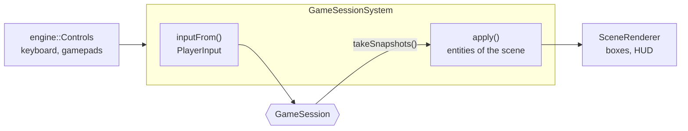

# A game in the client

How the client plays a game: one game scene, fed by a **game session**, offline or online
([ADR 0015](../decisions/0015-one-game-scene-local-or-remote-session.md)). Offline, the `Simulation` of
[libs/game](game.md) runs in the client; online, it runs in a server instance, and the client receives its
snapshots (the online session comes with `client: networking`).

To play: **Play**, then **Solo**, in the main menu. Arrows (or WASD, ZQSD) move the ship, Space fires, Escape
opens the pause menu.

## Code layout

```
apps/client/src/Game/
  GameSession.hpp        what the scene knows of a game: inputs in, snapshots out
  LocalSession.cpp       a game offline: the Simulation, stepped 60 times per second
  RemoteSession.cpp      a game online: the UDP session with the instance (The client online)
  GameSessionSystem.cpp  controls → PlayerInput → session; snapshots → entities of the scene
  EntityLook.cpp         the box of each kind of entity (lookOf()), the colours of the players
  GameView.cpp           the orthographic camera of the game scene (computeGameView())
  ShipLooks.cpp          the 3D models of the ships: fitted to their box, rolling, flames
  ShotLooks.cpp          the models of energy of the shots
  ImpactLooks.cpp        the impacts of the shots and the explosions of the ships (ImpactSystem plays them)
  DamageLooks.cpp        the damage written above the Bydos hit (DamageNumberSystem shows it)
  EntitySounds.cpp       the sound of each kind of entity, for a shot fired, a shot that hits, a ship destroyed
  GameScenes.cpp         the game scene, its HUD, and the pause menu
```

The code of the client is the library `r-type_client_core`, and `main.cpp` the program, like the server: the
tests use the library (`tests/client_game.cpp`).

## A frame



*Each frame, the input of the local player goes to the session, and the snapshots that come back become the
entities the scene draws.*

1. **The input.** `inputFrom()` reads the virtual gamepad of the engine: the four directions, and `FaceDown`
   (Space, A on a gamepad) to fire. The bindings are those of [Input](input.md): the game never reads a key.
   When a menu is over the scene (pause, console), the input is empty and the session is paused.
2. **The session.** `update(elapsed)` lets the time go by. The `LocalSession` adds up the frame times and steps
   the simulation once per 1/60 s, whatever the frame rate, at most 5 times per frame: after a long frame (a
   loading, a debugger), the game slows down for a moment instead of freezing to catch up.
3. **The world.** Each snapshot holds the whole world at its tick. An entity of the game gets an entity of the
   scene the first time it appears (`Replicated` with its id, `Position`, `Drawable`, and its look), is moved
   by the next ones, and is destroyed when a snapshot no longer has it.

The `GameSessionSystem` runs after the `InterfaceSystem`: Escape opens the pause menu before the game reads
the input. When the game scene closes, the engine destroys its entities and the system forgets its session.

## The scenes

| Scene | What it holds |
|---|---|
| `game` | The starry sky, the world of the session, and the HUD: one line per player, in its colour, with its lives and score. Escape opens the pause menu. |
| `pause` | Over the game, dimmed: **Resume**, or **Leave the game**. Offline, the game stops while it is open. |

`GameScenes::play(session, onEnd)` starts a game with a session: the game scene replaces every scene. "Solo"
plays a `LocalSession`, and goes back to the main menu when it ends; the lobby plays a `RemoteSession`, and
goes back to its list ([The client online](client-online.md)). The game ends when the player leaves it from the
pause menu, or when its session is over (`isOver()`): game over, or the game lost online.

## What it looks like

Each entity has the size of its collider in the game. The snapshots carry the kind of an entity, not its
size: a ship has the size of the [rules](game.md), the other kinds that of the configuration of the
repository.

| Entity | Look |
|---|---|
| Ship | 168 × 98: the 3D model `spaceship_ezno.glb`, tinted with the colour of its player (blue, red, green, yellow for the slots 0 to 3) |
| Shot | 68 × 18.8: the model of energy `projectiles/player/shot_basic.glb` (a charged shot: a 48 × 16 box in the colour of the player) |
| Bydo (`BydoFlyer`) | 140 × 54: the 3D model `drop_ship_v2.glb`, facing left |
| Bydo shot (`pulse`) | 68 × 22: the model of energy `projectiles/enemy/shot_spiral.glb`, facing left |
| Bydo plasma orb (`BydoPlasmaShot`) | 44 × 44: the model of energy `projectiles/enemy/orb_plasma.glb` |
| Any other kind | A grey square |

`lookOf()` gives the size and colour of each kind, from a table indexed by kind. A kind given a `ShipLook`
or a `ShotLook` (`GameSessionSystem::setShipLook()` / `setShotLook()`, called by `GameScenes`, kept by
`ShipLooks` / `ShotLooks`, which give the entities their models) is drawn with
its 3D model instead of a box; without one, as in the tests, it stays a box.

### Shots in 3D

The shots are models of energy (`engine::Model::energy`), drawn with the energy shader
(`libs/shaders/glsl/Energy.frag`, `render::Renderer::drawEnergyModel()`): the colour of their texture, added
to what is behind them without hiding anything, white hot where they face the camera, flickering with
`images/fx/energy_noise.png` flowing over them. As the ships, `ShotLook::core` is the box around the core of
the model seen through the camera of the game, trail and rings excluded, measured on the model: the model is
scaled to make its width that of the collider and centred on the shot, and the colliders have the
proportions of the cores (`config/projectiles/`). The shots of the Bydos face left. A shot is turned in the
plane of the game the way it flies, from its velocity: a Bydo shot aimed at a player
([Enemy behaviors](game.md#enemy-behaviors)) flies askew, and a plasma orb sways with its zigzag. Its collider
stays a box aligned with the axes. The plasma orbs of the Bydos have their own kind, `BYDO_PLASMA_SHOT`, so
that they have their own model.

### Ships in 3D

The game is flat, its models are not. The game scene has an **orthographic** camera
(`computeGameView(visibleArea)`) that sees the plane z = 0 as the screen sees the game: a world unit for a
game unit, y pointing down, centred on the visible area. A model placed at the position of an entity is drawn
where its box would be, with the same size anywhere on the screen: what is drawn is what collides.

- **Orientation**: the models point their nose to +x and their top to +y. A half turn around the x axis
  puts their top up on the screen and their side towards the camera, and 20° more show a little of their top.
  The Bydos are also turned by a half turn around their vertical axis, to face left.
- **Size**: `ShipLook::hull` is the box around the hull of the model seen through this camera, flames and
  trails excluded, in model units, measured on the model in its `Move` pose. The model is scaled to make the
  width of this box that of the collider, and moved to put its centre on the entity. The colliders have the
  proportions of these hulls: `Rules::shipHalfWidth/Height` 84 × 49 for the players, `halfWidth = 70,
  halfHeight = 27` in `config/ships/bydo_scout.lua`. A new model means measuring its hull again.
- **Roll**: a ship rolls around its length while it climbs (its belly towards the camera, up to 40°) or
  dives (its top, up to 25°), at full vertical speed (`ShipAttitude`, from the vertical velocity of the snapshots). The
  roll eases towards its target every frame and adds to the tilt, around the same x axis; the hull stays
  centred on the entity. Only drawn: the collider stays the box of the level hull. The `MoveUp` / `MoveDown`
  animations of the rig are not used: they switch at once, and roll the ship further than the game wants.
- **Flames**: a little flame, whatever the ship does: the `Idle` animation of the rig hides its flames in the
  thrusters, `Move` shows them long, and the ship is posed halfway between the two
  (`ModelAnimation::blendedAnimation` = `Move`, `blendAmount` 0.5). The trails behind the flames are never
  drawn: they stretch far behind the ship once it rolls its belly towards the camera. Their meshes
  (`ShipLook::trailMeshes`, by index in the model file) go into `Model::hiddenMeshes`, which the renderer does
  not draw.
- **Cost**: the models are skinned on the CPU, a few milliseconds per pose. The ships of a model are
  kept in step (the time of their animation is that of the session), and the `SceneRenderer` poses a model
  again only when its pose changes: ten Bydos cost one pose per frame.

The models are chosen by the client (`Assets.hpp`): the snapshots do not say which ship of `config/ships/`
an entity flies.

### Impacts

An entity destroyed in the game (`DestroyCause::Killed`) leaves an impact where it was last drawn: a shot that
hit something, a ship shot down. One that leaves the area or whose player leaves (`Removed`) leaves nothing.
The game marks a shot that hits `Killed` (`CombatSystem`), so the client draws its impact.

| Destroyed | Impact (`models/fx/impacts/`) | Colour |
|---|---|---|
| Shot of a player | `impact_spark.glb` | cyan, as its energy |
| Bydo shot (`pulse`) | `impact_burst.glb` | purple |
| Bydo plasma orb | `impact_splash.glb` | orange |
| Bydo, ship of a player | `impact_explosion.glb` | its own orange, deepened |

The impacts are skinned models of energy, exported from Blender with a single animation, `Impact` (0.43 s
to 1 s). `ImpactLook` (`GameSessionSystem::setImpactLook()`, set by `GameScenes`) gives the model, its
animation and length (`ResourceManager::getModelAnimationDuration()`), its scale in game units per model unit,
and its tint: the models of the shot impacts are white, drawn in the colour of their shot. The impact is an
entity of its own (`Impact`, `Model`, `ModelAnimation` with a speed of 0), 300 units in front of the plane of
the game so that the wings of the ships do not hide it. The `ImpactSystem` moves the time of its animation,
fades it out during the last quarter, and destroys it at its end, before the animation would loop.

Online, `ENTITIES_DESTROYED` arrives while the entity is still drawn, about 100 ms in the past: the
`GameSessionSystem` remembers the ids killed, and the impact appears when the entity goes. Several impacts of
the same model share it in different poses: the renderer poses the model again before drawing each one, in
the glow of the frame too.

### Damage numbers

A Bydo hit writes the damage it takes above it: a number in warm yellow, in the font of the titles, that pops
out larger, rises and fades out in 0.8 s. The client does not know the damage of the weapons: it reads the
hit points of each entity in the snapshots (`EntityState::health`), keeps the latest in `Replicated::health`,
and a drop from one snapshot to the next is the damage taken. A Bydo killed is no longer in the snapshots: it
writes the hit points it had left, the damage of the last shot that the game counted. Several hits in the same
tick, or between two snapshots received online, make one number, their sum.

`DamageLook` (`GameSessionSystem::setDamageLook()`, set by `GameScenes` for the Bydos only) gives the font, the
size and the colour. The number is an entity of its own (`DamageNumber`, `Text`, `Opacity`, `Scale` with a
`Tween` for the pop), 30 units above the centre of the Bydo, drawn in the World layer above the 2D entities.
The `DamageNumberSystem` moves it up at 90 units per second, fades it out during the second half of its time,
and destroys it at the end.

### Sounds

A shot that appears in the game plays the sound of the weapon that fired it (`sounds/fx/blaster/`):

| Shot | Weapon | Sound | Volume |
|---|---|---|---|
| Shot of a player | `player_cannon` | `basical_blaster.wav` | 0.5 |
| Bydo shot (`pulse`) | `blaster` of the scouts | `low_blaster.wav`, the shortest: they fire 12 times per second | 0.35 |
| Bydo plasma orb | `plasma_gun` of the gunners | `big_blaster.wav` | 0.7 |

A ship killed in the game explodes with `sounds/fx/destruction.wav`: a Bydo at 0.8, the ship of a player at 1.
A shot that hits something, which the game kills too, sounds with `sounds/fx/collision.wav`, at 1 whatever the
shot: the file is much quieter than the others. A shot that destroys a ship plays both.

The clients see the kind of an entity, not the weapon that fired it, so the sounds go by kind, like the looks:
an `EntitySound` gives the sound and its volume, for the shots (`GameSessionSystem::setShotSound()`) and for the
destructions (`setDestructionSound()`), both set by `GameScenes`. The `GameSessionSystem` does not play them: it
gives an `engine::SoundEffect`, heard from the side of the screen the entity is on (pan up to 0.6 at the
edges), and the engine's `SoundSystem`, registered right after the game, plays it in the same frame
([Audio](audio.md#in-the-engine)). The shot that appears carries its sound; the ship destroyed is gone at once,
so its sound is carried by its impact: a kind without an `ImpactLook` makes no sound when destroyed. Online, the
sounds play when the shot is drawn and when the ship disappears, about 100 ms after the game. `medium_blaster.wav`
is not used yet; the destruction sound of `config/ships/` (`ShipSounds`) is not read by the client, which does not
know which enemy a Bydo is.

## Tests

`tests/client_game.cpp` (tag `[client]`) runs without a window, with the `FakeInput` keyboard:

- the `LocalSession`: 60 steps per second of game time with frames of any length, at most 5 per update, its
  player moved by its input, nothing while paused;
- `inputFrom()` and `lookOf()`: the controls held become the bits of the input, the ship has the size of the
  rules, the four players have four colours, the Bydos a look of their own;
- `computeGameView()`: an orthographic camera centred on the visible area, as high as it, y pointing down;
- the `GameSessionSystem` in an `Engine`: the ship drawn where the simulation puts it and moved by the
  keyboard, a 3D model fitted to its box once given a `ShipLook` (rolling its belly towards the camera little
  by little while it climbs, the hull staying on the ship, its top while it dives, level again once it
  stops), shots created when fired and destroyed once out of the area, the game stopped while a menu is over
  its scene, an empty input under a menu even for a session that goes on (as online), and the session forgotten
  when its scene closes;
- the impacts: an entity killed leaves the impact of its kind where it was last drawn, even when its
  destruction comes first (online), fades out, and is gone at the end of its animation; an entity removed, or
  of a kind without an impact, leaves none;
- the damage numbers: a drop of the hit points writes the points lost above the entity, which rises, fades
  out and goes; an entity killed writes the points it had left, one removed or of a kind without a
  `DamageLook` writes none;
- the sounds: a shot of a kind given a sound appears with its `SoundEffect`, its volume, and a pan on its side
  of the screen, the other entities with none; a ship killed gives its destruction sound to its impact, one
  removed makes none.

```sh
./build/bin/rtype_tests "[client]"
```

## Limits and next steps

- **No interpolation offline**: the entities move 60 times per second, the rate of the simulation; online,
  they are interpolated between the snapshots ([The client online](client-online.md#interpolation)).
- **No end of game**: the rules have no lives to lose yet (`server: gameplay`).
