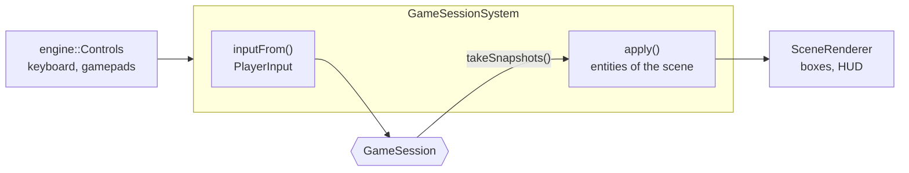

# A game in the client

How the client plays a game: one game scene, fed by a **game session**, offline or online
([ADR 0015](../decisions/0015-one-game-scene-local-or-remote-session.md)). Offline, the `Simulation` of
[libs/game](game.md) runs in the client; online, it runs in a server instance, and the client receives its
snapshots (the online session comes with `client: networking`).

To play: **Play**, then **Solo**, in the main menu. The hangar opens first, on the ship equipped last:
**Launch** starts the game with the ship looked at, and keeps it for the next time. A ship locked by the level
of the account ([config/hangar.lua](../guides/configure-enemies-and-weapons.md#the-ships-and-the-weapons-of-the-hangar-confighangarlua))
can be looked at, not launched. In the top right corner, the player chooses its two weapons among those its
level opens: the primary one, in hand when the ship appears, and the secondary one.

The game opens without a loading screen nor a cut. The hangar preloads the game scene as it opens
(`Engine::preloadScene()`). On **Launch**, the ship takes off (`ShipSelectorSystem`): the interface fades out, the
pedestal sinks, the ship turns to its profile, speeds off to the right and levels off as the game shows it. The
camera follows it, the sky and the light of the game replace those of the hangar, and the camera pulls back while
it narrows until it frames the ship as the game opens (`ArrivalZoom` in `Game/GameView.hpp`, without perspective).
Then the game is launched; online, the ship flies on until the master answers. The game opens on the same shot,
its sky scrolled as far (`ShipSelection::arrivalSky`), and its camera pulls back to the whole game while the HUD
fades in (`RescueCamera::arrival`).

Arrows (or WASD, ZQSD) move
the ship, Space fires, Q and E (A and E on AZERTY) held turn the ship by 30° up and down to fire diagonally,
Left Shift takes the other weapon in hand (the HUD names both, the one in hand bright), Escape opens the pause menu.

## Code layout

```
apps/client/src/Game/
  GameSession.hpp        what the scene knows of a game: inputs in, snapshots out
  LocalSession.cpp       a game offline: the Simulation, stepped 60 times per second
  RemoteSession.cpp      a game online: the UDP session with the instance (The client online)
  GameSessionSystem.cpp  controls → PlayerInput → session; snapshots → entities of the scene
  EntityLook.cpp         the box of each kind of entity (lookOf()), the colours of the players
  GameView.cpp           the orthographic camera of the game scene (computeGameView())
  RescueCameraSystem.cpp the camera of the rescue: close ups on the shogun, dashes and combined attack
  ShipLooks.cpp          the 3D models of the ships: fitted to their box, rolling, flames
  ShotLooks.cpp          the models of energy of the shots
  ImpactLooks.cpp        the impacts of the shots and the explosions of the ships (ImpactSystem plays them)
  DamageLooks.cpp        the damage written above the Bydos hit (DamageNumberSystem shows it)
  HealthBarLooks.cpp     the health bars above the Bydos and the allies hit (HealthBarSystem shows them)
  DeathScreen.cpp        the death screen of the local player (DeathScreenSystem counts it down)
  Hud.cpp                the HUD of the game scene (HudSystem writes it)
  EntitySounds.cpp       the sound of each kind of entity, for a shot fired, a shot that hits, a ship destroyed
  GameScenes.cpp         the game scene and the pause menu
```

The code of the client is the library `r-type_client_core`, and `main.cpp` the program, like the server: the
tests use the library (`tests/client_game.cpp`).

## A frame



*Each frame, the input of the local player goes to the session, and the snapshots that come back become the
entities the scene draws.*

1. **The input.** `inputFrom()` reads the virtual gamepad of the engine: the four directions, and `FaceDown`
   (Space, A on a gamepad) to fire. The bindings are those of [Input](input.md): the game never reads a key.
   When a menu is over the scene (pause, console), the input is empty and the session is paused.
2. **The session.** `update(elapsed)` lets the time go by. The `LocalSession` adds up the frame times and steps
   the simulation once per 1/60 s, whatever the frame rate, at most 5 times per frame: after a long frame (a
   loading, a debugger), the game slows down for a moment instead of freezing to catch up.
3. **The world.** Each snapshot holds the whole world at its tick. An entity of the game gets an entity of the
   scene the first time it appears (`Replicated` with its id, `Position`, `Drawable`, and its look), is moved
   by the next ones, and is destroyed when a snapshot no longer has it.
4. **Between two ticks.** The screen draws more frames than the game steps (144 per second against 60):
   `between()` gives where to draw the entities at this frame, positions only, no event. The `LocalSession`
   moves each one on with its velocity by the fraction of the time to the next step, and the ship of the player
   with the input held, as the next step will move it, walls included: a key pressed shows at the next frame,
   without drawing anything a tick late. Not during the rescue, which flies the ship on its own. Online, the
   `RemoteSession` gives nothing: its snapshots are drawn at the frame rate already
   ([The client online](client-online.md#interpolation)).

The `GameSessionSystem` runs after the `InterfaceSystem`: Escape opens the pause menu before the game reads
the input. When the game scene closes, the engine destroys its entities and the system forgets its session.

## The scenes

| Scene | What it holds |
|---|---|
| `game` | The [scrolling sky](#the-sky), the world of the session, and the [HUD](#hud). Escape opens the pause menu. |
| `pause` | Over the game, a veil on its left, as the pages of settings: **Resume**, or **Leave the game**; online with other players, the voice of each ([Voice](voice.md#in-the-hud-and-the-pause-menu)). Offline, the game stops while it is open. |

`GameScenes::play(session, onEnd)` starts a game with a session: the game scene replaces every scene. "Solo"
plays a `LocalSession`, and goes back to the main menu when it ends; the lobby plays a `RemoteSession`, and
goes back to its list ([The client online](client-online.md)). The game ends when the player leaves it from the
pause menu, or when its session is over (`isOver()`): game over, or the game lost online.

## What it looks like

Each entity has the size of its collider in the game. The snapshots carry the kind of an entity, not its
size: a ship has the size of the [rules](game.md), a Bydo that of the collider of its ship (the snapshots
carry its index, `EntityState::ship`), the other kinds that of the configuration of the repository.

| Entity | Look |
|---|---|
| Ship | 168 × 98: the 3D model `spaceship_ezno.glb`, tinted with the colour of its player (blue, red, green, yellow for the slots 0 to 3) |
| Shot | 68 × 18.8: the model of energy `projectiles/player/shot_basic.glb` (a charged shot: a 48 × 16 box in the colour of the player) |
| Bydo (`BydoFlyer`) | The size of the collider of its ship, and the model of its ship (`config/ships/`), facing left, when it is a model of the hangar (`ShipCatalog`, which gives its hull and trails); otherwise `drop_ship_v2.glb`. Every ship of `config/ships/` but the boss has the box of the ships of the players, 168 × 98 |
| Bydo shot (`pulse`) | The size of the collider of its projectile and the model of its projectile (`config/projectiles/`); otherwise 68 × 22: the model of energy `projectiles/enemy/shot_spiral.glb`, facing left |
| Bydo plasma orb (`BydoPlasmaShot`) | 44 × 44: the model of energy `projectiles/enemy/orb_plasma.glb` |
| Any other kind | A grey square |

`lookOf()` gives the size and colour of each kind, from a table indexed by kind. A kind given a `ShipLook`
or a `ShotLook` (`GameSessionSystem::setShipLook()` / `setShotLook()`, called by `GameScenes`, kept by
`ShipLooks` / `ShotLooks`, which give the entities their models) is drawn with
its 3D model instead of a box; without one, as in the tests, it stays a box.

### The sky

The sky of the game scene (`createGameSky()` in `GameScenes.cpp`) scrolls to the left, the nearer the faster,
so that the ships seem to fly to the right; even the deep sky moves visibly, nothing stays still ([The sky](scenes-and-interface.md#the-sky) in the engine). The
pictures are in `assets/images/backgrounds/`; the layers are 5120 × 1440 and join on their sides.

| Order | Picture | Speed (units/s) | |
|---|---|---|---|
| 0 | `space_bg_0_deep.png` | 40 | The deep sky, opaque |
| 1 | `space_galaxy.png` | 50 | 360 high, seen from the start, back every 4200 units |
| 2 | `space_bg_1_nebula.png` | 80 | |
| 4 | `space_bg_2_stars.png` | 140 | |
| 5 | `space_moon.png`, `space_planet_ringed.png` | 160, 170 | 200 and 640 high, hiding the stars, back every 9000 and 13000 units |
| 6 | `space_bg_3_near.png` | 300 | The nearest stars |

The sky keeps scrolling while the game is paused. The main menu and the hangar keep the still `starfield.png`.

### Shots in 3D

The shots are models of energy (`engine::Model::energy`), drawn with the energy shader
(`libs/shaders/glsl/Energy.frag`, `render::Renderer::drawEnergyModel()`): the colour of their texture, added
to what is behind them without hiding anything, white hot where they face the camera, flickering with
`images/fx/energy_noise.png` flowing over them. As the ships, `ShotLook::core` is the box around the core of
the model seen through the camera of the game, trail and rings excluded, measured on the model: the model is
scaled to make its width that of the collider and centred on the shot, and the colliders have the
proportions of the cores (`config/projectiles/`). The shots of the Bydos face left. A shot is turned in the
plane of the game the way it flies, from its velocity: a Bydo shot aimed at a player
([Enemy behaviors](game.md#enemy-behaviors)) flies askew, and a plasma orb sways with its zigzag. Its collider
stays a box aligned with the axes. The plasma orbs of the Bydos have their own kind, `BYDO_PLASMA_SHOT`, so
that they have their own model.

The shots of the players and of the Bydos are drawn with the model of their projectile (`model` of
`config/projectiles/`): each weapon its own. The snapshots give the index of the projectile of a shot among
the ids of the projectiles, in alphabetical order (`EntityState::ship`), and the client loads every projectile of its
configuration at the opening of the game (`setConfiguredProjectileLooks()`): its core is measured on the
bounds of the model, the front of the model, at most three times as long as it is tall, the rest being its
trail, and its light takes the colour of the mechanic of the weapon that fires it (for the players blue
bullets, orange missiles, pink lasers, green plasma; for the Bydos purple bullets, red missiles, magenta
lasers, orange plasma). The basic shot keeps its measured core, and so do `shot_spiral.glb` and
`orb_plasma.glb` for the Bydos, facing left.

### Ships in 3D

The game is flat, its models are not. The game scene has an **orthographic** camera
(`computeGameView(visibleArea)`) that sees the plane z = 0 as the screen sees the game: a world unit for a
game unit, y pointing down, centred on the visible area. A model placed at the position of an entity is drawn
where its box would be, with the same size anywhere on the screen: what is drawn is what collides.

- **Orientation**: the models point their nose to +x and their top to +y. A half turn around the x axis
  puts their top up on the screen and their side towards the camera, and 20° more show a little of their top.
  The Bydos are also turned by a half turn around their vertical axis, to face left.
- **Size**: `ShipLook::hull` is the box around the hull of the model seen through this camera, flames and
  trails excluded, in model units, measured on the model in its `Move` pose. The model is scaled to make the
  width of this box that of the collider, and moved to put its centre on the entity. Every ship but the
  boss has the box of `Rules::shipHalfWidth/Height`, 84 × 49: the players, and the Bydos of `config/ships/`
  (`halfWidth = 84, halfHeight = 49`), all as wide on the screen. A new model means measuring its hull again.
- **Roll**: a ship rolls around its length while it climbs (its belly towards the camera, up to 40°) or
  dives (its top, up to 25°), at full vertical speed (`ShipAttitude`, from the vertical velocity of the snapshots). The
  roll eases towards its target every frame and adds to the tilt, around the same x axis; the hull stays
  centred on the entity. Only drawn: the collider stays the box of the level hull. The `MoveUp` / `MoveDown`
  animations of the rig are not used: they switch at once, and roll the ship further than the game wants.
- **Flames**: a little flame, whatever the ship does: the `Idle` animation of the rig hides its flames in the
  thrusters, `Move` shows them long, and the ship is posed halfway between the two
  (`ModelAnimation::blendedAnimation` = `Move`, `blendAmount` 0.5). The trails behind the flames are never
  drawn: they stretch far behind the ship once it rolls its belly towards the camera. Their meshes
  (`ShipLook::trailMeshes`, by index in the model file) go into `Model::hiddenMeshes`, which the renderer does
  not draw.
- **Recoil**: a ship of the players (or an ally of the rescue) plays the `Shoot` animation of its rig each
  time it fires: its hull kicks back and a flash grows at its muzzle, for 0.3 s. The snapshots do not say who
  fired a shot: a shot of the players that appears makes the ship of the players drawn in 3D nearest to it
  recoil, if it is no farther than twice `Rules::shipHalfWidth` (the allies fire the shots of a player, so its
  owner is not enough). `Shoot` only moves the hull and the muzzle, from the rest pose of the rig: it is added
  over the flight (`addModelAnimation()`, `ModelAnimation::addedAnimation`), each bone keeping its pose plus
  what `Shoot` changes from its first frame, in the space of its parent; played alone, it would show the
  ship in the rest pose. The Bydos do not recoil.
- **Cost**: the models are skinned on the CPU, a few milliseconds per pose. The ships of a model are
  kept in step (the time of their animation is that of the session), and the `SceneRenderer` poses a model
  again only when its pose changes: ten Bydos cost one pose per frame. A ship recoiling has a pose of its
  own for 0.3 s.

The ships of the players, the allies and the Bydos of an unknown ship have their models chosen by the client
(`Assets.hpp`). A Bydo flies the model of its ship: the snapshots carry the index of the ship
(`EntityState::ship`, its rank among the ids of `config/ships/` in alphabetical order, `ShipRegistry::getIndex()`),
and the client, which reads the same configuration, gives each ship whose model is one of the hangar a
`ShipLook` (`GameSessionSystem::setShipLook(ship, look, size)`, from `GameScenes`), before the looks of the
kinds. Client and game must read the same `config/ships/`: another configuration gives other indexes.

**The boss** (`EntityKind::BydoBoss`, the shogun) is a standing figure, not a ship: a `BossLook`
(`Game/BossLooks.hpp`), without roll nor tilt. Its model is turned by the same half turn around x, then by
`BossLook::spin` (-70°) around its vertical axis, to face left, a little towards the camera: the model faces
+z, as its toes and its visor show; its hull is its body
in its `Idle` pose, blade and gun excluded, the proportions of its collider (`config/ships/bydo_shogun.lua`). It
plays the animation of its stance, from the flags of the snapshots: `Guard`, `Slash` or `Shoot`, `Fly` while it
moves without one, `Idle` otherwise, fading from one to the next in 0.25 s. Its blade makes a sound (`BossLook::slashSounds`: `sounds/fx/saber/laser_saber.wav`, with the wind of
`wing_giant_flap.wav`) as a dash starts: the `Slashing` flag with a speed above 400 units per second, not the
blade raised before it. Each sound has a child entity of the boss to play it, as an entity plays one
`SoundEffect` at a time. Its health bar is wider and higher,
and the start of its wave, the last one, shows a banner of its own.

The local player flies the ship equipped in the hangar: `GameScenes` gives it its own look
(`GameSessionSystem::setLocalShipLook()`), from the entry of the ship catalog (`ShipSelector/ShipCatalog.cpp`),
which keeps the hull and the trail meshes of each model, measured as above. The ships of the other players keep
the look of their kind, the Ezno: the server does not know which ship each player equipped. The collider stays
that of the rules: the long ships are fitted to its width, and are thinner than it.

### Impacts

An entity destroyed in the game (`DestroyCause::Killed`) leaves an impact where it was last drawn: a shot that
hit something, a ship shot down. One that leaves the area or whose player leaves (`Removed`) leaves nothing.
The game marks a shot that hits `Killed` (`CombatSystem`), so the client draws its impact.

| Destroyed | Impact (`models/fx/impacts/`) | Colour |
|---|---|---|
| Shot of a player | `impact_spark.glb` | cyan, as its energy |
| Bydo shot (`pulse`) | `impact_burst.glb` | purple |
| Bydo plasma orb | `impact_splash.glb` | orange |
| Bydo, ship of a player | `impact_explosion.glb` | its own orange, deepened |

The impacts are skinned models of energy, exported from Blender with a single animation, `Impact` (0.43 s
to 1 s). `ImpactLook` (`GameSessionSystem::setImpactLook()`, set by `GameScenes`) gives the model, its
animation and length (`ResourceManager::getModelAnimationDuration()`), its scale in game units per model unit,
and its tint: the models of the shot impacts are white, drawn in the colour of their shot. The impact is an
entity of its own (`Impact`, `Model`, `ModelAnimation` with a speed of 0), 300 units in front of the plane of
the game so that the wings of the ships do not hide it. The `ImpactSystem` moves the time of its animation,
fades it out during the last quarter, and destroys it at its end, before the animation would loop.

Online, `ENTITIES_DESTROYED` arrives while the entity is still drawn, 50 ms or more in the past: the
`GameSessionSystem` remembers the ids killed, and the impact appears when the entity goes. Several impacts of
the same model share it in different poses: the renderer poses the model again before drawing each one, in
the glow of the frame too.

### Damage numbers

A Bydo hit writes the damage it takes above it: a number in warm yellow, in the font of the titles, that pops
out larger, rises and fades out in 0.8 s. The client does not know the damage of the weapons: it reads the
hit points of each entity in the snapshots (`EntityState::health`), keeps the latest in `Replicated::health`,
and a drop from one snapshot to the next is the damage taken. A Bydo killed is no longer in the snapshots: it
writes the hit points it had left, the damage of the last shot that the game counted. Several hits in the same
tick, or between two snapshots received online, make one number, their sum.

`DamageLook` (`GameSessionSystem::setDamageLook()`, set by `GameScenes` for the Bydos only) gives the font, the
size and the colour. The number is an entity of its own (`DamageNumber`, `Text`, `Opacity`, `Scale` with a
`Tween` for the pop), 30 units above the centre of the Bydo, drawn in the World layer above the 2D entities.
The `DamageNumberSystem` moves it up at 90 units per second, fades it out during the second half of its time,
and destroys it at the end.

### Health bars

A Bydo hit, or the ship of another player online, shows its health bar above it: the gauge of the interface
(`engine::Gauge`, its rail, its light and the spark at its end), without a caption and 100 units long. The bar
slides down to the hit points left at 1.5 bars per second, so that it is seen going down, and its light turns
red at or below a third of them (`Gauge::low`, `GaugeStyle::lowLight`). It shows for 2 s after the last hit,
fades out in 0.4 s, and shows again at the next hit. The ship of the local player has none: it would hide it.

The snapshots carry the hit points left, not the maximum: `Replicated::maxHealth` keeps the most an entity had,
its full health since it appears with all of it (a client that joins a game sees the Bydos already hit as
full). A heal or a respawn fills the bar up again at once, without showing it.

`HealthBarLook` (`GameSessionSystem::setHealthBarLook()`, set by `GameScenes` for the Bydos and the player
ships) gives the length of the bar, how far above the centre of the entity it is, and the share at which it
turns red. The bar is created at the first hit, attached to the entity (`ecs::Parent`, so that it follows it
and goes with it), and kept in `Replicated::healthBar`: an entity drawn in the World layer, under the damage
numbers, whose gauge reads `HealthBar::shown`. The `HealthBarSystem` slides it down and fades it out.

### Auras

Each ship drawn in 3D casts an aura in the colour of its side, so that the player tells at a glance its own
ship, those of its allies and those of its enemies. It is a shader projected on the model
(`render::Aura`, `Renderer::drawAura()`, `libs/shaders/glsl/Aura.vert` and `Aura.frag`): the meshes of the
model are drawn again, their vertices pushed 2.5 units out along their normals, lit in the colour of the aura
where they graze the view (Fresnel) and clear where they face the camera, so that the model shows through. The
light is faint and breathes a little; it is added to the image without hiding anything, and
spreads around the ship in the glow of the frame (`Aura::bloom`). The hidden meshes of the model (the trails of
the flames) have none.

The Settings page chooses the three colours, or none (`AuraColors`, [Settings](settings.md)): the ship of the
local player (green by default), the ships of the other players and of the allies of the rescue (blue), the
Bydos (red). The bosses have none. `GameSessionSystem::setAuraColors()` gives the system the colours the page
changes; a ship reads them when it appears, and its `engine::Model` keeps its aura, which the `SceneRenderer`
draws right after the model, in its pose.

### Sounds

A shot that appears in the game plays the sound of the weapon that fired it (`sounds/fx/blaster/`):

| Shot | Weapon | Sound | Volume |
|---|---|---|---|
| Shot of a player | `player_cannon` | `basical_blaster.wav` | 0.5 |
| Bydo shot (`pulse`) | `blaster` of the scouts | `low_blaster.wav`, the shortest: they fire 12 times per second | 0.35 |
| Bydo plasma orb | `plasma_gun` of the gunners | `big_blaster.wav` | 0.7 |

A ship killed in the game explodes with `sounds/fx/destruction.wav`: a Bydo at 0.8, the ship of a player at 1.
A shot that hits something, which the game kills too, sounds with `sounds/fx/collision.wav`, at 1 whatever the
shot: the file is much quieter than the others. A shot that destroys a ship plays both.

The clients see the kind of an entity, not the weapon that fired it, so the sounds go by kind, like the looks:
an `EntitySound` gives the sound and its volume, for the shots (`GameSessionSystem::setShotSound()`) and for the
destructions (`setDestructionSound()`), both set by `GameScenes`. The `GameSessionSystem` does not play them: it
gives an `engine::SoundEffect`, heard from the side of the screen the entity is on (pan up to 0.6 at the
edges), and the engine's `SoundSystem`, registered right after the game, plays it in the same frame
([Audio](audio.md#in-the-engine)). The shot that appears carries its sound; the ship destroyed is gone at once,
so its sound is carried by its impact: a kind without an `ImpactLook` makes no sound when destroyed. Online, a
shot of the player sounds when it is fired, predicted ([Shots of the player](client-online.md#shots-of-the-player));
the others' and the destructions when they are drawn, 50 ms or more after the game. `medium_blaster.wav`
is not used yet; the destruction sound of `config/ships/` (`ShipSounds`) is not read by the client, which does not
know which enemy a Bydo is.

### HUD

The HUD is the one of the Figma design (file `RrrH0ic4ttdyDoc3nRnWBr`, "Rangée 6 · HUD en jeu", node 121:29),
1440 wide, scaled by 4/3 to the 1920 of the game:

- a shadow along the top of the screen (black at 60 % fading out) and one along the bottom (fading in to 65 %),
  under the HUD and the toasts: `engine::Box` with a `bottom` colour, a vertical gradient;
- bottom left, the local player: one picture per life of the start (`images/hud/life.png`, `life_lost.png`, as
  on the death screen), lit for the lives left; its slot, `1P`, and online its name (`1P · KAZE`) and the icon
  of its voice; its score on seven digits, in large;
- bottom right, the other players, one line each from the top in the order of their slots: online, the icon of
  its voice, then `P2`, its name and its score, its name turned white while it talks; offline, `P2` and its
  score. Under them, online, the ping (`28 MS`) with four signal bars, lit under 25, 60 and 120 ms
  (`HudSystem::FourBars`…), one at least. Offline, there is no ping: nothing is shown;
- top right, the events, which stay the toasts of the engine ([Events](#events)).

`openHud()` creates its entities in the game scene, in the Interface layer under the death screen, and a `Hud`
that lists them. The `HudSystem` writes them each frame from the players of the latest snapshot
(`GameSessionSystem::players()`), the ping of the session (`GameSession::ping()`: the round-trip time of the
`network::ClientSession` online, none offline), the names of the players (`GameSession::playerNames()`, none
offline) and its voice (`GameSession::voiceView()`, none offline), and places them through their `Anchor`: the
lines of the other players pile up from the ping, and their parts follow the width of the one on their right.
Before the first snapshot, the local player has all its lives and a score of 0.

The voice in the HUD is the one of Série 16 of the design (`Voix en jeu`, node 210:1483): the icons, and the
badge above the ship of a pilot who talks, are described in [Voice](voice.md#in-the-hud-and-the-pause-menu).

The design also has a record (`HI`) and a Beam gauge: the game keeps no record and has no charged shot yet.
The events name the players by slot.

#### In the cockpit

In a VR headset, the HUD is on the screens of the cockpit (Figma, Série 17, `Cockpit VR`, section 221:1772),
each part given the surface of its screen (`engine::OnSurface`, [VR](vr.md#the-interface-in-the-cockpit)).
While the surfaces are apart (`Metrics::surfacesApart()`), the `HudSystem` gives the parts the sizes of
`CockpitHud`, larger than those of the screen (`ScreenHud`) to be read at arm's length, and places them from the
top of the part of their screen the pilot sees: the panel of the dashboard hides the sides of the screens of
the ship and of the navigation ([VR](vr.md#the-interface-in-the-cockpit)), so what is left of them is about
square, and taller than wide for the navigation. The screen of the ship keeps everything on its left, out from
under the flight stick, which hides its bottom right; the navigation puts the kind of game and the ping on two
lines.

| Screen | Size, game units | Shows |
| ------ | ---------------- | ----- |
| Ship (`HudShip`, on the right) | 317 × 360 | The slot and the name of the pilot, the icon of its voice, its lives, its score, its experience, its hit points. |
| Navigation (`HudNav`, in the middle) | 230 × 310 | `WAVE` over the wave (`03 / 08`, or `WAVE · ENDLESS` over `07`), `BOSS APPROACHING` in red while a boss is in the game, the kind of game (`SOLO`, `ONLINE` after a cyan light), and under it the ping and its bars. |
| Sides (`HudAux`, the four small screens) | 420 × 300 | `PILOTS` over a line per other pilot: the icon of its voice, its slot, its name, its score; `FLYING SOLO` alone. |
| Hologram (`Holo`) | 480 × 330 | The radar: the frame of the board and its grid, a square per ship and Bydo (`radarBlip()`, `Game/Radar.hpp`): the pilot in white, the other players and the allies in cyan, the Bydos in red, the boss framed in orange. The shots are not shown. |

The wave, the boss, the kind of game, the title of the pilots and the radar are on the screens of the cockpit
only: on the screen their texts are empty and the radar transparent. The shadows, which belong to the screen,
are hidden in the cockpit. The words come from the locales (`hud.*`).

### Events

The corner of the toasts (top right) tells the deaths of the game, as event lines (`engine::Engine::showToast()`
with a subject, a message and an actor):

| What | Line | Type |
|---|---|---|
| A Bydo shot down by the local player | `FLYER shot down by P1` | `Success` |
| The ship of the local player shot down | `P1 was shot down` | `Error` |
| The ship of an ally shot down | `P2 was shot down` | `Warning` |

The kills of the allies are not told: four players would fill the corner. The players are named as in the HUD,
`P1` to `P4`, and the Bydos by their kind (`event.flyer`, `event.shooter`, `event.tank`, `event.boss`).

The snapshots do not tell who killed what. The game spends a shot of a player that hits (`DestroyCause::Killed`,
in the same tick as the Bydo it kills), so the killer of a Bydo is the owner of the shot of a player killed with
it nearest to it, kept in `Replicated::owner`. Two players killing two Bydos side by side in the same tick may
swap their kills; a Bydo killed by no shot has no killer. The `GameSessionSystem` tells each ship killed while
drawn, a Bydo or the ship of a player, to its kill handler (`setKillHandler()`, a `Kill`: its kind, its owner,
its killer), when the game tells its destruction; `GameScenes` turns it into the line.

### Waves

When a wave starts, a banner crosses the screen (`engine::Engine::showBanner()`, `Info`): `WAVE 03` and
`BYDOS INCOMING` (`event.wave`, `event.wave_detail`), fully shown for 1.5 s instead of the 3 s of the style, as
it comes back with each wave. Only the number and the music of the wave reach the client: its name
stays in the game. Offline, they are `Snapshot::waveStarted` and `Snapshot::waveMusic`; online, `RemoteSession`
keeps those of `WAVE_STARTED` and puts them in the next snapshot it gives. The `GameSessionSystem` tells them to
its wave handler (`setWaveHandler()`), and `GameScenes` shows the banner and plays the music of the wave
(`music` in its Lua file, for instance `sounds/boss_theme.mp3` for the shogun), looped, in place of the one
playing. A wave without music leaves the current one; it stops when the game ends. A path that leaves the
assets (absolute, or with `..`) is ignored, as the game may be a server.

### The rescue against the final boss

Offline, the last ship lost against the shogun brings allies to the rescue instead of the game over
([The rescue against the final boss](game.md#the-rescue-against-the-final-boss)). The stage of the rescue is in
each snapshot (`Snapshot::rescue`); the `GameSessionSystem` tells each new one to its rescue handler
(`setRescueHandler()`), and `GameScenes` shows it:

| Stage | What the client does |
|---|---|
| `Voice` | Plays the voice of the rescue, `RTYPE_SOUND_RESCUE_VOICE` (`sounds/rescue_voice.wav`), over the music. Without the file, a warning is logged and the rescue goes on silently. The allies come `Rules::rescueVoiceTicks` later: keep it the length of the file |
| `Arrival` | A banner, `REINFORCEMENTS` / `THE SQUADRON ANSWERS THE CALL` (`rescue.title`, `rescue.detail`), `Success` |
| `Prompt` | `PRESS SPACE - COMBINED ATTACK` (`rescue.prompt`) under the middle of the screen, in the titles, blinking, until the next stage |
| `Combined` | A short banner, `COMBINED ATTACK` (`rescue.combined`) |

**The voice** (`Voice`), **the dashes of the shogun** (`Dash`) and **the combined attack** (`Combined`) are shot
as scenes of a film:

- **The cuts.** Each ship the blade goes through is in the snapshot (`Snapshot::struck`, by id). The
  `GameSessionSystem` leaves on it the strike look of its kind (`setStrikeLook()`: `impact_burst.glb`, larger
  than the ship, in the cold white of the blade), plays its strike sound (`setStrikeSound()`: the collision
  sound), and tells its strike handler (`setStrikeHandler()`), with which `GameScenes` shakes the camera.
- **The camera.** The camera entity of the game scene has a `RescueCamera`, which the `RescueCameraSystem`
  moves after the `GameSessionSystem`, from one shot per stage (how much of the game it sees, its tilt, how
  fast it gets there, the shake it keeps, its subject). It frames a focus that follows its subject a little
  late, the shogun or the ship of the local player, the framing kept inside the view at rest, and leans up to
  4° into a dash while the shogun runs ahead of its focus. A blow (`shakeCamera()`) shakes it: it moves, turns and closes in a little, then calms down.

| Stage | Shot |
|---|---|
| `Voice` | A slow push in to 50 % on the ship of the local player, where it was last drawn: it was just lost, so the camera frames its explosion while the voice calls the allies |
| `Arrival`, `Assault` | Back to the whole game, the allies flying in |
| `Dash` | Closes up to 62 % of the view on the shogun; each strike shakes it (0.75) |
| `Prompt` | Back to the whole game |
| `Combined` | A slow push in to 48 %, tilted by 3°, rumbling under the fire (a shake of 0.45 at the least); the fall of the shogun (its kill, told to `GameScenes`) shakes it fully |
| `Finished` | A slow pull back from the explosion to the whole game, level |
| others | The whole game |

The numbers of the shots are at the top of `RescueCameraSystem.cpp`, the strengths of the blows in
`GameScenes.cpp`.

The allies (`EntityKind::AllyShip`) are drawn with the model of the hangar ship VX-04 (`spaceship.glb`), untinted,
with the size of a ship of a player.

### Death screen

When the ship of the local player is lost with lives left, `GameScenes` shows the death screen until its next
ship comes, `Rules::respawnDelay` (180 ticks, 3 s) later:

- a red banner across the screen (`engine::Engine::showBanner()`, `Error`), `SHIP DESTROYED` (`death.title`),
  fully shown for the time left once its entrance and its exit are taken off, so that it leaves as the ship
  comes;
- a black veil at 50 % over the game and the HUD, which fades in at once;
- in the band of the banner, where its detail would be, `LIVES LEFT` (`death.lives`) and one picture per life of
  the start (`images/hud/life.png`, `life_lost.png`, from the Figma design): the lives left lit, the others
  lost. The life just lost is lit over its picture of a life lost, and goes out once seen;
- under the band, `RESPAWN` (`death.respawn`) and the seconds left in an `engine::Ring` that runs out with them,
  a spark at the end of its light. Each new second pops.

`openDeathScreen()` creates its entities in the game scene, in the Interface layer, over the HUD and under the
toasts, and a `DeathScreen` that lists them. The `DeathScreenSystem` plays it in the time of the game: it
counts down to the tick of the next ship from the tick of the latest snapshot (`GameSessionSystem::tick()`), so
the countdown stops while the game is paused offline, then fades everything out and destroys it once that tick
is reached. The client takes the lives at the start and the delay from the default `game::Rules`, like its
prediction. The last life opens no death screen: the event of the ship lost is told as for any other.

### Results screen

Online, when a game goes to its end (every player out of lives), `GameScenes` keeps what the local player did
in it from its last `PlayerState` (`GameScenes::results()`): the waves cleared, the Bydos shot down, the best
streak, the score and the experience earned, even with no wave cleared. The snapshots of the game do not
carry its end: `RemoteSession` gives the outcome of `GAME_OVER` to the next snapshot it takes, with the
players of the latest snapshot received, their final scores. `OnlineScenes` then leaves the game and shows
them in the results scene (`GameScenes::showResults()`), over the sky of the game, until the player presses
**Continue** (`summary.continue`) or Escape, which goes back to the list of the games:

- a veil and `THE R-TYPE SECTION HAS FALLEN` (`summary.title`: the elite pilots of the lore) in chrome fade
  in, with the sound of the game over;
- the four figures land one after the other, each popping from larger with a thump;
- the experience earned counts up from 0, ticking higher and higher, while the bar of the level of the account
  fills from the experience before the game to the one after, with the level and the experience into it under
  it. Each level gained pops `LEVEL UP` (`progress.level_up`) with its fanfare, and the bar starts again from
  its left end. An achievement sound once all is counted;
- a guest sees the experience it earned, then, on a server with accounts, that it keeps it only signed in
  (`progress.guest`).

The experience before the game is the one of the last `PROGRESS` as the player joined it. The one after is
guessed as that and the experience of the game until the master tells it (`PROGRESS` with experience gained),
which may come while the screen counts: the bar follows it. Shown on the results, that `PROGRESS` makes no
toast; one that comes in the lobby still does.

`openResultsScreen()` creates the entities and a `ResultsScreen` that lists them; the `ResultsSystem` plays it
in the time of the screen and gives its sounds to the `engine::SoundSystem` (`sounds/fx/results/`: the sound of
the game over is "Energy - short end sparkles 04", the one of a level gained "Level up bonus 2", the one of
the experience counted "Apocalyptic Game Achievement Completed 1", its ticks "Game Weapons Designed Hit Bass
Layer Sweetener Sub Click Tick"; the thump of a figure is synthesized for the game).

## Quests

### Events and stats

The `GameRecorder` of the game scenes (`Game/GameRecorder.hpp`) tells the engine what happens in the games:
each time, it counts it in a stat of the player, kept in the settings as an integer (`stats.*`), then triggers
an event of the engine (ADR 0008), created with the scenes, before any game.

| Event | When | Stats |
|---|---|---|
| `game:started` | the game scene opens | `stats.games_played` |
| `game:bydo_killed` | a Bydo shot down by the local player | `stats.bydos_killed`, and `stats.flyers_killed`, `stats.shooters_killed` or `stats.tanks_killed` |
| `game:boss_killed` | a boss shot down, by anyone | `stats.bosses_defeated` |
| `game:player_killed` | the ship of the local player shot down | `stats.deaths` |
| `game:wave_started` | a wave starts | `stats.best_wave` (the highest) |
| `game:won`, `game:lost` | a snapshot tells how the game ended (`GameSessionSystem::setOutcomeHandler`) | `stats.victories`, `stats.defeats` |
| `game:ended` | the player leaves the game, or its session is over | `stats.best_score` (the highest), `stats.total_score` |

The events carry nothing: a listener reads the stats. They are counted at once, before the trigger, because
an event triggered several times before an update wakes its listeners once. The settings are written to their
file at the end of each game, and when a quest is completed.

### Quests

A quest is an `engine::QuestSystem`: a system with an id, the events that wake it, and `progress()`, which
tells whether it is now completed. `Engine::addQuest()` disables it and subscribes it to its events with
`Reaction::Enable` and `Duration::Once`, so it runs once at the update after a trigger. A completed quest is
written in the settings as `quest.<id>=true`; at the next run, `addQuest()` leaves it disabled and subscribed
to nothing.

`registerQuests()` (`Quests/Quests.cpp`) registers the quests of the client, after the scenes, from two
tables:

- `StatQuest`s, completed once a stat reaches a target, checked when its event is triggered: 20 of them
  (games played, Bydos shot down in all and by kind, bosses, first death, waves, victories, defeats, scores);
- `EventQuest`s, completed the first time their event is triggered: here the `<scene>:open` events of the
  lore, the hangar, the online lobby and the settings menu.

A completed quest writes the settings file at once and shows a blue banner (`ToastType::Quest`):
`quest.completed` as its title, the name of the quest (`quest.<id>` in the locales) as its detail. A quest is
added with a line in one of the tables and its name in `en.lang` and `fr.lang`.

## Tests

`tests/client_game.cpp` (tag `[client]`) runs without a window, with the `FakeInput` keyboard:

- the `LocalSession`: 60 steps per second of game time with frames of any length, at most 5 per update, its
  player moved by its input, nothing while paused; between two steps, its ship moving at every frame at 144
  frames per second and stopping at the next frame when the key is let go, without events, nothing while
  paused;
- `inputFrom()` and `lookOf()`: the controls held become the bits of the input, the ship has the size of the
  rules, the four players have four colours, the Bydos a look of their own;
- `computeGameView()`: an orthographic camera centred on the visible area, as high as it, y pointing down;
- the `GameSessionSystem` in an `Engine`: the ship drawn where the simulation puts it and moved by the
  keyboard, a 3D model fitted to its box once given a `ShipLook` (rolling its belly towards the camera little
  by little while it climbs, the hull staying on the ship, its top while it dives, level again once it
  stops), shots created when fired and destroyed once out of the area, the game stopped while a menu is over
  its scene, an empty input under a menu even for a session that goes on (as online), and the session forgotten
  when its scene closes;
- the impacts: an entity killed leaves the impact of its kind where it was last drawn, even when its
  destruction comes first (online), fades out, and is gone at the end of its animation; an entity removed, or
  of a kind without an impact, leaves none;
- the damage numbers: a drop of the hit points writes the points lost above the entity, which rises, fades
  out and goes; an entity killed writes the points it had left, one removed or of a kind without a
  `DamageLook` writes none;
- the health bars: a hit shows the gauge above the entity, which slides down to the hit points left, then
  fades out and shows again at the next hit; the ships of the other players show
  theirs, not the local one, and a heal fills it up again;
- the sounds: a shot of a kind given a sound appears with its `SoundEffect`, its volume, and a pan on its side
  of the screen, the other entities with none; a ship killed gives its destruction sound to its impact, one
  removed makes none;
- the kills: a Bydo killed is told with the owner of the shot of a player killed nearest to it, or no killer
  without one, a shot or an entity removed is not told, and the ship of a player killed is told with its owner;
- the waves: each wave started is told once, with its number;
- the rescue: a ship struck by the blade of the shogun shows the cut of its kind where it is drawn, with its
  sound, and is told, one without a strike look only told; the `RescueCamera` sees the whole game at rest,
  closes up on the shogun during its dashes inside the game, shakes at a strike then calms down, and goes back
  once they are over; during the voice it pushes in on the ship of the local player where it was last drawn,
  and pulls back as the allies arrive; during the combined attack it pushes in slowly, closer, tilted and rumbling, then pulls
  back level and still once the shogun has fallen;
- the death screen: the seconds left in the countdown and its ring follow the snapshots, not the frames, each new
  second pops, and the screen goes once the tick of the next ship is reached; the lives left are lit, the one
  just lost goes out after the veil and the rest have faded in;
- the HUD: the lives left of the local player lit, its slot and its score on seven digits, all its lives before
  the first snapshot; the scores of the other players, the first on top, a player gone leaving its line; the
  ping with its signal bars when the session has one, nothing offline; online, the names of the pilots and the
  icons of their voice, and the badge above the ship of a pilot who talks (tag `[voice]`);
- the HUD in the cockpit (tag `[vr]`): each part on the surface of its screen; on the screen, its look kept and
  nothing of the cockpit shown; in the cockpit, larger, placed from the top of its screens, with the wave, the
  kind of game and the other pilots, and back as before on the screen; the radar, which shows the ships and the
  Bydos but not the shots, and warns of the boss; where a blip is in the frame of the board.

```sh
./build/bin/rtype_tests "[client]"
```

## Limits and next steps

- **No interpolation offline**: the entities move 60 times per second, the rate of the simulation; online,
  they are interpolated between the snapshots ([The client online](client-online.md#interpolation)).
- **No end of game**: the rules have no lives to lose yet (`server: gameplay`).
