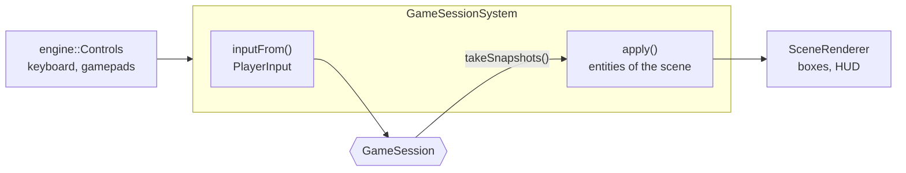

# A game in the client

How the client plays a game: one game scene, fed by a **game session**, offline or online
([ADR 0015](../decisions/0015-one-game-scene-local-or-remote-session.md)). Offline, the `Simulation` of
[libs/game](game.md) runs in the client; online, it runs in a server instance, and the client receives its
snapshots (the online session comes with `client: networking`).

To play: **Play**, then **Solo**, in the main menu. Arrows (or WASD, ZQSD) move the ship, Space fires, Escape
opens the pause menu.

## Code layout

```
apps/client/src/Game/
  GameSession.hpp        what the scene knows of a game: inputs in, snapshots out
  LocalSession.cpp       a game offline: the Simulation, stepped 60 times per second
  GameSessionSystem.cpp  controls → PlayerInput → session; snapshots → entities of the scene
  GameScenes.cpp         the game scene, its HUD, and the pause menu
```

The code of the client is the library `r-type_client_core`, and `main.cpp` the program, like the server: the
tests use the library (`tests/client_game.cpp`).

## A frame



*Each frame, the input of the local player goes to the session, and the snapshots that come back become the
entities the scene draws.*

1. **The input.** `inputFrom()` reads the virtual gamepad of the engine: the four directions, and `FaceDown`
   (Space, A on a gamepad) to fire. The bindings are those of [Input](input.md): the game never reads a key.
   When a menu is over the scene (pause, console), the input is empty and the session is paused.
2. **The session.** `update(elapsed)` lets the time go by. The `LocalSession` adds up the frame times and steps
   the simulation once per 1/60 s, whatever the frame rate, at most 5 times per frame: after a long frame (a
   loading, a debugger), the game slows down for a moment instead of freezing to catch up.
3. **The world.** Each snapshot holds the whole world at its tick. An entity of the game gets an entity of the
   scene the first time it appears (`Replicated` with its id, `Position`, `Drawable`, and its look), is moved
   by the next ones, and is destroyed when a snapshot no longer has it.

The `GameSessionSystem` runs after the `InterfaceSystem`: Escape opens the pause menu before the game reads
the input. When the game scene closes, the engine destroys its entities and the system forgets its session.

## The scenes

| Scene | What it holds |
|---|---|
| `game` | The starry sky, the world of the session, and the HUD: one line per player, in its colour, with its lives and score. Escape opens the pause menu. |
| `pause` | Over the game, dimmed: **Resume**, or **Main menu**, which ends the game. Offline, the game stops while it is open. |

`GameScenes::play(session)` starts a game with a session: the game scene replaces every scene. "Solo" plays a
`LocalSession`; `client: networking` will play a `RemoteSession` the same way.

## What it looks like

For now each entity is a coloured box of the size of its collider in the [rules](game.md), so that what is
drawn is what collides:

| Entity | Look |
|---|---|
| Ship | 96 × 48, in the colour of its player: blue, red, green, yellow for the slots 0 to 3 |
| Shot | 24 × 8, in the colour of the player who fired |
| Anything else (Bydos, later) | A grey square |

`lookOf()` decides it: sprites can replace the boxes there, without changing the rest.

## Tests

`tests/client_game.cpp` (tag `[client]`) runs without a window, with the `FakeInput` keyboard:

- the `LocalSession`: 60 steps per second of game time with frames of any length, at most 5 per update, its
  player moved by its input, nothing while paused;
- `inputFrom()` and `lookOf()`: the controls held become the bits of the input, the sizes are those of the
  rules, the four players have four colours;
- the `GameSessionSystem` in an `Engine`: the ship drawn where the simulation puts it and moved by the
  keyboard, shots created when fired and destroyed once out of the area, the game stopped while a menu is over
  its scene, an empty input under a menu even for a session that goes on (as online), and the session forgotten
  when its scene closes.

```sh
./build/bin/rtype_tests "[client]"
```

## Limits and next steps

- **No interpolation**: the entities move 60 times per second, the rate of the simulation. Online, snapshots
  come 30 times per second: drawing 100 ms in the past between two snapshots comes with the network.
- **Boxes instead of sprites**, and no explosion when an entity is destroyed: the snapshots already say which
  ones were killed (`DestroyCause::Killed`).
- **No end of game**: the rules have no lives to lose yet (`server: gameplay`).
