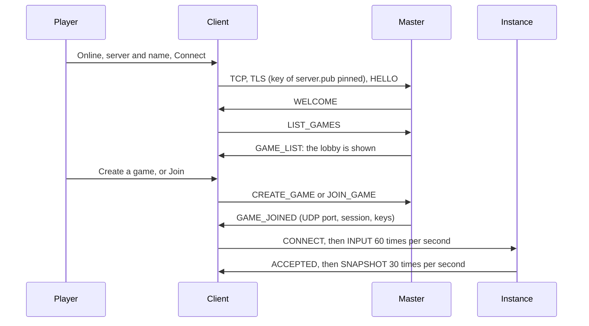

# The client online

How the client joins the lobby of a master and plays a game of it: the same game scene as offline, fed by a
`RemoteSession` instead of a `LocalSession` ([A game in the client](client-game.md),
[ADR 0015](../decisions/0015-one-game-scene-local-or-remote-session.md)). To set up a server and play, see
[Play online](../guides/play-online.md).

## Code layout

```
apps/client/src/
  Online/
    LobbyClient.cpp    the connection to the lobby: TLS with the key pinned, HELLO, the requests
    OnlineScenes.cpp   the Online menu and the list of the games
  Game/
    RemoteSession.cpp  a game online: the UDP session with the instance, inputs out, world in
    Interpolation.cpp  the world drawn 100 ms in the past, between the snapshots around that time
```

The client has one `EventLoop` for its network, polled by the game loop once per frame before the engine
updates: everything network runs on the thread of the game, without locks.

## From the menu to the game



*The client goes through the master to get a game, then talks to its instance directly.*

1. **Online** asks for the server (`host:port`, the port 4242 by default, `[::1]:4242` for IPv6) and the name of
   the player. An IP address is used as it is; a host name is looked up when Connect is pressed.
2. **The key of the server** is read from `server.pub`, next to the executable
   ([Generate the server keys](../guides/generate-the-server-keys.md)). A server that does not hold the matching
   private key is refused during the handshake: "This is not the expected server".
3. **The lobby** lists the games of the server: Create a game (for 4 players, named after the player), Join one,
   Refresh, Disconnect. Escape disconnects too.
4. **The game** plays a `RemoteSession` with what `GAME_JOINED` gave. When it ends, by the pause menu or because
   the game ended, the client leaves it (`LEAVE_GAME`) and shows the list again.

Everything that goes wrong is shown in a toast: a server unreachable or not the expected one, a game full, a
game that crashed, the connection lost. A lobby connection lost brings the player back to the main menu.

## LobbyClient

```cpp
rtype::client::LobbyClient lobby(loop, server, pinned, "Pavel",
    {.onWelcome = [&](std::uint32_t player) { lobby.listGames(showList); },
     .onLeftGame = [&](const rtype::lobby::LeftGameMessage &left) { /* game over, crash, timeout */ },
     .onClosed = [&](const std::string &reason) { /* toast it */ }});
lobby.joinGame(id, [&](const rtype::client::LobbyClient::JoinResult &result) { /* GAME_JOINED or an error */ });
```

- **One callback per request.** The master answers in order ([lobby protocol](../protocol/lobby.md)), so each
  reply goes to the oldest request waiting. An `ERROR` goes to the callback of its request:
  `describe(code)` gives the message for the player.
- **`LEFT_GAME`** is the reply to `LEAVE_GAME`, or a notification when the player did not ask (game over,
  crash, timeout): the latter goes to `onLeftGame`.
- **`PING`** is sent after 10 seconds without sending anything, so that the master, which closes a connection
  silent for 30 seconds, keeps it.
- **A name is checked before connecting** (`std::invalid_argument`): `HELLO` is written in a handler of the loop,
  where nothing may throw.

## RemoteSession

| Direction | What | How often |
|---|---|---|
| Client → instance | `INPUT`: the input of the player, stamped with a tick, with the inputs of the 7 ticks before | 60 per second, whatever the frame rate |
| Instance → client | `SNAPSHOT` parts and `ENTITIES_DESTROYED`, into a `RemoteWorld` | 30 and as they come |
| Instance → client | `PLAYER_JOINED`, `PLAYER_LEFT`: the names of the players | When they join and leave |
| Instance → client | `GAME_OVER`, `DISCONNECT`, or nothing for 5 seconds: the end | Once |

- **The tick of an input** is the one at which the game should apply it (section 9.2 of the
  [game protocol](../protocol/game.md#92-inputs)): the tick of the latest snapshot, plus the time since it came,
  plus the round-trip time measured by the session, plus 2 ticks of margin. It never goes back: the game
  ignores an input older than the last one.
- **`takeSnapshots()`** gives, at every frame, the world of the [interpolation](#interpolation): the
  `GameSessionSystem` draws it as it draws the offline world, and the entities move at the frame rate.
- **Pausing** does nothing online: the game goes on, and the input sent under the pause menu is empty.
- **Leaving** sends `DISCONNECT` to the game, when the session is destroyed.

## Interpolation

The snapshots come 30 times per second, some late, some lost; the client draws 60, 144 times per second. Drawing
the newest snapshot moves the entities in jumps: still for 33 ms, then 20 units at once. `Interpolation` draws
the world **100 ms in the past** instead, between the two snapshots around that time
([game protocol, 9.3](../protocol/game.md#93-snapshots)):

```
snapshots received:   tick 40 ──────────── tick 42 ──────────── tick 44 (newest)
                                   ▲
                       drawn tick 41.3 = newest − 6 ticks (100 ms): 65 % of the way from 40 to 42
```

| What happens | What is drawn |
|---|---|
| Snapshots on time | Each entity between its positions in the two snapshots around the drawn tick |
| A snapshot lost | The same, between the snapshots that arrived: 4 ticks apart instead of 2 |
| No snapshot for a while | Each entity goes on with its velocity for 250 ms at most, then waits |
| An entity created | It appears when the drawn tick reaches its first snapshot |
| An entity destroyed | It disappears when the drawn tick reaches its destruction, not when `ENTITIES_DESTROYED` arrives 100 ms earlier |

**The drawn tick** advances with the time of the frames, 60 ticks per second, and is nudged towards its target
(newest tick − 6): a little faster when it falls behind, a little slower when it gets ahead, never backwards.
The jitter of the snapshots and the drift between the clocks of the client and of the server are absorbed
without a jump; after a pause of more than half a second (a window dragged, a debugger), it jumps to its
target.

`Interpolation` is pure, without a clock nor a network: the `RemoteSession` gives it each world received
(`receive()`), the destructions (`destroyed()`) and the time of each frame (`advance()`), and draws `view()`.

## Tests

`tests/client_online.cpp` (tag `[online]`) runs the client against a real master in the same process: the
`Lobby` and the `Games` of `r-type_server`, with real instances.

- the address of a server, and a message for every error of the master;
- two clients welcomed, a game created, listed and joined, an error given to its request, a player who leaves;
- a server without the pinned key refused, a server unreachable, a name refused before connecting;
- two clients playing the same game, each moving its own ship and seeing the other's, with the names of the
  players, the world drawn at every frame behind the newest one, and inputs stamped ahead of the world;
- a game that crashes reported to its player, who can create another one, and a game that stops ending the
  session of its player.

`tests/client_interpolation.cpp` (tag `[interpolation]`) plays a server sending 30 snapshots per second to a
client drawing 144 frames per second: the world drawn 100 ms behind, an entity moving a little at every frame,
with snapshots on time, irregular or lost; extrapolation then waiting without snapshots; entities appearing and
disappearing when the drawn tick reaches them; a server clock running faster; a pause; and the drawn tick
never going back.

```sh
./build/bin/rtype_tests "[online]"
./build/bin/rtype_tests "[interpolation]"
```

## Limits and next steps

- **No prediction**: the ship of the player moves when the game says so, a round trip after the key is pressed,
  plus the 100 ms of the interpolation. Predicting it, with the rules of `libs/game`, is the next step.
- **The names of the players** are known (`RemoteSession::names()`) but not shown in the HUD yet.
- **One server at a time**, typed by hand: no list of servers, no address remembered.
