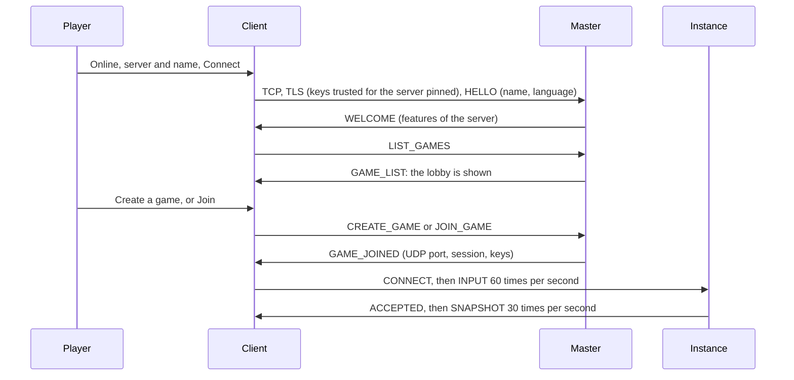
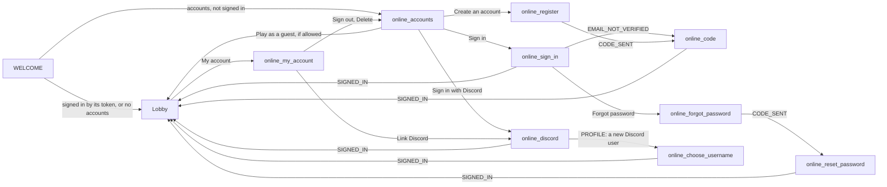

# The client online

How the client joins the lobby of a master and plays a game of it: the same game scene as offline, fed by a
`RemoteSession` instead of a `LocalSession` ([A game in the client](client-game.md),
[ADR 0015](../decisions/0015-one-game-scene-local-or-remote-session.md)). To set up a server and play, see
[Play online](../guides/play-online.md).

## Code layout

```
apps/client/src/
  Online/
    LobbyClient.cpp    the connection to the lobby: TLS with the key pinned, HELLO, the requests
    OnlineScenes.cpp   the Online menu, the servers met, their keys, the list of the games, the profile
    AccountScenes.cpp  the scenes of the accounts: sign in, create an account, the code, Discord, my account
    OnlineScreen.cpp   the look the Online screens share: header, fields, notes, keys, Discord buttons
    FormErrors.cpp     the field of a form each error of the master is about
    SessionTokens.cpp  the session token of the account signed in on each server, kept in the settings
    KnownProfiles.cpp  the account remembered for each server, and the pictures kept on disk
  main.cpp             gives OnlineScenes the SocialSdkAuthorizer of libs/discord, polled every frame
  Game/
    RemoteSession.cpp  a game online: the UDP session with the instance, inputs out, world in
    Interpolation.cpp  the world drawn 100 ms in the past, between the snapshots around that time
    Prediction.cpp     the ship of the player, moved at once by its inputs, then reconciled with the game
```

The client has one `EventLoop` for its network, polled by the game loop once per frame before the engine
updates: everything network runs on the thread of the game, without locks.

## From the menu to the game



*The client goes through the master to get a game, then talks to its instance directly.*

1. **Online** asks for the name of the player and the server (`host:port`, the port 4242 by default,
   `[::1]:4242` for IPv6), or offers the servers met before, on the right: those whose key the player trusted,
   each with the account remembered for it ([Profiles](#profiles)). An IP address is used as it is; a host name
   is looked up when Connect is pressed.
2. **The key of the server** is the one `KnownServers` trusts for it ([Trusted servers](#trusted-servers)). A
   server that does not hold a matching private key is refused during the handshake, before `HELLO` leaves: the
   player is asked to trust it if it was never met, warned otherwise.
3. **The lobby** lists the games of the server in rows: a full game is dim and cannot be joined; Create a game
   (for 4 players, named after the player), Refresh. Escape disconnects. The pilot is at the top right, with
   its avatar: My account, or, for a guest, the way to sign in.
4. **The game** plays a `RemoteSession` with what `GAME_JOINED` gave. When it ends, by the pause menu or because
   the game ended, the client leaves it (`LEAVE_GAME`) and shows the list again.

On a server with accounts, `WELCOME` leads to the scenes of the [accounts](#accounts) first, unless the player
comes back signed in.

What goes wrong with a field of a form is shown under it, in red (`showError()`, `fieldOf()` in
`Online/FormErrors.hpp`): a wrong password under the password, a username taken under the username, a wrong
code under the code. Everything else is shown in a toast, in the language of the game: a server unreachable or
not the expected one, a game full, a game that crashed, the connection lost. A lobby connection lost brings the
player back to the main menu.

The screens follow the Série 14 of the design: the widgets of the engine for forms, lists and avatars
([Forms](scenes-and-interface.md#forms), [Lists and avatars](scenes-and-interface.md#lists-and-avatars)),
a header with its back arrow, the keys of the screen at the bottom left. The Online menu opens over the main
menu; the screens after Connect have the starry sky of the main menu behind them; the questions (a new key, a
key changed, Discord, the deletion) open over the screen that asks them, under a veil.

What the administrators of the server do is shown in a toast too ([Administration](administration.md)): a
message they send (`Server: <text>`), a game they end (back to the list), a removal from the game then from the
server, an address banned (back to the main menu, with the reason).

## Trusted servers

Players never handle a key file: each server makes its key at its first start, and the player trusts it at
the first connection, as with SSH ([ADR 0021](../decisions/0021-server-generated-key-trust-on-first-use.md)).
`KnownServers` (`Online/KnownServers.hpp`) gives the key the client trusts for a server: the one the player
trusted, kept in the [settings](settings.md) under `servers.known.<address>`, or none for a server never met. A server is known by
its address in lowercase (`serverAddress()`: `rtype.example.org:4242`, `[::1]:4242`): the same server under
another name or IP address is a new server.

When the server presents a key it does not trust, the LobbyClient calls `onUntrusted` with it, and
`KnownServers::judge()` tells what it means:

| Verdict | The client |
|---|---|
| `FirstUse`: a server never met | Shows its fingerprint (`fingerprintLines()`, in groups of 4 digits) in the scene `online_trust`. **Trust and connect** remembers it (`trust()`, which writes the settings) and connects again |
| `Changed`: a server trusted with another key | Refuses it, and shows the key expected and the key presented in the scene `online_changed_key`. No button accepts the new key: the player must **Forget the server key** in the Online menu first (`forget()`) |

The settings are in the data directory of the player (`rtype::render::userDataDirectory()`: `%APPDATA%\R-Type` on
Windows, `~/.local/share/r-type` elsewhere), read when the client starts. Settings that cannot be written keep
the key trusted until the client closes, and the client says so.

## LobbyClient

```cpp
rtype::client::LobbyClient lobby(loop, server, known.trusted(address), "Pavel",
    {.onWelcome = [&](std::uint32_t player) { lobby.listGames(showList); },
     .onLeftGame = [&](const rtype::lobby::LeftGameMessage &left) { /* game over, crash, timeout, admin */ },
     .onServerMessage = [&](const std::string &text) { /* toast it */ },
     .onClosed = [&](const std::string &reason) { /* toast it */ },
     .onUntrusted = [&](const rtype::network::KeyFingerprint &presented) { /* ask the player, or warn */ },
     .onSessionExpired = [&] { /* forget the token, connect again as a guest */ },
     .describe = [&](rtype::lobby::ErrorCode code) { return translations.text(rtype::client::errorKey(code)); }},
    "fr", sessions.token(address));
lobby.joinGame(id, [&](const rtype::client::LobbyClient::JoinResult &result) { /* GAME_JOINED or an error */ });
lobby.signIn("Pilot_7", password, [&](const rtype::client::LobbyClient::SignInResult &result) { /* SIGNED_IN */ });
```

- **One callback per request.** The master answers in order ([lobby protocol](../protocol/lobby.md)), so each
  reply goes to the oldest request waiting. An `ERROR` goes to the callback of its request:
  `describe(code)` gives the message for the player.
- **`LEFT_GAME`** is the reply to `LEAVE_GAME`, or a notification when the player did not ask (game over,
  crash, timeout, removed by an administrator, game ended by one): the latter goes to `onLeftGame`.
- **`SERVER_MESSAGE`** is a notification: it goes to `onServerMessage`, never to a request.
- **`ERROR (KICKED)` or `ERROR (BANNED)` with the request 0** answers no request: the master closes the
  connection after it, and `onClosed` gets its `describe()`. `BANNED` in reply to `HELLO` ends the same way.
- **`PING`** is sent after 10 seconds without sending anything, so that the master, which closes a connection
  silent for 30 seconds, keeps it.
- **A name and a locale are checked before connecting** (`std::invalid_argument`): `HELLO` is written in a
  handler of the loop, where nothing may throw. The locale is the language of the game (`en` or `fr`), so that
  the emails of the master come in it.
- **`WELCOME` tells what the master offers** (`features()`): guests, password accounts, Discord; and the
  account the token of `HELLO` signed in (`account()`), whose username is then the name of the player.
- **The requests of the accounts** ([lobby protocol 4](../protocol/lobby.md#6-accounts)): `registerAccount()`,
  `verifyEmail()`, `resendCode()`, `signIn()`, `forgotPassword()`, `resetPassword()`, `signOut()`,
  `deleteAccount()`, and those of Discord, `discordSignIn()` (the application of the master),
  `discordConfirm()` (`SIGNED_IN`, `DiscordConfirmed` for `DONE`, with the profile of a new user for `PROFILE`,
  or the error) and `chooseUsername()`; `profile()` (`GET_PROFILE`) and `picture()`, which asks `GET_AVATAR` until
  it has every part of the picture. Those
  that sign in give `SIGNED_IN` or the error, and sign the connection in; the others give nothing or the error. A field the protocol cannot carry (an empty password, a code that is not 6 digits,
  a username of 17 bytes) gets at once the error the master would give it, without being sent.
- **`DONE` to `SIGN_OUT` or `DELETE_ACCOUNT`**: the master closes the connection, so the client closes it first,
  and `onClosed` is not called: it is not a connection lost.
- **`SESSION_EXPIRED` in reply to `HELLO`** goes to `onSessionExpired`, instead of `onClosed`. Any other error
  after which the master closes the connection (`BANNED` after a `SIGN_IN`, `MALFORMED`) goes to `onClosed`.
- **The messages of the errors**: `describe(code)` in English, for the logs and the tests; `errorKey(code)` the
  key of its message in `en.lang` and `fr.lang` (`error.game_full`), which the scenes show, and give the
  `LobbyClient` through `Handlers::describe`.
- **A password, a code, a code verifier and a token are never logged**, at any level.

## Accounts

On a server with accounts ([lobby protocol 4, section 6](../protocol/lobby.md#6-accounts)), the client offers
what `WELCOME` says the server offers, Discord first. A server without accounts looks as it did before them.



*Each scene goes back (Escape) to the one before it; the choice of the accounts disconnects.*

- **The session token** of `SIGNED_IN` is kept for the server by `SessionTokens` (`Online/SessionTokens.hpp`), in
  the [settings](settings.md) under `servers.session.<address>`, the address as `KnownServers` knows it. The
  next **Connect** sends it in `HELLO`, without a name: the player comes back signed in, even after a restart.
- **It is forgotten** at sign-out and at the deletion of the account (`DONE`), then the client connects again as
  a guest; and on `SESSION_EXPIRED` (a session older than 30 days, a new password, a ban, a sign-out from
  another machine), after which the client connects again without it and says so in a toast.
- **The password fields** are `InterfaceBuilder::passwordField()`: drawn as `*`, never copied to the clipboard
  ([Interface](scenes-and-interface.md#forms)). Creating an account shows the strength of the password in a
  gauge, full at the 10 characters the master asks for. A password lives in its field only: it is read when the button is
  pressed, and never kept by the scenes.
- **The settings file** is readable by the player only on Unix (mode `0600`), since it holds the tokens.
- **The language of the game** is sent in `HELLO`, so that the emails of the master come in it; every error
  code has its message in `en.lang` and `fr.lang`.
- **The code of the email** is typed in six cells (`InterfaceBuilder::codeField()`), and sent as soon as they
  are full.
- **My account** shows the avatar of the pilot, its username in chrome, its Discord name, then a sheet: the
  server, the date the account was made, its email (masked: `k***@example.org`) and whether it is verified, its
  password (set, or none for an account made with Discord), its Discord name, its role. **Link Discord**
  (**Refresh from Discord** once linked) on a server that offers it, **Sign out**, and **Delete the account** in
  red, which asks over the sheet, No by default, for the password once more, or **Confirm with Discord** for an
  account made with Discord.

### Discord

On a server whose `WELCOME` offers Discord ([ADR 0026](../decisions/0026-discord-social-sdk.md)):

1. **Continue with Discord** sends `DISCORD_SIGN_IN`; `DISCORD_AUTHORIZE` gives the id of the Discord
   application of the master, and the client opens `online_discord` over the screen: the ring of the logo, and
   the three steps (Discord opened, the answer of the player, the server checking), with **Cancel**.
2. `discord::Authorizer::authorize()` asks the player: the Discord client if it runs, the browser otherwise.
   `SocialSdkAuthorizer` (`libs/discord`) does it with `Client::Authorize` of the Discord Social SDK, scope
   `identify`, and the challenge of a code verifier of PKCE it makes; the SDK receives the code on the loopback
   of the player. Its callbacks run in `poll()`, which the game loop calls every frame, after the network.
3. The code, the verifier and the redirect address go in `DISCORD_CONFIRM`. `SIGNED_IN` keeps the token as any
   sign-in does; `PROFILE` leads a new Discord user to `online_choose_username`, its Discord picture, display
   name and `@username` above the username it chooses, proposed from its Discord name; `DONE` brings a player
   signed in back to **My account** (the identity linked, its profile read again), or, for **Confirm with
   Discord**, straight to `DELETE_ACCOUNT` with an empty password.

The player who refuses in Discord, or a Discord that cannot be reached, gets a toast and the scene before. The
SDK starts at the first sign-in with Discord only; its logs go to the logger `discord`, warnings and errors.
Cancel, or the connection lost, gives up the authorization running (`cancel()`): what Discord answers then goes
nowhere.

### Profiles

Signed in, by a token or by a sign-in, the client asks `GET_PROFILE` for its account: its Discord names and the
version of its picture. A picture it does not keep already comes with `GET_AVATAR`, in parts
(`LobbyClient::picture()`); it is kept on disk under its version, in the folder `pictures` of the user data, and
made a round texture (`ResourceManager::loadRoundPicture()`). The lobby and My account show it as soon as it is
there.

`KnownProfiles` remembers the account of each server under `servers.profile.<address>` in the
[settings](settings.md) (its username, whether it is linked to Discord, the version of its picture), so that the
servers met in the Online menu show who will be signed in, with the picture, before connecting. It is forgotten
at sign-out and at the deletion of the account; the pictures stay, as another server may show them.

`libs/discord` is two targets, so that the tests never load the library of Discord: `rtype::discord`, the
interface, which the client and its tests know, and `rtype::discord_sdk`, its implementation, linked by the
executable `r-type_client` alone. The SDK itself is kept in `libs/discord/sdk/` (its `README.md`), for Linux
x86-64 and Windows x64; its library is copied beside the executable, in the build and in the package.

## RemoteSession

| Direction | What | How often |
|---|---|---|
| Client → instance | `INPUT`: the input of the player, stamped with a tick, with the inputs of the 7 ticks before | 60 per second, whatever the frame rate |
| Instance → client | `SNAPSHOT` parts and `ENTITIES_DESTROYED`, into a `RemoteWorld` | 30 and as they come |
| Instance → client | `PLAYER_JOINED`, `PLAYER_LEFT`: the names of the players | When they join and leave |
| Instance → client | `GAME_OVER`, `DISCONNECT`, or nothing for 5 seconds: the end | Once |

- **The tick of an input** is the one at which the game should apply it (section 9.2 of the
  [game protocol](../protocol/game.md#92-inputs)): the tick of the latest snapshot, plus the time since it came,
  plus the round-trip time measured by the session, plus 2 ticks of margin. It never goes back: the game
  ignores an input older than the last one.
- **`takeSnapshots()`** gives, at every frame, the world of the [interpolation](#interpolation): the
  `GameSessionSystem` draws it as it draws the offline world, and the entities move at the frame rate.
- **Pausing** does nothing online: the game goes on, and the input sent under the pause menu is empty.
- **Leaving** sends `DISCONNECT` to the game, when the session is destroyed.

## Interpolation

The snapshots come 30 times per second, some late, some lost; the client draws 60, 144 times per second. Drawing
the newest snapshot moves the entities in jumps: still for 33 ms, then 20 units at once. `Interpolation` draws
the world **100 ms in the past** instead, between the two snapshots around that time
([game protocol, 9.3](../protocol/game.md#93-snapshots)):

```
snapshots received:   tick 40 ──────────── tick 42 ──────────── tick 44 (newest)
                                   ▲
                       drawn tick 41.3 = newest − 6 ticks (100 ms): 65 % of the way from 40 to 42
```

| What happens | What is drawn |
|---|---|
| Snapshots on time | Each entity between its positions in the two snapshots around the drawn tick |
| A snapshot lost | The same, between the snapshots that arrived: 4 ticks apart instead of 2 |
| No snapshot for a while | Each entity goes on with its velocity for 250 ms at most, then waits |
| An entity created | It appears when the drawn tick reaches its first snapshot |
| An entity destroyed | It disappears when the drawn tick reaches its destruction, not when `ENTITIES_DESTROYED` arrives 100 ms earlier |

**The drawn tick** advances with the time of the frames, 60 ticks per second, and is nudged towards its target
(newest tick − 6): a little faster when it falls behind, a little slower when it gets ahead, never backwards.
The jitter of the snapshots and the drift between the clocks of the client and of the server are absorbed
without a jump; after a pause of more than half a second (a window dragged, a debugger), it jumps to its
target.

`Interpolation` is pure, without a clock nor a network: the `RemoteSession` gives it each world received
(`receive()`), the destructions (`destroyed()`) and the time of each frame (`advance()`), and draws `view()`.

## Prediction

The interpolation draws the world 100 ms in the past, on top of the round trip: fine for the others, whose
keys the player does not see, but the ship of the player itself would answer late. `Prediction` moves it at
once instead, and the game stays the one that decides:

1. **Each input sent** moves the predicted ship by one tick, with `game::moveShip()`, the movement of the game
   itself: speed, diagonals, walls. The inputs are kept with their tick.
2. **Each snapshot** says where the game had the ship at its tick, every input up to that tick applied. The
   prediction starts again from there and replays the inputs sent for the later ticks (**reconciliation**).
   When nothing was lost, it lands exactly where it was: no correction at all.
3. **A wrong guess** (an input lost without its copies, something the game saw first) moves the prediction:
   the ship is not teleported, the gap is drawn and fades out in a few frames. A gap of more than 120 units
   (the ship came back elsewhere) is applied at once.
4. **Without a ship** (destroyed, waiting to come back), nothing is predicted: the game decides.

```
inputs sent:   12  13  14  15  16   ◄── applied at once: the ship is drawn there
snapshot of 13 from the game ──► start from its position, replay 14, 15, 16 ──► the same place, if nothing was lost
```

`game::moveShip()` (`libs/game/include/rtype/game/ShipMovement.hpp`) is shared with the systems of the game,
and a test checks that both give the same position to the bit, over a minute of random inputs against the walls.
A rule that changes how a ship moves must change there, or every snapshot would correct the prediction.

Only the movement of the ship is predicted: its shots, the hits and its destruction are drawn as the game sends
them, through the interpolation.

## Tests

`tests/client_online.cpp` (tag `[online]`) runs the client against a real master in the same process: the
`Lobby` and the `Games` of `r-type_server`, with real instances.

- the address of a server, and a message for every error of the master;
- two clients welcomed, a game created, listed and joined, an error given to its request, a player who leaves;
- a server without the pinned key refused, a server unreachable, a name refused before connecting;
- a client trusting no key told the key of the server instead of closed, then welcomed once it trusts it;
- two clients playing the same game, each moving its own ship and seeing the other's, with the names of the
  players, the world drawn at every frame behind the newest one, and inputs stamped ahead of the world;
- a game that crashes reported to its player, who can create another one, and a game that stops ending the
  session of its player.

The accounts (tag `[online][accounts]`) run against a master with accounts, a mailer of the tests that keeps
the codes, on SQLite and PostgreSQL:

- an account created, verified with the code of its email, kept in the settings, and signed in again from its
  token alone after a restart of the client;
- an expired token told through `onSessionExpired`, not as a connection lost, forgotten, then a guest welcomed;
- a sign-out closing the connection without an error, its token refused after;
- a wrong password and its message, fields refused before sending, then the right password by email;
- a forgotten password changed with its code, which signs in; an account deleted with its password;
- Discord against a fake Discord (tag `[discord]`): the application of the master, a new Discord user signed in
  once it chose its username, a code verifier refused before sending, and the account, without password,
  deleted after a confirmation of Discord;
- the token kept for its server only, in a file readable by its owner only;
- every error code with a message in `en.lang` and `fr.lang`.

`tests/known_servers.cpp` (tag `[online]`) checks the key trusted for each server: a server trusted on first
use, kept in the settings, then refused with another key until forgotten; settings holding something else than a
fingerprint, which trusts nothing; a fingerprint shown in groups of 4 digits.

`tests/client_interpolation.cpp` (tag `[interpolation]`) plays a server sending 30 snapshots per second to a
client drawing 144 frames per second: the world drawn 100 ms behind, an entity moving a little at every frame,
with snapshots on time, irregular or lost; extrapolation then waiting without snapshots; entities appearing and
disappearing when the drawn tick reaches them; a server clock running faster; a pause; and the drawn tick
never going back.

`tests/client_prediction.cpp` (tag `[prediction]`) plays the client against the real rules, a `Simulation` with
the `InputBuffer` of the server, the inputs and the snapshots delayed: never corrected when nothing is lost, nor
when an `INPUT` is lost (the next ones carry its inputs); the ship answering before the game; the game ending
where the prediction was; the walls; without redundancy, a lost input corrected smoothly; no ship, then back
elsewhere; a correction too large applied at once; and the ticks skipped when stamping.

```sh
./build/bin/rtype_tests "[online]"
./build/bin/rtype_tests "[online][accounts]"
./build/bin/rtype_tests "[interpolation]"
./build/bin/rtype_tests "[prediction]"
```

## Limits and next steps

- **The shots are not predicted**: they leave a round trip and 100 ms after Fire is pressed. Predicting them
  means drawing a shot before the game creates it, then matching it with the one it sends.
- **The player sees the others 100 ms in the past** and its own ship in the present: a Bydo shot can seem to
  miss and still hit, as in every game that predicts.
- **The names of the players** are known (`RemoteSession::names()`) but not shown in the HUD yet.
- **One server at a time**, typed by hand: no list of servers, no address remembered.
