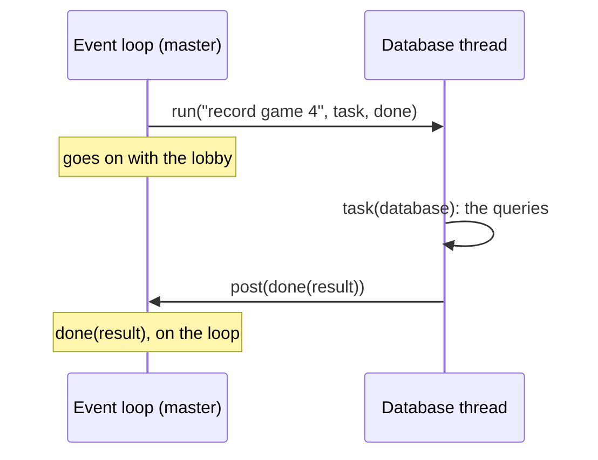

# Database

`libs/database` (`rtype::database`) keeps the data a program needs from one run to the next, in SQLite or in
PostgreSQL, through [SOCI](https://soci.sourceforge.net) ([ADR 0023](../decisions/0023-server-database.md)). It
holds no table of the game: it opens a database, applies the migrations a program gives it, and gives the SOCI
session to run queries. The server is its user; the settings of the client are another system
([Settings](settings.md)).

| | |
|---|---|
| Engines | SQLite 3.54.1, built from its single C file, on every platform. PostgreSQL, through the libpq of the system, when it is found ([Building with PostgreSQL](#building-with-postgresql)). |
| Dependencies | SOCI 4.1.4 (public: its session is in the API), fmt 12.2.0 (SOCI's), SQLite: all through CPM, with a hash. libpq: from the system, optional |
| Threads | A `Database` is used by one thread at a time; a `DatabaseThread` gives it a thread of its own |

## Opening a database

A database is given by its address, as the user writes it:

| Address | Engine |
|---|---|
| `sqlite:rtype.db`, `sqlite:/data/rtype.db` | A SQLite file, created with its directories if missing. A file name may contain spaces. |
| `postgresql://rtype@db.example.org:5432/rtype?sslmode=verify-full`, `postgres://...` | A PostgreSQL server, in the [format libpq reads](https://www.postgresql.org/docs/current/libpq-connect.html#LIBPQ-CONNSTRING-URIS). Refused, saying why, by a program built without PostgreSQL. |

```cpp
#include "rtype/database/Database.hpp"

using rtype::database::Address;
using rtype::database::Database;

const Address address = Address::parse(text);   // std::invalid_argument: not an address
Database database = Database::open(address);    // rtype::database::Error: cannot be opened
logger.info("Database {}", address.toString()); // without its password, if it has one
```

`Database::open()` throws `rtype::database::Error`, whose message is for the user, if the database cannot be
opened: a directory that cannot be created, a file that is not a SQLite database (it is left as it is), a
server that does not answer or refuses the user, an engine this program is built without
(`rtype::database::isBuiltWith(engine)` tells). A SQLite database waits 5 seconds for a lock held by another
connection, and checks foreign keys, as PostgreSQL does. A PostgreSQL server that does not answer within 10
seconds fails, unless the address gives its own `connect_timeout`; its notices ("relation already exists,
skipping"...) go to the logs, in debug.

## Building with PostgreSQL

The PostgreSQL engine uses libpq, the client library of PostgreSQL, from the system: `libpq-dev` on Debian and
Ubuntu, `postgresql-libs` on Arch, the PostgreSQL installer on Windows. The CMake option `RTYPE_WITH_POSTGRESQL`
chooses:

| Value | Effect |
|---|---|
| `AUTO` (default) | Built when libpq is found, on Linux. Left out on Windows |
| `ON` | Required: the configure fails without libpq. On Windows, `libpq.dll` and the DLLs it needs (from the `bin` folder of PostgreSQL) must be beside the programs or on the `PATH` |
| `OFF` | Left out: SQLite only |

The configure says what it built: `Database engines: SQLite, PostgreSQL (libpq 18.6)`. A program built with it
needs libpq to run (`libpq5` on Debian and Ubuntu).

## Migrations

The schema of a program changes with it: each change is a **migration**, numbered from 1, that the program
gives in order. The database keeps those it applied in the table `schema_migrations` (version, description,
date), and `migrate()` applies the others:

```cpp
const std::vector<rtype::database::Migration> Migrations{
    {1, "create the players table",
     {"CREATE TABLE players (id BIGINT PRIMARY KEY, name TEXT NOT NULL UNIQUE, created_at BIGINT NOT NULL)"}},
    {2, "create the games table",
     {"CREATE TABLE games (id BIGINT PRIMARY KEY, player_id BIGINT NOT NULL REFERENCES players (id))",
      "CREATE INDEX games_by_player ON games (player_id)"}},
};

const int applied = database.migrate(Migrations); // 0 when the database is up to date
```

- **Each migration runs in a transaction**, with the row that records it: a migration that fails leaves
  nothing of itself, and the database stays at the previous version.
- **One statement per string**: SQLite runs only the first statement of a string.
- **A migration is never changed once merged**: a database that applied it would not apply it again. A change
  is a new migration.
- **What the database has must match the program**, or `migrate()` throws `Error`: a migration the program does
  not know (the database was used by a newer program), or known by another description (two branches each
  added their own migration under the same number).
- Migrations numbered otherwise than 1, 2, 3..., or without a description or statements, throw
  `std::invalid_argument`: a bug of the program, found by its tests.

`schemaVersion()` gives the version of the database: its last migration, 0 for a new database.

## Queries

The queries go through the SOCI session, with their values **bound**, never pasted into the SQL: a value cannot
change the query, whatever it contains.

```cpp
soci::session &sql = database.session();

// Writing
sql << "INSERT INTO players (id, name, created_at) VALUES (:id, :name, :created_at)",
    soci::use(id), soci::use(name), soci::use(createdAt);

// Reading one row: a column that can be NULL needs an indicator
long long best = 0;
soci::indicator found = soci::i_ok;
sql << "SELECT MAX(score) FROM games WHERE player_id = :id", soci::use(id), soci::into(best, found);

// Reading rows
const soci::rowset<soci::row> rows = (sql.prepare << "SELECT id, name FROM players ORDER BY name");
for (const soci::row &row : rows) {
    show(row.get<long long>(0), row.get<std::string>(1));
}
```

Several changes that go together go in a transaction: all of them are kept, or none.

```cpp
database.transaction([&] {
    sql << "INSERT INTO games ...";
    sql << "UPDATE players ...";
}); // committed; an exception rolls it back and goes on
```

A query that fails throws `soci::soci_error`.

## Portable SQL

SOCI runs the SQL it is given: it does not translate it. Write the SQL both engines understand:

| For | Write | Not |
|---|---|---|
| Ids | `BIGINT PRIMARY KEY`, the new one read with `INSERT ... RETURNING id` | `SERIAL` (PostgreSQL), `AUTOINCREMENT` (SQLite) |
| Insert or update | `INSERT ... ON CONFLICT (id) DO UPDATE SET x = excluded.x` | `INSERT OR REPLACE` (SQLite), `MERGE` |
| Dates | Unix milliseconds in a `BIGINT`, read as `long long` | `TIMESTAMP`, `datetime()`, `NOW()` |
| Booleans | `INTEGER`, 0 or 1 | `BOOLEAN` |
| Text | `TEXT` | `VARCHAR(n)`: SQLite ignores the length |
| Integers in C++ | `long long` for a `BIGINT` | `int`, which a large value overflows |
| Order | `ORDER BY`, whenever the order matters | Relying on the order rows come in |

The tests of the queries run on every engine available ([Tests](#tests)): what one engine refuses fails there.

## The database thread

A query can take a while: a remote PostgreSQL answers in milliseconds, or in seconds when the network is slow.
The thread of the master runs the lobby and must not wait for it. `DatabaseThread` owns a `Database` and runs
its tasks on a thread of its own, then hands their result back to the thread that asked, through the `post`
function given to it: the `post()` of the event loop, so that a result is handled like a message received.



```cpp
rtype::database::DatabaseThread thread(std::move(database),
                                       [&](std::function<void()> function) { loop.post(std::move(function)); });

thread.run("read the best score of Pavel",
    [id](rtype::database::Database &database) {   // on the database thread
        long long best = 0;
        database.session() << "SELECT MAX(score) FROM games WHERE player_id = :id", soci::use(id), soci::into(best);
        return best;
    },
    [](std::optional<long long> best) { /* on the loop: empty if the task failed */ });

thread.run("record game 4", [game](rtype::database::Database &database) { record(database, game); });
```

| | |
|---|---|
| Order | The tasks run one at a time, in the order they were given. |
| Result | `done` receives `std::optional<Result>`, or `bool` for a task that returns nothing: empty or `false` if the task threw. Without `done`, a failure is only logged. |
| Failure | A task that throws is logged with its description, and the next tasks run. |
| What a task touches | The `Database` it is given, and copies of what it needs: never the objects of the loop, which the loop thread changes meanwhile. |
| Full queue | At most `maxPending` tasks wait (1024): `run()` returns `false` beyond, logs it, and never calls `done`. |
| Lost connection | The task that found it fails: it is not run twice, since it may have been done. Before the next one, the thread connects again, 0.5 s after a failed attempt, then 1 s, 2 s... up to 30 s; the tasks wait meanwhile. |
| Destruction | The tasks already given run, then the thread stops. Without a connection, it stops at once, and the tasks left fail. `post` must stay valid until then: destroy the `DatabaseThread` before the event loop. |

## Tests

The tests of the database run on every engine available: SQLite always, PostgreSQL when this program has it and
`RTYPE_TEST_POSTGRESQL_URL` gives a server, on which each test gets a schema of its own
(`tests/helpers/TestDatabase.hpp`). The [testing policy](../contributing/testing.md#running-the-tests) shows how
to run one in Docker; the CI does it on Linux.

`tests/database.cpp` (tag `[database]`):

- addresses: the forms accepted, those refused, a password never shown;
- opening (SQLite): a file created with its directories, a name with spaces, a file that is not a database
  refused and left as it is; a PostgreSQL server that refuses the connection, without showing the password, or
  this build without PostgreSQL;
- migrations: applied in order and once, a new one applied alone, one that fails leaving nothing, a newer
  database refused, a migration known by another description refused, a numbering error;
- transactions: committed, or rolled back by an exception;
- portable SQL: `RETURNING`, `ON CONFLICT`, 64-bit dates, foreign keys checked, a `NULL` read with an indicator.

`tests/database_thread.cpp` (tag `[database]`) gives the thread a queue of functions in place of the event loop:
tasks run in order on another thread and their results come back on the thread of the test; a task that fails
gives an empty result and the next ones run; a full queue refuses a task; the tasks given run before the thread
stops; a lost connection is opened again; on PostgreSQL, a connection the server ends
(`pg_terminate_backend`) is opened again; and on SQLite, whose directory a test moves away, the next task waits
while the database cannot be reached, and a thread destroyed meanwhile stops at once and fails the tasks left.
