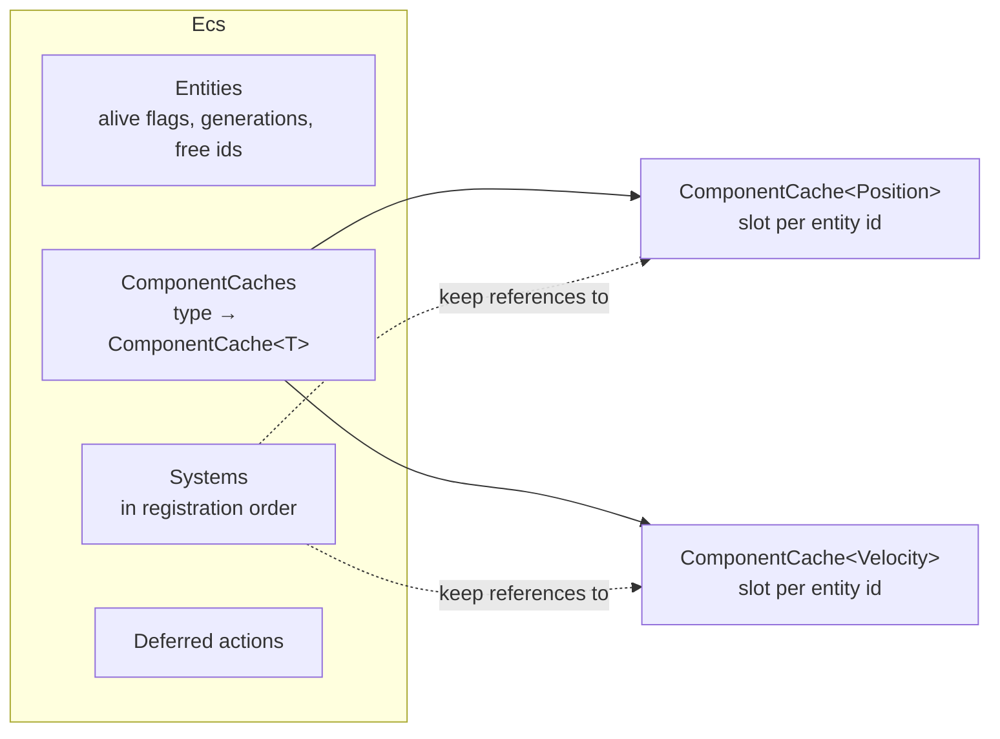

# ECS

`libs/ecs` (`rtype::ecs`) is the Entity Component System everything else is built on: the client's world and
interface ([ADR 0007](../decisions/0007-client-in-the-ecs.md)), the physics and the rules of the game. It is
shared with the server, so it depends on nothing, not even raylib.

The ECS only knows **entities, components and systems**, plus a hierarchy between entities. Game notions
(scenes, events, drawing, input) belong to the engine (`libs/engine`), built on top of it: see
[Scenes and interface](scenes-and-interface.md). How the components are stored is decided in
[ADR 0006](../decisions/0006-ecs-component-storage.md).

## Where things are

```
libs/ecs/include/rtype/ecs/
  Ecs.hpp                       Ecs: entities, components, systems, update, deferred actions
  Entity/Entity.hpp             entity_t, EntityRef
  Component/ComponentCache.hpp  ComponentCache<T>: the components of one type
  Component/ComponentCaches.hpp ComponentCaches: one cache per type
  Component/ICache.hpp          type-erased base of the caches
  System/System.hpp             System: base class of the systems
  Hierarchy.hpp                 Position, LocalPosition, Parent, Hidden, attach(), isHidden(), TransformSystem
```

Include `"rtype/ecs/Ecs.hpp"` for the core, and `"rtype/ecs/Hierarchy.hpp"` for the hierarchy.

## Overview



*An entity is an index: its components are the slots at that index in every cache. Systems hold references to
the caches they use.*

## Entities

An entity is only an id, `entity_t` (`std::uint32_t`): the index of its components in every cache.

| Call | Effect |
|---|---|
| `ecs.createEntity()` | A new entity, without components. Reuses the id of the last destroyed entity, if any. |
| `ecs.destroyEntity(entity)` | Removes all its components, destroys its children recursively (see [Hierarchy](#hierarchy)) and frees its id. Does nothing on a dead entity. |
| `ecs.isAlive(entity)` | Whether the id currently designates an entity. |

### Entity references

Because ids are reused, an `entity_t` kept somewhere may end up designating another entity. An `EntityRef`
(`ecs.ref(entity)`) adds a **generation**, increased every time the id is freed: once the entity is destroyed,
`ecs.isAlive(reference)` is false, even if its id was given to a new entity.

```cpp
struct Target {
    EntityRef entity;   // not entity_t
};

const Target &target = ecs.getComponent<Target>(missile);
if (ecs.isAlive(target.entity)) {
    aimAt(target.entity.id);
}
```

Keep an `EntityRef`, never an `entity_t`, in a component or in any object that outlives the current update.

## Components

A component is plain data attached to an entity: a struct with default values, no logic, no pointer to
another entity (use an `EntityRef`). An empty struct is a **tag**, such as `Hidden`.

| Call | Effect |
|---|---|
| `ecs.addComponent<T>(entity, args...)` | Builds a `T` from `args` in the entity's slot and returns it. Replaces the component the entity already has. |
| `ecs.removeComponent<T>(entity)` | Empties the slot. Does nothing if the entity has no `T`. |
| `ecs.hasComponent<T>(entity)` | Whether the entity has a `T`. |
| `ecs.getComponent<T>(entity)` | The entity's `T`. The entity **must** have one: check with `hasComponent()` first. |
| `ecs.cache<T>()` | The `ComponentCache<T>`, to go through every entity that has a `T`. |

These calls look the type up in a hash map every time: they are meant for building entities and for tests.
A system looks its caches up once, in its constructor (see [Systems](#systems)).

### Caches

`ComponentCache<T>` is a `std::vector<std::optional<T>>` indexed by the entity id. The cache of a type is
created on first use; `emplace`, `erase`, `has`, `get` and `size` are what systems use.

- `size()` is one past the highest id that ever had a `T`: it never shrinks, and slots below it may be empty.
- A reference to a **cache** stays valid as long as the `Ecs` lives.
- A reference to a **component** (`T &`) is invalidated when a `T` is added to an entity whose id is beyond
  `size()`: the vector grows and moves its slots. Do not keep one across an `addComponent<T>()`.

### Where to put them

Components used by the client **and** the server (positions, velocities, health) go in a library both link:
`libs/ecs` for the hierarchy, `libs/physics` for movement and collisions, `libs/game` for the rules. Never
in `libs/engine`, which depends on raylib and is not linked by the server.

## Systems

A system derives from `rtype::ecs::System`. It gets the caches of the components it uses with `use<T>(caches)`
in its constructor and keeps the references, then goes through the entity ids in `update()`:

```cpp
class DamageSystem : public System
{
    ComponentCache<Health> &_health;
    ComponentCache<Hit> &_hits;

public:
    explicit DamageSystem(ComponentCaches &caches) : _health(use<Health>(caches)), _hits(use<Hit>(caches)) {}

    void update(float /*elapsed*/) override
    {
        for (entity_t entity = 0; entity < _hits.size(); ++entity) {
            if (_hits.has(entity) && _health.has(entity)) {
                _health.get(entity).points -= _hits.get(entity).damage;
            }
        }
    }
};
```

- `use<T>()` also records the type: `componentTypes()` lists the components a system uses.
- `update(float elapsed)` receives the time since the previous update, in seconds. Systems never read a
  clock, so that the tests and the server control time.
- Iterate over the **rarest** component's cache, and test the others with `has()`.
- A system that needs something else (the `Ecs` to create entities, the scenes, the rules) takes it by
  reference in its constructor, after the caches.

`ecs.registerSystem<S>(args...)` builds `S(caches, args...)`, keeps ownership of it and returns a reference.
Systems are never removed: set `enabled = false` to skip one (the engine's events do this, see
[ADR 0008](../decisions/0008-events-switch-systems.md)).

A step-by-step example, with a test: [How to write a system](../guides/write-a-system.md).

## An update

`ecs.update(elapsed)` runs, in order:

1. every **enabled** system, in **registration order**, with the same `elapsed`;
2. the **deferred actions**, in the order they were deferred. An action may defer another one: they run until
   none is left.

The registration order is therefore the order of the frame: register the systems that move entities before
the ones that read positions. The order of the client is in
[The systems and their order](scenes-and-interface.md#the-systems-and-their-order).

### Deferred actions

`ecs.defer(action)` runs `action` after the systems of the current update, or after those of the next update
when called outside of one. It is how a system changes the world while it goes through it:

```cpp
if (_health.get(entity).points <= 0) {
    _ecs.defer([this, entity] { spawnExplosion(_ecs, entity); });
}
```

### What a system may do while it iterates

| Change | During the loop |
|---|---|
| Read or write components of existing entities | Safe. |
| `removeComponent()`, `destroyEntity()` | Safe: slots are only emptied, nothing moves. |
| `createEntity()` then `addComponent()` | **Defer it**: the caches may grow, which moves their components under the systems reading them. |
| `addComponent()` of a type some system iterates or holds a reference to | **Defer it**, for the same reason. |

## Hierarchy

`Hierarchy.hpp` attaches entities to others: the Force to the ship, a turret to a boss, a button to its panel.

| Component | Meaning |
|---|---|
| `Position` | Position in the world, in game units. The physics and the game move it; for an entity with a parent, the `TransformSystem` computes it. |
| `Parent` | The entity is attached to another one (`EntityRef`). |
| `LocalPosition` | Position relative to the parent. |
| `Hidden` | Hides the entity and its children, without destroying them. |

```cpp
attach(ecs, force, ship, {64.0f, 0.0f});   // the Force follows the ship, 64 units in front of it
```

`attach()` gives the child a `Parent` and a `LocalPosition`, and a `Position` if it has none.

- **Following**: the `TransformSystem` sets `Position = position of the parent + LocalPosition` for every entity
  with the three components, parents first whatever their ids. Register it after the systems that move
  entities and before the ones that use positions (collisions, rendering). Move a child through its
  `LocalPosition`: its `Position` is overwritten.
- **Hiding**: `isHidden(ecs, entity)` is true if the entity or one of its ancestors has `Hidden`. A closed
  dropdown can hide its options this way. Systems that draw or handle input check it; the ECS itself does not.
- **Destroying**: `ecs.destroyEntity(boss)` also destroys its turrets, recursively. A child never outlives its
  parent with a dangling reference.
- **Detaching**: remove the `Parent` (and the `LocalPosition`): the entity keeps its last `Position` and is
  moved like any other one from then on.
- **Loops**: a hierarchy deeper than 64 levels is taken for a loop (an entity being its own ancestor) and its
  positions stop being computed there, instead of hanging the game.

The `TransformSystem` recomputes every chain from its root, and destroying an entity scans the `Parent` cache
for its children. Both are cheap with the shallow hierarchies of the game.

## Limits

They follow from [ADR 0006](../decisions/0006-ecs-component-storage.md), and suit a few hundred entities:

- Every system visits every slot up to the highest id of its cache, empty or not.
- A rare component still takes one slot per entity id.
- There are no queries over several components and no per-system entity lists: each system tests `has()`.
- There is no locking: an `Ecs` is used by one thread at a time. Each game on the server is its own process
  with its own `Ecs` ([ADR 0013](../decisions/0013-one-process-per-game.md)).

If profiling shows a problem, a sparse set for some types or per-system entity lists can be added behind the
same cache interface, with a new ADR.

## Testing

| File | Tag | Covers |
|---|---|---|
| `tests/ecs.cpp` | `[ecs]` | Caches, recycled ids, systems (filtering, `enabled`, destroying while iterating, `componentTypes()`). |
| `tests/ecs_world.cpp` | `[ecs][world]` | Elapsed time, entity references, deferred actions, hierarchy. |

```sh
./build/bin/rtype_tests "[ecs]"
```
