# Game

The game library (`libs/game`, namespace `rtype::game`) holds the **rules of the R-Type**: the players, their
ships and weapons, the Bydos, the hits and the waves. It is used by the server instances, which
run the games online, and by the client offline, in its `LocalSession` ([A game in the client](client-game.md))
([ADR 0015](../decisions/0015-one-game-scene-local-or-remote-session.md)): the rules are written once, and a
Bydo behaves the same offline and online.

The `Simulation` depends on the ECS, the physics and the log only: no window, no sound, no network. The
[messages](#messages) of the game protocol are written with the serialization of `libs/network` (`Writer`,
`Reader`), a private dependency: the rules never see it.

## A game in three calls

A `Simulation` is one game. It takes the inputs of the players, steps the world **one tick at a time**, and
gives a **snapshot** of it:

```cpp
#include "rtype/game/Game.hpp"

rtype::game::Simulation simulation;
simulation.addPlayer(0); // slots 0 to 3

// Every tick, 60 times per second
simulation.setInput(0, input);                               // the controls of player 0
simulation.step();                                           // exactly 1/60 s of game
const rtype::game::Snapshot &world = simulation.snapshot();  // what to draw
```

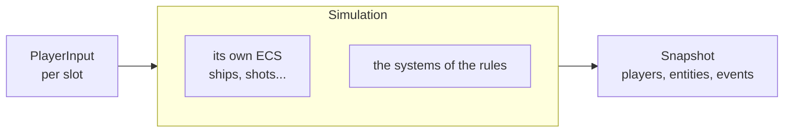

*The simulation turns the inputs of the players into a snapshot of the world, one tick at a time.*

### Who calls step()

The simulation never reads a clock: whoever uses it decides when a tick passes. That is what makes a game the
same on every machine, and the tests exact.

| Where | Who calls `step()` |
|---|---|
| Client offline | `LocalSession::update(elapsed)` adds up the frame times and steps once per 1/60 s, like `PhysicsStep` |
| Server instance | The simulation thread, with a `Timer` at 60 Hz |
| Tests | A loop: 600 steps are 10 seconds of game, computed in a few milliseconds |

**The same inputs, in the same order, give the same snapshots**, bit for bit: a test checks it over 20
seconds of a game with three players. Keep it that way: no clock, no `std::rand()`, no iteration over an
`std::unordered_map` in the rules; a random generator, when the Bydos need one, is seeded by the game.

## Inputs

`PlayerInput` is the byte of the protocol ([game protocol](../protocol/game.md#92-inputs)): one bit per control.
It is **data, not a device**: `libs/game` does not use `libs/input`, which reads the keyboard and the gamepads
through raylib and only exists in the client. The client makes the `PlayerInput` from the virtual gamepad of the
engine (`rtype::engine::Controls`, fed by `libs/input` with the bindings of the player), once per tick; the server
receives it in `INPUT` messages.

```
Keyboard, gamepads ─► libs/input ─► engine::Controls ─► GameSessionSystem ─► game::PlayerInput ─► Simulation
   (raylib)          (bindings)    (virtual gamepad)       (client)           (one byte)        (client or server)
```

```cpp
rtype::game::PlayerInput input;
input.set(rtype::game::PlayerInput::Up, controls.isDown(rtype::engine::Control::Up));
input.set(rtype::game::PlayerInput::Fire, controls.isDown(rtype::engine::Control::FaceDown));

input.direction();                   // {x, y}, each -1, 0 or 1: up and down together cancel
rtype::game::PlayerInput::fromByte(b); // from the network: the reserved bits are dropped
```

An input stays until the next `setInput()`: a player who holds Right keeps moving.

## Snapshots

A `Snapshot` is the world at the end of a tick, with the fields of the `SNAPSHOT` message
([game protocol](../protocol/game.md#snapshot-0x80)), plus the events of the tick:

| Field | Content |
|---|---|
| `tick` | The tick it describes, 1 after the first step |
| `players` | Slot, lives and score of each player, by slot |
| `entities` | Each entity: id, kind, owner, position (its centre), velocity, health, flags, by id |
| `destroyed` | The entities destroyed since the previous snapshot, with the cause (removed, or killed: an explosion) |
| `waveStarted`, `gameOver` | A wave started, the game ended |
| `rescue` | Where the rescue against the final boss is, offline (`RescueStage`, [The rescue against the final boss](#the-rescue-against-the-final-boss)) |
| `struck` | The ships the blade of the shogun went through during the rescue, by id, offline: the client draws the cut |

- **Ids are never reused** within a game (`NetworkId`, unlike the ids of the ECS): a client keeps them to
  recognize its entities from one snapshot to the next.
- **Positions are floats** in game units; the network encodes them in eighths of a unit. Every entity stays in
  the area the protocol can encode (`PositionLimit`): what leaves the game area is removed.
- An entity in `destroyed` is no longer in `entities`.

## What the rules do now

| Rule | Where | Numbers (`Rules`) |
|---|---|---|
| A ship appears on the left, one height per slot, with the health and the weapon of the [players](#players) | `spawnPlayerShip()` | — |
| It moves with the input, as fast in diagonal | `PlayerControlSystem`, with `shipVelocity()` (`ShipMovement.hpp`, shared with the prediction of the client) | `shipSpeed` 600 units/s |
| It stays entirely in the 1920 × 1080 area | `physics::BoundsSystem`, `ConfinedToBounds` | `shipHalfWidth`, `shipHalfHeight` |
| Fire held shoots its [weapon](#weapons) from its nose, to the right | `WeaponSystem`, `spawnWeaponShot()` | — (the weapon's) |
| The waves come one after the other, one per difficulty, then the game is won | `WaveSystem`, `spawnEnemy()` | `firstWaveDelay` 120 ticks, `wavePause` 180 |
| A Bydo flies to the left, and fires its weapon once in the area | `EnemySystem`, `WeaponSystem` | — (its definition's) |
| What has `Damage` hurts what it touches: player shots the Bydos, the Bydos and their shots the ships | `CombatSystem` | `hitInvulnerableTicks` 60 |
| A Bydo with no hit points left is destroyed, its score goes to the player of the shot | `CombatSystem` | — |
| A ship with no hit points left is destroyed, the player loses a life and gets a new ship, invulnerable for a while | `CombatSystem` | `respawnDelay` 180 ticks (3 s), `invulnerableTicks` 120 |
| Every player out of lives ends the game (defeat) | `CombatSystem` | `lives` 3 |
| Offline, the last life lost against the final boss brings allies to the rescue instead | `CombatSystem`, `RescueSystem` | `rescue`, `rescueVoiceTicks`... |
| What leaves the area is removed | `AreaSystem`, `LeavesArea` | `areaMargin` 128 units |
| A player who leaves takes its ship away | `Simulation::removePlayer()` | — |

A tick runs the systems in this order: `PlayerControlSystem` (inputs), `WaveSystem` (the waves),
`EnemySystem` (the Bydos), `RescueSystem` (the rescue against the final boss), `WeaponSystem` (the weapons),
`ProjectileSystem` (the velocity of the projectiles),
`physics::MovementSystem` (movement), `physics::BoundsSystem` (the walls), `CombatSystem` (the hits, the
lives), `AreaSystem` (what left), then the snapshot is taken.

### Hits

The `CombatSystem` tests what touches what with the colliders of the entities, boxes or spheres
(`overlaps()`, `Hitbox.hpp`). An entity with a `Damage` component takes that many hit points from the `Health`
of what it hits:

- **A player shot** (its `Owner` is a slot) hurts a Bydo and is spent (`DestroyCause::Killed`: the client draws
  its impact). A Bydo behind its guard (`EnemyStance::Guard`, ordered by its behavior) takes no damage. The
  Bydo with no hit points left starts its next phase with all its health if it has one left
  (`EnemyDefinition::phases`, `Enemy::phase`): a boss outlasts the 255 hit points of a `Health`. Otherwise it is
  destroyed (`DestroyCause::Killed`) and `EnemyDefinition::score` goes to the player of the shot.
- **A Bydo shot** (`NoOwner`) hurts a ship and is spent, killed as well; **a Bydo** hurts a ship it runs into
  (`EnemyDefinition::collisionDamage`) and keeps going. A ship that survives is invulnerable for
  `hitInvulnerableTicks`, so that a Bydo on it does not take its health away tick after tick.
- The damage of a shot is that of its weapon (`WeaponDefinition::damage`): `spawnWeaponShot()` gives it its
  `Damage`. A projectile made by `spawnProjectile()` alone has none: it hurts nothing.

## Projectiles

A kind of projectile is **data**, a `ProjectileDefinition`, so that a new one is added without writing a
system. A `ProjectileRegistry` keeps the definitions by id, and `spawnProjectile()` makes an entity from one.

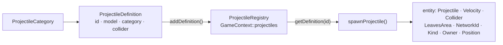

The life of a projectile, from the shot to its disappearance:

```mermaid
sequenceDiagram
    participant Sys as A system (PlayerControlSystem...)
    participant Reg as ProjectileRegistry
    participant Ecs as ECS
    participant Tick as Systems of the tick
    participant Cli as Client

    Sys->>Ecs: defer(spawnProjectile(id, owner, position, velocity))
    Note over Sys,Ecs: after the systems of the tick, so the caches are not grown while read
    Ecs->>Reg: getDefinition(id)
    Reg-->>Ecs: model, category, collider
    Ecs->>Ecs: new entity (Projectile, Velocity, Collider, LeavesArea, NetworkId, Kind, Owner, Position)
    loop every tick
        Tick->>Ecs: MovementSystem moves it
        Tick->>Ecs: CombatSystem tests the hits
    end
    Tick->>Ecs: AreaSystem removes it once out of the area (DestroyCause::Removed)
    Ecs-->>Cli: Snapshot: its Kind, position and velocity; then `destroyed`
```

The data of a definition and where each one ends up:

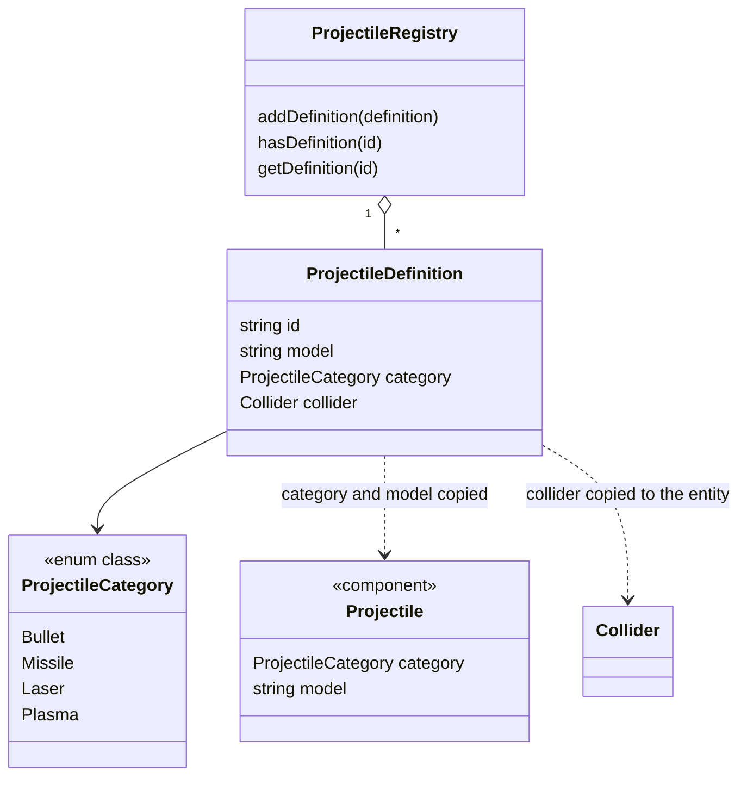

| Attribute | Type | Role |
|---|---|---|
| `id` | `std::string` | Unique name in the registry, how the systems and the configuration files designate it |
| `model` | `std::string` | Path of the 3D model. The game only carries it: it has no raylib, the client loads it |
| `category` | `ProjectileCategory` | `Bullet`, `Missile`, `Laser`, `Plasma`: what the rules that depend on the behavior key on |
| `collider` | `physics::Collider` | The shape that hits what it meets, centred on the projectile |

```cpp
simulation.context().projectiles.addDefinition(
    {"pulse", "models/pulse.glb", ProjectileCategory::Plasma,
     physics::Collider{physics::Aabb{{}, {8.0f, 4.0f, 0.0f}}, {}, false}});

spawnProjectile(ecs, context, "pulse", slot, x, y, 1500.0f, 0.0f); // from a system, through Ecs::defer()
```

- **The behavior of a category is in functions** (`Projectile/ProjectileBehavior.hpp`), since a C++ `enum class`
  has no methods: one `switch` per question, so a new category is a new case in each.

  | Function | Answers | Bullet | Missile | Laser | Plasma |
  |---|---|---|---|---|---|
  | `getProjectileVelocity(category, launch, age, rules)` | How it moves, each tick (`ProjectileSystem`) | Straight | Speeds up (`missileBoostPerTick`, `missileMaxBoost`) | Straight | Zigzags (`plasmaZigzagSpeed`, `plasmaZigzagInterval`) |
  | `getProjectileSounds(category)` | The paths of its sounds: `spawn`, `move`, `vanish` (left the area), `impact` (hit). All empty: no sound file yet | | | | |

  The sounds are paths: the game has no audio, the client plays them. Nothing sends the events (spawn, vanish,
  impact) to the client yet, like the model, they wait for a decision on the protocol.
- **The velocity is not in the definition**: the caller gives it at each shot, so that a weapon decides how
  fast its projectile goes; it is kept as `Projectile::launch`, and the category moves the projectile from it. `spawnProjectile()` throws `std::out_of_range` for an unknown id.
- **The registry is an `std::unordered_map`**, only looked up by id, never iterated: this does not break the
  [determinism](#who-calls-step) above. Iterating it in the rules would.
- **The clients see an `EntityKind` only**: a projectile with an owner is a `PlayerShot`, without one a
  `BydoPlasmaShot` if its category is `Plasma`, a `BydoShot` otherwise. The client draws each kind with its
  own model; the model of the definition is not in the snapshot.
- The players and the Bydos fire them through their [weapons](#weapons), which give them their damage.

The definitions come from the Lua files of `config/projectiles/` (see [Configuration](#configuration)); the
`Simulation` registers them when it is made.

## Weapons

A kind of weapon is **data** too, a `WeaponDefinition`, kept by id in a `WeaponRegistry`
(`GameContext::weapons`). Durations are in ticks, distances in game units.

| Field | Type | What it is |
|---|---|---|
| `projectile` | `std::string` | The ammunition: the id of a `ProjectileDefinition` |
| `mechanic` | `ProjectileCategory` | The firing mechanic: how its projectiles move (replaces the category of the projectile) |
| `projectileSpeed` | `float` | Speed the projectiles leave with, forward: to the right for a player, to the left for a Bydo |
| `fireInterval` | ticks | Between two shots while Fire is held (not 0) |
| `range` | `float` | Distance a projectile flies before it vanishes, 0 for no limit |
| `magazineSize` | shots | Ammunition capacity, `InfiniteAmmo` (0) for a weapon that never runs out |
| `reloadTicks` | ticks | Reload time of an empty magazine |
| `damage` | `std::uint8_t` | Hit points each projectile takes from what it hits (not 0, default 10) |

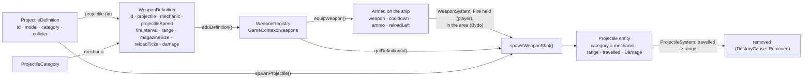

The state of the magazine, run by the `WeaponSystem` at each tick (with `magazineSize` not `InfiniteAmmo`):

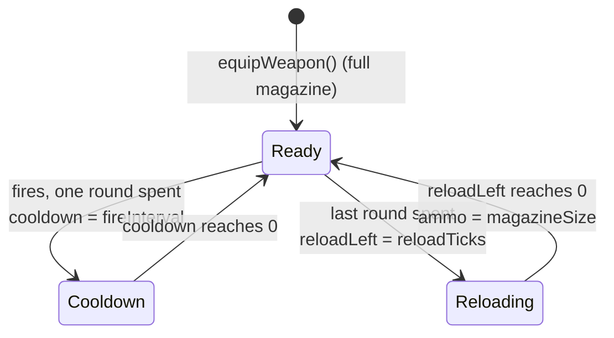

```cpp
simulation.context().weapons.addDefinition({"blaster", "pulse", ProjectileCategory::Laser, 1000.0f, 5, 600.0f, 8, 90});
equipWeapon(ecs, context, ship, "blaster"); // gives the ship an Armed component
```

- `WeaponSystem` runs each `Armed` ship: it counts the cooldown down, spends a round per shot, reloads on its
  own when the magazine is empty (no shot meanwhile) and fires through `spawnWeaponShot()` (deferred), from
  the nose of the ship (the edge of its collider). A player fires while Fire is held, a Bydo as soon as it is
  in the game area.
- How a weapon steps, where the shot of a player starts and how a shot moves are in `WeaponFiring.hpp`
  (`stepWeapon()`, `playerShot()`, `moveShot()`), as the movement of the ship is in `ShipMovement.hpp`: the
  client predicts the shots of its player online with them, and a test checks, for every weapon of
  `config/weapons/`, that they give the ticks, the positions and the state of the weapon of the game, to the
  bit.
- A ship **without** `Armed` does not fire. The ships of the players get the weapon of the
  [players](#players), the Bydos that of their definition.
- The range is checked by `ProjectileSystem` on the distance flown (`Projectile::travelled`); a projectile past
  it is removed with `DestroyCause::Removed`.

## Ships

A kind of ship is **data**, a `ShipDefinition`, kept by id in a `ShipRegistry` (`GameContext::ships`): what a
ship looks and sounds like, whoever flies it. The game only carries the paths of the model and of the sounds:
it has no window and no audio, the client loads and plays them. An empty sound path means no sound.

| Field | Type | What it is |
|---|---|---|
| `model` | `std::string` | Path of the 3D model (required) |
| `sounds.move` | `std::string` | Played while it moves |
| `sounds.destruction` | `std::string` | Played when it is destroyed |
| `sounds.collision` | `std::string` | Played when it collides with something |
| `collider` | `physics::Collider` | The shape that hits and is hit, centred on the ship (default a box of 48 × 24 half sizes). The ships of the players keep the box of the rules, shared with the prediction of the client |

```cpp
simulation.context().ships.addDefinition({"bydo_scout", "models/bydo_scout.glb",
                                          {"sounds/scout_move.ogg", "sounds/scout_destruction.ogg",
                                           "sounds/scout_collision.ogg"}});
```

`addDefinition()` throws `std::invalid_argument` for an empty or taken id or no model; `getDefinition()` throws
`std::out_of_range` for an unknown id.

## Players

What every player starts with is a `PlayerDefinition` (`Player/PlayerDefinition.hpp`), given in
`GameConfig::player` and kept in `GameContext::player`:

| Field | Type | What it is |
|---|---|---|
| `ship` | `std::string` | The id of a `ShipDefinition`: its model and its sounds |
| `weapon` | `std::string` | The id of a `WeaponDefinition`, given to every ship of a player (`equipWeapon()`) |
| `health` | `std::uint8_t` | Hit points of each ship (not 0, default 100) |

The `Simulation` throws `std::invalid_argument` for an unknown ship or weapon, or no health. Left empty, as in
a `GameConfig` made by hand, the ships have no weapon and do not fire. The configuration of the repository
gives the players `player_ship` and `player_cannon` (`config/player.lua`).

## Enemies

A kind of enemy is **data** as well, an `EnemyDefinition`, kept by id in an `EnemyRegistry`
(`GameContext::enemies`). Speeds are in game units per second. The [waves](#waves) make them appear with
`spawnEnemy()`.

| Field | Type | What it is |
|---|---|---|
| `ship` | `std::string` | The id of a `ShipDefinition`: its model and its sounds |
| `health` | `std::uint8_t` | Hit points it starts with, like the `Health` component (not 0) |
| `speed` | `float` | Top speed (above 0) |
| `acceleration` | `float` | Speed gained per second until the top speed, in units/s² (0 or more; 0 = top speed at once) |
| `weapon` | `std::string` | The id of a `WeaponDefinition` |
| `score` | `std::uint32_t` | Points for the player who destroys it (default 100) |
| `collisionDamage` | `std::uint8_t` | Hit points a ship loses when it runs into it (default 20) |
| `behavior` | `std::optional<EnemyBehavior>` | What moves it and makes it fire (see [Enemy behaviors](#enemy-behaviors)); none: it flies left and fires as soon as it can |
| `phases` | `std::uint8_t` | How many times its health is filled (not 0, default 1): it gets all of it back at each new phase |
| `boss` | `bool` | Sent as `EntityKind::BydoBoss` instead of `BydoFlyer`: the clients draw it as a boss (default false) |

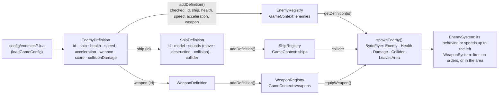

```cpp
simulation.context().enemies.addDefinition({"bydo_scout", "bydo_scout", 30, 240.0f, 720.0f, "blaster"});
```

- `addDefinition()` throws `std::invalid_argument` for an empty or taken id, no ship, no health, no weapon, a
  speed not above 0 or a negative acceleration; `getDefinition()` throws `std::out_of_range` for an unknown id.
- The ship and the weapon are **not** looked up when the enemy is added, so that the registries can be filled
  in any order; an unknown one fails when the enemy is made: `spawnEnemy()` throws `std::out_of_range`.
- `spawnEnemy(ecs, context, id, x, y)` makes a `BydoFlyer` (the only kind of Bydo the clients are told for now)
  with no owner, still. Without a behavior, the `EnemySystem` speeds it up to the left, in a straight line, and
  the `WeaponSystem` fires its weapon as soon as it is in the game area; with one, it gets an `EnemyOrders` and
  does what its behavior says.
- The definitions come from the Lua files of `config/enemies/`, like those of the other kinds (see
  [Configuration](#configuration)).

### Enemy behaviors

A kind of enemy can be **code**: an `update(enemy, game)` function in its file of `config/enemies/`, called at
every tick for each of its enemies, which decides when it moves and when it fires
([ADR 0019](../decisions/0019-luabridge3-scripting-library.md)). How to write one is in the guide
[Script the behavior of an enemy](../guides/script-enemy-behaviors.md); `config/enemies/bydo_gunner.lua` is an
example.

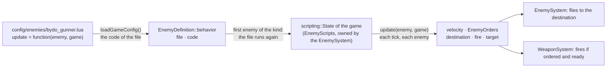

**What a behavior sees and orders**, with recipes, is in the guide
[Script the behavior of an enemy](../guides/script-enemy-behaviors.md#reference): the enemy (position, velocity,
top speed, age, health, phase, weapon, a `memory` of its own), the players and their weapons, the time and the
random numbers of the game; the orders `setVelocity`, `moveTo`, `fire`, `fireAt`, and the stances `guard`,
`slash` and `aim`. On the C++ side:

- **The bound types are copies.** `EnemyScripts` gives each call an `enemy` userdata built from the components
  (`Position`, `Velocity`, `Health`, `Armed`, `Enemy::age`, `EnemyOrders`), owned by Lua, read-only, and reads
  its orders back after the call: a new velocity, and the `EnemyOrders` (destination, kept from one tick to the
  next; `fire`, `target` and `stance`, reset at every call). The stance goes into the flags of the snapshot
  (`EntityState::Guarding`, `Slashing`, `Shooting`), for the clients to animate. A script that keeps `enemy` changes nothing. `game` is built
  once per tick (`startTick()`), with the players in slot order.
- **Moving and firing stay in C++.** The `EnemySystem` flies an enemy with a destination to it at its top
  speed, slower on the last tick so that it stops on it; the `WeaponSystem` fires an enemy with `EnemyOrders`
  only when `fire` is set and the weapon is ready, towards `target` with `spawnAimedShot()`. `weapon.ready`
  tells the script the weapon is ready *at this tick*, the `WeaponSystem` running after the `EnemySystem`.
- **Deterministic.** The behaviors run in the order of the entities, in the sandbox of the configuration, with
  the random numbers of the `GameContext`: the same game replays the same, on the server and offline. An online
  client never runs them, it shows the snapshots.
- **One state per game.** `EnemyScripts` (`src/Enemy/`, the only place of the game that binds C++ to Lua) owns a
  `scripting::State` per `Simulation`: a behavior is loaded with the first enemy of its kind, by running its
  file again; the files have their own globals. A call may execute `EnemyScripts::InstructionLimit` (100 000)
  instructions.
- **A behavior that fails is stopped.** An error, the instruction limit, a file without `update`: the error is
  logged with the file, and the behavior is stopped for the rest of the game. Its enemies lose their
  `EnemyOrders` and fly and fire as if they had no behavior; the game goes on.

## Waves

A wave is a group of enemies that appear one after the other. Like the enemies, it is **data**: a
`WaveDefinition`, kept by name in a `WaveRegistry` (`GameContext::waves`), run by the `WaveSystem` (see
[A game of waves](#a-game-of-waves)).

| Field | Type | What it is |
|---|---|---|
| `name` | `std::string` | Unique name in the registry |
| `label` | `std::string` | Short text shown to the players |
| `description` | `std::string` | Longer text |
| `difficulty` | `std::uint8_t` | How hard the wave is, from 1 (`MinWaveDifficulty`) to 6 (`MaxWaveDifficulty`, the final boss) |
| `quantity` | `std::uint16_t` | How many enemies (above 0) |
| `spawnInterval` | `float` | Seconds between two enemies (0 or more; 0 = all at once) |
| `placement` | `WavePlacement` | `Manual` or `Random`, one mode per wave |
| `spawns` | `std::vector<WaveSpawn>` | Manual only: each enemy (`enemy`, `x`, `y`), in the order they appear |
| `enemy` | `std::string` | Random only: the id of the `EnemyDefinition` of every enemy |
| `area` | `WaveArea` | Random only: the rectangle (`minX`, `maxX`, `minY`, `maxY`) where they appear |
| `music` | `std::string` | Path of the music the clients play when the wave starts, relative to their assets; empty = the music playing goes on. Sent in `WAVE_STARTED` |

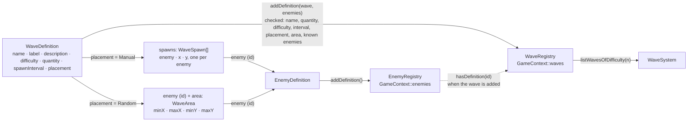

The dotted arrow is the check made when a wave is added.

The default `area` is a band just past the right edge of the game area (x from `GameWidth` to
`GameWidth + 100`, the whole height), so that enemies come in from the side. A wave does not mix manual and
random enemies: for that, play two waves one after the other.

```cpp
auto &context = simulation.context();
context.waves.addDefinition(
    {"scouts_random", "Scouts", "Five scouts from the right", 2, 5, 0.5f, WavePlacement::Random, {}, "bydo_scout"},
    context.enemies);
context.waves.addDefinition({"scouts_line", "Scout line", "", 1, 2, 0.0f, WavePlacement::Manual,
                             {{"bydo_scout", 2000.0f, 200.0f}, {"bydo_scout", 2000.0f, 800.0f}}},
                            context.enemies);
```

- `addDefinition()` needs the `EnemyRegistry`: unlike the enemies, the waves check that every enemy they name
  is known, so the enemies are filled first.
- It throws `std::invalid_argument` for an empty or taken name, a quantity of 0, a negative interval, a
  Manual wave whose `spawns` do not number `quantity` or that sets `enemy`, a Random wave without `enemy` or
  with `spawns`, an unknown enemy, or an empty area (min above max). `getDefinition()` throws
  `std::out_of_range` for an unknown name.
- `listWavesOfDifficulty(n)` gives the names of the waves of a difficulty **in alphabetical order**: the map is
  never iterated as it is, so that the same random number draws the same wave on every machine.

### A game of waves

A game has five waves at most: wave n is a wave of difficulty n, drawn at random among those of that
difficulty (`GameContext::randomBetween()`, from `Rules::seed`). A difficulty without a wave is skipped. The
`WaveSystem` keeps where the game is in `GameContext::wave` (`WaveProgress`):

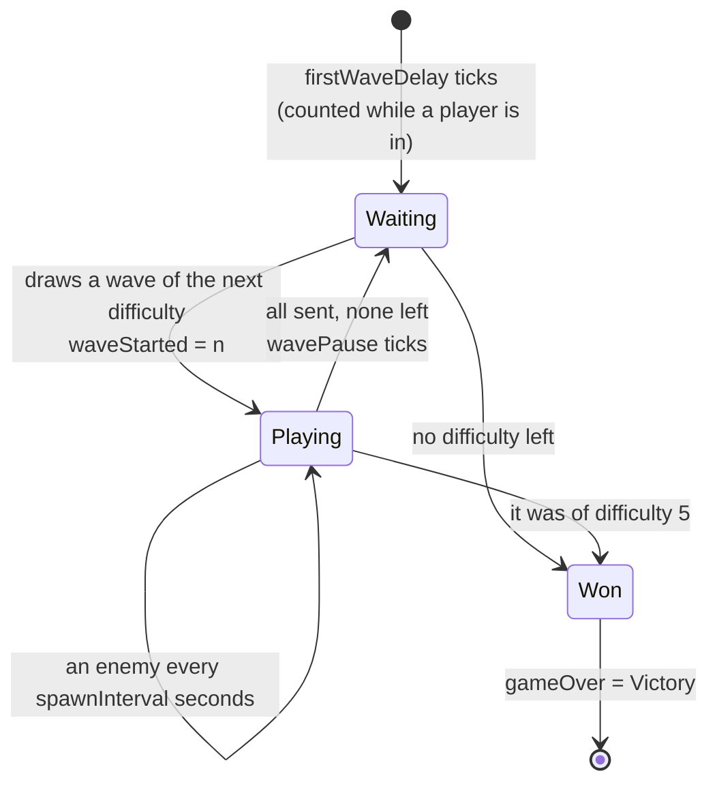

- A wave sends its enemies one every `spawnInterval` seconds (all at once for 0): a `Manual` wave at the
  positions of its `spawns`, a `Random` one at a random point of its `area`. They are created after the
  systems of the tick (`spawnEnemy()`, deferred).
- It ends once every enemy is sent and none is left, destroyed or gone out of the area.
- The start of a wave is in the snapshot (`waveStarted`, its number, which is its difficulty); the server
  sends it to the clients (`WAVE_STARTED`).
- Nothing happens without a wave in the registry (the tests made by hand), nor while no player is in. Once
  the game is over (`GameContext::over`), won or lost, the waves stop.

### The rescue against the final boss

Offline, in the story mode of the client, the fight against the shogun cannot be lost: `Rules::rescue` (set by
the `LocalSession`, off online) turns the defeat into a scripted rescue. Online, the server leaves the waves of
the final boss out of its configuration (`readGameConfig()`): the game is won once the waves before it are
beaten.

When the last ship of the last player is lost in the last wave, with a boss alive, the `CombatSystem` starts the
rescue (`GameContext::rescue`, `RescueProgress`) instead of the defeat. From then on the `RescueSystem`, run
right after the `EnemySystem`, flies the boss, the allies and the ship of the player, stage by stage
(`RescueStage`, in each snapshot as `rescue`):

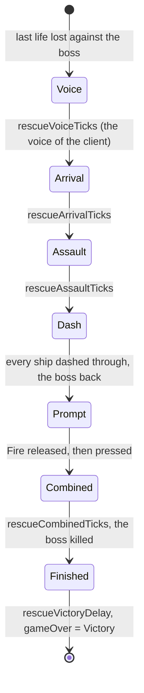

| Stage | What happens |
|---|---|
| `Voice` | The client plays the voice of the rescue; the boss guards on its spot (1600, 540) |
| `Arrival` | Five allies (`AllyShip`, `spawnAlly()`, with an `Ally` component) fly in from the left with a new ship for the player, who gets a life back, into an arrowhead: the player at its tip |
| `Assault` | The allies shoot at the boss, which guards and cannot be hurt; the player flies and fires freely |
| `Dash` | The boss raises its blade, then dashes through each ship of the formation in turn, throwing it back without hurting it (the ship struck is in the next snapshot, `struck`), and flies back to its spot |
| `Prompt` | The client asks for Fire (Space); a Fire held since before must be released first |
| `Combined` | Every ship fires at the boss; its health drains by steps to 0, then it is killed and its score goes to the player |
| `Finished` | The victory comes `rescueVictoryDelay` ticks later |

- While the rescue runs, the `WaveSystem` and the behaviors of the Bydos wait, and the `CombatSystem` hurts no
  ship of a player. The boss is ordered every tick (`EnemyOrders`): a stance, no shot, `invulnerable`.
- The shots of the allies belong to the player rescued (its slot as `Owner`): they hit the Bydos as its own.
  The allies have neither health nor hitbox: nothing hits them.
- `AllyShip` is never sent online: the protocol does not know it.
- The numbers are in `Rules` (`rescueVoiceTicks` 360, `rescueArrivalTicks` 150, `rescueAssaultTicks` 300,
  `rescueCombinedTicks` 150, `rescueVictoryDelay` 180); the formation and the dashes in `RescueSystem.cpp`.
  `rescueVoiceTicks` is the length of the voice of the client (`RTYPE_SOUND_RESCUE_VOICE`).

## Configuration

The definitions of a game are not written in C++: each one is a Lua file of the `config/` folder, which the
server and the client read the same way ([ADR 0018](../decisions/0018-lua-game-config.md),
[ADR 0019](../decisions/0019-luabridge3-scripting-library.md)). How to write one, with every field, is in the
guide [Configure enemies and weapons](../guides/configure-enemies-and-weapons.md).

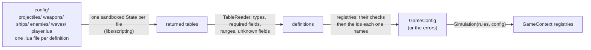

```cpp
const rtype::game::LoadedGameConfig loaded = rtype::game::loadGameConfig("config");
if (!loaded.isValid()) {
    for (const std::string &error : loaded.errors) { /* "enemies/bydo_scout.lua: health: expected ..." */ }
}
rtype::game::Simulation simulation({}, loaded.config);
```

- **`loadGameConfig(directory)`** (`Config/GameConfigLoader.hpp`) reads every `.lua` file under the five
  folders, sub-folders included, sorted by path so that every machine reads them in the same order, and
  `player.lua` at the root. Each file runs in a `scripting::State` of its own and returns one table; a missing
  folder has no definitions, a missing directory or `player.lua` is an error.
- **The checks come in two steps.** First each table: the types, the required fields, the ranges and the
  unknown fields (a misspelt optional field is an error, not a silent default), by a `TableReader` that reads
  the fields raw (no metamethod runs). Then, once every file is read, the registries check the definitions
  (an id defined twice...) and the ids they name are looked up: a weapon its projectile, an enemy its ship and
  its weapon, a wave its enemies, the player its ship and its weapon. The second step only runs if the first one found nothing, so that a broken
  file does not make every file that names it fail too.
- **All or nothing.** Every error of a step is listed, one line each with its file and field; with any error,
  `LoadedGameConfig::config` is empty. The loader logs nothing: the server refuses to start and logs them
  ([Server](server.md#common-options)), the client starts without the configuration and shows them in its
  console.
- **`GameConfig`** is plain values (`Config/GameConfig.hpp`): it is read once, then each `Simulation` gets a
  copy and registers it in its `GameContext`, in the order of the dependencies (projectiles, weapons, ships,
  enemies, waves, then the player).
- **No Lua in the public headers of the game.** `libs/scripting` is a private dependency of `libs/game`; only
  the sources of `src/Config/` and `src/Enemy/` (the [behaviors](#enemy-behaviors)) include Lua and LuaBridge3
  (`rtype/scripting/Lua.hpp`).

**`libs/scripting`** (`rtype::scripting`) builds Lua 5.4 from its sources (without the `io`, `os`, `package`,
`debug`, `coroutine` and `utf8` libraries) and gives a `State`: only the base functions, `table`, `string` and
`math`, without `load`, `loadfile`, `dofile`, `math.random` nor `math.randomseed`; text chunks only (no
precompiled bytecode); an instruction limit (`State::DefaultInstructionLimit`) for each run of a file and
each call of a function (`callFunction()`), that stops an endless loop with an error; and an environment table
per run, so that two files do not share their globals. Its errors are `ScriptError`s whose message starts with
the name of the file. Lua's string hashes get a fixed seed, so that `pairs()` goes through a table in the same
order on every run.

## Adding gameplay

The rules are components and systems on the ECS, like the physics, so that anyone can add some:

1. **A component** in `Component/Components.hpp`: plain data, `struct Charge { std::uint32_t ticks = 0; };`.
2. **A kind of entity**, if the clients must draw it: a value in `EntityKind` (`Snapshot.hpp`) and in the table
   of the [protocol](../protocol/game.md#91-the-world), in the range of its family; then a `spawn...()`
   function in `Entities.hpp`, which gives it a `NetworkId`, its `Kind`, its `Owner` and its `Position`.
3. **A system** in `System/`: it receives the caches, the `Ecs` and the `GameContext` (rules, tick, players and
   their inputs, events), and is registered in the constructor of `Simulation`, at its place in the tick.
4. **The numbers** in `Rules`, so that they can be tuned in one place, and the tests use their own.
5. **A test** in `tests/game_simulation.cpp`: inputs in, snapshot checked.

Inside a system, create and destroy entities through `ecs.defer()`: changing the world while a system goes
through the caches is not safe. `destroyEntity(ecs, context, entity, cause)` destroys an entity and records it
for the snapshot.

## Messages

`Messages.hpp` turns the messages of a game session into payloads and back, as the
[game protocol](../protocol/game.md#9-game-messages) says. The sessions of `libs/network` (`ClientSession`,
`SessionHost`) carry them with their type (`message_type::Snapshot`...); the server and the client share this
one implementation.

| Message | Type | Direction | Struct |
|---|---|---|---|
| `ACCEPTED` | `0x02` | Game → Client | `AcceptedMessage`: slot, tick rate, tick |
| `PLAYER_JOINED` | `0x04` | Game → Client | `PlayerJoinedMessage`: slot, player id, name |
| `PLAYER_LEFT` | `0x05` | Game → Client | `PlayerLeftMessage`: slot, reason |
| `INPUT` | `0x40` | Client → Game | `InputMessage`: tick, inputs newest first |
| `SNAPSHOT` | `0x80` | Game → Client | `SnapshotPart`: tick, last input, input lead, weapon of the ship of the client, part, players, entities (the age of the shots in the byte of the health) |
| `ENTITIES_DESTROYED` | `0x81` | Game → Client | `EntitiesDestroyedMessage`: tick, ids and causes |
| `WAVE_STARTED` | `0x82` | Game → Client | `WaveStartedMessage` |
| `GAME_OVER` | `0x83` | Game → Client | `GameOverMessage` |

```cpp
// Game, once per client, every 2 ticks
for (const rtype::game::SnapshotPart &part : rtype::game::splitSnapshot(simulation.snapshot(), lastInput, lead)) {
    host.send(session, rtype::game::message_type::Snapshot, rtype::game::encode(part),
              rtype::network::Delivery::Unreliable);
}
for (const auto &message : rtype::game::destroyedMessages(simulation.snapshot())) {
    host.send(session, rtype::game::message_type::EntitiesDestroyed, rtype::game::encode(message),
              rtype::network::Delivery::Reliable);
}

// Client, in the message handler of its ClientSession
if (type == rtype::game::message_type::Snapshot) {
    if (const auto part = rtype::game::decodeSnapshotPart(payload)) {
        world.apply(*part);
    }
}
```

- **`encode()`** has one overload per message. A value the protocol forbids (a slot above 3, no input, an id
  of 0, a part that does not fit in a datagram) is a bug of the sender: it throws.
- **`decode...()`** never throws: it gives nothing for every case the protocol calls malformed, and for bytes
  left after the last field, and the receiver drops the message. Unknown reasons, causes and outcomes are read
  as the protocol says (`Quit`, `Removed`, `Defeat`), and reserved bits are dropped. The decoders are pure, with
  no state: they can be fuzzed.
- **Positions and velocities** are floats in the structs, and eighths of a unit on the network: rounded to the
  nearest eighth, and kept within what an `i16` holds (−4096 to 4095.875).
- **`splitSnapshot()`** cuts a `Snapshot` in parts that fit in a datagram, each with the tick and the players:
  69 entities per part with four players (`maxEntitiesPerPart()`), 16 parts at most. **`destroyedMessages()`**
  does the same for the destroyed entities: 228 per message.
- **Unknown kinds** are decoded, so that a newer game can add some: `isKnown()` tells the client to skip them.

### The world of a client

`RemoteWorld` keeps the world as a client knows it from those messages, with the rules of the
[protocol](../protocol/game.md#93-snapshots): snapshots can be lost, late or out of order, and destructions
are reliable.

```cpp
rtype::game::RemoteWorld world;
world.apply(part);                                // a SNAPSHOT part
for (const auto &removed : world.apply(message)) { // an ENTITIES_DESTROYED
    // removed.last: where it was, for an explosion when removed.cause is Killed
}
for (const auto &[id, entity] : world.entities()) { /* draw it */ }
```

| What arrives | What the world does |
|---|---|
| A part older than the latest applied | Ignored (`apply()` gives false); the other parts of the latest tick still apply |
| An entity in a part | Created, or updated |
| An entity missing from a part | Kept: its part may have been lost |
| `ENTITIES_DESTROYED` | The entities are removed and given back with their last state; their ids are remembered until the snapshots reach the tick of their destruction, so that an older part cannot bring them back |
| A kind it does not know | Skipped |

It keeps the latest state only; drawing a little in the past and interpolating between snapshots come on top of
it, in the client. Like the Simulation, it has no clock and no network.

## Tests

The tests in `tests/game_simulation.cpp` (tag `[game]`) step simulations and check their snapshots: the
inputs, the players added and removed, the movement and its speed in diagonal, the walls, the shots and their
interval, shots removed once out of the area with ids never given again, the same game twice with the same
inputs, and an hour of random inputs with four players keeping every entity in the range of the protocol.
They also check the Bydos (their flight, their shots to the left), the hits (damage, score, a Bydo running
into a ship), and the waves: one per difficulty, a missing difficulty skipped, the interval and the area of
their enemies, the wave drawn from the seed, nothing without a player, and the victory told once. The
behaviors of the Bydos: flying to a point and stopping there, firing only when ordered, aiming at a player,
the memory of each enemy, their random numbers drawn from the seed, an enemy without orders keeping still, and
a behavior that fails or never ends stopped while the game goes on.

The tests in `tests/game_rescue.cpp` (tag `[game]`) play the rescue against the shogun of the repository: the
last life lost is a defeat without `Rules::rescue`; with it, the voice, five allies and a new ship with a life,
their shots that do not hurt the boss, its dashes through every ship that kill none, a Fire held that does not
count, then the combined attack, the boss killed and scored, and the victory.

The tests in `tests/game_config.cpp` (tag `[game]`) load the configuration of the repository, read each kind
with its defaults, and check each error: the field that is missing, of the wrong type, out of range or
unknown, the file that does not return a table or does not run, the unknown ids, the ids defined twice, a
missing `player.lua`, and the errors of several files at once; an enemy with an `update` function keeps the
code of its file, and the gunner of the repository stops, fires three orbs and leaves. The tests in
`tests/scripting.cpp` (tag `[scripting]`) check the sandbox of the `State`, the instruction limit, the separate
globals, the names in the errors, and the functions called with their arguments, each call under a limit of its
own.

The tests in `tests/game_messages.cpp` (tags `[messages]` and `[world]`) check the bytes of the example of the
specification, the round trip of every message, the rounding and the limits of positions, every malformed
case, the encoders refusing forbidden values, random bytes that never crash a decoder, the splitting of
snapshots and destructions into datagrams, the rules of `RemoteWorld`, and a whole game of four players sent
through the messages, where the client ends with the world of the game.

```sh
./build/bin/rtype_tests "[game],[scripting]"
```
