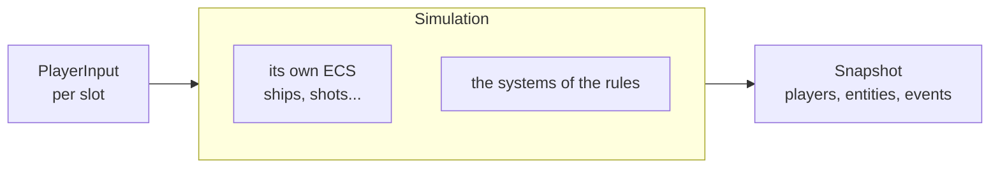

# Game

The game library (`libs/game`, namespace `rtype::game`) holds the **rules of the R-Type**: the players, their
ships and shots, and later the Bydos, the waves and the collisions. It is used by the server instances, which
run the games online, and by the client offline, in its `LocalSession` ([A game in the client](client-game.md))
([ADR 0015](../decisions/0015-one-game-scene-local-or-remote-session.md)): the rules are written once, and a
Bydo behaves the same offline and online.

The `Simulation` depends on the ECS, the physics and the log only: no window, no sound, no network. The
[messages](#messages) of the game protocol are written with the serialization of `libs/network` (`Writer`,
`Reader`), a private dependency: the rules never see it.

## A game in three calls

A `Simulation` is one game. It takes the inputs of the players, steps the world **one tick at a time**, and
gives a **snapshot** of it:

```cpp
#include "rtype/game/Game.hpp"

rtype::game::Simulation simulation;
simulation.addPlayer(0); // slots 0 to 3

// Every tick, 60 times per second
simulation.setInput(0, input);                               // the controls of player 0
simulation.step();                                           // exactly 1/60 s of game
const rtype::game::Snapshot &world = simulation.snapshot();  // what to draw
```



*The simulation turns the inputs of the players into a snapshot of the world, one tick at a time.*

### Who calls step()

The simulation never reads a clock: whoever uses it decides when a tick passes. That is what makes a game the
same on every machine, and the tests exact.

| Where | Who calls `step()` |
|---|---|
| Client offline | `LocalSession::update(elapsed)` adds up the frame times and steps once per 1/60 s, like `PhysicsStep` |
| Server instance | The simulation thread, with a `Timer` at 60 Hz |
| Tests | A loop: 600 steps are 10 seconds of game, computed in a few milliseconds |

**The same inputs, in the same order, give the same snapshots**, bit for bit: a test checks it over 20
seconds of a game with three players. Keep it that way: no clock, no `std::rand()`, no iteration over an
`std::unordered_map` in the rules; a random generator, when the Bydos need one, is seeded by the game.

## Inputs

`PlayerInput` is the byte of the protocol ([game protocol](../protocol/game.md#92-inputs)): one bit per control.
It is **data, not a device**: `libs/game` does not use `libs/input`, which reads the keyboard and the gamepads
through raylib and only exists in the client. The client makes the `PlayerInput` from the virtual gamepad of the
engine (`rtype::engine::Controls`, fed by `libs/input` with the bindings of the player), once per tick; the server
receives it in `INPUT` messages.

```
Keyboard, gamepads ─► libs/input ─► engine::Controls ─► GameSessionSystem ─► game::PlayerInput ─► Simulation
   (raylib)          (bindings)    (virtual gamepad)       (client)           (one byte)        (client or server)
```

```cpp
rtype::game::PlayerInput input;
input.set(rtype::game::PlayerInput::Up, controls.isDown(rtype::engine::Control::Up));
input.set(rtype::game::PlayerInput::Fire, controls.isDown(rtype::engine::Control::FaceDown));

input.direction();                   // {x, y}, each -1, 0 or 1: up and down together cancel
rtype::game::PlayerInput::fromByte(b); // from the network: the reserved bits are dropped
```

An input stays until the next `setInput()`: a player who holds Right keeps moving.

## Snapshots

A `Snapshot` is the world at the end of a tick, with the fields of the `SNAPSHOT` message
([game protocol](../protocol/game.md#snapshot-0x80)), plus the events of the tick:

| Field | Content |
|---|---|
| `tick` | The tick it describes, 1 after the first step |
| `players` | Slot, lives and score of each player, by slot |
| `entities` | Each entity: id, kind, owner, position (its centre), velocity, health, flags, by id |
| `destroyed` | The entities destroyed since the previous snapshot, with the cause (removed, or killed: an explosion) |
| `waveStarted`, `gameOver` | A wave started, the game ended |

- **Ids are never reused** within a game (`NetworkId`, unlike the ids of the ECS): a client keeps them to
  recognize its entities from one snapshot to the next.
- **Positions are floats** in game units; the network encodes them in eighths of a unit. Every entity stays in
  the area the protocol can encode (`PositionLimit`): what leaves the game area is removed.
- An entity in `destroyed` is no longer in `entities`.

## What the rules do now

| Rule | Where | Numbers (`Rules`) |
|---|---|---|
| A ship appears on the left, one height per slot | `spawnPlayerShip()` | — |
| It moves with the input, as fast in diagonal | `PlayerControlSystem`, with `shipVelocity()` (`ShipMovement.hpp`, shared with the prediction of the client) | `shipSpeed` 600 units/s |
| It stays entirely in the 1920 × 1080 area | `physics::BoundsSystem`, `ConfinedToBounds` | `shipHalfWidth`, `shipHalfHeight` |
| Fire held shoots from its nose | `PlayerControlSystem`, `spawnPlayerShot()` | `fireInterval` 10 ticks (6 per second), `shotSpeed` 1500 units/s |
| What leaves the area is removed | `AreaSystem`, `LeavesArea` | `areaMargin` 128 units |
| A player who leaves takes its ship away | `Simulation::removePlayer()` | — |

The Bydos, the collisions, the damage, the lives and the score come with `server: gameplay`.

A tick runs the systems in this order: `PlayerControlSystem` (inputs), `physics::MovementSystem` (movement),
`physics::BoundsSystem` (the walls), `AreaSystem` (what left), then the snapshot is taken.

## Adding gameplay

The rules are components and systems on the ECS, like the physics, so that anyone can add some:

1. **A component** in `Component/Components.hpp`: plain data, `struct Charge { std::uint32_t ticks = 0; };`.
2. **A kind of entity**, if the clients must draw it: a value in `EntityKind` (`Snapshot.hpp`) and in the table
   of the [protocol](../protocol/game.md#91-the-world), in the range of its family; then a `spawn...()`
   function in `Entities.hpp`, which gives it a `NetworkId`, its `Kind`, its `Owner` and its `Position`.
3. **A system** in `System/`: it receives the caches, the `Ecs` and the `GameContext` (rules, tick, players and
   their inputs, events), and is registered in the constructor of `Simulation`, at its place in the tick.
4. **The numbers** in `Rules`, so that they can be tuned in one place, and the tests use their own.
5. **A test** in `tests/game_simulation.cpp`: inputs in, snapshot checked.

Inside a system, create and destroy entities through `ecs.defer()`: changing the world while a system goes
through the caches is not safe. `destroyEntity(ecs, context, entity, cause)` destroys an entity and records it
for the snapshot.

## Messages

`Messages.hpp` turns the messages of a game session into payloads and back, as the
[game protocol](../protocol/game.md#9-game-messages) says. The sessions of `libs/network` (`ClientSession`,
`SessionHost`) carry them with their type (`message_type::Snapshot`...); the server and the client share this
one implementation.

| Message | Type | Direction | Struct |
|---|---|---|---|
| `ACCEPTED` | `0x02` | Game → Client | `AcceptedMessage`: slot, tick rate, tick |
| `PLAYER_JOINED` | `0x04` | Game → Client | `PlayerJoinedMessage`: slot, player id, name |
| `PLAYER_LEFT` | `0x05` | Game → Client | `PlayerLeftMessage`: slot, reason |
| `INPUT` | `0x40` | Client → Game | `InputMessage`: tick, inputs newest first |
| `SNAPSHOT` | `0x80` | Game → Client | `SnapshotPart`: tick, last input, part, players, entities |
| `ENTITIES_DESTROYED` | `0x81` | Game → Client | `EntitiesDestroyedMessage`: tick, ids and causes |
| `WAVE_STARTED` | `0x82` | Game → Client | `WaveStartedMessage` |
| `GAME_OVER` | `0x83` | Game → Client | `GameOverMessage` |

```cpp
// Game, once per client, every 2 ticks
for (const rtype::game::SnapshotPart &part : rtype::game::splitSnapshot(simulation.snapshot(), lastInput)) {
    host.send(session, rtype::game::message_type::Snapshot, rtype::game::encode(part),
              rtype::network::Delivery::Unreliable);
}
for (const auto &message : rtype::game::destroyedMessages(simulation.snapshot())) {
    host.send(session, rtype::game::message_type::EntitiesDestroyed, rtype::game::encode(message),
              rtype::network::Delivery::Reliable);
}

// Client, in the message handler of its ClientSession
if (type == rtype::game::message_type::Snapshot) {
    if (const auto part = rtype::game::decodeSnapshotPart(payload)) {
        world.apply(*part);
    }
}
```

- **`encode()`** has one overload per message. A value the protocol forbids (a slot above 3, no input, an id
  of 0, a part that does not fit in a datagram) is a bug of the sender: it throws.
- **`decode...()`** never throws: it gives nothing for every case the protocol calls malformed, and for bytes
  left after the last field, and the receiver drops the message. Unknown reasons, causes and outcomes are read
  as the protocol says (`Quit`, `Removed`, `Defeat`), and reserved bits are dropped. The decoders are pure, with
  no state: they can be fuzzed.
- **Positions and velocities** are floats in the structs, and eighths of a unit on the network: rounded to the
  nearest eighth, and kept within what an `i16` holds (−4096 to 4095.875).
- **`splitSnapshot()`** cuts a `Snapshot` in parts that fit in a datagram, each with the tick and the players:
  69 entities per part with four players (`maxEntitiesPerPart()`), 16 parts at most. **`destroyedMessages()`**
  does the same for the destroyed entities: 228 per message.
- **Unknown kinds** are decoded, so that a newer game can add some: `isKnown()` tells the client to skip them.

### The world of a client

`RemoteWorld` keeps the world as a client knows it from those messages, with the rules of the
[protocol](../protocol/game.md#93-snapshots): snapshots can be lost, late or out of order, and destructions
are reliable.

```cpp
rtype::game::RemoteWorld world;
world.apply(part);                                // a SNAPSHOT part
for (const auto &removed : world.apply(message)) { // an ENTITIES_DESTROYED
    // removed.last: where it was, for an explosion when removed.cause is Killed
}
for (const auto &[id, entity] : world.entities()) { /* draw it */ }
```

| What arrives | What the world does |
|---|---|
| A part older than the latest applied | Ignored (`apply()` gives false); the other parts of the latest tick still apply |
| An entity in a part | Created, or updated |
| An entity missing from a part | Kept: its part may have been lost |
| `ENTITIES_DESTROYED` | The entities are removed and given back with their last state; their ids are remembered until the snapshots reach the tick of their destruction, so that an older part cannot bring them back |
| A kind it does not know | Skipped |

It keeps the latest state only; drawing 100 ms in the past and interpolating between snapshots come on top of
it, in the client. Like the Simulation, it has no clock and no network.

## Tests

The tests in `tests/game_simulation.cpp` (tag `[game]`) step simulations and check their snapshots: the
inputs, the players added and removed, the movement and its speed in diagonal, the walls, the shots and their
interval, shots removed once out of the area with ids never given again, the same game twice with the same
inputs, and an hour of random inputs with four players keeping every entity in the range of the protocol.

The tests in `tests/game_messages.cpp` (tags `[messages]` and `[world]`) check the bytes of the example of the
specification, the round trip of every message, the rounding and the limits of positions, every malformed
case, the encoders refusing forbidden values, random bytes that never crash a decoder, the splitting of
snapshots and destructions into datagrams, the rules of `RemoteWorld`, and a whole game of four players sent
through the messages, where the client ends with the world of the game.

```sh
./build/bin/rtype_tests "[game]"
```
