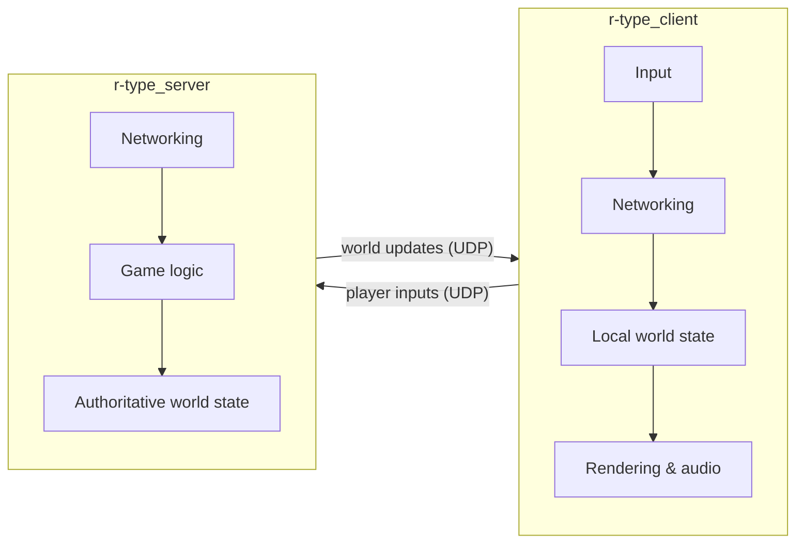

# Architecture

!!! warning "Draft"

    This page describes the **target** architecture. It is updated as each subsystem is implemented.

R-Type follows a client/server model with an **authoritative server**: clients only send player inputs and
render what the server tells them; every gameplay decision (spawns, collisions, deaths) is taken by the
server.

## Overview



*Clients send their inputs to the server over UDP; the server simulates the game and sends world updates
back to every client.*

## Layers

The engine is split into decoupled subsystems, shared by the client and the server where it makes sense.

| Layer | Responsibility | Used by |
|---|---|---|
| **Core** | Entities, components, systems, timing, logging | Client, server |
| **Networking** | Sockets, binary serialization, the [protocol](../protocol/index.md) | Client, server |
| **Game logic** | Players, Bydos, missiles, waves, collisions | Server |
| **Rendering** | Sprites, star-field, UI, built on raylib | Client |
| **Audio** | Music and sound effects | Client |
| **Input** | Keyboard / gamepad mapping to player actions | Client |

## Repository layout

```
client/     graphical client (r-type_client)
server/     game server (r-type_server)
tests/      unit and smoke tests (Catch2)
cmake/      CMake helpers (CPM bootstrap)
docs/       this documentation (Zensical)
doxygen/    API reference configuration
scripts/    developer and CI scripts
```
