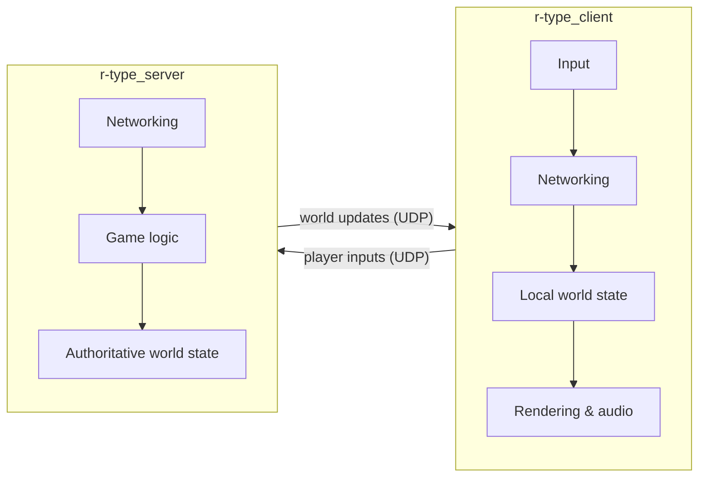

# Architecture

!!! warning "Draft"

    This page describes the **target** architecture. It is updated as each subsystem is implemented.

R-Type follows a client/server model with an **authoritative server**: clients only send player inputs and
render what the server tells them; every gameplay decision (spawns, collisions, deaths) is taken by the
server.

## Overview



*Clients send their inputs to the server over UDP; the server simulates the game and sends world updates
back to every client.*

## Layers

The engine is split into decoupled subsystems, shared by the client and the server where it makes sense.

| Layer | Responsibility | Used by |
|---|---|---|
| **Core** | Entities, components, systems (`libs/ecs`), timing, logging | Client, server |
| **Networking** | Sockets, binary serialization, the [protocol](../protocol/index.md) | Client, server |
| **Game logic** | Players, Bydos, missiles, waves, collisions | Server |
| **Rendering** | Sprites, star-field, UI, built on raylib | Client |
| **Audio** | Music and sound effects | Client |
| **Input** | Keyboard / gamepad mapping to player actions | Client |

## Rendering

The render library (`libs/render`, namespace `rtype::render`) wraps raylib: its public headers contain no
raylib type, so the rest of the client never depends on raylib directly.

| Class | Role |
|---|---|
| `Window` | Opens the window and closes it when destroyed. Only one can exist. |
| `ResourceManager` | Loads textures and fonts once, and hands out handles (`TextureId`, `FontId`) to refer to them. |
| `Renderer` | Draws textures, text and shapes between `beginFrame()` and `endFrame()`. |

The three objects depend on each other: they are created in this order and destroyed in the reverse one,
which C++ does automatically when they are declared in this order.

```cpp
const Window window;
ResourceManager resources(window, applicationDirectory() / "assets");
Renderer renderer(window, resources);
```

The game is drawn at a fixed **logical resolution** (1920x1080 by default), whatever the size of the window:
all positions and sizes are in game units, so the server and the client agree on coordinates. At the end of
each frame, the image is scaled to fit the window while keeping its aspect ratio, with black bars on the
sides if needed.

## Repository layout

```
apps/       executables, one subdirectory per program
  client/   graphical client (r-type_client)
    assets/ sprites, fonts and sounds, copied next to the executable
  server/   game server (r-type_server)
libs/       libraries shared by the programs, one subdirectory per library
tests/      unit and smoke tests (Catch2)
cmake/      CMake helpers (CPM bootstrap)
docs/       this documentation (Zensical)
doxygen/    API reference configuration
scripts/    developer and CI scripts
```

Each library keeps its public headers apart from its implementation, so that the libraries it depends on
(raylib, for instance) stay out of its interface:

```
libs/<name>/
  CMakeLists.txt
  include/rtype/<name>/   public headers, included as <rtype/<name>/Header.hpp>
  src/                    implementation
```

The client's assets live in `apps/client/assets/`. The build copies them next to the executable
(`build/bin/assets/`) and the client package ships them in the same place, so the client loads them from
`rtype::render::applicationDirectory() / "assets"` and finds them wherever it is started from. Paths given
to the `ResourceManager` are relative to this directory, for instance `"sprites/player.png"`.
