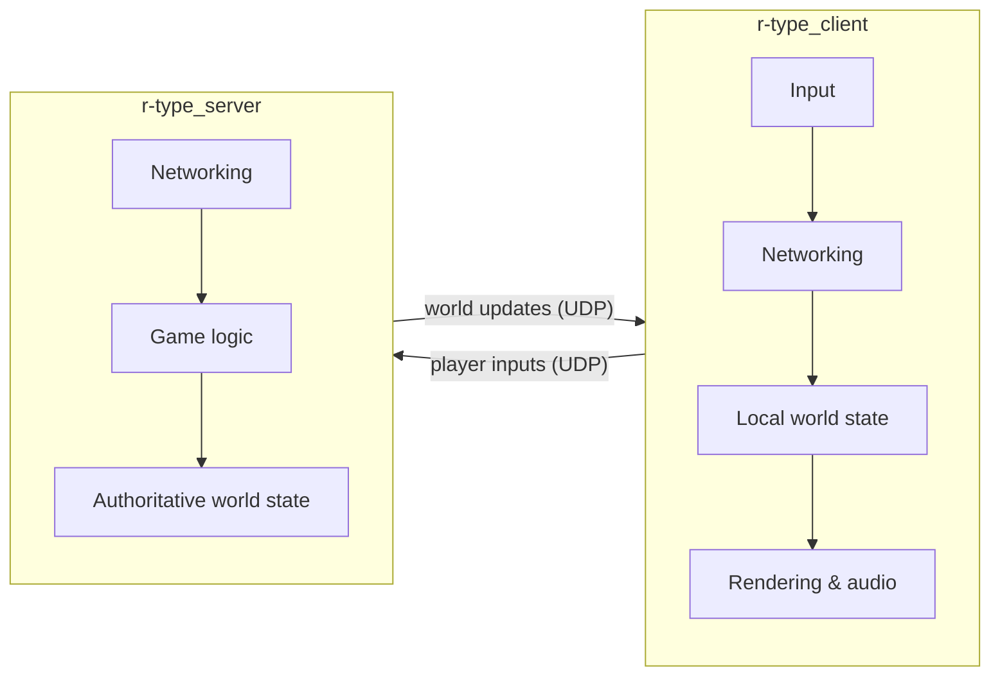
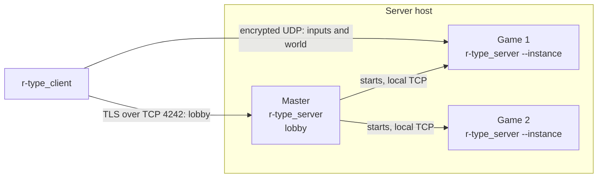
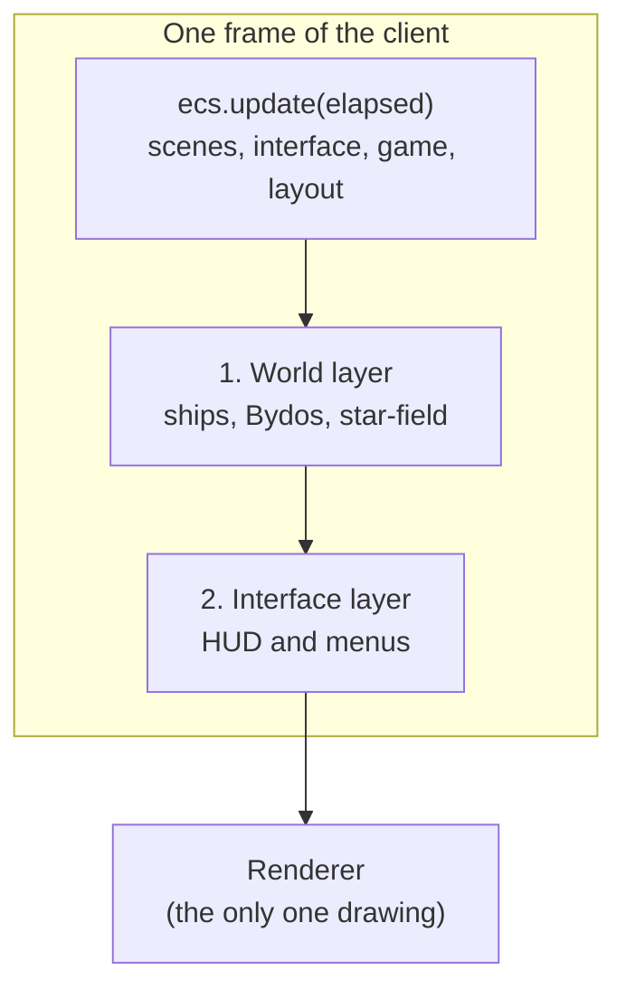

# Architecture

!!! warning "Draft"

    This page describes the **target** architecture. It is updated as each subsystem is implemented.

R-Type follows a client/server model with an **authoritative server**: clients only send player inputs and
render what the server tells them; every gameplay decision (spawns, collisions, deaths) is taken by the
server.

## Overview



*Clients send their inputs to the server over UDP; the server simulates the game and sends world updates
back to every client.*

### Server processes

The server hosts several games at once. The `r-type_server` you start is the **master**: it runs the lobby
and starts **one process per game** ([ADR 0013](../decisions/0013-one-process-per-game.md)). The client talks
to the master over TCP until it joins a game, then to the game over UDP
([ADR 0012](../decisions/0012-tcp-lobby-udp-game.md)). Both are encrypted
([ADR 0014](../decisions/0014-encryption.md)).



*The client joins a game through the master, then exchanges the game traffic directly with that game's
process.*

New to networking? Start with [Networking concepts](networking-concepts.md).

## Layers

The engine is split into decoupled subsystems, shared by the client and the server where it makes sense.

| Layer | Responsibility | Used by |
|---|---|---|
| **Core** | Entities, components, systems (`libs/ecs`), physics (`libs/physics`), logging (`libs/log`), timing | Client, server |
| **Networking** | Sockets (Asio), binary serialization, reliability over UDP, encryption, the [protocol](../protocol/index.md) | Client, server |
| **Game logic** | Players, Bydos, missiles, waves, collisions (`libs/game`, [ADR 0015](../decisions/0015-one-game-scene-local-or-remote-session.md)) | Server, client offline |
| **Rendering** | Window, textures, drawing, built on raylib | Client |
| **Interface** | Menus, options and HUD, made of entities like the world (`libs/engine`) | Client |
| **Audio** | Music and sound effects, built on raylib (`libs/audio`) | Client |
| **Input** | Keyboard / gamepad mapping to player actions | Client |

## World and interface

Everything the client draws is an entity of the ECS, as decided in
[ADR 0007](../decisions/0007-client-in-the-ecs.md): the world (ships, Bydos, missiles, star-field), the HUD and
the menus. Each drawn entity belongs to a **layer**, and the layers are drawn one after the other:



*Each frame updates the ECS, then draws the world layer and the interface layer on top of it.*

- Only the `Renderer` draws: the systems never call raylib.
- The interface layer is always drawn after the world. In VR, the world layer is drawn on the board and the
  interface layer on a floating panel.
- Phases of the game (home screen, game, pause menu) are **scenes**: groups of entities opened and closed
  together. See [Scenes and interface](scenes-and-interface.md).

## Libraries

The programs are built on ten libraries:

| Library | Role | Page |
|---|---|---|
| `libs/render` | Window, textures and fonts, drawing at a fixed logical resolution. Wraps raylib. | [Rendering](rendering.md) |
| `libs/input` | Keyboard and gamepads turned into game actions, with rebindable controls. Wraps raylib. | [Input](input.md) |
| `libs/ecs` | Entities, components and systems, with a hierarchy. Shared with the server, so it never depends on raylib. | [Scenes and interface](scenes-and-interface.md) |
| `libs/log` | Messages with a level and a subsystem name, coloured in a terminal. Shared with the server. | [Logging](logging.md) |
| `libs/network` | Addresses, UDP and TCP sockets, the event loop that runs them, TCP framing, TLS and the binary serialization. Wraps Asio and Mbed TLS. Shared with the server. | [Networking](networking.md) |
| `libs/physics` | Movement and collisions as components and systems on the ECS. Knows no game: each game names its collision layers and reacts to the collisions. Shared with the server. | — |
| `libs/engine` | Client systems on the ECS: scenes, drawing, animations, menus as entities, navigation. | [Scenes and interface](scenes-and-interface.md) |
| `libs/audio` | Sound effects and streamed music, with separate volumes. Wraps raylib. | [Audio](audio.md) |
| `libs/core` | Building blocks shared by the other libraries: resource handles and caches. Header-only, no dependency. | — |
| `libs/shaders` | GLSL shaders (colour filters, lighting of the 3D models), one file per stage in `glsl/`, embedded at build time as C++ strings and compiled by `render`. Header-only, no dependency. | [Rendering](rendering.md) |

Their public headers contain no raylib type: raylib is a private dependency of `render`, `input` and `audio`,
and the client code only uses our own classes. The server only links the libraries that do not depend on
raylib: the ECS, the physics, the log, the core and the network libraries. Likewise, Asio and Mbed TLS are
private dependencies of `network`.

## Repository layout

```
apps/       executables, one subdirectory per program
  client/   graphical client (r-type_client)
    assets/ sprites, fonts and sounds, copied next to the executable
  server/   game server (r-type_server)
  keygen/   generates the keys of the server (r-type_keygen)
libs/       libraries shared by the programs, one subdirectory per library
  audio/    sound effects and music (client)
  core/     handles and resource caches (all)
  ecs/      entity component system, scenes, hierarchy (client and server)
  engine/   client systems: drawing, animations, menus (client)
  input/    keyboard and gamepad input (client)
  log/      logging (client and server)
  network/  addresses, sockets and event loop (client and server)
  render/   window, resources and drawing (client)
  shaders/  GLSL shaders, embedded in the binaries at build time (client)
tests/      unit and smoke tests (Catch2)
cmake/      CMake helpers (CPM bootstrap)
docs/       this documentation (Zensical)
doxygen/    API reference configuration
scripts/    developer and CI scripts
```

Each library keeps its public headers apart from its implementation, so that the libraries it depends on
(raylib, for instance) stay out of its interface:

```
libs/<name>/
  CMakeLists.txt
  include/rtype/<name>/   public headers, included as <rtype/<name>/Header.hpp>
  src/                    implementation
```

The client's assets live in `apps/client/assets/`. The build copies them next to the executable
(`build/bin/assets/`) and the client package ships them in the same place, so the client loads them from
`rtype::render::applicationDirectory() / "assets"` and finds them wherever it is started from. Paths given
to the `ResourceManager` are relative to this directory, for instance `"sprites/player.png"`.
