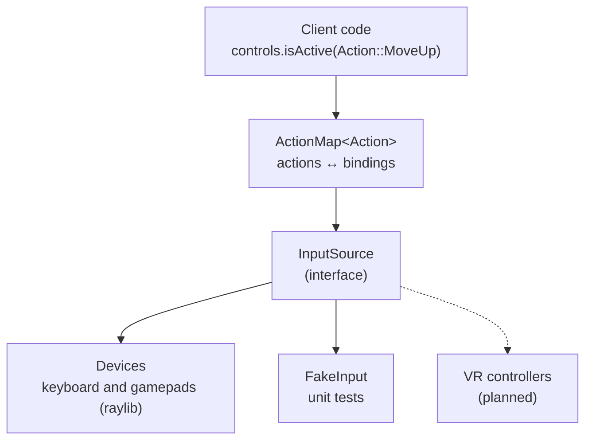
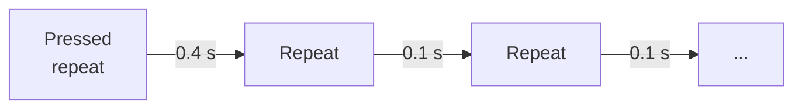

# Input

The input library (`libs/input`, namespace `rtype::input`) turns the keyboard and gamepads into **game
actions**. The game never asks whether a key is held, only whether an action is active:

```cpp
if (controls.wasPressed(Action::Shoot)) { ... }
```

This keeps raylib out of the game code, lets players change their controls, makes the input logic testable
without a keyboard, and gives the client exactly what it sends to the server: what the player wants to do,
not which key they pressed.

## Layers



*The client reads actions from an `ActionMap`, which queries an `InputSource`; the real devices, the tests
and future VR controllers are interchangeable sources.*

| Class / header | Role |
|---|---|
| `Keys.hpp` | The `Key`, `GamepadButton` and `GamepadAxis` enums. |
| `InputSource` | Interface answering "is this key or button held, where is this stick?". |
| `Devices` | The `InputSource` reading the real keyboard and gamepads. The only file that uses raylib. |
| `Binding` | One physical input: a key, a gamepad button, or one direction of a stick or trigger. |
| `ActionMap<Action>` | Binds each action to its inputs, and updates the actions once per frame. |
| `TextInput` | The text of an input field, edited with the typed characters and Backspace. |

The library does not know the actions of R-Type: the client defines them, in
`apps/client/src/Controls.hpp`, and `ActionMap` is a template over their type.

## Keys and buttons

**Keys are physical positions**, named after a US (QWERTY) keyboard. `Key::W` is the key left of `E`,
labelled `Z` on a French (AZERTY) keyboard: controls defined as WASD are ZQSD on AZERTY without any
change.

**Gamepad buttons are named after their position**, so that they mean the same on every brand:

| `GamepadButton` | Xbox | PlayStation |
|---|---|---|
| `FaceDown` | A | Cross |
| `FaceRight` | B | Circle |
| `FaceLeft` | X | Square |
| `FaceUp` | Y | Triangle |
| `LeftBumper` / `RightBumper` | LB / RB | L1 / R1 |
| `LeftTrigger` / `RightTrigger` | LT / RT | L2 / R2 |
| `Select` / `Start` | View / Menu | Share / Options |

**Axes** go from -1 to 1 for the sticks (left and up are negative, like screen coordinates) and from 0 to 1
for the triggers. A disconnected gamepad reads as released.

## Bindings

A `Binding` is created with one of four functions:

```cpp
Binding::key(Key::Space)
Binding::gamepadButton(GamepadButton::FaceDown)                     // first gamepad by default
Binding::gamepadAxis(GamepadAxis::LeftY, AxisDirection::Negative)   // left stick pushed up
Binding::mouseButton(MouseButton::Left)
```

An axis binding only uses **one half** of the axis: the left stick pushed up triggers `MoveUp`, pushed down
triggers `MoveDown`. Each binding gives a **strength** between 0 and 1:

- a key, a gamepad button or a mouse button gives 0 or 1;
- an axis gives 0 inside the **dead zone**, then grows progressively up to 1.

The dead zone (25% of the range by default, see `ActionMap::setDeadZone()`) ignores sticks that do not come
back exactly to the centre. Outside of it, the remaining range is scaled back to 0..1, so that the movement
starts smoothly instead of jumping when the stick leaves the dead zone:

| Stick position | Strength |
|---|---|
| 0.2 | 0 (inside the dead zone) |
| 0.625 | 0.5 |
| 1 | 1 |

## Actions

### Binding actions

Each action can have any number of bindings; adding the same one twice has no effect.

```cpp
enum class Action { MoveUp, Shoot };

ActionMap<Action> controls;
controls.bind(Action::Shoot, Binding::key(Key::Space));
controls.bind(Action::Shoot, Binding::gamepadButton(GamepadButton::FaceDown));
```

`unbind()`, `clear()` and `bindings()` change and list the bindings at any time, which is what an options
menu needs to let players choose their own controls.

### Reading actions

`update()` reads the input source and updates every action. It is called **once per frame**, before
reading the actions, which keep the state read there until the next update: all the code of a frame sees the
same state. It also takes the time elapsed since the previous frame, used to repeat held actions and to
measure how long they are held.

```cpp
controls.update(devices, window.frameTime());

const float up = controls.strength(Action::MoveUp);   // 0..1, for analog movement
if (controls.wasPressed(Action::Shoot)) { fire(); }
```

| Function | True when | Typical use |
|---|---|---|
| `isActive(action)` | The action is held. | Moving, continuous fire. |
| `wasPressed(action)` | The action started at the last update (one frame only). | Firing once per press, validating a menu. |
| `wasReleased(action)` | The action stopped at the last update (one frame only). | Charged shot released. |
| `wasRepeated(action)` | The action was pressed, or is held and repeats (see below). | Moving in a menu, auto-fire. |
| `strength(action)` | Returns 0..1: the strongest of its bindings. | Analog movement. |
| `heldDuration(action)` | Returns how long the action has been held, in seconds. | Charged shot. |

The strength of an action is the **maximum** of its bindings, not their sum: holding the up arrow and the
stick at the same time does not move faster.

### Repeating and holding

Holding ++arrow-down++ in a menu should move the selection once, then keep moving it after a short delay,
like in a text editor. `wasRepeated()` gives this behaviour: it is true when the action is pressed, then
again after a delay, then at regular intervals while it is held.



*A held action repeats when pressed, after 0.4 s, then every 0.1 s.*

The delay and the interval are set with `setRepeat(delay, interval)`, 0.4 s and 0.1 s by default. Repeating
needs the elapsed time given to `update()`: without it, an action is only repeated when it is pressed.

`heldDuration()` gives how long an action has been held. On the update where the action is released, it still
gives how long it was held, so that a shot charged while holding the button can be fired on release:

```cpp
if (controls.wasReleased(Action::Shoot)) {
    const float charge = std::min(controls.heldDuration(Action::Shoot) / 2.0f, 1.0f);   // full after 2 s
    fire(charge);
}
```

## Controls of R-Type

`apps/client/src/Controls.cpp` defines the default controls:

| Action | Keyboard | Gamepad (first one) |
|---|---|---|
| `MoveUp` | ++arrow-up++ or ++w++ (++z++ on AZERTY) | D-pad up, left stick up |
| `MoveDown` | ++arrow-down++ or ++s++ | D-pad down, left stick down |
| `MoveLeft` | ++arrow-left++ or ++a++ (++q++ on AZERTY) | D-pad left, left stick left |
| `MoveRight` | ++arrow-right++ or ++d++ | D-pad right, left stick right |
| `Shoot` | ++space++ | Bottom face button, right trigger |
| `Menu` | ++escape++ | Start |
| `ToggleFullscreen` | ++f11++ | — |

### Menu controls

Menus have their own actions, separate from the game ones: `engine::Navigation`, with their own `ActionMap`
(see [Navigation](scenes-and-interface.md#navigation)). The same key can then mean something
else in a menu: ++escape++ opens the pause menu in game, and goes back in a menu. The interface reads the input
before the game, and the game only reads its actions while its scene receives the input (see
[Scenes](scenes-and-interface.md#scenes)).

When moving, the client normalises the direction: pushing up and right at the same time must not move faster
than pushing in one direction.

```cpp
Vector2 direction{controls.strength(Action::MoveRight) - controls.strength(Action::MoveLeft),
                  controls.strength(Action::MoveDown) - controls.strength(Action::MoveUp)};
const float length = std::hypot(direction.x, direction.y);
if (length > 1.0f) {
    direction = {direction.x / length, direction.y / length};
}
```

To add an action, follow [Add a player action](../guides/add-a-player-action.md).

## Mouse

The `InputSource` gives the state of the mouse:

| Function | Gives |
|---|---|
| `mousePosition()` | Position of the pointer in the window, in **pixels**. |
| `isMouseButtonDown(button)` | Whether a button (`Left`, `Right`, `Middle`, `Back`, `Forward`) is held. |
| `mouseWheel()` | How much the wheel turned since the previous frame, in notches: positive up, negative down. |

Mouse buttons are usually read through actions, with `Binding::mouseButton()`, to get presses, releases and
repeats like any other input.

### Window pixels and game units

The game is scaled to fit the window and may have black bars around it: a position in window pixels is not a
position in the game. The `Renderer` converts it, since it knows both sizes:

```cpp
const MousePosition mouse = devices.mousePosition();
const Vector2 pointer = renderer.windowToGame({mouse.x, mouse.y});   // in game units, like everything drawn
```

A pointer in the black bars is outside of the game: its coordinates are negative or larger than the game
size. The conversion is the reverse of the scaling done at the end of each frame (`letterbox()`), and is unit
tested (`windowToGame()` in `Viewport.hpp`).

!!! note "Two vector types"

    The input library returns a `MousePosition`, not a `rtype::render::Vector2`: it does not depend on the
    render library. A small shared math library (`Vector2`, `Rectangle`) used by the ECS, the input and the
    render libraries would remove this conversion.

### Mouse in menus

In menus, the widget under the pointer gets the focus when the mouse moves, and a click activates it. See
[Navigation](scenes-and-interface.md#navigation).

## Text entry

A text field, such as a server address or a player name, reads **characters**, not keys. Characters follow
the keyboard layout and its modifiers: ++shift+a++ gives "A", and the accent keys of a French keyboard give
"é". The `InputSource` gives the characters typed since the previous frame with `takeTypedText()`, and a
`TextInput` turns them into the text of a field:

```cpp
TextInput address;
address.setMaxLength(21);
address.setFilter([](char32_t c) { return (c >= U'0' && c <= U'9') || c == U'.' || c == U':'; });

// Once per frame, while the field has the focus
address.update(devices, window.frameTime());
renderer.drawText(font, address.text(), position, 48.0f, colors::White);
```

- `setMaxLength()` limits the number of characters; `setFilter()` decides which characters are accepted, for
  instance only digits and dots for an address. Control characters (tabulation, line feed...) are always
  refused. Both also apply to pasted text.
- The text is stored in **UTF-8**, ready to be drawn. `length()` counts characters, which can be less than
  the size in bytes: "é" takes two bytes.
- `wasChanged()` tells whether the text changed at the last update, for instance to validate it while it is
  typed.

### Editing

A `TextInput` behaves like the text fields of common applications:

| Keys | Effect |
|---|---|
| Typing | Inserts at the cursor, replacing the selection if there is one. |
| ++arrow-left++ / ++arrow-right++ | Moves the cursor by one character. With a selection, goes to its start or its end. |
| ++ctrl+arrow-left++ / ++ctrl+arrow-right++ | Moves the cursor by one word. |
| ++home++ / ++end++ | Moves the cursor to the start or the end of the text. |
| ++shift++ + any of the moves above | Selects the text between the cursor and where it started. |
| ++backspace++ / ++del++ | Erases the selection, or the character before or after the cursor. |
| ++ctrl+backspace++ / ++ctrl+del++ | Erases the word before or after the cursor. |
| ++ctrl+a++ | Selects the whole text. |
| ++ctrl+c++ / ++ctrl+x++ / ++ctrl+v++ | Copies or cuts the selection, pastes the clipboard. |

Moving the cursor and erasing [repeat](#repeating-and-holding) while the keys are held. The clipboard is the
system one: text copied from a browser can be pasted in the game, and the other way around.

!!! note "Control+A on AZERTY keyboards"

    Keys are physical positions, and the A key of an AZERTY keyboard is where QWERTY keyboards have Q. Select
    all is bound to both positions, so ++ctrl+a++ works on both keyboards; as a side effect, ++ctrl+q++ also
    selects everything on a QWERTY keyboard. C, X and V are at the same place on QWERTY, AZERTY and QWERTZ
    keyboards.

The cursor and the selection are given as **byte offsets** in `text()`. To draw them, measure the text
before them:

```cpp
const auto offsetOf = [&](std::size_t byte) {
    return position.x + renderer.measureText(font, field.text().substr(0, byte), size).x;
};

if (!field.selection().empty()) {   // selection, behind the text
    const float begin = offsetOf(field.selection().begin);
    renderer.drawRectangle({begin, position.y, offsetOf(field.selection().end) - begin, height}, selectionColor);
}
renderer.drawText(font, field.text(), position, size, colors::White);
const float cursorX = offsetOf(field.cursor());   // cursor, on top of the text
renderer.drawLine({cursorX, position.y}, {cursorX, position.y + height}, 3.0f, colors::White);
```

### Reading characters once per frame

!!! warning "Once per frame, while the field has the focus"

    Typed characters are consumed when they are read: a second call to `takeTypedText()` in the same frame
    returns nothing. Only the field that has the focus calls `update()`; characters typed while no field has
    the focus are lost, not delayed.

The fonts loaded by the `ResourceManager` include the accented Latin letters, so that typed names are drawn
correctly (see [Fonts](rendering.md#fonts)).

### Why not an existing library

Libraries such as [Dear ImGui](https://github.com/ocornut/imgui) or [RmlUi](https://github.com/mikke89/RmlUi)
provide complete text fields. They also read the input and draw the interface themselves, outside of our
`Renderer` and `ActionMap`, which would mean adapters for the rendering, the gamepad navigation and the VR
panel, and would bypass the ECS in which the interface is built
([ADR 0007](../decisions/0007-client-in-the-ecs.md)). For the few text fields of the game (player
name, server address), a small class built on our input is simpler. Dear ImGui remains a good candidate for
development tools, such as an in-game console or an entity inspector, which do not need to look like the game.

## Testing

`tests/action_map.cpp` and `tests/text_input.cpp` test the `ActionMap` and the `TextInput` with a
`FakeInput` (`tests/FakeInput.hpp`), an `InputSource` whose keys, buttons, axes, mouse, typed text and
clipboard are set by the test. No window nor device is needed, so the tests run in the CI:

```cpp
FakeInput input;
input.keys = {Key::Space};
actions.update(input);
REQUIRE(actions.wasPressed(Action::Shoot));
```

## Adding an input source

Any class implementing `InputSource` works with `ActionMap`, without changing the game. This is how VR
controllers are planned to be supported: a new source, and if needed new kinds of bindings for their
buttons and gestures.

## Limits and next steps

- **The pause menu does not pause the game**, which is shared with the other players.
- **Text fields are single-line**, without undo, mouse selection, nor scrolling: a text wider than its field
  overflows it. This is enough for a player name or a server address.
- **Bindings are not saved**: the controls chosen by a player are lost when the game closes.
- **No mouse in text fields**: clicking does not place the cursor, dragging does not select.
- **The actions are not sent to the server yet**: they will be encoded in the `INPUT` message of the
  [protocol](../protocol/index.md), one bit per action.
