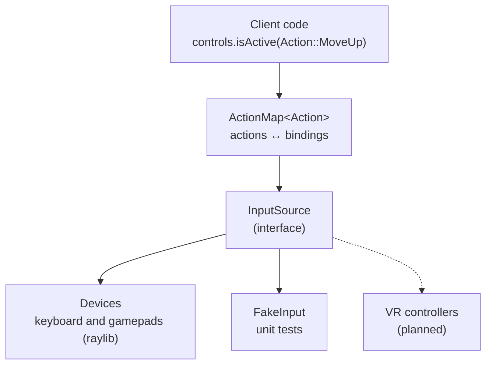

# Input

The input library (`libs/input`, namespace `rtype::input`) turns the keyboard and gamepads into **game
actions**. The game never asks whether a key is held, only whether an action is active:

```cpp
if (controls.wasPressed(Action::Shoot)) { ... }
```

This keeps raylib out of the game code, lets players change their controls, makes the input logic testable
without a keyboard, and gives the client exactly what it sends to the server: what the player wants to do,
not which key they pressed.

## Layers



*The client reads actions from an `ActionMap`, which queries an `InputSource`; the real devices, the tests
and future VR controllers are interchangeable sources.*

| Class / header | Role |
|---|---|
| `Keys.hpp` | The `Key`, `GamepadButton` and `GamepadAxis` enums. |
| `InputSource` | Interface answering "is this key or button held, where is this stick?". |
| `Devices` | The `InputSource` reading the real keyboard and gamepads. The only file that uses raylib. |
| `Binding` | One physical input: a key, a gamepad button, or one direction of a stick or trigger. |
| `ActionMap<Action>` | Binds each action to its inputs, and updates the actions once per frame. |

The library does not know the actions of R-Type: the client defines them, in
`apps/client/src/Controls.hpp`, and `ActionMap` is a template over their type.

## Keys and buttons

**Keys are physical positions**, named after a US (QWERTY) keyboard. `Key::W` is the key left of `E`,
labelled `Z` on a French (AZERTY) keyboard: controls defined as WASD are ZQSD on AZERTY without any
change.

**Gamepad buttons are named after their position**, so that they mean the same on every brand:

| `GamepadButton` | Xbox | PlayStation |
|---|---|---|
| `FaceDown` | A | Cross |
| `FaceRight` | B | Circle |
| `FaceLeft` | X | Square |
| `FaceUp` | Y | Triangle |
| `LeftBumper` / `RightBumper` | LB / RB | L1 / R1 |
| `LeftTrigger` / `RightTrigger` | LT / RT | L2 / R2 |
| `Select` / `Start` | View / Menu | Share / Options |

**Axes** go from -1 to 1 for the sticks (left and up are negative, like screen coordinates) and from 0 to 1
for the triggers. A disconnected gamepad reads as released.

## Bindings

A `Binding` is created with one of three functions:

```cpp
Binding::key(Key::Space)
Binding::gamepadButton(GamepadButton::FaceDown)                     // first gamepad by default
Binding::gamepadAxis(GamepadAxis::LeftY, AxisDirection::Negative)   // left stick pushed up
```

An axis binding only uses **one half** of the axis: the left stick pushed up triggers `MoveUp`, pushed down
triggers `MoveDown`. Each binding gives a **strength** between 0 and 1:

- a key or a button gives 0 or 1;
- an axis gives 0 inside the **dead zone**, then grows progressively up to 1.

The dead zone (25% of the range by default, see `ActionMap::setDeadZone()`) ignores sticks that do not come
back exactly to the centre. Outside of it, the remaining range is scaled back to 0..1, so that the movement
starts smoothly instead of jumping when the stick leaves the dead zone:

| Stick position | Strength |
|---|---|
| 0.2 | 0 (inside the dead zone) |
| 0.625 | 0.5 |
| 1 | 1 |

## Actions

### Binding actions

Each action can have any number of bindings; adding the same one twice has no effect.

```cpp
enum class Action { MoveUp, Shoot };

ActionMap<Action> controls;
controls.bind(Action::Shoot, Binding::key(Key::Space));
controls.bind(Action::Shoot, Binding::gamepadButton(GamepadButton::FaceDown));
```

`unbind()`, `clear()` and `bindings()` change and list the bindings at any time, which is what an options
menu needs to let players choose their own controls.

### Reading actions

`update()` reads the input source and updates every action. It is called **once per frame**, before
reading the actions, which keep the state read there until the next update: all the code of a frame sees the
same state.

```cpp
controls.update(devices);

const float up = controls.strength(Action::MoveUp);   // 0..1, for analog movement
if (controls.wasPressed(Action::Shoot)) { fire(); }
```

| Function | True when | Typical use |
|---|---|---|
| `isActive(action)` | The action is held. | Moving, continuous fire. |
| `wasPressed(action)` | The action started at the last update (one frame only). | Firing once per press, validating a menu. |
| `wasReleased(action)` | The action stopped at the last update (one frame only). | Charged shot released. |
| `strength(action)` | Returns 0..1: the strongest of its bindings. | Analog movement. |

The strength of an action is the **maximum** of its bindings, not their sum: holding the up arrow and the
stick at the same time does not move faster.

## Controls of R-Type

`apps/client/src/Controls.cpp` defines the default controls:

| Action | Keyboard | Gamepad (first one) |
|---|---|---|
| `MoveUp` | ++arrow-up++ or ++w++ (++z++ on AZERTY) | D-pad up, left stick up |
| `MoveDown` | ++arrow-down++ or ++s++ | D-pad down, left stick down |
| `MoveLeft` | ++arrow-left++ or ++a++ (++q++ on AZERTY) | D-pad left, left stick left |
| `MoveRight` | ++arrow-right++ or ++d++ | D-pad right, left stick right |
| `Shoot` | ++space++ | Bottom face button, right trigger |

When moving, the client normalises the direction: pushing up and right at the same time must not move faster
than pushing in one direction.

```cpp
Vector2 direction{controls.strength(Action::MoveRight) - controls.strength(Action::MoveLeft),
                  controls.strength(Action::MoveDown) - controls.strength(Action::MoveUp)};
const float length = std::hypot(direction.x, direction.y);
if (length > 1.0f) {
    direction = {direction.x / length, direction.y / length};
}
```

To add an action, follow [Add a player action](../guides/add-a-player-action.md).

## Testing

`tests/action_map.cpp` tests the `ActionMap` with a `FakeInput`, an `InputSource` whose keys, buttons and
axes are set by the test. No window nor device is needed, so the tests run in the CI:

```cpp
FakeInput input;
input.keys = {Key::Space};
actions.update(input);
REQUIRE(actions.wasPressed(Action::Shoot));
```

## Adding an input source

Any class implementing `InputSource` works with `ActionMap`, without changing the game. This is how VR
controllers are planned to be supported: a new source, and if needed new kinds of bindings for their
buttons and gestures.

## Limits and next steps

- **Escape closes the window**: this is raylib's default behaviour, to be replaced by a pause menu.
- **Bindings are not saved**: the controls chosen by a player are lost when the game closes.
- **No mouse support** yet for the menus.
- **The actions are not sent to the server yet**: they will be encoded in the `INPUT` message of the
  [protocol](../protocol/index.md), one bit per action.
