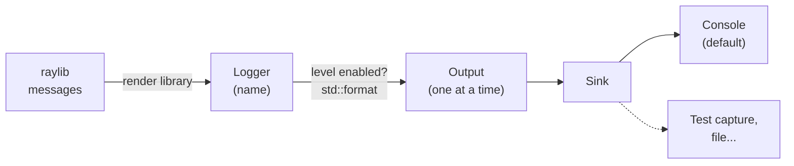

# Logging

The log library (`libs/log`, namespace `rtype::log`) writes the messages of the client and the server. It is
shared by both programs and, like the ECS, does not depend on raylib.

```
19:23:00.315 INFO  server   Server started on port 4242
19:23:00.315 DEBUG network  Packet INPUT #1532 from client 2
19:23:00.315 INFO  network  Client 2 connected from 127.0.0.1:51034
19:23:00.315 WARN  network  Client 3 has not answered for 2.5 s
19:23:00.315 ERROR network  Client 3 crashed: connection lost
                            Notifying the 2 other players
```

Each line shows the local time to the millisecond, the level, the name of the subsystem that sent the message,
and the message. In a terminal, levels are coloured, warnings and errors stand out, and each subsystem keeps
the same colour from one run to the next.

## Writing messages

Each subsystem creates a `Logger` with its name, and writes messages with the
[`std::format`](https://en.cppreference.com/w/cpp/utility/format/format) syntax:

```cpp
#include "rtype/log/Logger.hpp"

const rtype::log::Logger logger("network");

logger.info("Client {} connected from {}:{}", id, address, port);
logger.warning("Packet of {} bytes is too short, ignored", size);
```

The format string is checked at compile time: a missing or extra argument is a compilation error, not a
crash. A logger only holds its name, so it is cheap to create; loggers can be used from several threads at
the same time.

!!! tip "Do not use `std::cout`"

    Write messages with a logger rather than `std::cout` or `std::cerr`: they get a time, a level and a
    name, they can be filtered, and they do not get mixed up when several threads write at the same time.

### Levels

| Level | Use it for | Shown by default |
|---|---|---|
| `trace` | Very detailed tracing, for instance every packet received. | No |
| `debug` | Information useful when debugging. | No |
| `info` | Normal events: a client connected, a wave started. | Yes |
| `warning` | Something unexpected that the program recovers from. | Yes |
| `error` | A failure: an operation could not be done. | Yes |

Messages below the current level are ignored **before** being formatted: disabled `trace` messages in a
loop cost almost nothing. When computing a value only to log it is expensive, check
`logger.isEnabled(Level::Debug)` first.

### Naming loggers

Use short lower-case names for subsystems: `client`, `server`, `network`, `game`, `render`. The name column
is 8 characters wide; longer names still work but shift their message to the right.

## Settings

| Setting | How |
|---|---|
| Minimum level | Environment variable `RTYPE_LOG_LEVEL` (`trace`, `debug`, `info`, `warning`, `error`), or `rtype::log::setLevel()`. `info` by default. |
| Colours | On when the error output is a terminal, off when it is redirected to a file or when the [`NO_COLOR`](https://no-color.org) environment variable is set. `rtype::log::setColors()` forces them. |
| Destination | The error output by default. `rtype::log::setSink()` replaces it. |

Both programs call `rtype::log::configureFromEnvironment()` at startup, so the level can be changed without
recompiling:

=== "Linux"

    ```sh
    RTYPE_LOG_LEVEL=debug ./build/bin/r-type_server
    ```

=== "Windows (PowerShell)"

    ```powershell
    $env:RTYPE_LOG_LEVEL = "debug"; .\build\bin\r-type_server.exe
    ```

An unknown level is reported with a warning, and the default level is kept.

## raylib messages

raylib prints its own messages: about thirty lines when the window opens, one more for every texture loaded.
The render library redirects them to a logger named `raylib`, when the `Window` is created:

| raylib level | Our level |
|---|---|
| `TRACE` | `trace` |
| `DEBUG`, `INFO` | `debug` |
| `WARNING` | `warning` |
| `ERROR`, `FATAL` | `error` |

raylib's `INFO` messages are details for us: they are hidden by default, and shown with
`RTYPE_LOG_LEVEL=debug`. Its warnings, for instance a file that cannot be read, are always shown.

!!! note "Fatal errors"

    raylib stops the program after a `FATAL` message, except when its messages are redirected. On desktop,
    its only fatal message is a failure to open the window, which `Window` reports with an exception: the
    error then goes through the normal error handling of the program.

## How it works



*A logger checks the level and formats the message, then the message goes to the current sink, which writes
it to the console by default.*

- **Thread safety.** The level is atomic, and messages go through the sink one at a time, protected by a
  mutex: lines written by different threads never get mixed up.
- **Sinks.** A `Sink` receives each message as a `Record` (level, logger name, message, time). The console
  sink formats it with `formatRecord()` and writes it to the error output, which is not buffered: a message
  is visible even if the program crashes right after it.
- **Colours.** Terminal colour codes; on Windows, the console is switched to the mode that understands them.
  Logger colours are chosen from a hash of the name that gives the same result on every platform.

## Testing

`tests/log.cpp` replaces the sink with one that captures the messages, then checks their level, logger name
and formatted text. The tests also check `formatRecord()` directly: columns, colours only when asked, and
alignment of multi-line messages.

A sink can be used the same way to check that some code logs what it should:

```cpp
class CaptureSink : public rtype::log::Sink {
public:
    std::vector<std::string> messages;
    void write(const rtype::log::Record &record) override { messages.emplace_back(record.message); }
};

auto sink = std::make_shared<CaptureSink>();
rtype::log::setSink(sink);
// ... code under test ...
rtype::log::setSink(nullptr);   // back to the console
```

## Limits and next steps

- **No log file yet.** The server will probably need one; it is a new `Sink`, without changes elsewhere.
- **No thread name** in the lines. It may be worth adding once the server runs several threads.
