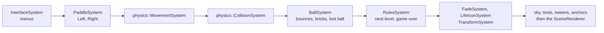

# Orbit Breaker

**Orbit Breaker** is a brick breaker made with the engine of R-Type alone, to show that the engine runs
another game than R-Type. It is its own program, `orbit_breaker`, in `apps/minigame/`. It uses the libraries of
`libs/` (ECS, physics, rendering, input, audio, scenes and interface, settings) and no code of the R-Type client
nor of its game.

```sh
./build/bin/orbit_breaker
```

## How to play

The player moves a paddle along the bottom of the arena with Left and Right (arrows, A/D, or the gamepad), and
launches the ball with Fire (Space, or the bottom face button). The ball bounces on the walls, the bricks and
the paddle, which aims it: hit by its middle, the ball leaves straight up, by its edges, slanted up to 60
degrees. A brick takes one to three hits, its colour showing how many are left; each hit makes the ball a
little faster. A hit scores 10 points, and each brick hit since the ball left the paddle is worth more: 20 for
the second, 30 for the third, up to 80 (the combo, shown under the score). A ball lost under the paddle costs a life, out of three. Once every brick is
broken, the next level starts, with more rows and stronger bricks. Escape pauses the game. The best score is
kept from one run to the next, in `orbit_breaker.txt` of the data directory of the player.

## Look and feel

- **A sky of space** behind every scene: four layers sliding at different speeds (a parallax) and a ringed
  planet passing slowly (`Backdrop`, `BackdropSprite`, `Scroll`).
- **The arena**: translucent walls with a line of light, bricks lit from the top (a gradient `Box`), a paddle
  and a ball in a halo (a `Sprite` attached to them as a child), and a trail of light behind the ball.
- **The hits**: a brick hit pops (a `Tween` of its `Scale`) and shows the points it gave, rising; a brick
  broken bursts into a growing ring of light and sparks of its colour. These effects fade out and are destroyed
  (`Fade`, `FadeSystem`).
- **The interface**: a menu whose title breathes, between two borders of bricks shimmering each at its own
  pace; a bar along the top with the score, the combo, the level and the lives as small paddles; "LEVEL 2" in
  a banner at each level; a blinking "press Space" while the ball waits; the pause and the end of a game over
  the dimmed arena, the end with the score, the level reached and the best score.

## What the engine does

| Part of the engine | Used for |
|---|---|
| ECS (`libs/ecs`) | Every wall, brick, paddle, ball and spark is an entity; the rules are systems; the halos are children of the ball and of the paddle |
| Physics (`libs/physics`) | `MovementSystem` moves the paddle and the ball; `CollisionSystem` keeps the paddle between the walls (`Static`), reports what the ball touches (a `trigger`), and sweeps the ball (`FastMoving`) so that it does not go through a brick between two frames. Collision layers keep the paddle out of the bricks |
| Rendering (`libs/render`) | The window, the boxes, the sprites, the sky and the texts, scaled to any window size |
| Scenes and interface (`libs/engine`) | The menu, the arena, the pause and the end of a game are scenes; their buttons, texts and HUD are built with `InterfaceBuilder`; Escape goes back |
| Input (`libs/input`, `Controls`) | The paddle and the launch read the virtual gamepad, so the keyboard and the gamepads work alike |
| Audio (`libs/audio`) | The sounds of the bounces, of the bricks and of a lost ball, and of the buttons |
| Settings (`engine::Settings`) | The best score |

## A frame



*Each frame, the menus read the input, the paddle moves, the physics moves everything and finds the contacts,
then the game reacts to them.*

- **The ball bounces by itself.** The physics stops a body against a wall by removing the speed that goes into
  it, which makes it slide. The ball is a trigger instead: the physics only reports its contacts, with their
  normal and their depth, and `BallSystem` mirrors its speed on them (`reflect()`), puts it back out of what it
  hit, and aims it on the paddle (`leavePaddle()`). A ball already going away from a surface is not mirrored
  again, so that two bricks hit at once do not send it back into them.
- **The arena only moves while it is played.** The physics systems are given `Scenes::updates()`: under the
  pause, which is a scene over the arena, nothing moves.

## Code

| File | Contents |
|---|---|
| `Breaker.hpp` | The sizes and speeds, the components (`Paddle`, `Ball`, `Brick`, `LifeIcon`), the collision layers, the `Match` |
| `Bounce.cpp`, `Levels.cpp` | The rules without the ECS: the bounces, the speed, the bricks of each level, the points of a combo |
| `Looks.hpp` | The pictures and the font of the effects and of the sky, loaded once by the program |
| `Visuals.cpp` | The building blocks of the look, shared by the arena, the effects, the bar and the menus: a drawn entity, the pop and the shimmer of an entity, a text of its own size, the colours of the paddle |
| `Arena.cpp` | The entities of the arena, and the sky |
| `Effects.cpp` | The sparks, the rings, the points, the banners and the trail, and the `FadeSystem` |
| `Hud.cpp` | The bar of the score, the combo, the level and the lives, and the `LifeIconSystem` |
| `PaddleSystem.cpp`, `BallSystem.cpp`, `RulesSystem.cpp` | The systems of the game |
| `Systems.cpp`, `Scenes.cpp`, `main.cpp` | The systems registered in order, the scenes, and the program |

The game is a library, `orbit_breaker_core`, linked by the program and by the tests. Its assets (three fonts,
five sounds, three effects and the five pictures of the sky) are taken from those of the client at each build and copied into `orbit_breaker_assets/`
next to the program; the release ships them in its own archive (the `minigame` component).

## Tests

The tests in `tests/orbit_breaker.cpp` (tag `[orbit]`) check the bounces, the speed and the levels, then play
whole games with the systems of the game on a fake keyboard, without a window: the ball waits on the paddle and
is launched, the walls stop the paddle, a ball kept in play breaks bricks and goes faster while its effects fade
and go, a ball missed costs a life and the last one ends the game once, and a player that aims at the bricks
clears the first level. The points of a combo are tested too.

```sh
./build/bin/rtype_tests "[orbit]"
```
