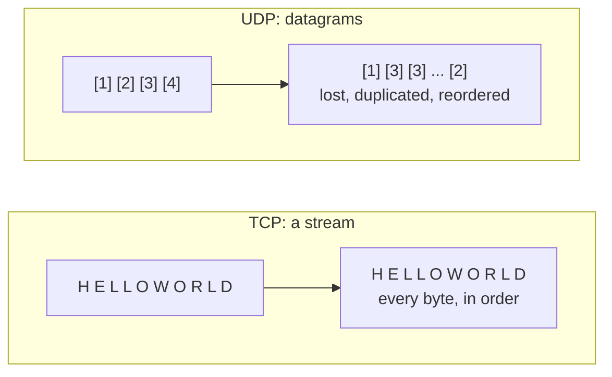

# Networking concepts

This page explains the words used in the networking documentation, the
[protocol specification](../protocol/index.md) and the decision records
[0011](../decisions/0011-networking-library.md) to [0014](../decisions/0014-encryption.md). Read it first if
you have not written networked games before: each term links the general idea to what R-Type does with it.

## Addresses and ports

IP address
:   Identifies a machine on a network: `203.0.113.7` (IPv4) or `2001:db8::7` (IPv6).

Port
:   A number from 1 to 65535 that identifies a program on a machine. An address and a port together
    (`203.0.113.7:4242`) identify one program. The R-Type master listens on TCP port 4242 by default, and each
    game on its own UDP port.

Socket
:   The object a program uses to send and receive on a port. `libs/network` wraps them in `UdpSocket`,
    `TcpListener` and `TcpConnection`.

Loopback
:   The address `127.0.0.1` (`localhost`): the machine itself. Traffic to it never leaves the machine. The
    master and its games talk over it.

## TCP and UDP

*TCP delivers a continuous flow of bytes, complete and in order. UDP delivers separate messages that may be
lost, duplicated or reordered.*

TCP
:   A **connection** between two programs that carries a **stream** of bytes. Every byte arrives, in order:
    the system resends what is lost. The cost: if one packet is lost, everything after it waits for it to be
    resent (*head-of-line blocking*). R-Type uses TCP for the lobby ([ADR 0012](../decisions/0012-tcp-lobby-udp-game.md)).

UDP
:   No connection: a program sends **datagrams**, independent messages, to an address and a port. Each one
    arrives whole or not at all, but it may be lost, arrive twice, or arrive after a later one. Nothing waits
    for anything. R-Type uses UDP for everything inside a game.

Datagram
:   One UDP message. One datagram carries one R-Type message.

Framing
:   How a receiver finds where each message ends in a TCP stream, which has no boundaries. FTP ends each
    command with `\r\n`; R-Type starts each message with its size, and the receiver reads exactly that many
    bytes.

MTU and fragmentation
:   The largest packet a network link carries, often 1500 bytes. A larger datagram is split into fragments,
    and if one fragment is lost, the whole datagram is lost. R-Type datagrams are at most 1200 bytes, which
    fits every common path on the Internet.

## Turning data into bytes

Serialization
:   Writing a message as bytes (encoding), and reading it back (decoding). R-Type writes each field one by
    one with `Writer` and reads it with `Reader`, which refuses to read past the end of the data. A C++
    `struct` is never sent as-is with `memcpy`: the compiler adds *padding* between fields, differently on
    each compiler.

Endianness
:   The order of the bytes of a number in memory. `0x1234` is `12 34` in **big-endian** and `34 12` in
    little-endian (x86 processors). The R-Type protocol always uses big-endian, also called *network byte
    order*.

Malformed message
:   A message too short, too long, of an unknown type or with out-of-range values. The receiver drops it
    without crashing and without allocating memory based on its content.

## Living with an unreliable network

Packet loss, duplication, reordering
:   What UDP lets happen. On the Internet, losing 1 to 2 % of the datagrams is common.

Sequence number
:   A number the sender writes in every datagram, increased by one each time. It lets the receiver detect
    duplicates, missing datagrams and old datagrams.

Acknowledgement (ack)
:   A message, or a field in one, that says "I received datagram n". R-Type puts in every datagram the last
    sequence number received and a bitmap of the ones before it, so one datagram acknowledges many.

Reliable / unreliable message
:   An **unreliable** message is sent once: losing it does not matter, because the next one replaces it (the
    positions of the entities). A **reliable** message is resent until it is acknowledged (a player dies, a
    player leaves).

Heartbeat
:   A small message sent regularly, even with nothing to say, to show the other side is alive. R-Type sends
    at least one datagram per second.

Timeout
:   How long without any message before the other side is considered dead. A client silent for a few seconds
    is removed from its game, and the other players are told.

## Time and lag

Latency, round-trip time (RTT), ping
:   **Latency** is the time a message takes to arrive. The **round-trip time** is the time for a message and
    its answer: what games display as **ping**. Typically 1 ms on a local network, 20–100 ms over the
    Internet.

Jitter
:   The variation of the latency from one message to the next.

Bandwidth
:   The amount of data sent per second, measured in kilobits per second (kbit/s).

Tick, tick rate, fixed step
:   A **tick** is one step of the simulation. The **tick rate** is the number of ticks per second (60 for the
    R-Type simulation). With a **fixed step**, each tick advances the world by the same duration (1/60 s),
    whatever the speed of the machine, so the server and the clients compute the same thing
    ([ADR 0010](../decisions/0010-physics-engine.md#fixed-time-step)).

## Keeping the world in sync

Authoritative server
:   The server decides everything that happens in the game; the clients display it. A client never says
    "I am at (120, 40)", only "the up key is pressed": the server moves the ship.

Input
:   What a client sends: the actions pressed at a given tick (move, shoot).

Snapshot
:   The state of the entities a client needs to see (position, velocity, type), sent by the server 20 to 30
    times per second, unreliably.

Event
:   Something that happened once: an entity appears or is destroyed, a player dies, a player leaves. Sent
    reliably.

Replication
:   The whole mechanism that copies the server's world to the clients: snapshots and events.

Network id
:   The id the server gives to an entity for the network. The ECS `entity_t` of the same entity differs on
    the server and on each client, so the client keeps a table from network ids to its own entities.

Interpolation
:   Displaying the other entities slightly in the past (about 100 ms), between two snapshots already
    received, so that they move smoothly instead of jumping 20 times per second.

Client-side prediction and reconciliation
:   **Prediction**: the client moves its own ship immediately when a key is pressed, without waiting for the
    server. **Reconciliation**: when the server's answer arrives, the client corrects its ship if they
    disagree, and replays the inputs sent since.

Delta compression
:   Sending only what changed since a snapshot the client acknowledged, instead of the whole state.

## The R-Type server

Master
:   The `r-type_server` process you start. It runs the lobby: players connect to it over TCP, list the games,
    create or join one. It starts and watches the games ([ADR 0013](../decisions/0013-one-process-per-game.md)).

Instance
:   One game, in its own process (`r-type_server --instance`), with its own ECS world and its own UDP port.

Lobby
:   Everything before and around the games: the player's name, the list of games, creating and joining one.

Session id
:   The number that identifies a player inside a game, written in the header of each datagram so that the game
    knows which keys to use.

Standalone mode
:   An instance started without a master, with a fixed test key, in debug builds only. Used by the tests and
    the fuzzing.

## Reaching a server over the Internet

NAT
:   A home router shares one public IP address between all the machines of the home. It lets answers to
    outgoing traffic come back, and drops unsolicited incoming traffic. The client always speaks first, and its
    heartbeat keeps the way open, so players have nothing to configure.

Port forwarding
:   A rule on a router that sends incoming traffic on a port to one machine of the local network. Needed only
    if the server is hosted behind a home router.

Firewall
:   Filters traffic by port and protocol. The server's host must let in TCP 4242 and the UDP range of the
    games.

## Security

Symmetric key
:   A secret shared by both sides, used to encrypt and to decrypt. Fast. The keys of the datagrams are
    symmetric.

Key pair: public and private key
:   Two linked keys. The **private key** stays secret on its owner's machine; the **public key** can be given
    to everyone. Something signed with the private key can be checked with the public one. The server has a
    key pair.

TLS
:   The standard protocol that encrypts a TCP connection and proves the identity of the server: the "S" of
    HTTPS. R-Type uses TLS 1.3 on the lobby connection ([ADR 0014](../decisions/0014-encryption.md)).

Certificate, fingerprint, pinning
:   A **certificate** carries the server's public key. Its **fingerprint** is a short hash of it (SHA-256).
    **Pinning** means the client only accepts one known key, shipped with it, like SSH's `known_hosts`.

AEAD, tag
:   *Authenticated encryption with associated data*: one operation that encrypts the payload and computes a
    **tag** over the payload and some clear data (the header). Any change to either makes the tag wrong, and
    the datagram is dropped. R-Type uses ChaCha20-Poly1305.

Nonce
:   A number used once: each encryption with the same key needs a different nonce. R-Type uses the packet
    number of the datagram.

Man-in-the-middle
:   An attacker on the path who sets up encryption with each side and relays the traffic, reading everything.
    Prevented by checking the server's identity (pinning).

Replay
:   An attacker records a valid datagram and sends it again later. Prevented by refusing packet numbers
    already seen.

Spoofing
:   Sending datagrams with a fake source address. Spoofed datagrams are dropped, because they cannot carry a
    valid tag without the key.

Amplification
:   Using a server to flood a victim: send it a small request with the victim's address as source, and the
    server sends a large answer to the victim. A server must never answer an unknown address with more bytes
    than it received.

Flooding, rate limiting
:   Sending a huge number of messages to overload a server. **Rate limiting** caps the clients and the messages
    per second and per address.

Fuzzing
:   Feeding a program millions of random or mutated inputs to find crashes. The decoders are pure functions
    (bytes in, message or error out) so that a fuzzer can call them directly
    ([ADR 0004](../decisions/0004-testing-tools.md)).
