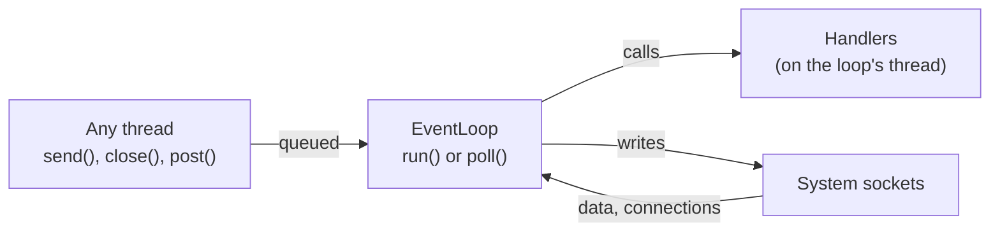
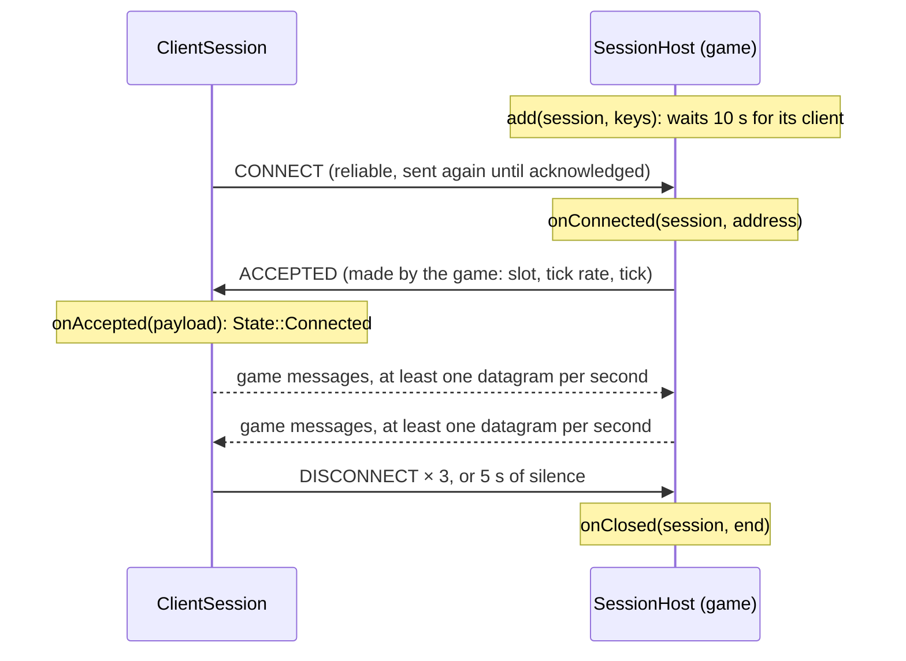

# Networking

The network library (`libs/network`, namespace `rtype::network`) opens sockets and moves bytes between the
client and the server. It is shared by both programs and, like the ECS, does not depend on raylib. It is built
on [Asio](https://think-async.com/Asio/) ([ADR 0011](../decisions/0011-networking-library.md)) and encrypts
with [Mbed TLS](https://www.trustedfirmware.org/projects/mbed-tls/)
([ADR 0014](../decisions/0014-encryption.md)). Neither appears in its headers.

New to networking? Read [Networking concepts](networking-concepts.md) first.

| Class | Role |
|---|---|
| `Address` | An IP address and a port, `127.0.0.1:4242` |
| `EventLoop` | Waits for the network and calls the handlers of the sockets |
| `UdpSocket` | Sends and receives datagrams |
| `TcpListener` | Listens on a TCP port and accepts connections |
| `TcpConnection` | Sends and receives a stream of bytes |
| `TlsConnection` | A TCP connection encrypted with TLS 1.3, on which the client is sure to talk to our server |
| `ServerIdentity` | The private key of the server, and the certificate it presents |
| `KeyFingerprint` | The SHA-256 of a public key, which the client pins |
| `DatagramKey`, `sealDatagram()`, `openDatagram()` | Encrypt a game datagram with a player's key, and check and decrypt it |
| `ReplayWindow`, `PacketCounter` | Drop the datagrams received twice, and number the ones sent |
| `MessageChannel` | Acknowledgements, resends and ordering of the messages of one session over UDP |
| `DatagramBody`, `encodeBody()`, `decodeBody()` | The decrypted body of a datagram: acknowledgements and messages |
| `Timer`, `StopSignals` | Call a function after a delay or every interval, and when the program is asked to stop |
| `ClientSession`, `SessionHost` | A client's session with its game, and the game's sessions with its players: connecting, heartbeats, timeouts, disconnecting |
| `FramedConnection` | A TCP or TLS connection that sends and receives whole messages (frames) |
| `FrameDecoder`, `makeFrame()` | Split a TCP stream into frames, and build a frame |
| `NetworkError`, `tlsCategory()` | The errors of the library and of TLS, as `std::error_code` |
| `Writer`, `Reader` | Turn the fields of a message into bytes and back, following the protocol |
| `isValidText()` | Checks a text before sending it as a `str8` |

The lobby, the game instances and the [protocol](../protocol/index.md) messages are built on top of these
classes, in the next steps of the "Server & networking" work.

## The event loop

Sockets do not block: sending returns at once, and received data is given to a **handler**, a function the
socket calls when data arrives. The `EventLoop` is what waits for the network and calls these handlers. Every
socket belongs to a loop, and its handlers are only called on the thread that runs the loop.

There are two ways to run a loop:

=== "A network thread (server)"

    ```cpp
    rtype::network::EventLoop loop;
    // ... create the sockets ...

    std::thread network([&loop] { loop.run(); }); // waits for events until stop()
    // ... the simulation runs on this thread ...
    loop.stop();
    network.join();
    ```

=== "Once per frame (client)"

    ```cpp
    rtype::network::EventLoop loop;
    // ... create the sockets ...

    while (!window.shouldClose()) {
        loop.poll(); // handles what is ready, returns at once
        // ... update and draw ...
    }
    ```



*Calls from any thread are queued to the loop; the loop talks to the system and calls the handlers on its own
thread.*

**Threads.** Every function of the sockets can be called from any thread: the work is handed to the loop's
thread, and done in the order of the calls. `loop.post(function)` does the same for any function, which is how
another thread hands work to the network thread. The handlers are always called on the loop's thread, so the
data they touch must be protected if another thread reads it.

**Lifetime.** Sockets must be destroyed before their loop. A socket can be destroyed at any time otherwise,
including from inside one of its handlers: data that arrives afterwards is ignored.

**Exceptions.** An exception thrown by a handler leaves `run()` or `poll()`, which can be called again.

### Timers and stop signals

Two helpers call a function on the loop's thread, like the handlers of the sockets:

```cpp
rtype::network::Timer tick(loop);
tick.startRepeating(std::chrono::milliseconds(16), [&] { host.update(Clock::now()); }); // every tick

rtype::network::Timer timeout(loop);
timeout.start(std::chrono::seconds(10), [&] { connection.close(); }); // once
timeout.cancel();                                                     // or not at all

rtype::network::StopSignals signals(loop, [&](const char *signal) { /* Ctrl+C, SIGTERM... */ });
```

- A `Timer` started again forgets what it was doing; cancelled or destroyed on the loop's thread, it never calls
  its handler, even if it was already due. A repeating timer that falls behind skips the calls it missed rather
  than making them in a burst.
- `StopSignals` catches Ctrl+C (`SIGINT`), `SIGTERM`, and on Windows `SIGBREAK`, while it exists: the program no
  longer ends at once, the handler decides. The [server](server.md#stopping) uses it to stop properly.

## Addresses

```cpp
using rtype::network::Address;

Address::anyIpv4(4242);                   // 0.0.0.0:4242, every interface: for a server
Address::loopbackIpv4(4242);              // 127.0.0.1:4242, this machine only
Address::parse("192.168.1.10", 4242);     // std::optional<Address>: nothing if not an IP address
rtype::network::resolve("localhost", 4242); // std::vector<Address>, IPv4 first; looks up host names
```

- `parse()` only reads IP addresses. `resolve()` also looks up host names, and **blocks** until the answer
  arrives, which can take seconds: call it at startup or from a thread that can wait, never in the game loop.
  It throws `std::system_error` if the name does not exist.
- Port 0 means "any free port": a socket bound to it gets one from the system, given by `localAddress()`.
- An address can be logged directly, `logger.info("Client connected from {}", address)`, and used as a key of
  an `std::unordered_map`.

## UDP

```cpp
rtype::network::UdpSocket socket(loop, Address::anyIpv4(4242));

socket.startReceiving([&](const Address &from, std::span<const std::byte> datagram) {
    socket.send(from, datagram); // echo
});
```

- The constructor binds the socket, and throws `std::system_error` if it cannot, for instance if the port is
  already in use.
- `send()` copies the data: the buffer can be reused at once. A datagram the system cannot send (full buffer,
  unreachable network) is dropped and logged, like a datagram lost on the way: UDP never guarantees delivery.
- The data given to the handler is only valid during the call: copy it to keep it.
- Errors while receiving are logged, and the socket keeps receiving. On Windows, a datagram sent to a closed
  port makes the next receive fail: this does not stop the socket.

## TCP

A TCP connection is a **stream**: the bytes arrive complete and in order, but not in the pieces they were sent
in. Two `send()` calls may arrive in one handler call, and one `send()` in several. The layer above splits the
stream into messages ([protocol framing](../protocol/lobby.md#3-framing)).

=== "Server"

    ```cpp
    rtype::network::TcpListener listener(loop, Address::anyIpv4(4242));
    std::vector<rtype::network::TcpConnection> clients;

    listener.startAccepting([&](rtype::network::TcpConnection connection) {
        connection.start(
            [](std::span<const std::byte> bytes) { /* bytes received */ },
            [](std::error_code reason) { /* closed by the client, or lost */ });
        clients.push_back(std::move(connection)); // keep it, or it is closed
    });
    ```

=== "Client"

    ```cpp
    using rtype::network::TcpConnection;
    std::optional<TcpConnection> server;

    TcpConnection::connect(loop, address, [&](std::error_code error, std::optional<TcpConnection> connection) {
        if (error) {
            logger.error("Cannot reach the server: {}", error.message());
            return;
        }
        connection->start(onReceive, onClose);
        server = std::move(connection);
    });
    ```

| Event | What happens |
|---|---|
| `connect()` cannot reach the server | The handler receives the error: refused, unreachable, or `std::errc::timed_out` after the timeout (10 s by default) |
| The peer closes the connection | The close handler is called once, with no error |
| The connection fails (reset, network down) | The close handler is called once, with the error |
| `close()` is called, or the connection is destroyed | The bytes already given to `send()` are sent, then the connection closes. **The handlers are not called**: the code that closed it already knows |
| A listener is closed or destroyed | No new connection is accepted. Connections already accepted stay open |

Connections disable Nagle's algorithm, which would delay small messages to group them: lobby messages are sent
at once.

A listener lets a restarted server listen again at once on its port on Linux. It does not on Windows, where
the same option would let another program take a port in use.

## TCP framing

A TCP stream has no boundaries, so each message is sent as a **frame**: its size on two bytes, its type on one
byte, then its payload ([lobby, section 3](../protocol/lobby.md#3-framing)). `FramedConnection` does it on top
of a `TcpConnection`: the code above it only sees whole messages.

```
size (u16) | type (u8) | payload (size − 1 bytes)
00 0D        01          00 03 05 50 61 76 65 6C 02 66 72 00      HELLO, version 3, "Pavel", "fr"
```

```cpp
rtype::network::FramedConnection client(std::move(connection)); // a TcpConnection, not started yet

client.start(
    [](std::uint8_t type, std::span<const std::byte> payload) {
        rtype::network::Reader reader(payload); // one whole message: decode it according to its type
    },
    [](std::error_code reason) {
        if (reason == rtype::network::NetworkError::FrameTooLarge) { /* the peer broke the protocol */ }
    });

rtype::network::Writer hello;
hello.writeU16(1);
hello.writeString("Pavel");
client.send(0x01, hello.bytes()); // type, then payload: the size is added
```

- **Whole and in order.** Each call to the frame handler is one frame, as it was sent, whatever the pieces TCP
  delivered.
- **Invalid frames close the connection.** A size of 0, or above 16382, is refused as soon as its two bytes
  arrive, without waiting for the rest. The connection is closed, the close handler receives
  `NetworkError::EmptyFrame` or `NetworkError::FrameTooLarge`, and a warning is logged. The frames received
  before it are still handled.
- **Bounded memory.** The connection keeps at most the frame being received: a peer announcing a frame of
  16 KiB and sending it slowly holds 16 KiB, never more.
- **Payloads above `MaxFramePayloadSize`** (16381 bytes) cannot be sent: `send()` throws `std::length_error`.
- **`close()`** sends the frames already given to `send()`, then closes. It also stops the frames already
  received from being handled: after `close()`, even from inside the frame handler, no handler is called.

The splitting itself is done by `FrameDecoder`, which works on bytes only, without a socket, so that it can be
tested and fuzzed alone:

```cpp
rtype::network::FrameDecoder decoder;
decoder.feed(bytes);                       // bytes received, in any pieces
while (const auto frame = decoder.next()) { // each complete frame
    handle(frame->type, frame->payload);
}
if (decoder.failed()) { /* decoder.error(): EmptyFrame or FrameTooLarge */ }
```

## TLS

The lobby connection is encrypted with **TLS 1.3** ([lobby, section 2](../protocol/lobby.md#2-tls)): nobody on
the path can read or change the bytes, and the client is sure to talk to our server, not to someone in the
middle. `TlsConnection` adds it on top of a `TcpConnection`, and works the same way: `start()`, `send()`,
`close()`, a receive handler and a close handler.

### Keys

The server has a key pair (ECDSA P-256). It keeps the **private key** secret, in a file given to it, and the
clients know its **public key**. They do not compare the whole key, only its **fingerprint**: the SHA-256 of
the key, 64 hexadecimal digits, like SSH's `known_hosts`
([ADR 0014](../decisions/0014-encryption.md#tcp-tls-13-server-key-pinned)). The server makes its key at its
first start: see [Manage the server key](../guides/generate-the-server-keys.md). Which key the client trusts
for which server, the one the player trusted at the first connection, is the client's business
([ADR 0021](../decisions/0021-server-generated-key-trust-on-first-use.md),
[Playing online](client-online.md#trusted-servers)).

```cpp
// Server: its private key, the --key option
const auto identity = rtype::network::ServerIdentity::load("server.key");
logger.info("Server key {}", identity.fingerprint().toHex());

// Client: the fingerprint of the server's public key, kept in the settings as 64 hexadecimal digits
const std::optional<rtype::network::KeyFingerprint> pinned = rtype::network::KeyFingerprint::parse(text);
```

| Function | Gives | Throws |
|---|---|---|
| `ServerIdentity::load(path)`, `fromPrivateKey(pem)` | The identity of the server, from an ECDSA P-256 private key in PEM | `std::system_error` (file), `std::invalid_argument` (not such a key) |
| `ServerIdentity::generate()` | A new key pair, for the tests and the first start of a server | — |
| `identity.privateKeyPem()`, `publicKeyPem()`, `fingerprint()` | The keys in PEM, to write them to files, and the fingerprint | — |
| `KeyFingerprint::loadPublicKey(path)`, `ofPublicKey(pem)` | The fingerprint of a public key in PEM | `std::system_error` (file), `std::invalid_argument` (not a key) |
| `KeyFingerprint::parse(hex)`, `toHex()` | The fingerprint from and to 64 hexadecimal digits | — (`parse` returns `std::nullopt`) |

The fingerprint is the one OpenSSL computes, so it can be checked by hand:

```sh
openssl pkey -in server.key -pubout -outform DER | sha256sum
```

The certificate a TLS server must present is made from the private key when the identity is created: it is
self-signed, and the client only looks at the key it holds. No certificate authority, domain name or expiry
date is involved.

### Connecting

Each side wraps its TCP connection, not started yet, then starts it:

=== "Client"

    ```cpp
    rtype::network::TcpConnection::connect(loop, server,
        [&](std::error_code error, std::optional<rtype::network::TcpConnection> connection) {
            if (error) { /* server unreachable */ return; }
            lobby.emplace(rtype::network::FramedConnection(
                rtype::network::TlsConnection::client(std::move(*connection), pinned)));
            lobby->start(onFrame, onClose);
            lobby->send(0x01, hello.bytes()); // waits for the end of the handshake
        });
    ```

=== "Server"

    ```cpp
    listener.startAccepting([&](rtype::network::TcpConnection connection) {
        auto client = std::make_unique<rtype::network::FramedConnection>(
            rtype::network::TlsConnection::server(std::move(connection), identity));
        client->start(onFrame, onClose);
        clients.push_back(std::move(client));
    });
    ```

`FramedConnection` takes a `TlsConnection` as well as a `TcpConnection`: the frames are then encrypted, and the
code above does not change.

- **The handshake starts with `start()`.** Both sides agree on keys, and the server proves it holds the private
  key of its certificate. It takes one round trip, a few milliseconds on a local network.
- **Bytes sent before its end wait for it**, then leave encrypted. The client can send `HELLO` at once.
- **Its end can be known**: `start()` takes a third handler, optional, called once when the handshake has
  ended, before the first bytes received. The lobby uses it to time the handshake and `HELLO` apart
  (`start(onFrame, onClose, onSecured)` on a `FramedConnection` over TLS; never called over plain TCP).
- **The client checks the key.** It trusts one key (`client(connection, pinned)`), or several
  (`client(connection, trusted, onUntrusted)`). If the server presents another key, the handshake fails,
  a warning is logged with the fingerprint presented, `onUntrusted` receives that fingerprint, then the close
  handler receives `NetworkError::UntrustedServer`. Nothing the client sent is ever delivered to that server.
- **Trusting no key** makes every handshake fail: that is how the client learns the key of a server it never
  met, to show it to the player, without sending it anything.
- **TLS 1.3 only**, with the algorithms of the specification: `TLS_CHACHA20_POLY1305_SHA256` (preferred) or
  `TLS_AES_128_GCM_SHA256`, key exchange with `x25519` or `secp256r1`, signatures with
  `ecdsa_secp256r1_sha256`. A peer offering only TLS 1.2 is refused. No session ticket, no resumption.
- **Everything received is authenticated.** A changed byte, a record from someone else, or a peer that does
  not speak TLS ends the connection with an error of `tlsCategory()`, whose `message()` comes from Mbed TLS.
- **`close()`** sends the bytes already given to `send()`, tells the peer that the connection ends (a TLS
  `close_notify`), then closes. Called during the handshake, it waits for its end if bytes are waiting to be
  sent. The peer's close handler is called without error.

The close handler of a TLS connection, or of a framed connection over TLS, can receive:

| Reason | Meaning |
|---|---|
| No error | The peer closed the connection |
| `NetworkError::UntrustedServer` | Client: the server does not have a trusted key. `onUntrusted` told which key it presented: ask the player to trust it, or tell them the server is not the expected one. |
| `NetworkError::HandshakeInterrupted` | The TCP connection ended during the handshake: closed, or reset, by the peer |
| `reason.category() == tlsCategory()` | The TLS layer refused something: wrong version, invalid record, alert from the peer… |
| `NetworkError::EmptyFrame`, `FrameTooLarge` | Framed connections: the peer sent an invalid frame |
| A system error | The connection was lost |

### Threads

Mbed TLS is built without its own locks. Every call into it, from any connection or identity, holds one lock of
the library, so identities can be loaded and connections used from any thread. A handshake holds it for about a
millisecond: negligible at the scale of a lobby, and a reason to enable the locks of Mbed TLS
(`MBEDTLS_THREADING_C`) if measurements ever show waiting.

### Random bytes and SHA-256

`rtype/network/Crypto.hpp` gives the programs the cryptography they need outside the protocols, from the same
TF-PSA-Crypto, without its types in the header: `randomBytes(span)` and `randomBytes<Size>()` draw from its
random generator, for the keys of the games, the local access token of the panel, the session tokens, salts and
codes of the [accounts](accounts.md); `sha256(bytes)` and `sha256(text)` hash, for the session tokens and codes
the database keeps. Both take the lock of the library, from any thread, and throw `std::runtime_error` if the
cryptography cannot be used. Never `std::rand()` nor `std::random_device` for a secret: they promise nothing an
attacker cannot guess.

```cpp
#include "rtype/network/Crypto.hpp"

const auto token = rtype::network::randomBytes<32>();                         // std::array<std::byte, 32>
const rtype::network::Sha256 kept = rtype::network::sha256(std::span(token)); // what the database keeps
```

## Encrypted datagrams

Every datagram of a game is encrypted and authenticated ([game protocol](../protocol/game.md#2-datagram-layout),
[ADR 0014](../decisions/0014-encryption.md)). UDP has no connection and no handshake, so TLS cannot be used:
the master draws two keys per player, sends them to the client over TLS (`GAME_JOINED`) and to the game, and
each side encrypts what it sends with its own key.

```
 0      2   3   4             8                       16                      16 + n         32 + n
 ┌──────┬───┬───┬─────────────┬───────────────────────┬───────────────────────┬──────────────┐
 │ "RT" │ 1 │ 0 │ session id  │ packet number         │ body, encrypted       │ tag          │
 └──────┴───┴───┴─────────────┴───────────────────────┴───────────────────────┴──────────────┘
  header: in clear, but covered by the tag              ChaCha20                 Poly1305
```

- The **header** stays in clear, so that the receiver knows the session, hence the key, before decrypting.
  The tag covers it as well: changing the session id or the packet number makes the datagram invalid.
- The **body** is encrypted with **ChaCha20-Poly1305** (RFC 8439). The nonce, a number that must never be
  used twice with the same key, is the packet number: that is why `PacketCounter` never gives a number twice,
  and stops instead of going back to 0.
- The **tag** (16 bytes) proves that the datagram was made with the key and not changed on the way. Without
  the key, nobody can make a datagram that opens, nor change a byte of one, which also proves who sent it:
  only the player who received the key over TLS.

These functions only take bytes and give bytes, with no socket, like the frame decoder: the sessions of the
next steps call them.

=== "Sending"

    ```cpp
    // Once per session: the key of this side, and its packet numbers
    rtype::network::DatagramKey ownKey(keyBytes);   // 32 bytes from GAME_JOINED
    rtype::network::PacketCounter packets;

    // For every datagram
    const std::optional<std::uint64_t> number = packets.next();
    if (!number) {
        // Every packet number was used (2^64 - 1 datagrams): the session must close
    }
    socket.send(peer, rtype::network::sealDatagram(ownKey, {sessionId, *number}, body));
    ```

=== "Receiving"

    ```cpp
    // Once per session: the key of the peer, and the numbers already received
    rtype::network::DatagramKey peerKey(peerKeyBytes);
    rtype::network::ReplayWindow window;

    // For every datagram, in this order, dropping it silently at the first failure
    const auto header = rtype::network::parseDatagramHeader(datagram); // size, magic, version...
    if (!header || header->session != sessionId) {
        return;
    }
    if (!window.accepts(header->packetNumber)) {
        return; // received already: duplicated by the network, or replayed by an attacker
    }
    const auto body = rtype::network::openDatagram(peerKey, datagram);
    if (!body) {
        return; // forged, or changed on the way
    }
    window.mark(header->packetNumber); // only now: a forged datagram must not move the window
    handle(*body);
    ```

| Function | Gives | Refuses |
|---|---|---|
| `DatagramKey(bytes)`, `DatagramKey::generate()`, `key.bytes()` | A key from its 32 bytes or drawn at random, and its bytes to send them over TLS | — |
| `parseDatagramHeader(datagram)` | The session and the packet number, not authenticated yet | Size outside 32–1200 bytes, wrong magic, version or reserved byte, session or number 0 (`std::nullopt`) |
| `sealDatagram(key, header, body)` | The datagram, `body.size() + 32` bytes | A body above 1168 bytes (`std::length_error`), a session or number 0 (`std::invalid_argument`) |
| `openDatagram(key, datagram)` | The body | An invalid header, another key, any byte changed (`std::nullopt`) |
| `window.accepts(n)`, `window.mark(n)` | Whether `n` may be new, and remembering it | 0, a number received already, more than 256 below the highest one |
| `packets.next()` | 1, 2, 3… | After `2^64 - 1` (`std::nullopt`) |

**Why a replay window.** An attacker can record a valid datagram and send it again later: it still opens,
since it was made with the key. The window remembers the numbers received, and drops the second copy. It only
keeps the last 256: a datagram later than that is useless in a game anyway, and the window stays 40 bytes.

**Keys are secret.** A `DatagramKey` is never logged, its bytes are erased from memory when its last copy is
destroyed, and copying it shares the same key. Like TLS, sealing and opening hold the lock of Mbed TLS
([Threads](#threads)), so keys can be used from any thread.

## Reliability over UDP

UDP loses, duplicates and reorders datagrams. Most game messages do not mind: a snapshot lost is replaced by
the next one. Some must arrive, though: an entity destroyed, the end of the game. The `MessageChannel` gives
each message the choice ([game protocol](../protocol/game.md#6-reliability)):

| | `Delivery::Unreliable` | `Delivery::Reliable` |
|---|---|---|
| Sent | Once | Again and again, until the peer acknowledges it |
| Arrives | Maybe, in any order | Exactly once, in the order it was sent |
| For | What the next message replaces: snapshots, inputs | What must not be missed: destructions, waves, the end of the game |

### How it works

**Acknowledgements.** Every datagram says which packets were received from the peer: the highest number
(`Ack`) and 32 bits for the 32 before it (`Ack bits`), taken straight from the `ReplayWindow`. A datagram
lost now is acknowledged, or not, by any of the next 33: one ack lost costs nothing.

```
Packets received by B:  … 37 38 __ 40 41          (39 was lost)
B tells A:               Ack = 41, Ack bits: bit 0 = 1 (40 ✓), bit 1 = 0 (39 ✗), bit 2 = 1 (38 ✓), bit 3 = 1 (37 ✓)
```

**Resending.** The sender remembers which packet carried each reliable message. When one of them is
acknowledged, the message is forgotten; when none is after the **resend delay**, `max(1.5 × RTT, 100 ms)`, the
message goes again in the next datagram, which has a new packet number. A message may be sent several times;
the receiver keeps the first copy only.

**Ordering.** Each reliable message has an id, 0, 1, 2… (wrapping from 65535 to 0). The receiver delivers id
`E`, then `E + 1`, and so on: a message that arrives early waits until those before it are there, at most 256
ahead. An id already delivered is ignored.

```
Received:     2   0   3   1
Delivered:    –   0   –   1 2 3
```

**Round-trip time.** When a packet is acknowledged, the time since it was sent is a sample of the RTT, smoothed
as `0.9 × rtt + 0.1 × sample`. It sets the resend delay, and it is the ping shown to the player. Until the first
sample, it is assumed to be 100 ms.

**Failing.** If the peer stops acknowledging, the reliable messages pile up: at 256 waiting, the channel
**fails** and the session must close. Likewise once every packet number was used.

### Using it

The channel only builds and reads the **bodies** of the datagrams, and is given the time: the session around
it seals and opens them ([Encrypted datagrams](#encrypted-datagrams)), and owns the socket and the timers.

=== "Sending"

    ```cpp
    rtype::network::MessageChannel channel;   // one per session

    channel.send(0x80, snapshot, rtype::network::Delivery::Unreliable);
    channel.send(0x81, destroyed, rtype::network::Delivery::Reliable);

    // Once per tick, or at least once per second (a heartbeat then): as many datagrams as needed
    const auto now = rtype::network::MessageChannel::Clock::now();
    do {
        const auto datagram = channel.next(now);
        if (!datagram) {
            return closeSession(); // the channel failed
        }
        socket.send(peer, rtype::network::sealDatagram(ownKey, {sessionId, datagram->packetNumber},
                                                       datagram->body));
    } while (channel.hasMessagesToSend(now));
    ```

=== "Receiving"

    ```cpp
    const auto header = rtype::network::parseDatagramHeader(datagram);
    if (!header || header->session != sessionId || !channel.accepts(header->packetNumber)) {
        return;
    }
    const auto body = rtype::network::openDatagram(peerKey, datagram);
    if (!body) {
        return;
    }
    const auto messages = channel.receive(header->packetNumber, *body, now);
    if (!messages) {
        return; // malformed body: dropped, and not acknowledged
    }
    for (const rtype::network::ReceivedMessage &message : *messages) {
        handle(message.type, message.payload);
    }
    ```

`next()` puts the reliable messages due first, then the unreliable ones in order, as many as fit in 1200
bytes. A snapshot part that fills a datagram goes in its own: `hasMessagesToSend()` tells when another datagram
is needed.

| Function | Gives | Refuses or fails |
|---|---|---|
| `send(type, payload, delivery)` | Queues the message | A payload above 1151 bytes (unreliable) or 1149 (reliable): `std::length_error`. Returns false if the channel failed |
| `next(now)` | The packet number and body of the next datagram | `std::nullopt` once failed |
| `hasMessagesToSend(now)` | Whether another datagram is needed now | — |
| `accepts(n)`, `receive(n, body, now)` | Whether a packet may be new; the messages to handle | `std::nullopt` for a packet already received or a malformed body |
| `rtt()`, `resendDelay()`, `pendingReliable()`, `failed()` | The measures, for the logs and the console | — |

`encodeBody()` and `decodeBody()` are the codec of the body alone, for the tests and the fuzzer.

## Game sessions

A **session** is the link between one client and its game, over UDP: everything above put together, plus what
makes it a connection ([game protocol](../protocol/game.md#7-session)). The master gives both sides the same
session id and keys (`GAME_JOINED` to the client, `ADD_PLAYER` to the game); then:



*A session connects with `CONNECT` and `ACCEPTED`, stays open with heartbeats, and ends with `DISCONNECT` or a
timeout.*

| | `ClientSession` (client) | `SessionHost` (game) |
|---|---|---|
| Sessions | One: the one of `GAME_JOINED` | One per player, added on `ADD_PLAYER` |
| Sends to | The game's address, through its send function | The address each client sends from, learned from its first authentic datagram |
| Handlers | `onAccepted`, `onMessage`, `onClose` | `onConnected`, `onMessage`, `onClosed` |
| Before connecting | `send()` refuses game messages until `ACCEPTED` | Messages before `CONNECT` are ignored |
| Gives up | No `ACCEPTED` within 5 s: `ConnectTimedOut` (UDP is probably blocked) | No `CONNECT` within 10 s: `ConnectTimedOut` |

Like the channel, the sessions have no socket and no clock: they are given the datagrams received and the time,
and send through a function. The application owns the `UdpSocket` and calls `update()` regularly:

=== "Client (game loop)"

    ```cpp
    rtype::network::UdpSocket socket(loop, rtype::network::Address::anyIpv4(0));
    rtype::network::ClientSession session(joined.sessionId, joined.clientKey, joined.serverKey,
        [&](std::span<const std::byte> datagram) { socket.send(gameAddress, datagram); });

    socket.startReceiving([&](const rtype::network::Address &from, std::span<const std::byte> datagram) {
        if (from == gameAddress) { // only the game's datagrams
            session.receive(datagram, Clock::now());
        }
    });
    session.start(onAccepted, onMessage, onClose, Clock::now());

    // Every frame
    loop.poll();
    session.send(InputType, input, rtype::network::Delivery::Unreliable);
    session.update(Clock::now()); // sends, resends, acknowledgements, heartbeat, timeouts
    ```

=== "Game (network thread)"

    ```cpp
    rtype::network::UdpSocket socket(loop, rtype::network::Address::anyIpv4(port));
    rtype::network::SessionHost host(
        [&](const rtype::network::Address &to, std::span<const std::byte> datagram) { socket.send(to, datagram); },
        {
            .onConnected = [&](std::uint32_t session, const rtype::network::Address &) {
                host.send(session, rtype::network::session_message::Accepted, accepted,
                          rtype::network::Delivery::Reliable);
            },
            .onMessage = [&](std::uint32_t session, std::uint8_t type, std::span<const std::byte> payload) {},
            .onClosed = [&](std::uint32_t session, rtype::network::SessionEnd end) {},
        });
    socket.startReceiving([&](const rtype::network::Address &from, std::span<const std::byte> datagram) {
        host.receive(from, datagram, Clock::now());
    });

    host.add(sessionId, clientKey, serverKey, Clock::now()); // on ADD_PLAYER
    host.update(Clock::now());                                // every tick
    ```

The session layer handles `CONNECT`, `ACCEPTED` and `DISCONNECT` itself; every other message (`PLAYER_JOINED`,
`INPUT`, `SNAPSHOT`…) goes to `onMessage`. The payload of `ACCEPTED` is made by the game and given as is to the
client's `onAccepted`.

### How a session ends

| `SessionEnd::Cause` | When | `DISCONNECT` sent |
|---|---|---|
| `Disconnected` | The peer sent `DISCONNECT`, with its reason (`Quit`, `GameOver`, `Shutdown`, `ProtocolError`) | — |
| `TimedOut` | Nothing authentic received for **5 s**: the peer crashed or lost the network | No: the peer does not hear anyway |
| `ConnectTimedOut` | Never connected (5 s for the client, 10 s for the game) | No |
| `Failed` | The peer stopped acknowledging: 256 reliable messages wait | Yes, `ProtocolError` |
| — | The application called `close(reason)` | Yes, with the reason; **no handler is called** |

`DISCONNECT` is not reliable: it is sent in **three datagrams in a row**, and one of them is enough. If all
three are lost, the peer closes after its 5 s timeout.

### What the game protects itself against

`SessionHost::receive()` follows the order of the protocol and drops silently at the first failure, **without
ever answering**: an answer to a forged datagram could be used to flood someone else.

1. Size and header (`parseDatagramHeader()`).
2. A known session.
3. **At most 200 datagrams per second and per source address**, counted before decrypting: a flood costs
   almost nothing. The counter is a `RateLimiter` (`rtype/network/RateLimiter.hpp`), which the relay of the
   master also uses, with the same limit, before it forwards anything; the counters of the addresses that
   stopped sending are forgotten after 10 seconds.
4. The replay window, then the tag, then the body.

**Behind the relay of the master** ([Server](server.md#the-relay)), the clients send to one public port for
every game, and the master forwards each datagram to the instance of its session, on the loopback, in a
[relay frame](../protocol/instances.md#5-the-relay-frame): the address of the client, then the datagram,
unchanged. Nothing here changes: the relay reads only the clear header, `parseDatagramHeader()`, and the instance
hands the real address of each client to its `SessionHost`, so the limit per address and the following of an
address that changes work as before.

```cpp
// The relay, inbound: from the public port to the instance of the session
const auto header = rtype::network::parseDatagramHeader(datagram);
if (!header || banned(from) || !rates.allow(from, now)) return;
loopback.send(instanceOf(header->session), rtype::server::encodeRelayFrame(from, datagram));
```

**A client whose port changes**, which a home router may do, is followed: an authentic datagram from another
address with a newer packet number moves the session there. An older one, arriving late, does not.

**Handlers may call the host**, including `close()` of the session they are called for: the messages that
follow in the same datagram are then dropped.

## Binary serialization

A message is sent as bytes: each field written one after the other, as the
[protocol conventions](../protocol/index.md#2-conventions) define it: big-endian integers, no padding,
`str8` texts. `Writer` writes the fields, `Reader` reads them back. To add a message, follow
[Add a network message](../guides/add-a-network-message.md).

```cpp
rtype::network::Writer writer;
writer.writeU8(0x01);        // type: HELLO
writer.writeU16(1);          // version
writer.writeString("Pavel"); // name: length on one byte, then the UTF-8 bytes
connection.send(writer.bytes());
```

| Type of the specification | Writer | Reader |
|---|---|---|
| `u8`, `u16`, `u32`, `u64` | `writeU8()` … `writeU64()` | `readU8()` … `readU64()` |
| `i16`, `i32` | `writeI16()`, `writeI32()` | `readI16()`, `readI32()` |
| `bool` | `writeBool()` | `readBool()`: a value other than 0 or 1 is an error |
| `bytes[N]` | `writeBytes(span)` | `readBytes(n)` (a view into the data) or `readBytes<N>()` (a copy) |
| `str8` | `writeString(text)` | `readString(min, max)`: length range of the field, text checked |
| `str16` | `writeString16(text)` | `readString16(min, max)`: the same, with a length on two bytes |

**Why not `memcpy` a struct?** The compiler adds padding between fields, differently on GCC and MSVC, and an
x86 processor stores integers little-endian. Writing each field explicitly gives the same bytes everywhere.

### Reading safely

The bytes come from the network: they may be cut, forged or random. `Reader` is built so that a decoder
cannot go wrong:

- **It never reads past the end.** A field that is not entirely there fails.
- **The first failure sticks.** After a missing or invalid field, every later read returns 0, `false` or an
  empty value, and `error()` keeps the first problem. A decoder reads all its fields, then checks once:

    ```cpp
    rtype::network::Reader reader(payload);
    const std::uint16_t version = reader.readU16();
    const std::string name = reader.readString(1, 16);
    if (!reader.finish()) { // fails if a read failed, or if bytes are left
        logger.debug("HELLO dropped: {}", toString(reader.error()));
        return std::nullopt;
    }
    ```

- **Texts are checked**: valid UTF-8 (no cut or overlong characters, no surrogates), no ASCII control
  character, length within the range of the field. A name cannot carry a line break that would forge a line
  in the logs, nor terminal escape codes.
- **Decoders refuse values themselves** with `reader.fail()`, for instance a number of players above 4.
- **Nothing is allocated from an unchecked length.** A `str8` is at most 255 bytes, a `str16` at most the
  maximum of its field, and either is only built once its length is in range and its bytes are there. For a list, never `reserve(count)` with a count read from the network: loop while
  `reader.ok()`, and the loop stops at the end of the data even if the count announces 65535 entries.
- **No side effect**: a reader only reads its bytes. Decoders built on it are pure functions, bytes in and
  message or error out, which a fuzzer can call millions of times
  ([testing policy](../contributing/testing.md)).

`Writer` is used with values from our own code: a value the protocol forbids (a `str8` over 255 bytes, a text
with a control character) is a programming error, and throws an exception. Check a text typed by the player
with `isValidText()` before sending it.

## Logs

The library writes with a logger named `network` ([Logging](logging.md)):

| Level | Messages |
|---|---|
| `trace` | Every datagram and every piece of a stream received, with its size |
| `trace` (TLS) | Every piece of a TLS stream decrypted, with its size |
| `trace` (datagrams) | Every encrypted datagram dropped, with the reason: invalid header, or not authentic. Never the keys |
| `trace` (reliability) | Every malformed body dropped, every reliable message sent again |
| `debug` (reliability) | A channel that fails, and why; unreliable messages dropped because too many wait to be sent |
| `trace` (sessions) | Every datagram of an unknown session dropped |
| `debug` (sessions) | Sessions added, connecting, accepted, connected, moved to another address, closed and ended (with the cause), source addresses over 200 datagrams per second |
| `debug` | Sockets opened and closed, connections accepted, opened, closed and lost, datagrams dropped, TLS handshakes started and done (with the cipher suite) |
| `warning` | A listener that cannot accept connections (for instance, no file descriptor left), a peer sending an invalid frame, a TLS connection failing or closed during its handshake, a TLS server presenting a key that is not trusted, with its fingerprint |

```sh
RTYPE_LOG_LEVEL=debug ./build/bin/r-type_server
```

## Tests

The tests in `tests/network.cpp` (tag `[network]`) run over the loopback, with ports chosen by the system so
that they never conflict: datagrams in both directions and from another thread, ports in use, connections,
large transfers, closing from either side, refused connections and timeouts.

The tests in `tests/serialization.cpp` (same tag) check the round trip of every type, the edge values, every
rejection case, and the `HELLO` frame given as an example in the specification, byte for byte.

The tests in `tests/framing.cpp` (same tag) check the frame decoder with frames cut byte by byte, grouped, or
cut at random places, the maximum size and the invalid sizes; then framed connections over the loopback: frames
in both directions, a peer sending an invalid frame, and `close()` from inside the frame handler.

The tests in `tests/tls.cpp` (same tag) check the fingerprints against the one OpenSSL computes, the identities
(generated, saved and read back, refused keys, files), then TLS connections over the loopback: large transfers
in both directions, bytes sent before the handshake, a server with another key, a relay in the middle that
reads nothing and whose changed byte is detected, peers that do not speak TLS, closing, frames over TLS, the end of the handshake reported once and never
for a failed one, and
Mbed TLS used from two threads at once.

The tests in `tests/crypto.cpp` (tags `[network]`, `[crypto]`) check SHA-256 against the digests of FIPS 180-2,
and that random bytes differ from one draw to the next.

The tests in `tests/datagram.cpp` (same tag) check two datagrams byte for byte against another implementation
of RFC 8439 (Python's `cryptography` package), the round trip of bodies from 0 to 1168 bytes, that every bit
changed anywhere makes a datagram invalid, other keys, random bytes, every invalid header, the edges of the
replay window (256 and 257 numbers below, jumps, any order, the largest number) and the end of the packet
numbers.

The tests in `tests/reliability.cpp` (same tag) check the body byte for byte, its round trip, every malformed
case and random bodies; then a channel alone: acknowledgements, resends after the delay and not before, delivery
in order whatever the order of the datagrams, ids wrapping from 65535 to 0, large messages in datagrams of their
own, the RTT, and failing when the peer stops acknowledging. Last, two channels play 10 seconds of a game
through a **fake network** that loses 30 % of the datagrams, duplicates 10 % and delays them by 20 to 120 ms,
so that they arrive out of order: every reliable message arrives once and in order, no unreliable message
arrives twice.

The tests in `tests/session.cpp` (same tag) run a `ClientSession` and a `SessionHost` through a fake network in
memory, with the time given by the test: connecting, `CONNECT` sent again, both connect timeouts, heartbeats
over 20 s of silence, the 5 s timeout on both sides, 30 % loss, `DISCONNECT` both ways and with two copies out of
three lost, a game that stops acknowledging, a handler that closes its session, replayed, forged and unknown
datagrams that get no answer, a client whose port changes, a late datagram from another address, and the limit
of 200 datagrams per second. A last test runs a session over real UDP sockets on the loopback.

The tests in `tests/timer.cpp` (same tag) check timers once and repeating, cancelled and destroyed when already
due, started again and from another thread, and the stop signals, raised in the test process itself.

Our client and server were also checked against OpenSSL, by hand (it is not installed on every CI runner):

```sh
# Our client against an OpenSSL server holding the test key of tests/tls.cpp
openssl req -new -x509 -key test.key -out test.crt -subj "/CN=test"
openssl s_server -accept 4433 -key test.key -cert test.crt -tls1_3 -www
# OpenSSL's client against our server: TLS 1.3 accepted, TLS 1.2 refused
openssl s_client -connect 127.0.0.1:4433 -tls1_3
openssl s_client -connect 127.0.0.1:4433 -tls1_2
```

```sh
./build/bin/rtype_tests "[network]"
```

## Limits and next steps

- **No R-Type messages yet**: the lobby and the game instances come next, following the
  [protocol](../protocol/index.md). The fuzzing of the decoders comes with them; `parseDatagramHeader()` and
  `openDatagram()` are ready for it.
- **No handshake timeout in the connection itself**: a peer that opens a connection and never finishes the
  handshake keeps it open. The server closes such connections with the limits of the
  [protocol](../protocol/index.md) (10 s for the handshake), in the lobby step.
- **One lock for all of Mbed TLS**, see [Threads](#threads).
- **One copy per send**: `send()` copies the data into a new buffer, unless it is given a `std::vector` it can
  take (`send(std::move(bytes))`). Enough for now; a pool of buffers can replace it if measurements show the
  cost.
- **IPv4 or IPv6, not both on one socket**: a socket bound to `Address::anyIpv6()` may or may not accept IPv4
  depending on the system. The server listens on IPv4 for now.
