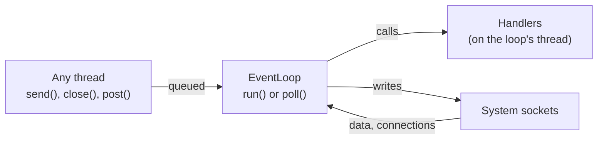

# Networking

The network library (`libs/network`, namespace `rtype::network`) opens sockets and moves bytes between the
client and the server. It is shared by both programs and, like the ECS, does not depend on raylib. It is built
on [Asio](https://think-async.com/Asio/) ([ADR 0011](../decisions/0011-networking-library.md)), which never
appears in its headers.

New to networking? Read [Networking concepts](networking-concepts.md) first.

| Class | Role |
|---|---|
| `Address` | An IP address and a port, `127.0.0.1:4242` |
| `EventLoop` | Waits for the network and calls the handlers of the sockets |
| `UdpSocket` | Sends and receives datagrams |
| `TcpListener` | Listens on a TCP port and accepts connections |
| `TcpConnection` | Sends and receives a stream of bytes |

This library only moves bytes. Splitting a TCP stream into messages, encryption, reliability over UDP and the
[protocol](../protocol/index.md) messages are built on top of it, in the next steps of the
"Server & networking" work.

## The event loop

Sockets do not block: sending returns at once, and received data is given to a **handler**, a function the
socket calls when data arrives. The `EventLoop` is what waits for the network and calls these handlers. Every
socket belongs to a loop, and its handlers are only called on the thread that runs the loop.

There are two ways to run a loop:

=== "A network thread (server)"

    ```cpp
    rtype::network::EventLoop loop;
    // ... create the sockets ...

    std::thread network([&loop] { loop.run(); }); // waits for events until stop()
    // ... the simulation runs on this thread ...
    loop.stop();
    network.join();
    ```

=== "Once per frame (client)"

    ```cpp
    rtype::network::EventLoop loop;
    // ... create the sockets ...

    while (!window.shouldClose()) {
        loop.poll(); // handles what is ready, returns at once
        // ... update and draw ...
    }
    ```



*Calls from any thread are queued to the loop; the loop talks to the system and calls the handlers on its own
thread.*

**Threads.** Every function of the sockets can be called from any thread: the work is handed to the loop's
thread, and done in the order of the calls. `loop.post(function)` does the same for any function, which is how
another thread hands work to the network thread. The handlers are always called on the loop's thread, so the
data they touch must be protected if another thread reads it.

**Lifetime.** Sockets must be destroyed before their loop. A socket can be destroyed at any time otherwise,
including from inside one of its handlers: data that arrives afterwards is ignored.

**Exceptions.** An exception thrown by a handler leaves `run()` or `poll()`, which can be called again.

## Addresses

```cpp
using rtype::network::Address;

Address::anyIpv4(4242);                   // 0.0.0.0:4242, every interface: for a server
Address::loopbackIpv4(4242);              // 127.0.0.1:4242, this machine only
Address::parse("192.168.1.10", 4242);     // std::optional<Address>: nothing if not an IP address
rtype::network::resolve("localhost", 4242); // std::vector<Address>, IPv4 first; looks up host names
```

- `parse()` only reads IP addresses. `resolve()` also looks up host names, and **blocks** until the answer
  arrives, which can take seconds: call it at startup or from a thread that can wait, never in the game loop.
  It throws `std::system_error` if the name does not exist.
- Port 0 means "any free port": a socket bound to it gets one from the system, given by `localAddress()`.
- An address can be logged directly, `logger.info("Client connected from {}", address)`, and used as a key of
  an `std::unordered_map`.

## UDP

```cpp
rtype::network::UdpSocket socket(loop, Address::anyIpv4(4243));

socket.startReceiving([&](const Address &from, std::span<const std::byte> datagram) {
    socket.send(from, datagram); // echo
});
```

- The constructor binds the socket, and throws `std::system_error` if it cannot, for instance if the port is
  already in use.
- `send()` copies the data: the buffer can be reused at once. A datagram the system cannot send (full buffer,
  unreachable network) is dropped and logged, like a datagram lost on the way: UDP never guarantees delivery.
- The data given to the handler is only valid during the call: copy it to keep it.
- Errors while receiving are logged, and the socket keeps receiving. On Windows, a datagram sent to a closed
  port makes the next receive fail: this does not stop the socket.

## TCP

A TCP connection is a **stream**: the bytes arrive complete and in order, but not in the pieces they were sent
in. Two `send()` calls may arrive in one handler call, and one `send()` in several. The layer above splits the
stream into messages ([protocol framing](../protocol/lobby.md#3-framing)).

=== "Server"

    ```cpp
    rtype::network::TcpListener listener(loop, Address::anyIpv4(4242));
    std::vector<rtype::network::TcpConnection> clients;

    listener.startAccepting([&](rtype::network::TcpConnection connection) {
        connection.start(
            [](std::span<const std::byte> bytes) { /* bytes received */ },
            [](std::error_code reason) { /* closed by the client, or lost */ });
        clients.push_back(std::move(connection)); // keep it, or it is closed
    });
    ```

=== "Client"

    ```cpp
    using rtype::network::TcpConnection;
    std::optional<TcpConnection> server;

    TcpConnection::connect(loop, address, [&](std::error_code error, std::optional<TcpConnection> connection) {
        if (error) {
            logger.error("Cannot reach the server: {}", error.message());
            return;
        }
        connection->start(onReceive, onClose);
        server = std::move(connection);
    });
    ```

| Event | What happens |
|---|---|
| `connect()` cannot reach the server | The handler receives the error: refused, unreachable, or `std::errc::timed_out` after the timeout (10 s by default) |
| The peer closes the connection | The close handler is called once, with no error |
| The connection fails (reset, network down) | The close handler is called once, with the error |
| `close()` is called, or the connection is destroyed | The bytes already given to `send()` are sent, then the connection closes. **The handlers are not called**: the code that closed it already knows |
| A listener is closed or destroyed | No new connection is accepted. Connections already accepted stay open |

Connections disable Nagle's algorithm, which would delay small messages to group them: lobby messages are sent
at once.

A listener lets a restarted server listen again at once on its port on Linux. It does not on Windows, where
the same option would let another program take a port in use.

## Logs

The library writes with a logger named `network` ([Logging](logging.md)):

| Level | Messages |
|---|---|
| `trace` | Every datagram and every piece of a stream received, with its size |
| `debug` | Sockets opened and closed, connections accepted, opened, closed and lost, datagrams dropped |
| `warning` | A listener that cannot accept connections (for instance, no file descriptor left) |

```sh
RTYPE_LOG_LEVEL=debug ./build/bin/r-type_server
```

## Tests

The tests in `tests/network.cpp` (tag `[network]`) run over the loopback, with ports chosen by the system so
that they never conflict: datagrams in both directions and from another thread, ports in use, connections,
large transfers, closing from either side, refused connections and timeouts.

```sh
./build/bin/rtype_tests "[network]"
```

## Limits and next steps

- **No messages yet**: framing, encryption and reliability come next, following the
  [protocol](../protocol/index.md).
- **One copy per send**: `send()` copies the data into a new buffer. Enough for now; a pool of buffers can
  replace it if measurements show the cost.
- **IPv4 or IPv6, not both on one socket**: a socket bound to `Address::anyIpv6()` may or may not accept IPv4
  depending on the system. The server listens on IPv4 for now.
