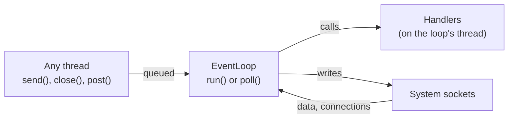

# Networking

The network library (`libs/network`, namespace `rtype::network`) opens sockets and moves bytes between the
client and the server. It is shared by both programs and, like the ECS, does not depend on raylib. It is built
on [Asio](https://think-async.com/Asio/) ([ADR 0011](../decisions/0011-networking-library.md)), which never
appears in its headers.

New to networking? Read [Networking concepts](networking-concepts.md) first.

| Class | Role |
|---|---|
| `Address` | An IP address and a port, `127.0.0.1:4242` |
| `EventLoop` | Waits for the network and calls the handlers of the sockets |
| `UdpSocket` | Sends and receives datagrams |
| `TcpListener` | Listens on a TCP port and accepts connections |
| `TcpConnection` | Sends and receives a stream of bytes |
| `FramedConnection` | A TCP connection that sends and receives whole messages (frames) |
| `FrameDecoder`, `makeFrame()` | Split a TCP stream into frames, and build a frame |
| `NetworkError` | The errors of the library, as `std::error_code` |
| `Writer`, `Reader` | Turn the fields of a message into bytes and back, following the protocol |
| `isValidText()` | Checks a text before sending it as a `str8` |

Encryption, reliability over UDP and the [protocol](../protocol/index.md) messages are built on top of these
classes, in the next steps of the "Server & networking" work.

## The event loop

Sockets do not block: sending returns at once, and received data is given to a **handler**, a function the
socket calls when data arrives. The `EventLoop` is what waits for the network and calls these handlers. Every
socket belongs to a loop, and its handlers are only called on the thread that runs the loop.

There are two ways to run a loop:

=== "A network thread (server)"

    ```cpp
    rtype::network::EventLoop loop;
    // ... create the sockets ...

    std::thread network([&loop] { loop.run(); }); // waits for events until stop()
    // ... the simulation runs on this thread ...
    loop.stop();
    network.join();
    ```

=== "Once per frame (client)"

    ```cpp
    rtype::network::EventLoop loop;
    // ... create the sockets ...

    while (!window.shouldClose()) {
        loop.poll(); // handles what is ready, returns at once
        // ... update and draw ...
    }
    ```



*Calls from any thread are queued to the loop; the loop talks to the system and calls the handlers on its own
thread.*

**Threads.** Every function of the sockets can be called from any thread: the work is handed to the loop's
thread, and done in the order of the calls. `loop.post(function)` does the same for any function, which is how
another thread hands work to the network thread. The handlers are always called on the loop's thread, so the
data they touch must be protected if another thread reads it.

**Lifetime.** Sockets must be destroyed before their loop. A socket can be destroyed at any time otherwise,
including from inside one of its handlers: data that arrives afterwards is ignored.

**Exceptions.** An exception thrown by a handler leaves `run()` or `poll()`, which can be called again.

## Addresses

```cpp
using rtype::network::Address;

Address::anyIpv4(4242);                   // 0.0.0.0:4242, every interface: for a server
Address::loopbackIpv4(4242);              // 127.0.0.1:4242, this machine only
Address::parse("192.168.1.10", 4242);     // std::optional<Address>: nothing if not an IP address
rtype::network::resolve("localhost", 4242); // std::vector<Address>, IPv4 first; looks up host names
```

- `parse()` only reads IP addresses. `resolve()` also looks up host names, and **blocks** until the answer
  arrives, which can take seconds: call it at startup or from a thread that can wait, never in the game loop.
  It throws `std::system_error` if the name does not exist.
- Port 0 means "any free port": a socket bound to it gets one from the system, given by `localAddress()`.
- An address can be logged directly, `logger.info("Client connected from {}", address)`, and used as a key of
  an `std::unordered_map`.

## UDP

```cpp
rtype::network::UdpSocket socket(loop, Address::anyIpv4(4243));

socket.startReceiving([&](const Address &from, std::span<const std::byte> datagram) {
    socket.send(from, datagram); // echo
});
```

- The constructor binds the socket, and throws `std::system_error` if it cannot, for instance if the port is
  already in use.
- `send()` copies the data: the buffer can be reused at once. A datagram the system cannot send (full buffer,
  unreachable network) is dropped and logged, like a datagram lost on the way: UDP never guarantees delivery.
- The data given to the handler is only valid during the call: copy it to keep it.
- Errors while receiving are logged, and the socket keeps receiving. On Windows, a datagram sent to a closed
  port makes the next receive fail: this does not stop the socket.

## TCP

A TCP connection is a **stream**: the bytes arrive complete and in order, but not in the pieces they were sent
in. Two `send()` calls may arrive in one handler call, and one `send()` in several. The layer above splits the
stream into messages ([protocol framing](../protocol/lobby.md#3-framing)).

=== "Server"

    ```cpp
    rtype::network::TcpListener listener(loop, Address::anyIpv4(4242));
    std::vector<rtype::network::TcpConnection> clients;

    listener.startAccepting([&](rtype::network::TcpConnection connection) {
        connection.start(
            [](std::span<const std::byte> bytes) { /* bytes received */ },
            [](std::error_code reason) { /* closed by the client, or lost */ });
        clients.push_back(std::move(connection)); // keep it, or it is closed
    });
    ```

=== "Client"

    ```cpp
    using rtype::network::TcpConnection;
    std::optional<TcpConnection> server;

    TcpConnection::connect(loop, address, [&](std::error_code error, std::optional<TcpConnection> connection) {
        if (error) {
            logger.error("Cannot reach the server: {}", error.message());
            return;
        }
        connection->start(onReceive, onClose);
        server = std::move(connection);
    });
    ```

| Event | What happens |
|---|---|
| `connect()` cannot reach the server | The handler receives the error: refused, unreachable, or `std::errc::timed_out` after the timeout (10 s by default) |
| The peer closes the connection | The close handler is called once, with no error |
| The connection fails (reset, network down) | The close handler is called once, with the error |
| `close()` is called, or the connection is destroyed | The bytes already given to `send()` are sent, then the connection closes. **The handlers are not called**: the code that closed it already knows |
| A listener is closed or destroyed | No new connection is accepted. Connections already accepted stay open |

Connections disable Nagle's algorithm, which would delay small messages to group them: lobby messages are sent
at once.

A listener lets a restarted server listen again at once on its port on Linux. It does not on Windows, where
the same option would let another program take a port in use.

## TCP framing

A TCP stream has no boundaries, so each message is sent as a **frame**: its size on two bytes, its type on one
byte, then its payload ([lobby, section 3](../protocol/lobby.md#3-framing)). `FramedConnection` does it on top
of a `TcpConnection`: the code above it only sees whole messages.

```
size (u16) | type (u8) | payload (size − 1 bytes)
00 09        01          00 01 05 50 61 76 65 6C      HELLO, version 1, "Pavel"
```

```cpp
rtype::network::FramedConnection client(std::move(connection)); // a TcpConnection, not started yet

client.start(
    [](std::uint8_t type, std::span<const std::byte> payload) {
        rtype::network::Reader reader(payload); // one whole message: decode it according to its type
    },
    [](std::error_code reason) {
        if (reason == rtype::network::NetworkError::FrameTooLarge) { /* the peer broke the protocol */ }
    });

rtype::network::Writer hello;
hello.writeU16(1);
hello.writeString("Pavel");
client.send(0x01, hello.bytes()); // type, then payload: the size is added
```

- **Whole and in order.** Each call to the frame handler is one frame, as it was sent, whatever the pieces TCP
  delivered.
- **Invalid frames close the connection.** A size of 0, or above 16382, is refused as soon as its two bytes
  arrive, without waiting for the rest. The connection is closed, the close handler receives
  `NetworkError::EmptyFrame` or `NetworkError::FrameTooLarge`, and a warning is logged. The frames received
  before it are still handled.
- **Bounded memory.** The connection keeps at most the frame being received: a peer announcing a frame of
  16 KiB and sending it slowly holds 16 KiB, never more.
- **Payloads above `MaxFramePayloadSize`** (16381 bytes) cannot be sent: `send()` throws `std::length_error`.
- **`close()`** sends the frames already given to `send()`, then closes. It also stops the frames already
  received from being handled: after `close()`, even from inside the frame handler, no handler is called.

The splitting itself is done by `FrameDecoder`, which works on bytes only, without a socket, so that it can be
tested and fuzzed alone:

```cpp
rtype::network::FrameDecoder decoder;
decoder.feed(bytes);                       // bytes received, in any pieces
while (const auto frame = decoder.next()) { // each complete frame
    handle(frame->type, frame->payload);
}
if (decoder.failed()) { /* decoder.error(): EmptyFrame or FrameTooLarge */ }
```

## Binary serialization

A message is sent as bytes: each field written one after the other, as the
[protocol conventions](../protocol/index.md#2-conventions) define it: big-endian integers, no padding,
`str8` texts. `Writer` writes the fields, `Reader` reads them back. To add a message, follow
[Add a network message](../guides/add-a-network-message.md).

```cpp
rtype::network::Writer writer;
writer.writeU8(0x01);        // type: HELLO
writer.writeU16(1);          // version
writer.writeString("Pavel"); // name: length on one byte, then the UTF-8 bytes
connection.send(writer.bytes());
```

| Type of the specification | Writer | Reader |
|---|---|---|
| `u8`, `u16`, `u32`, `u64` | `writeU8()` … `writeU64()` | `readU8()` … `readU64()` |
| `i16`, `i32` | `writeI16()`, `writeI32()` | `readI16()`, `readI32()` |
| `bool` | `writeBool()` | `readBool()`: a value other than 0 or 1 is an error |
| `bytes[N]` | `writeBytes(span)` | `readBytes(n)` (a view into the data) or `readBytes<N>()` (a copy) |
| `str8` | `writeString(text)` | `readString(min, max)`: length range of the field, text checked |

**Why not `memcpy` a struct?** The compiler adds padding between fields, differently on GCC and MSVC, and an
x86 processor stores integers little-endian. Writing each field explicitly gives the same bytes everywhere.

### Reading safely

The bytes come from the network: they may be cut, forged or random. `Reader` is built so that a decoder
cannot go wrong:

- **It never reads past the end.** A field that is not entirely there fails.
- **The first failure sticks.** After a missing or invalid field, every later read returns 0, `false` or an
  empty value, and `error()` keeps the first problem. A decoder reads all its fields, then checks once:

    ```cpp
    rtype::network::Reader reader(payload);
    const std::uint16_t version = reader.readU16();
    const std::string name = reader.readString(1, 16);
    if (!reader.finish()) { // fails if a read failed, or if bytes are left
        logger.debug("HELLO dropped: {}", toString(reader.error()));
        return std::nullopt;
    }
    ```

- **Texts are checked**: valid UTF-8 (no cut or overlong characters, no surrogates), no ASCII control
  character, length within the range of the field. A name cannot carry a line break that would forge a line
  in the logs, nor terminal escape codes.
- **Decoders refuse values themselves** with `reader.fail()`, for instance a number of players above 4.
- **Nothing is allocated from an unchecked length.** A `str8` is at most 255 bytes and only built once its
  bytes are there. For a list, never `reserve(count)` with a count read from the network: loop while
  `reader.ok()`, and the loop stops at the end of the data even if the count announces 65535 entries.
- **No side effect**: a reader only reads its bytes. Decoders built on it are pure functions, bytes in and
  message or error out, which a fuzzer can call millions of times
  ([testing policy](../contributing/testing.md)).

`Writer` is used with values from our own code: a value the protocol forbids (a `str8` over 255 bytes, a text
with a control character) is a programming error, and throws an exception. Check a text typed by the player
with `isValidText()` before sending it.

## Logs

The library writes with a logger named `network` ([Logging](logging.md)):

| Level | Messages |
|---|---|
| `trace` | Every datagram and every piece of a stream received, with its size |
| `debug` | Sockets opened and closed, connections accepted, opened, closed and lost, datagrams dropped |
| `warning` | A listener that cannot accept connections (for instance, no file descriptor left), a peer sending an invalid frame |

```sh
RTYPE_LOG_LEVEL=debug ./build/bin/r-type_server
```

## Tests

The tests in `tests/network.cpp` (tag `[network]`) run over the loopback, with ports chosen by the system so
that they never conflict: datagrams in both directions and from another thread, ports in use, connections,
large transfers, closing from either side, refused connections and timeouts.

The tests in `tests/serialization.cpp` (same tag) check the round trip of every type, the edge values, every
rejection case, and the `HELLO` frame given as an example in the specification, byte for byte.

The tests in `tests/framing.cpp` (same tag) check the frame decoder with frames cut byte by byte, grouped, or
cut at random places, the maximum size and the invalid sizes; then framed connections over the loopback: frames
in both directions, a peer sending an invalid frame, and `close()` from inside the frame handler.

```sh
./build/bin/rtype_tests "[network]"
```

## Limits and next steps

- **No messages yet**: encryption and reliability come next, following the [protocol](../protocol/index.md).
  The fuzzing of the decoders comes with them.
- **One copy per send**: `send()` copies the data into a new buffer, unless it is given a `std::vector` it can
  take (`send(std::move(bytes))`). Enough for now; a pool of buffers can replace it if measurements show the
  cost.
- **IPv4 or IPv6, not both on one socket**: a socket bound to `Address::anyIpv6()` may or may not accept IPv4
  depending on the system. The server listens on IPv4 for now.
