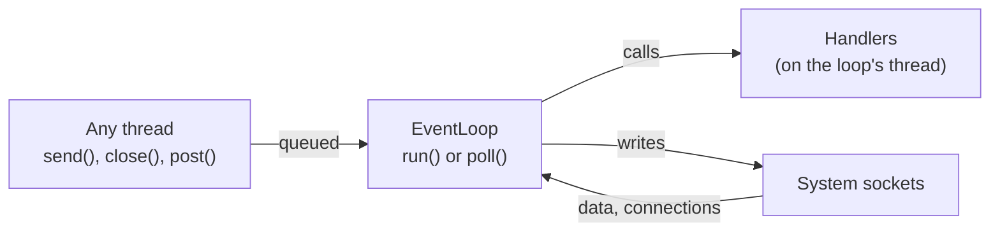

# Networking

The network library (`libs/network`, namespace `rtype::network`) opens sockets and moves bytes between the
client and the server. It is shared by both programs and, like the ECS, does not depend on raylib. It is built
on [Asio](https://think-async.com/Asio/) ([ADR 0011](../decisions/0011-networking-library.md)) and encrypts
with [Mbed TLS](https://www.trustedfirmware.org/projects/mbed-tls/)
([ADR 0014](../decisions/0014-encryption.md)). Neither appears in its headers.

New to networking? Read [Networking concepts](networking-concepts.md) first.

| Class | Role |
|---|---|
| `Address` | An IP address and a port, `127.0.0.1:4242` |
| `EventLoop` | Waits for the network and calls the handlers of the sockets |
| `UdpSocket` | Sends and receives datagrams |
| `TcpListener` | Listens on a TCP port and accepts connections |
| `TcpConnection` | Sends and receives a stream of bytes |
| `TlsConnection` | A TCP connection encrypted with TLS 1.3, on which the client is sure to talk to our server |
| `ServerIdentity` | The private key of the server, and the certificate it presents |
| `KeyFingerprint` | The SHA-256 of a public key, which the client pins |
| `FramedConnection` | A TCP or TLS connection that sends and receives whole messages (frames) |
| `FrameDecoder`, `makeFrame()` | Split a TCP stream into frames, and build a frame |
| `NetworkError`, `tlsCategory()` | The errors of the library and of TLS, as `std::error_code` |
| `Writer`, `Reader` | Turn the fields of a message into bytes and back, following the protocol |
| `isValidText()` | Checks a text before sending it as a `str8` |

The encryption of the datagrams, reliability over UDP and the [protocol](../protocol/index.md) messages are
built on top of these classes, in the next steps of the "Server & networking" work.

## The event loop

Sockets do not block: sending returns at once, and received data is given to a **handler**, a function the
socket calls when data arrives. The `EventLoop` is what waits for the network and calls these handlers. Every
socket belongs to a loop, and its handlers are only called on the thread that runs the loop.

There are two ways to run a loop:

=== "A network thread (server)"

    ```cpp
    rtype::network::EventLoop loop;
    // ... create the sockets ...

    std::thread network([&loop] { loop.run(); }); // waits for events until stop()
    // ... the simulation runs on this thread ...
    loop.stop();
    network.join();
    ```

=== "Once per frame (client)"

    ```cpp
    rtype::network::EventLoop loop;
    // ... create the sockets ...

    while (!window.shouldClose()) {
        loop.poll(); // handles what is ready, returns at once
        // ... update and draw ...
    }
    ```



*Calls from any thread are queued to the loop; the loop talks to the system and calls the handlers on its own
thread.*

**Threads.** Every function of the sockets can be called from any thread: the work is handed to the loop's
thread, and done in the order of the calls. `loop.post(function)` does the same for any function, which is how
another thread hands work to the network thread. The handlers are always called on the loop's thread, so the
data they touch must be protected if another thread reads it.

**Lifetime.** Sockets must be destroyed before their loop. A socket can be destroyed at any time otherwise,
including from inside one of its handlers: data that arrives afterwards is ignored.

**Exceptions.** An exception thrown by a handler leaves `run()` or `poll()`, which can be called again.

## Addresses

```cpp
using rtype::network::Address;

Address::anyIpv4(4242);                   // 0.0.0.0:4242, every interface: for a server
Address::loopbackIpv4(4242);              // 127.0.0.1:4242, this machine only
Address::parse("192.168.1.10", 4242);     // std::optional<Address>: nothing if not an IP address
rtype::network::resolve("localhost", 4242); // std::vector<Address>, IPv4 first; looks up host names
```

- `parse()` only reads IP addresses. `resolve()` also looks up host names, and **blocks** until the answer
  arrives, which can take seconds: call it at startup or from a thread that can wait, never in the game loop.
  It throws `std::system_error` if the name does not exist.
- Port 0 means "any free port": a socket bound to it gets one from the system, given by `localAddress()`.
- An address can be logged directly, `logger.info("Client connected from {}", address)`, and used as a key of
  an `std::unordered_map`.

## UDP

```cpp
rtype::network::UdpSocket socket(loop, Address::anyIpv4(4243));

socket.startReceiving([&](const Address &from, std::span<const std::byte> datagram) {
    socket.send(from, datagram); // echo
});
```

- The constructor binds the socket, and throws `std::system_error` if it cannot, for instance if the port is
  already in use.
- `send()` copies the data: the buffer can be reused at once. A datagram the system cannot send (full buffer,
  unreachable network) is dropped and logged, like a datagram lost on the way: UDP never guarantees delivery.
- The data given to the handler is only valid during the call: copy it to keep it.
- Errors while receiving are logged, and the socket keeps receiving. On Windows, a datagram sent to a closed
  port makes the next receive fail: this does not stop the socket.

## TCP

A TCP connection is a **stream**: the bytes arrive complete and in order, but not in the pieces they were sent
in. Two `send()` calls may arrive in one handler call, and one `send()` in several. The layer above splits the
stream into messages ([protocol framing](../protocol/lobby.md#3-framing)).

=== "Server"

    ```cpp
    rtype::network::TcpListener listener(loop, Address::anyIpv4(4242));
    std::vector<rtype::network::TcpConnection> clients;

    listener.startAccepting([&](rtype::network::TcpConnection connection) {
        connection.start(
            [](std::span<const std::byte> bytes) { /* bytes received */ },
            [](std::error_code reason) { /* closed by the client, or lost */ });
        clients.push_back(std::move(connection)); // keep it, or it is closed
    });
    ```

=== "Client"

    ```cpp
    using rtype::network::TcpConnection;
    std::optional<TcpConnection> server;

    TcpConnection::connect(loop, address, [&](std::error_code error, std::optional<TcpConnection> connection) {
        if (error) {
            logger.error("Cannot reach the server: {}", error.message());
            return;
        }
        connection->start(onReceive, onClose);
        server = std::move(connection);
    });
    ```

| Event | What happens |
|---|---|
| `connect()` cannot reach the server | The handler receives the error: refused, unreachable, or `std::errc::timed_out` after the timeout (10 s by default) |
| The peer closes the connection | The close handler is called once, with no error |
| The connection fails (reset, network down) | The close handler is called once, with the error |
| `close()` is called, or the connection is destroyed | The bytes already given to `send()` are sent, then the connection closes. **The handlers are not called**: the code that closed it already knows |
| A listener is closed or destroyed | No new connection is accepted. Connections already accepted stay open |

Connections disable Nagle's algorithm, which would delay small messages to group them: lobby messages are sent
at once.

A listener lets a restarted server listen again at once on its port on Linux. It does not on Windows, where
the same option would let another program take a port in use.

## TCP framing

A TCP stream has no boundaries, so each message is sent as a **frame**: its size on two bytes, its type on one
byte, then its payload ([lobby, section 3](../protocol/lobby.md#3-framing)). `FramedConnection` does it on top
of a `TcpConnection`: the code above it only sees whole messages.

```
size (u16) | type (u8) | payload (size − 1 bytes)
00 09        01          00 01 05 50 61 76 65 6C      HELLO, version 1, "Pavel"
```

```cpp
rtype::network::FramedConnection client(std::move(connection)); // a TcpConnection, not started yet

client.start(
    [](std::uint8_t type, std::span<const std::byte> payload) {
        rtype::network::Reader reader(payload); // one whole message: decode it according to its type
    },
    [](std::error_code reason) {
        if (reason == rtype::network::NetworkError::FrameTooLarge) { /* the peer broke the protocol */ }
    });

rtype::network::Writer hello;
hello.writeU16(1);
hello.writeString("Pavel");
client.send(0x01, hello.bytes()); // type, then payload: the size is added
```

- **Whole and in order.** Each call to the frame handler is one frame, as it was sent, whatever the pieces TCP
  delivered.
- **Invalid frames close the connection.** A size of 0, or above 16382, is refused as soon as its two bytes
  arrive, without waiting for the rest. The connection is closed, the close handler receives
  `NetworkError::EmptyFrame` or `NetworkError::FrameTooLarge`, and a warning is logged. The frames received
  before it are still handled.
- **Bounded memory.** The connection keeps at most the frame being received: a peer announcing a frame of
  16 KiB and sending it slowly holds 16 KiB, never more.
- **Payloads above `MaxFramePayloadSize`** (16381 bytes) cannot be sent: `send()` throws `std::length_error`.
- **`close()`** sends the frames already given to `send()`, then closes. It also stops the frames already
  received from being handled: after `close()`, even from inside the frame handler, no handler is called.

The splitting itself is done by `FrameDecoder`, which works on bytes only, without a socket, so that it can be
tested and fuzzed alone:

```cpp
rtype::network::FrameDecoder decoder;
decoder.feed(bytes);                       // bytes received, in any pieces
while (const auto frame = decoder.next()) { // each complete frame
    handle(frame->type, frame->payload);
}
if (decoder.failed()) { /* decoder.error(): EmptyFrame or FrameTooLarge */ }
```

## TLS

The lobby connection is encrypted with **TLS 1.3** ([lobby, section 2](../protocol/lobby.md#2-tls)): nobody on
the path can read or change the bytes, and the client is sure to talk to our server, not to someone in the
middle. `TlsConnection` adds it on top of a `TcpConnection`, and works the same way: `start()`, `send()`,
`close()`, a receive handler and a close handler.

### Keys

The server has a key pair (ECDSA P-256). It keeps the **private key** secret, in a file given to it, and the
clients know its **public key**. They do not compare the whole key, only its **fingerprint**: the SHA-256 of
the key, 64 hexadecimal digits, like SSH's `known_hosts`
([ADR 0014](../decisions/0014-encryption.md#tcp-tls-13-server-key-pinned)).

```cpp
// Server: its private key, the --key option
const auto identity = rtype::network::ServerIdentity::load("server.key");
logger.info("Server key {}", identity.fingerprint().toHex());

// Client: the fingerprint of the server's public key, shipped next to the executable...
const auto pinned = rtype::network::KeyFingerprint::loadPublicKey("server.pub");
// ... or written in a configuration, as 64 hexadecimal digits
const std::optional<rtype::network::KeyFingerprint> fromText = rtype::network::KeyFingerprint::parse(text);
```

| Function | Gives | Throws |
|---|---|---|
| `ServerIdentity::load(path)`, `fromPrivateKey(pem)` | The identity of the server, from an ECDSA P-256 private key in PEM | `std::system_error` (file), `std::invalid_argument` (not such a key) |
| `ServerIdentity::generate()` | A new key pair, for the tests and the key generation tool | — |
| `identity.privateKeyPem()`, `publicKeyPem()`, `fingerprint()` | The keys in PEM, to write them to files, and the fingerprint | — |
| `KeyFingerprint::loadPublicKey(path)`, `ofPublicKey(pem)` | The fingerprint of a public key in PEM | `std::system_error` (file), `std::invalid_argument` (not a key) |
| `KeyFingerprint::parse(hex)`, `toHex()` | The fingerprint from and to 64 hexadecimal digits | — (`parse` returns `std::nullopt`) |

The fingerprint is the one OpenSSL computes, so it can be checked by hand:

```sh
openssl pkey -pubin -in server.pub -outform DER | sha256sum
```

The certificate a TLS server must present is made from the private key when the identity is created: it is
self-signed, and the client only looks at the key it holds. No certificate authority, domain name or expiry
date is involved.

### Connecting

Each side wraps its TCP connection, not started yet, then starts it:

=== "Client"

    ```cpp
    rtype::network::TcpConnection::connect(loop, server,
        [&](std::error_code error, std::optional<rtype::network::TcpConnection> connection) {
            if (error) { /* server unreachable */ return; }
            lobby.emplace(rtype::network::FramedConnection(
                rtype::network::TlsConnection::client(std::move(*connection), pinned)));
            lobby->start(onFrame, onClose);
            lobby->send(0x01, hello.bytes()); // waits for the end of the handshake
        });
    ```

=== "Server"

    ```cpp
    listener.startAccepting([&](rtype::network::TcpConnection connection) {
        auto client = std::make_unique<rtype::network::FramedConnection>(
            rtype::network::TlsConnection::server(std::move(connection), identity));
        client->start(onFrame, onClose);
        clients.push_back(std::move(client));
    });
    ```

`FramedConnection` takes a `TlsConnection` as well as a `TcpConnection`: the frames are then encrypted, and the
code above does not change.

- **The handshake starts with `start()`.** Both sides agree on keys, and the server proves it holds the private
  key of its certificate. It takes one round trip, a few milliseconds on a local network.
- **Bytes sent before its end wait for it**, then leave encrypted. The client can send `HELLO` at once.
- **The client checks the key.** If the server presents another key, the handshake fails, an error is logged
  with the fingerprint presented, and the close handler receives `NetworkError::UntrustedServer`. Nothing the
  client sent is ever delivered to that server.
- **TLS 1.3 only**, with the algorithms of the specification: `TLS_CHACHA20_POLY1305_SHA256` (preferred) or
  `TLS_AES_128_GCM_SHA256`, key exchange with `x25519` or `secp256r1`, signatures with
  `ecdsa_secp256r1_sha256`. A peer offering only TLS 1.2 is refused. No session ticket, no resumption.
- **Everything received is authenticated.** A changed byte, a record from someone else, or a peer that does
  not speak TLS ends the connection with an error of `tlsCategory()`, whose `message()` comes from Mbed TLS.
- **`close()`** sends the bytes already given to `send()`, tells the peer that the connection ends (a TLS
  `close_notify`), then closes. Called during the handshake, it waits for its end if bytes are waiting to be
  sent. The peer's close handler is called without error.

The close handler of a TLS connection, or of a framed connection over TLS, can receive:

| Reason | Meaning |
|---|---|
| No error | The peer closed the connection |
| `NetworkError::UntrustedServer` | Client: the server does not have the pinned key. Tell the player the server is not the expected one. |
| `NetworkError::HandshakeInterrupted` | The TCP connection ended during the handshake: closed, or reset, by the peer |
| `reason.category() == tlsCategory()` | The TLS layer refused something: wrong version, invalid record, alert from the peer… |
| `NetworkError::EmptyFrame`, `FrameTooLarge` | Framed connections: the peer sent an invalid frame |
| A system error | The connection was lost |

### Threads

Mbed TLS is built without its own locks. Every call into it, from any connection or identity, holds one lock of
the library, so identities can be loaded and connections used from any thread. A handshake holds it for about a
millisecond: negligible at the scale of a lobby, and a reason to enable the locks of Mbed TLS
(`MBEDTLS_THREADING_C`) if measurements ever show waiting.

## Binary serialization

A message is sent as bytes: each field written one after the other, as the
[protocol conventions](../protocol/index.md#2-conventions) define it: big-endian integers, no padding,
`str8` texts. `Writer` writes the fields, `Reader` reads them back. To add a message, follow
[Add a network message](../guides/add-a-network-message.md).

```cpp
rtype::network::Writer writer;
writer.writeU8(0x01);        // type: HELLO
writer.writeU16(1);          // version
writer.writeString("Pavel"); // name: length on one byte, then the UTF-8 bytes
connection.send(writer.bytes());
```

| Type of the specification | Writer | Reader |
|---|---|---|
| `u8`, `u16`, `u32`, `u64` | `writeU8()` … `writeU64()` | `readU8()` … `readU64()` |
| `i16`, `i32` | `writeI16()`, `writeI32()` | `readI16()`, `readI32()` |
| `bool` | `writeBool()` | `readBool()`: a value other than 0 or 1 is an error |
| `bytes[N]` | `writeBytes(span)` | `readBytes(n)` (a view into the data) or `readBytes<N>()` (a copy) |
| `str8` | `writeString(text)` | `readString(min, max)`: length range of the field, text checked |

**Why not `memcpy` a struct?** The compiler adds padding between fields, differently on GCC and MSVC, and an
x86 processor stores integers little-endian. Writing each field explicitly gives the same bytes everywhere.

### Reading safely

The bytes come from the network: they may be cut, forged or random. `Reader` is built so that a decoder
cannot go wrong:

- **It never reads past the end.** A field that is not entirely there fails.
- **The first failure sticks.** After a missing or invalid field, every later read returns 0, `false` or an
  empty value, and `error()` keeps the first problem. A decoder reads all its fields, then checks once:

    ```cpp
    rtype::network::Reader reader(payload);
    const std::uint16_t version = reader.readU16();
    const std::string name = reader.readString(1, 16);
    if (!reader.finish()) { // fails if a read failed, or if bytes are left
        logger.debug("HELLO dropped: {}", toString(reader.error()));
        return std::nullopt;
    }
    ```

- **Texts are checked**: valid UTF-8 (no cut or overlong characters, no surrogates), no ASCII control
  character, length within the range of the field. A name cannot carry a line break that would forge a line
  in the logs, nor terminal escape codes.
- **Decoders refuse values themselves** with `reader.fail()`, for instance a number of players above 4.
- **Nothing is allocated from an unchecked length.** A `str8` is at most 255 bytes and only built once its
  bytes are there. For a list, never `reserve(count)` with a count read from the network: loop while
  `reader.ok()`, and the loop stops at the end of the data even if the count announces 65535 entries.
- **No side effect**: a reader only reads its bytes. Decoders built on it are pure functions, bytes in and
  message or error out, which a fuzzer can call millions of times
  ([testing policy](../contributing/testing.md)).

`Writer` is used with values from our own code: a value the protocol forbids (a `str8` over 255 bytes, a text
with a control character) is a programming error, and throws an exception. Check a text typed by the player
with `isValidText()` before sending it.

## Logs

The library writes with a logger named `network` ([Logging](logging.md)):

| Level | Messages |
|---|---|
| `trace` | Every datagram and every piece of a stream received, with its size |
| `trace` (TLS) | Every piece of a TLS stream decrypted, with its size |
| `debug` | Sockets opened and closed, connections accepted, opened, closed and lost, datagrams dropped, TLS handshakes started and done (with the cipher suite) |
| `warning` | A listener that cannot accept connections (for instance, no file descriptor left), a peer sending an invalid frame, a TLS connection failing or closed during its handshake |
| `error` | A TLS server presenting a key other than the pinned one, with its fingerprint |

```sh
RTYPE_LOG_LEVEL=debug ./build/bin/r-type_server
```

## Tests

The tests in `tests/network.cpp` (tag `[network]`) run over the loopback, with ports chosen by the system so
that they never conflict: datagrams in both directions and from another thread, ports in use, connections,
large transfers, closing from either side, refused connections and timeouts.

The tests in `tests/serialization.cpp` (same tag) check the round trip of every type, the edge values, every
rejection case, and the `HELLO` frame given as an example in the specification, byte for byte.

The tests in `tests/framing.cpp` (same tag) check the frame decoder with frames cut byte by byte, grouped, or
cut at random places, the maximum size and the invalid sizes; then framed connections over the loopback: frames
in both directions, a peer sending an invalid frame, and `close()` from inside the frame handler.

The tests in `tests/tls.cpp` (same tag) check the fingerprints against the one OpenSSL computes, the identities
(generated, saved and read back, refused keys, files), then TLS connections over the loopback: large transfers
in both directions, bytes sent before the handshake, a server with another key, a relay in the middle that
reads nothing and whose changed byte is detected, peers that do not speak TLS, closing, frames over TLS, and
Mbed TLS used from two threads at once.

Our client and server were also checked against OpenSSL, by hand (it is not installed on every CI runner):

```sh
# Our client against an OpenSSL server holding the test key of tests/tls.cpp
openssl req -new -x509 -key test.key -out test.crt -subj "/CN=test"
openssl s_server -accept 4433 -key test.key -cert test.crt -tls1_3 -www
# OpenSSL's client against our server: TLS 1.3 accepted, TLS 1.2 refused
openssl s_client -connect 127.0.0.1:4433 -tls1_3
openssl s_client -connect 127.0.0.1:4433 -tls1_2
```

```sh
./build/bin/rtype_tests "[network]"
```

## Limits and next steps

- **No messages yet**: the encryption of the datagrams and reliability come next, following the
  [protocol](../protocol/index.md). The fuzzing of the decoders comes with them.
- **No handshake timeout in the connection itself**: a peer that opens a connection and never finishes the
  handshake keeps it open. The server closes such connections with the limits of the
  [protocol](../protocol/index.md) (10 s for the handshake), in the lobby step.
- **One lock for all of Mbed TLS**, see [Threads](#threads).
- **One copy per send**: `send()` copies the data into a new buffer, unless it is given a `std::vector` it can
  take (`send(std::move(bytes))`). Enough for now; a pool of buffers can replace it if measurements show the
  cost.
- **IPv4 or IPv6, not both on one socket**: a socket bound to `Address::anyIpv6()` may or may not accept IPv4
  depending on the system. The server listens on IPv4 for now.
