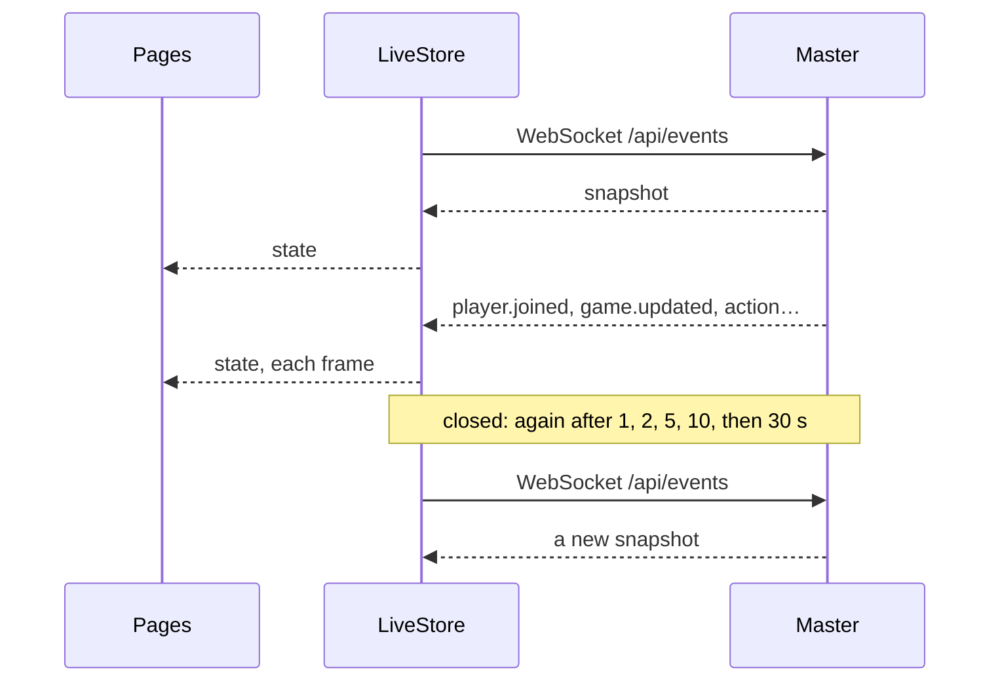

# The panel

The web panel of the administration ([ADR 0025](../decisions/0025-server-administration.md)): a page of the
master that shows the server live and acts on it, through the [administration API](../protocol/admin-api.md).
The master serves its files ([Web server](web.md)); the panel holds no secret and decides nothing: every rule
is the master's. To use it: [Administer a server](../guides/administer-a-server.md).

| | |
|---|---|
| Code | `web/admin/`, apart from the C++: Vite, React, TypeScript (strict), Chakra UI v3, React Router |
| Built | By Node, `npm run build`, to `web/admin/dist/`; installed beside the server as `admin/` with `RTYPE_ADMIN_PANEL_DIR` |
| Design | The Figma section [Panel d'administration](https://www.figma.com/design/RrrH0ic4ttdyDoc3nRnWBr/Untitled?node-id=144-28), in `src/theme/system.ts` |
| Tests | Vitest and Testing Library (`src/**/*.test.ts(x)`), the API mocked with MSW; Playwright (`e2e/`) against a real master |
| Develop | [web/admin/README.md](https://github.com/Akinator31/Rtype/blob/main/web/admin/README.md), [Contributing to the panel](../contributing/panel.md) |

## Pages

The frame of every page is the shell of the design: a side bar with the logo, the navigation by group (Server,
Communication, Administration) and the state of the master: its version and uptime; a top bar with the title of
the page and the live connection, with the delay before the next attempt while it is lost. The pages show what
a host acts on, and no more: no route of the API, no technical detail, a count of bytes only near the limit.

| Address | Page |
|---|---|
| `/` | The overview: players connected, games running and stuck, banned addresses and the next end, uptime, each opening its page; the games; the live feed; the players of each minute of the last hour since the panel opened; the latest actions. The master lost, its last values dimmed, and the last events |
| `/games` | The running games, live: their seats, wave, time of play and state; searched by name or id, filtered by state (running, stuck, waiting); an instance stuck on top, to end it. A line opens its game |
| `/games/{id}` | A game: its wave and time of play; its pilots, their address, score, state and latency; a message to its players; its own events. End it, remove a pilot, ban its address |
| `/players` | The players of the lobby, searched, filtered (in a game, in the lobby); a line opens and closes the card of its player, with the other pilots of its address. Remove one, ban its address |
| `/bans` | The addresses banned now and the time left of each, lifted from here; those lifted or expired lately, from the record; a new ban: address, duration, reason, the pilots it removes |
| `/messages` | A message to the whole lobby or to a game, from a template kept in the browser, previewed as the game shows it; the messages sent, from the record |
| `/history` | The record of the actions, newest first, a page of 100 at a time, searched and filtered by kind; an entry unfolded under its line into its details |
| `/settings` | The version, start and ports of the server, read only; the preferences of the panel: confirm the actions, a sound when an instance becomes stuck |

`/actions`, the address of the record before the history, leads to `/history`. The master answers `index.html`
for each of these addresses ([Routes](web.md#routes)), and React Router shows the page. Removing a player,
ending a game, banning an address and lifting a ban open a window first, which says what it does and takes a
reason; refused, the window stays open with the error of the master. The host may turn the window of removing
and ending off in the settings; a ban always asks its duration.

### Without a session

A panel opened without a session shows the page to open one: the token of `admin-url.txt`, pasted alone or in
its address, or read from the file itself (the browser reads it, nothing is uploaded), is sent to `/?token=`,
which the master trades for its cookie. A session that expires while the panel is open (12 hours, or a restart
of the master) puts the same field in a window over the page.

## One WebSocket

*The pages read one state; the store keeps it from the WebSocket alone.*

- `LiveStore` (`src/live/store.ts`) opens the WebSocket once, for the whole panel, and gives its state to the
  pages through `useLive()`, a `useSyncExternalStore`: a table updates without a reload, and without a request.
- `applyEvent()` (`src/live/state.ts`) applies a frame to the state, a pure function: the snapshot replaces
  the lists, each event updates one line. It also keeps the feed of events (40 lines, each with its game when it
  has one: a player joining a game, a new wave, an instance stuck), the actions recorded since the panel opened,
  a sample of the games and the players every 5 seconds for the attendance, and when the snapshot and the last
  frame came.
- Closed, the WebSocket is opened again after a delay that grows, 1, 2, 5, 10 then 30 seconds, and the master
  sends a new snapshot: what was missed meanwhile is in it. Meanwhile, the pages show the last state under a
  strip, with the attempt and when the next one starts; **Retry** tries at once (`LiveStore.retryNow()`).
- Refused before it opened, it may be the session that expired: the store asks `/api/server`, and on a `401`
  stops trying and says to open `admin-url.txt` again. No new attempt would get a session back.

The routes of the API are read where the events do not carry what a page shows: the bans, for the overview
and the bans page, asked again after each action; the record, for the history, the messages sent and the bans
that ended.

## Acting

`src/api/client.ts` sends the actions with the CSRF token of the session, which it asks once from
`/api/session` ([Requests from other sites](web.md#requests-from-other-sites)). A refused request is an
`ApiError`, with the status and the error of the master, which the dialog shows. The panel checks the texts
before sending them, as the master does after: a reason or a message of 200 bytes of UTF-8 at most, a message
on one line.

## The theme

The design gives the panel its values; `src/theme/system.ts` sets each of them once, in the Chakra system:

- **Tokens**: black, borders `#1e2023`, the edges of fields and buttons `#2e3135`, radius 8 px for a card, 6 for
  a strip or a toast, 4 for a field or a button; text white, silver `#c3c8cd`, secondary `#8a9097`, hints
  `#6b7177`, the labels of the groups `#4a4f55`, disabled `#33373b`; the red of the alerts `#e8726e`. Chakra's
  own semantic tokens (`bg`, `fg`, `border`) point at them, so its dialogs, fields and tables take them too.
- **Text styles**: `pageTitle` and `cardTitle` in chrome, the gradient of the design clipped to the text, its
  glow a drop shadow; `caption` and `label`, Inter Medium in capitals; `name`, `number` and `link` in Audiowide.
- **Recipes**, after the row of components of the design: the navigation entry (A0), its signal and its flare
  on the page shown; the action button (A1), principal, secondary or danger; the state badge (A2), active,
  neutral, alert or muted, pressable as a filter; the field (A3), its focus and its error lit; the actions of
  a table, a word lit when hovered.
- The other elements each have their component: the toast (A4), the strip, the window, the feed of events,
  which fades its lines with their rank, the attendance, the gauge.

## Within the CSP

The master serves the panel with a strict CSP ([The headers](web.md#the-headers)). The panel keeps to it:

- One script, the bundle of Vite, from the panel: no inline script, no `eval`.
- Its fonts (Audiowide, Inter Regular and Medium, under the OFL) and its images in its own files: Vite inlines
  none of them as a `data:` address (`assetsInlineLimit: 0`), which the CSP refuses for fonts.
- Its styles inline, which the CSP allows: Chakra UI writes them at run time.
- Its requests to its own origin only, the WebSocket included.

The end-to-end tests fail on any violation the browser reports.

## Tests

- `src/live/*.test.ts`: the state after each event, the feed, the samples; the store opening the WebSocket,
  reconnecting after its delays, stopping without a session.
- `src/api/client.test.ts`: the CSRF token asked once and sent with each action, none without it; the errors of
  the master; the pages of the record.
- `src/components/components.test.tsx`, `src/pages/pages.test.tsx`: each page from a snapshot, then live; the
  searches and the filters; each action through its window, what it sends, its toast; a refused action; a
  cancelled one; the preferences; the opening of a session, by its token or by `admin-url.txt`, and its window
  once it expired.
- `e2e/panel.spec.ts`: a real `r-type_server` serving the built panel, and `rtype_panel_players`
  (`tests/helpers/panel_players.cpp`), two players in a game. The panel opened with the address of
  `admin-url.txt`, the game seen live with the latency of its players, ended with a reason, its players back in
  the lobby, the action in the record; their address banned, which removes them, then the ban lifted; a panel without
  a session opened by pasting the address of `admin-url.txt`. No CSP
  violation, no error in the console.
