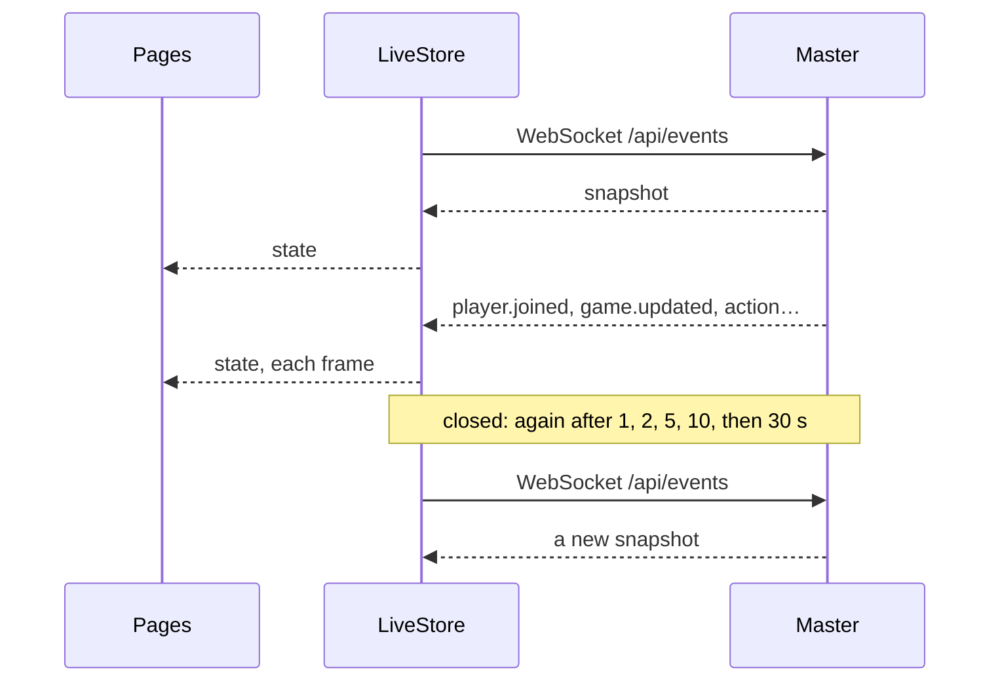

# The panel

The web panel of the administration ([ADR 0025](../decisions/0025-server-administration.md)): a page of the
master that shows the server live and acts on it, through the [administration API](../protocol/admin-api.md).
The master serves its files ([Web server](web.md)); the panel holds no secret and decides nothing: every rule
is the master's. To use it: [Administer a server](../guides/administer-a-server.md).

| | |
|---|---|
| Code | `web/admin/`, apart from the C++: Vite, React, TypeScript (strict), Chakra UI v3, React Router |
| Built | By Node, `npm run build`, to `web/admin/dist/`; installed beside the server as `admin/` with `RTYPE_ADMIN_PANEL_DIR` |
| Design | The Figma frame [R-Type UI — Éléments retenus](https://www.figma.com/design/RrrH0ic4ttdyDoc3nRnWBr/Untitled?node-id=42-3), in `src/theme/system.ts` |
| Tests | Vitest and Testing Library (`src/**/*.test.ts(x)`), the API mocked with MSW; Playwright (`e2e/`) against a real master |
| Develop | [web/admin/README.md](https://github.com/Akinator31/Rtype/blob/main/web/admin/README.md), [Contributing to the panel](../contributing/panel.md) |

## Pages

| Address | Page |
|---|---|
| `/` | The overview: players, players in a game, games, bans; the version, the uptime and the ports; the games and the players over time since the panel opened; the latest events. Message everyone |
| `/games` | The running games, live, filtered by name and by state (stale, with room) |
| `/games/{id}` | A game: its players, their scores, whether alive, their latency; its wave, tick and port. End it, message it, remove a player |
| `/players` | The players of the lobby and their game. Remove one, ban its address for an hour, a day or seven days |
| `/actions` | The record of the actions, newest first, a page of 50 at a time; the addresses banned now, each ban lifted from here |

The master answers `index.html` for each of these addresses ([Routes](web.md#routes)), and React Router shows
the page. Every action opens a dialog first, which says what it does and takes a reason; refused, the dialog
stays open with the error of the master.

## One WebSocket

*The pages read one state; the store keeps it from the WebSocket alone.*

- `LiveStore` (`src/live/store.ts`) opens the WebSocket once, for the whole panel, and gives its state to the
  pages through `useLive()`, a `useSyncExternalStore`: a table updates without a reload, and without a request.
- `applyEvent()` (`src/live/state.ts`) applies a frame to the state, a pure function: the snapshot replaces
  the lists, each event updates one line. It also keeps the feed of events (40 lines), the actions recorded
  since the panel opened, and a sample of the games and the players every 5 seconds, for the chart.
- Closed, the WebSocket is opened again after a delay that grows, 1, 2, 5, 10 then 30 seconds, and the master
  sends a new snapshot: what was missed meanwhile is in it. Meanwhile, the pages show the last state under a
  banner.
- Refused before it opened, it may be the session that expired: the store asks `/api/server`, and on a `401`
  stops trying and says to open `admin-url.txt` again. No new attempt would get a session back.

The routes of the API are read where the events do not carry what a page shows: the bans, for the overview
and the actions page, asked again after each action; the older actions of the record.

## Acting

`src/api/client.ts` sends the actions with the CSRF token of the session, which it asks once from
`/api/session` ([Requests from other sites](web.md#requests-from-other-sites)). A refused request is an
`ApiError`, with the status and the error of the master, which the dialog shows. The panel checks the texts
before sending them, as the master does after: a reason or a message of 200 bytes of UTF-8 at most, a message
on one line.

## The theme

The design gives the panel its values; `src/theme/system.ts` sets each of them once, in the Chakra system:

- **Tokens**: black, the surfaces from `#0a0b0d` to black, borders `#1e2023`, radius 8 px; text white,
  secondary `#8a9097`, hints `#6b7177`, disabled `#33373b`; the red of the alerts `#e8726e`. Chakra's own
  semantic tokens (`bg`, `fg`, `border`) point at them, so its dialogs, fields and tables take them too.
- **Text styles**: `chrome` for the titles of sections, the gradient of the design clipped to the text, its glow
  a drop shadow; `caption`, Inter Medium 10 px in capitals; `number` and `label` in Audiowide.
- **The flare** (`flareRecipe`): text only, no fill. Hovered, focused or selected, a 1 px line of light crosses
  it and its text glows, a sparkle after it; pressed, a short 2 px line under the text; red for what cannot be
  undone.
- The elements of the design each have their component: the gauge (J1), the notification (N1), the banner (N3),
  the feed of events (N6), which fades its lines from 100 % to 22 % with their rank, or the record with their
  age.

## Within the CSP

The master serves the panel with a strict CSP ([The headers](web.md#the-headers)). The panel keeps to it:

- One script, the bundle of Vite, from the panel: no inline script, no `eval`.
- Its fonts (Audiowide, Inter Regular and Medium, under the OFL) and its images in its own files: Vite inlines
  none of them as a `data:` address (`assetsInlineLimit: 0`), which the CSP refuses for fonts.
- Its styles inline, which the CSP allows: Chakra UI writes them at run time.
- Its requests to its own origin only, the WebSocket included.

The end-to-end tests fail on any violation the browser reports.

## Tests

- `src/live/*.test.ts`: the state after each event, the feed, the samples; the store opening the WebSocket,
  reconnecting after its delays, stopping without a session.
- `src/api/client.test.ts`: the CSRF token asked once and sent with each action, none without it; the errors of
  the master; the pages of the record.
- `src/components/components.test.tsx`, `src/pages/pages.test.tsx`: each page from a snapshot, then live; the
  filters; each action through its dialog, what it sends, its notification; a refused action; a cancelled one.
- `e2e/panel.spec.ts`: a real `r-type_server` serving the built panel, and `rtype_panel_players`
  (`tests/helpers/panel_players.cpp`), two players in a game. The panel opened with the address of
  `admin-url.txt`, the game seen live with the latency of its players, ended with a reason, its players back in
  the lobby, the action in the record; their address banned, which removes them, then the ban lifted; a panel without a session told to open `admin-url.txt` again. No CSP
  violation, no error in the console.
