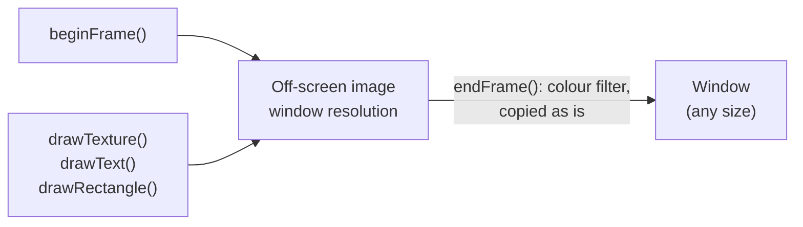
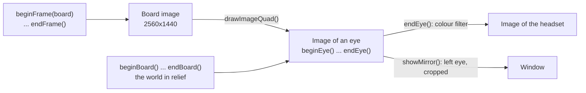

# Rendering

The render library (`libs/render`, namespace `rtype::render`) is the only part of the client that talks to
[raylib](../decisions/0002-raylib-graphics-library.md) for graphics. Its public headers contain no raylib
type: the rest of the client draws through our own classes and types, and does not even link raylib.

| Class / header    | Role                                                                   |
| ----------------- | ---------------------------------------------------------------------- |
| `Window`          | Opens the game window and closes it when destroyed.                    |
| `ResourceManager` | Loads textures and fonts once, and hands out handles to refer to them. |
| `Renderer`        | Draws textures, text and shapes at a fixed logical resolution.         |
| `Types.hpp`       | `Vector2`, `Rectangle`, `Color` and the `colors::` constants.          |
| `Paths.hpp`       | `applicationDirectory()`, the directory of the running executable.     |

## Lifetimes

Graphics resources live in the window's graphics context: textures cannot exist without an open window, and
must be freed before it closes. Each class enforces this with RAII (it acquires what it needs in its
constructor and frees it in its destructor) and by taking the objects it depends on as constructor
parameters:

```cpp
const Window window;                                                   // 1. opens the window
Engine engine;
ResourceManager resources(window, applicationDirectory() / "assets",
                          engine.getThreads().getAssetsWorker());
Renderer renderer(window, resources);                                  // 3. needs the window and the resources
```

C++ destroys local objects in the reverse order of their declaration, so this order is all it takes: the
renderer and the resources are freed before the window closes. Call
`engine.getThreads().stopAll()` when the frame loop ends, before destroying the resource manager.

!!! warning "Declaration order"

    Always declare the window first, then the resources, then the renderer. The constructors make it
    impossible to create the resources or the renderer without a window, but only the declaration order
    guarantees that they are destroyed before it.

## Window

`Window` opens the window in its constructor and closes it in its destructor. It cannot be copied nor moved,
and only one can exist at a time, since raylib supports a single window: creating a second one throws
`std::logic_error`.

```cpp
Window window({.width = 1920, .height = 1080, .title = "R-Type", .targetFps = 144});

while (!window.shouldClose()) { ... }   // close button, system shortcut (Alt+F4), or requestClose()
const float dt = window.frameTime();    // duration of the last frame, in seconds
```

`WindowSettings` also sets whether the window is resizable, whether vertical synchronisation is on, and
whether it opens in fullscreen.

### Window options

Most settings can be changed while the game runs, for instance from an options menu:

| Function                                      | Effect                                                                                          |
| --------------------------------------------- | ----------------------------------------------------------------------------------------------- |
| `setFullscreen(bool)`, `isFullscreen()`       | Switches between a window and fullscreen.                                                       |
| `setSize(width, height)`                      | Resizes the window, in pixels, and centres it on its screen. Leaves fullscreen first.           |
| `update()`                                    | Finishes a change of size the system has not applied yet. Called once per frame.                |
| `monitors()`, `monitor()`                     | The connected screens (name, resolution), and the index of the one the window is on.            |
| `moveToMonitor(index)`                        | Moves the window to another screen: it covers it in fullscreen, or is centred on it.            |
| `setTitle(title)`                             | Changes the title of the window.                                                                |
| `setCursorVisible(bool)`, `isCursorVisible()` | Shows or hides the mouse pointer over the window.                                               |
| `setVsync(bool)`                              | Turns vertical synchronisation on or off.                                                       |
| `setTargetFps(fps)`                           | Sets the maximum number of frames per second, 0 for no limit.                                   |
| `setPacedElsewhere(bool)`                     | While a VR headset paces the frames: no vertical synchronisation nor limit, the values asked kept ([VR](vr.md#who-paces-the-frames)). |
| `requestClose()`                              | Asks the window to close, for instance from a _Quit_ button: `shouldClose()` then returns true. |

**Fullscreen** covers the screen the window is on, at the resolution of that screen: the screen keeps its
video mode. A fullscreen that changes the video mode to match the window is slow to switch, can rearrange the
other screens, and behaves badly when switching to another application; since the game is already scaled to
any window size, it would bring nothing. Leaving fullscreen restores the previous size and position of the
window.

The window drives this fullscreen with GLFW, which raylib is built on (`glfwSetWindowMonitor()`), rather than
with raylib's own functions. Those also remove the title bar of the window and put it back: on Wayland (through
XWayland), the compositor then keeps the window in fullscreen and refuses any other size, and raylib believes
the window has a size it does not have, so the image is drawn in a corner of a black screen. The compositor
also applies the end of fullscreen a few frames late, and can shrink the window by its title bar meanwhile:
for a second after a change of size, `update()` asks for the size again until the window has it.

The client switches fullscreen with ++f11++ (the `ToggleFullscreen` action) or from the menu, and hides the
mouse pointer during the game, where it would hide part of the screen.

### Escape key

raylib closes the window when ++escape++ is pressed by default. `Window` disables this: in a game, Escape
opens a menu rather than quitting without confirmation. The client binds it to the `Menu` action, see
[Controls of R-Type](input.md#controls-of-r-type).

## Resources

### Handles

The `ResourceManager` loads files from the assets directory and returns a **handle** for each one:
`TextureId` for an image, `FontId` for a font. A handle is a small number that is cheap to copy and to store in
an ECS component. Texture and font handles are different types, so one cannot be passed where the other is
expected.

```cpp
const TextureId ship = resources.loadTexture("sprites/ship.png");
const FontId font = resources.loadFont("fonts/FiraSans-Black.ttf", 48);
```

### Each file is loaded once

For nonblocking loading, call `loadTextureAsync()`, `loadFontAsync()` or `loadModelAsync()` and keep the returned `std::shared_future`. Call `finishPendingLoads()` once per frame on the main thread. Check `future.wait_for(std::chrono::seconds(0))` before calling `get()`; draw a placeholder while it is pending. A failure is reported by `get()` as an exception. Requests for the same asset and options share one future. Pass `engine.getThreads().getAssetsWorker()` to the manager constructor. The client's startup displays a loading screen while its menu assets are prepared. See [ADR 0022](../decisions/0022-engine-thread-manager.md) for the thread ownership and shutdown.

Loading the same path again returns the same handle without reading the file again: fifty enemies sharing
one sprite share one texture in graphics memory. Fonts are identified by their path **and** their size,
because a font is rendered to a texture at the size it is loaded with.

Internally, each kind of resource is stored in a `ResourceCache`, a generic container that maps a key (the
path) to a handle and loads missing resources with a function given by the caller. It does not depend on
raylib, which is why it is unit tested without a window (`tests/resource_cache.cpp`). It is part of the core
library (`libs/core`), with the `Handle` type, so that the [audio library](audio.md) uses it too.

### The meshes of a model

`getModelMeshes(model)` lists the meshes of a loaded model, by the index that `drawModel()` hides them by: for a
glTF file, the name of the node that holds each one (or of its mesh), and the centre of its box at rest. raylib
makes a mesh per primitive, node by node, in the order of the file; the names are read again from the file in
that order, since raylib keeps none. A part is found by its name instead of an index that would change with the
file: the cockpit of [VR](vr.md#the-cockpit) finds its canopy and its hologram so.

### Pictures from the network

`loadRoundPicture(key, png, size)` makes a texture from a PNG in memory rather than from a file: the picture
of a player, sent by the master. It keeps the middle square of the image, scales it to `size` pixels, and makes
it transparent outside of its circle, with a pixel of transition so that its edge is smooth; the interface
draws it in the ring of an avatar ([Lists and avatars](scenes-and-interface.md#lists-and-avatars)). The key
names the picture (the server, the account and the version of its picture): the same key returns the same
texture without reading the bytes again.

### Errors

raylib does not report loading errors: a missing file gives an empty texture and a warning in the console.
The `ResourceManager` turns this into a `std::runtime_error` naming the file, so that a missing asset is
noticed immediately.

### Supported formats

!!! warning "No JPEG"

    raylib is built with its default options: images must be **PNG**, BMP, QOI or another format enabled by
    default. **JPEG is not supported**, and is a poor choice for sprites anyway, since it has no
    transparency. Fonts are TTF or OTF files.

### Fonts

By default, raylib only renders the ASCII characters of a font: any other character is drawn as "?". The
`ResourceManager` also renders the Latin-1 characters, which cover the accented letters of most Western
European languages ("é", "ç", "ü", "ß"...), plus "œ", "Œ", "€" and "←". Characters outside of this set, for
instance from Cyrillic or Asian scripts, are still drawn as "?".

A font is loaded only with the characters of this set that it has: `filterCharactersInFont()` reads its table
of characters (cmap) first. A display font with few symbols, such as Orbitron (no "«", "©" or "←"), then loads
without raylib warning about missing glyphs; those characters are drawn as "?" with it.

### Where assets are found

Assets live in `apps/client/assets/`. The build copies them next to the executable, and the client package
ships them in the same place. The client loads them from `applicationDirectory() / "assets"`, so it finds
them wherever it is started from. See [Draw a sprite](../guides/draw-a-sprite.md) for the full workflow.

## Renderer

### Logical resolution

The game has a fixed size, 1920x1080 game units by default, whatever the size of the window. Every position
and size given to the renderer is in these game units: a ship at `x = 1500` is at the same place on every
screen, which is what lets the server and all the clients agree on coordinates.

The whole game area is always shown, scaled as much as the window allows. When the window has another shape
than the game, the view extends **around** the game area, on both sides, instead of leaving black bars: a
16:10 screen shows the 1920x1080 game from `y = -60` to `y = 1140`, a 21:9 screen from `x = -320` to
`x = 2240`. `visibleArea()` gives that part of the game, in game units; the interface is placed relative to
it (the `AnchorSystem` uses it), so that it follows the edges of any screen, while the gameplay stays in the
game area.

Positions coming from the window, such as the mouse pointer, are in window pixels. `windowToGame()` converts
them into game units, taking the scaling into account (see [Mouse](input.md#window-pixels-and-game-units)).

### A frame

Everything is drawn between `beginFrame()` and `endFrame()`, in order: what is drawn last is on top.

```cpp
renderer.beginFrame(colors::Black);
renderer.drawTexture(background, {0.0f, 0.0f});
renderer.drawTexture(ship, {100.0f, 540.0f});
renderer.drawText(font, "Score: 42", {20.0f, 20.0f}, 48.0f, colors::White);
renderer.endFrame();
```

The frame is not drawn directly in the window, but in an off-screen image of the size of the window:



_Drawing calls write in game units to an off-screen image at the resolution of the window; `endFrame()`
copies it into the window._

1. `beginFrame()` recreates the off-screen image if the window changed size, starts drawing into it, fills it
   with the background colour, and sets a 2D view that maps the visible area onto it.
2. The drawing functions write into this image, in game units: the view scales them to pixels, so the image
   stays sharp on a large screen.
3. `endFrame()` copies the image into the window, through the colour filter, then shows it.

The visible area is computed by `computeVisibleArea()` (`Viewport.hpp`), a pure function that is unit tested
(`tests/viewport.cpp`).

### Frames into an image, and the eyes of a headset

In a VR headset ([VR](vr.md#in-the-headset)), the frame is not shown in the window: it is drawn into images,
the board, the panel of the menus and the screens of the cockpit, which each eye of the headset then shows in
3D.

| Function                              | Does                                                                                                         |
| ------------------------------------- | ------------------------------------------------------------------------------------------------------------ |
| `createImage(resolution)`             | Creates an image to draw frames into, filled with black. It lives as long as the renderer.                  |
| `beginFrame(image, background)`       | Starts a frame into the image instead of the window. `endFrame()` leaves it there and makes its mipmaps.     |
| `beginFrame(image, area, background)` | Starts a frame into the image showing an area of the game of its own, stretched to the image: a surface of the interface, a screen of the cockpit of 480 × 360 game units for instance. |
| `beginEye(eye, view, background)`     | Starts a 3D pass for an eye, into an image of the renderer of the size of the eye, with the view and the projection of the headset (`EyeView`). |
| `drawImageQuad(image, transform, look)` | Draws an image as a rectangle in 3D: the square of side 1 around the origin, facing +z, moved by `transform`, transparent where the image is. The images keep their transparency: a frame drawn into an image adds up how much of each pixel is covered, its colours premultiplied, so that a background with a low alpha leaves a pane clear where nothing is drawn on it. `ImageQuadLook` gives its tint, how far its sides bend towards the eye (a curved panel, drawn in 32 strips), and whether it is drawn over everything, whatever its depth. |
| `setModelMaterialImage(model, material, image)` | Shows an image as the emission map of a material of a model, found by its name in the glTF file: the screens of the cockpit show the HUD in the frame and with the glow of the artist. |
| `setModelMaterialGlow(model, material, color)` | Sets the light a material emits: its emission map multiplied by the colour, white as the artist made it, darker to dim it; a material without a map emits the colour all over. The lights of the cockpit that react to the game ([The cockpit alive](vr.md#the-cockpit-alive)). Black is kept one step over black, which the lighting shader would read as no emissive colour, white. |
| `drawSky(texture, tint)`              | Wraps a picture on a sphere around the eye, at infinity (it follows the eye, so it never comes nearer), repeated twice around and twice from top to bottom. Drawn first: it writes no depth. |
| `drawModel(model, light, ...)`, `drawEnergyModel(model, energy, ...)` | The models of a frame, seen by the eye instead of a camera. They do not glow.                 |
| `beginBoard(board)`, `endBoard()`     | Inside an eye, lays the World layer on the board in relief (`BoardView`, `Board.hpp`): between them, the drawings of a frame draw in 3D on the board, the 2D on its plane, the models of an orthographic camera with their depth, out of it, the 2D drawn after `drawGlow()` in front of them; `drawGlow()` makes the glow for the eye. A frame around the board, written in the depth only, hides what goes beyond it. `endBoard()` darkens it by `BoardView::brightness`. See [The board in relief](vr.md#the-board-in-relief). |
| `drawTransparentModel(model, light, ..., hiddenMeshes)` | The transparent meshes of a model (a canopy, a hologram), seen from both sides and without writing their depth, so that what is behind them stays sharp. Drawn after the opaque ones, from the farthest to the nearest. |
| `drawBeam(from, to, width, color)`, `drawDot(centre, radius, color)` | A ribbon of light turned to face the eye, fading towards its end, and a disc of light facing it, added to what is behind them and over everything: the ray of a controller and where it meets the panel. |
| `drawBox(transform, color, edge)`     | The cube of side 1 around the origin, moved by `transform`, of one colour with lit edges: a controller in a hand. |
| `endEye()`                            | Copies the image of the eye, through the colour filter and the dithering, into the framebuffer bound before `beginEye()`: the image of the headset. |
| `showMirror()`                        | Shows the left eye in the window, in place of a frame, cropped to the shape of the window (`computeMirrorCrop()`). |



_In the headset: the frame goes into the board, the board into each eye, with the world in relief for each eye
unless the board is flat, each eye into the headset and the left one into the window._

The frame of an image is the frame of the window, glow and smoothing included, without the vignette, which
belongs to a screen: in the headset the eye looks around the board. The colour filter is not applied to the
image either, but where the eyes are copied to the headset and to the window: it is for the whole view, not
only for the board. While the last frame was drawn into an image, `visibleArea()` is the area that frame showed:
the client draws the board last, so that it is the visible area of the game.

`setModelMaterialImage()` replaces the emission map of the material, and turns the texture coordinates of its
meshes upside down once: an image drawn into is stored from its bottom row, a texture of a glTF file from its
top row. The model keeps its own map aside and gives it back before it is unloaded, as raylib frees the maps
of the materials of a model with it.

An eye is drawn in an image of its own rather than directly in the image of the headset so that it can go
through the colour filter, as the frame of the window does. Its world is in metres, y up, -z ahead, the space of
the headset. The lighting shader takes where the models are seen from (`detail::ViewPoint`): a `Camera` of a
frame is one way to give it, the view matrix of an eye another.

### Drawing functions

| Function                                               | Draws                                                                                                                    |
| ------------------------------------------------------ | ------------------------------------------------------------------------------------------------------------------------ |
| `drawTexture(id, position, tint)`                      | A whole texture at its original size.                                                                                    |
| `drawTexture(id, source, destination, rotation, tint)` | Part of a texture (one frame of a sprite sheet), stretched to the destination and rotated around its centre, in degrees. |
| `drawRectangle(rectangle, color)`                      | A filled rectangle.                                                                                                      |
| `drawCircle(center, radius, color)`                    | A filled circle, for instance a star or a round projectile.                                                              |
| `drawRectangleOutline(rectangle, thickness, color)`    | The outline of a rectangle, for instance a hitbox or a button frame.                                                     |
| `drawCircleOutline(center, radius, thickness, color)`  | The outline of a circle, for instance a round hitbox.                                                                    |
| `drawLine(start, end, thickness, color)`               | A straight line of any thickness, for instance a laser.                                                                  |
| `drawTriangle(first, second, third, color)`            | A filled triangle, for instance a placeholder ship.                                                                      |
| `drawText(font, text, position, size, color)`          | Text with a loaded font.                                                                                                 |
| `drawText(text, position, size, color)`                | Text with raylib's built-in font, for debugging.                                                                         |
| `drawFps(position)`                                    | The number of frames per second, for debugging.                                                                          |

Outlines are drawn **inside** the shape: the outer edge of the outline is the edge of the rectangle or
circle. An outline drawn around a hitbox therefore shows exactly the area that collides.

`textureSize()` and `measureText()` give sizes without drawing, for instance to centre a text. The tint is
multiplied with the texture: white keeps it unchanged, a lower alpha fades it.

### Errors

Drawing outside of a frame, starting a frame twice or ending a frame that was not started throws
`std::logic_error`, with a message telling how to fix the call. These are programming errors: raylib would
otherwise draw to the wrong place without any warning. The same goes for the eyes: a frame and an eye are never
drawn at the same time, the 2D drawings and the models seen through a camera are for a frame or a board,
`drawImageQuad()`, `drawSky()`, `drawBeam()`, `drawDot()`, `drawBox()` and the models without a camera for an eye
out of its board, a board is drawn inside an eye and ended before it, and `showMirror()` is called between two
passes.
`PassOrder` (`PassOrder.hpp`) keeps this order; it holds no graphics resource, so `tests/render_passes.cpp`
checks it without a window.

### Colour filters

A colour filter changes the colours of the whole image, interface included, for colour-blind players or
players with low vision:

```cpp
renderer.setColorFilter(ColorFilter::Deuteranopia);
```

| Filter                                                             | For                                                                                    | Effect                                                                                       |
| ------------------------------------------------------------------ | -------------------------------------------------------------------------------------- | -------------------------------------------------------------------------------------------- |
| `Protanopia`, `Deuteranopia`                                       | Players who do not perceive red or green (red-green colour blindness, about 8% of men) | Shifts the colours they confuse towards colours they can tell apart.                         |
| `Tritanopia`                                                       | Players who do not perceive blue (blue-yellow colour blindness, rare)                  | Same, for blue and yellow.                                                                   |
| `SimulateProtanopia`, `SimulateDeuteranopia`, `SimulateTritanopia` | The team                                                                               | Shows the game as a colour-blind player sees it, to check that sprites stay distinguishable. |
| `HighContrast`                                                     | Players with low vision                                                                | Stronger contrast and saturation.                                                            |

The filter is a **shader** (a small program run by the graphics card on every pixel) applied in `endFrame()`,
when the off-screen image is copied to the window: the game keeps drawing with its normal colours, and the
filter costs one pass over the image. If the graphics card cannot compile it, a warning is logged and the game
is shown unfiltered. Its GLSL code is in the shaders library (`libs/shaders/glsl/`), next to the lighting shader
of the 3D models. At build time, each program becomes a generated header holding its code as strings
(`rtype/shaders/<Program>.hpp`), so the game needs no shader file; the graphics driver compiles them when the
game starts. If `glslangValidator` is installed, the build also checks their syntax.

**How it works.** Simulation uses the matrices of Machado, Oliveira and Fernandes (2009), applied to linear
colours (without the sRGB gamma curve). Correction, also called daltonisation, computes the difference
between the original colour and the simulated one, which is what the player cannot see, and moves it to the
channels they can see. For a player with deuteranopia, the perceived difference between the red and the
green of the test palette goes from 60 to 129 (on a scale of 0 to 441) with the correction.

!!! warning "A help, not a substitute"

    Correction makes confused colours easier to tell apart, it does not restore them. The game must not
    rely on colour only: player ships, enemies and projectiles should also differ by shape, as planned in
    [Accessibility](../accessibility.md). The simulation filters are the way to check it.

### Lighting of the 3D models

`drawModel()` lights a model with the `render::Light` it is given, through `Lighting.frag`:

| Field                   | Effect                                                                                      |
| ----------------------- | ------------------------------------------------------------------------------------------- |
| `direction`, `color`    | The sun: a directional light, with a highlight that depends on the material.                |
| `ambient`               | Light received everywhere, brighter from the top of the screen (`Camera::up`) than below.   |
| `rimDirection`, `rim`   | A rim light from behind, which outlines the edges of the silhouette. Black (off) by default. |

The shading is physically based, as glTF describes materials: a GGX highlight (Cook-Torrance) with a
Fresnel term, so that smooth parts catch a small, bright highlight, rough parts a wide, dim one, and every
surface reflects more at grazing angles. The roughness, metalness and occlusion maps of the materials are
used when they have some, and their roughness and metalness factors otherwise; others are a satin paint
(roughness 0.65, not metal). With no environment map, surfaces reflect the ambient light and a lobe around
the sun, weighted as in image based lighting (an analytic fit of the pre-integrated BRDF), and metals keep a
little diffuse light, so that a metal hull is not black outside of its highlight. Rough metals get back the
light that a single bounce of GGX loses, and the occlusion map also hides the reflections in the creases.
The brightest colours are compressed into white instead of clipping, and the roughness is widened where the
normal map changes quickly on screen, so that small details do not sparkle as the model turns.

Models emit their emission map multiplied by their emissive colour, or that colour all over without a map
(the engine flames of some ships): it shows on the night side and glows (`drawGlow()`). The emissive
strength of glTF is not applied.

### Antialiasing, glow, vignette and dithering

`drawGlow()`, called after the 3D models and before the interface:

1. smooths the jagged edges of what the frame holds (FXAA, `Antialiasing.frag`, `setAntialiasing()`, on by
   default). The frame is drawn in an image without multisampling: without it, the edges of the models are
   staircases of pixels that crawl as they move. The interface, drawn afterwards, keeps its sharp text;
2. draws the energy models and the light the lit models emit (engine flames, windows, beacons) again, at a
   quarter of the resolution. The lit models write their depth there, so that a hull hides the glow of what
   is behind it;
3. blurs this image, then blurs it again at an eighth of the resolution and adds it back as a wider, fainter
   halo, so that the light fades out slowly instead of stopping at the edge of the blur;
4. adds the result over the frame, then darkens its corners (`setVignette()`, 0.22 by default, 0 to turn it
   off), in the frames of the window only. The interface, drawn afterwards, is not darkened.

`endFrame()` always adds a faint noise of plus or minus one level per channel (dithering) when it copies the
frame to the window, in the same pass as the colour filter: the dark gradients of space and of the glow show
no steps.

## Implementation notes

These details only matter when working inside `libs/render`:

- **Pimpl.** `ResourceManager` and `Renderer` store their state in a `struct Impl` defined in their `.cpp`
  file. Their headers can then hold raylib objects without including `raylib.h`.
- **Private header.** The RAII wrappers of raylib textures and fonts are in `src/Resources.hpp`, shared by
  the `ResourceManager`, which loads them, and the `Renderer`, which draws them. `ResourceManager` declares
  `Renderer` as a friend so that it can read them.
- **Name clashes.** Our `Vector2`, `Rectangle` and `Color` have the same names as raylib's types. Inside the
  library, raylib's ones are written `::Rectangle`, and raylib's colour macros (`WHITE`, `BLACK`...) cannot
  be used, as they expand to our `Color`.
- **Triangle winding.** raylib only draws triangles whose corners are given counter-clockwise on screen: the
  others are culled without any warning. `drawTriangle()` reorders the corners, so they can be given in any
  order.
- **Meshes drawn one by one.** `LightingShader` draws each mesh with `DrawMesh()` rather than
  `DrawModelEx()`, to send the roughness and metalness of its material and replace its missing maps with
  plain textures: raylib leaves the texture of the previous mesh bound where a map has none. raylib 6 loads
  the glTF metal/roughness texture as two grey textures, in `MATERIAL_MAP_METALNESS` and
  `MATERIAL_MAP_ROUGHNESS`, with their factors in `value`.
- **glTF factors read again.** raylib keeps the roughness, metalness and emissive factors of a glTF
  material only along with their textures. `detail::Model` reads them again with cgltf, compiled inside
  raylib, and puts them where raylib puts those of textured materials (`value` of the roughness and
  metalness maps, `color` of the emission map). A roughness factor of 0 is taken as none.
- **Upside-down render target.** OpenGL stores off-screen images upside down: `endFrame()` copies the image
  with a negative source height to flip it back. `drawImageQuad()` reads the top of an image at v = 1 for the
  same reason.
- **Framebuffers raylib did not create.** The image of an eye of the headset is a framebuffer of `libs/xr`.
  `beginEye()` reads which one is bound (`rlGetActiveFramebuffer()`), and `endEye()` binds it again and sets a
  2D view of its size by hand, as `BeginTextureMode()` does for its own images. The eye pass sets the
  matrices of the headset with rlgl, as `BeginMode3D()` does with those of a camera.
- **`render::Matrix` and raylib's `Matrix`.** Both exist inside the library: raylib's one is written
  `::Matrix`.

## Limits and next steps

- **No sorting by layer**: the drawing order is the call order. The ECS render system will sort entities by
  layer (background, enemies, players, interface) before drawing them.
- **No 3D yet.** 3D models are planned: they will be drawn on the same plane and in the same game units as
  sprites, so that the server and the gameplay stay in 2D.
