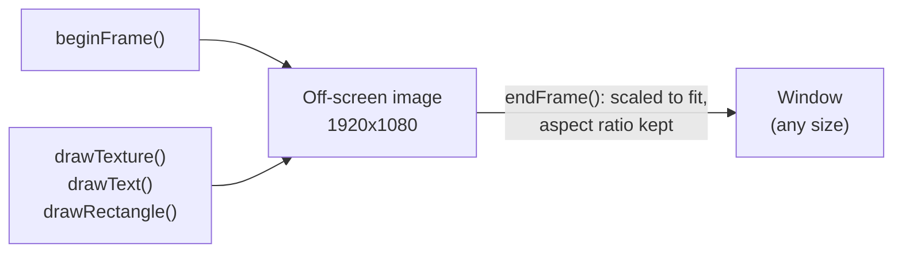

# Rendering

The render library (`libs/render`, namespace `rtype::render`) is the only part of the client that talks to
[raylib](../decisions/0002-raylib-graphics-library.md) for graphics. Its public headers contain no raylib
type: the rest of the client draws through our own classes and types, and does not even link raylib.

| Class / header | Role |
|---|---|
| `Window` | Opens the game window and closes it when destroyed. |
| `ResourceManager` | Loads textures and fonts once, and hands out handles to refer to them. |
| `Renderer` | Draws textures, text and shapes at a fixed logical resolution. |
| `Types.hpp` | `Vector2`, `Rectangle`, `Color` and the `colors::` constants. |
| `Paths.hpp` | `applicationDirectory()`, the directory of the running executable. |

## Lifetimes

Graphics resources live in the window's graphics context: textures cannot exist without an open window, and
must be freed before it closes. Each class enforces this with RAII (it acquires what it needs in its
constructor and frees it in its destructor) and by taking the objects it depends on as constructor
parameters:

```cpp
const Window window;                                                   // 1. opens the window
ResourceManager resources(window, applicationDirectory() / "assets");  // 2. needs an open window
Renderer renderer(window, resources);                                  // 3. needs the window and the resources
```

C++ destroys local objects in the reverse order of their declaration, so this order is all it takes: the
renderer and the resources are freed before the window closes.

!!! warning "Declaration order"

    Always declare the window first, then the resources, then the renderer. The constructors make it
    impossible to create the resources or the renderer without a window, but only the declaration order
    guarantees that they are destroyed before it.

## Window

`Window` opens the window in its constructor and closes it in its destructor. It cannot be copied nor moved,
and only one can exist at a time, since raylib supports a single window: creating a second one throws
`std::logic_error`.

```cpp
Window window({.width = 1920, .height = 1080, .title = "R-Type", .targetFps = 144});

while (!window.shouldClose()) { ... }   // close button, system shortcut (Alt+F4), or requestClose()
const float dt = window.frameTime();    // duration of the last frame, in seconds
```

`WindowSettings` also sets whether the window is resizable, whether vertical synchronisation is on, and
whether it opens in fullscreen.

### Window options

Most settings can be changed while the game runs, for instance from an options menu:

| Function | Effect |
|---|---|
| `setFullscreen(bool)`, `isFullscreen()` | Switches between a window and fullscreen. |
| `setSize(width, height)` | Resizes the window, in pixels. Leaves fullscreen first. |
| `setTitle(title)` | Changes the title of the window. |
| `setCursorVisible(bool)`, `isCursorVisible()` | Shows or hides the mouse pointer over the window. |
| `setVsync(bool)` | Turns vertical synchronisation on or off. |
| `setTargetFps(fps)` | Sets the maximum number of frames per second, 0 for no limit. |
| `requestClose()` | Asks the window to close, for instance from a *Quit* button: `shouldClose()` then returns true. |

**Fullscreen** is a borderless window covering the screen it is on, at the resolution of that screen. raylib
also has an exclusive fullscreen, which changes the video mode of the screen to match the window: it is slow
to switch, can rearrange the other screens, and behaves badly when switching to another application. Since the
game is already scaled to any window size, the borderless mode loses nothing. Leaving fullscreen restores the
previous size and position of the window.

The client switches fullscreen with ++f11++ (the `ToggleFullscreen` action) or from the menu, and hides the
mouse pointer during the game, where it would hide part of the screen.

### Escape key

raylib closes the window when ++escape++ is pressed by default. `Window` disables this: in a game, Escape
opens a menu rather than quitting without confirmation. The client binds it to the `Menu` action, see
[Controls of R-Type](input.md#controls-of-r-type).

## Resources

### Handles

The `ResourceManager` loads files from the assets directory and returns a **handle** for each one:
`TextureId` for an image, `FontId` for a font. A handle is a small number that is cheap to copy and to store in
an ECS component. Texture and font handles are different types, so one cannot be passed where the other is
expected.

```cpp
const TextureId ship = resources.loadTexture("sprites/ship.png");
const FontId font = resources.loadFont("fonts/FiraSans-Black.ttf", 48);
```

### Each file is loaded once

Loading the same path again returns the same handle without reading the file again: fifty enemies sharing
one sprite share one texture in graphics memory. Fonts are identified by their path **and** their size,
because a font is rendered to a texture at the size it is loaded with.

Internally, each kind of resource is stored in a `ResourceCache`, a generic container that maps a key (the
path) to a handle and loads missing resources with a function given by the caller. It does not depend on
raylib, which is why it is unit tested without a window (`tests/resource_cache.cpp`). It is part of the core
library (`libs/core`), with the `Handle` type, so that the [audio library](audio.md) uses it too.

### Errors

raylib does not report loading errors: a missing file gives an empty texture and a warning in the console.
The `ResourceManager` turns this into a `std::runtime_error` naming the file, so that a missing asset is
noticed immediately.

### Supported formats

!!! warning "No JPEG"

    raylib is built with its default options: images must be **PNG**, BMP, QOI or another format enabled by
    default. **JPEG is not supported**, and is a poor choice for sprites anyway, since it has no
    transparency. Fonts are TTF or OTF files.

### Fonts

By default, raylib only renders the ASCII characters of a font: any other character is drawn as "?". The
`ResourceManager` also renders the Latin-1 characters, which cover the accented letters of most Western
European languages ("é", "ç", "ü", "ß"...), plus "œ", "Œ" and "€". Characters outside of this set, for
instance from Cyrillic or Asian scripts, are still drawn as "?".

### Where assets are found

Assets live in `apps/client/assets/`. The build copies them next to the executable, and the client package
ships them in the same place. The client loads them from `applicationDirectory() / "assets"`, so it finds
them wherever it is started from. See [Draw a sprite](../guides/draw-a-sprite.md) for the full workflow.

## Renderer

### Logical resolution

The game is drawn at a fixed **logical resolution**, 1920x1080 by default, whatever the size of the window.
Every position and size given to the renderer is in these game units: a ship at `x = 1500` is at the same
place on every screen, which is what lets the server and all the clients agree on coordinates.

Positions coming from the window, such as the mouse pointer, are in window pixels. `windowToGame()` converts
them into game units, taking the scaling and the black bars into account (see
[Mouse](input.md#window-pixels-and-game-units)).

### A frame

Everything is drawn between `beginFrame()` and `endFrame()`, in order: what is drawn last is on top.

```cpp
renderer.beginFrame(colors::Black);
renderer.drawTexture(background, {0.0f, 0.0f});
renderer.drawTexture(ship, {100.0f, 540.0f});
renderer.drawText(font, "Score: 42", {20.0f, 20.0f}, 48.0f, colors::White);
renderer.endFrame();
```

The frame is not drawn directly in the window, but in an off-screen image at the logical resolution:



*Drawing calls write to an off-screen image at the logical resolution; `endFrame()` scales it into the window.*

1. `beginFrame()` starts drawing into the off-screen image and fills it with the background colour.
2. The drawing functions write into this image, in game units.
3. `endFrame()` copies the image into the window, scaled to the largest size that fits while keeping its
   aspect ratio and centred, then shows it. The remaining space is filled with black bars.

The area used in the window is computed by `letterbox()` (`Viewport.hpp`), a pure function that is unit
tested (`tests/viewport.cpp`). For instance, on a 2560x1080 screen, the 1920x1080 game is drawn at its
original size with 320 pixels of black bar on each side.

### Drawing functions

| Function | Draws |
|---|---|
| `drawTexture(id, position, tint)` | A whole texture at its original size. |
| `drawTexture(id, source, destination, rotation, tint)` | Part of a texture (one frame of a sprite sheet), stretched to the destination and rotated around its centre, in degrees. |
| `drawRectangle(rectangle, color)` | A filled rectangle. |
| `drawCircle(center, radius, color)` | A filled circle, for instance a star or a round projectile. |
| `drawRectangleOutline(rectangle, thickness, color)` | The outline of a rectangle, for instance a hitbox or a button frame. |
| `drawCircleOutline(center, radius, thickness, color)` | The outline of a circle, for instance a round hitbox. |
| `drawLine(start, end, thickness, color)` | A straight line of any thickness, for instance a laser. |
| `drawTriangle(first, second, third, color)` | A filled triangle, for instance a placeholder ship. |
| `drawText(font, text, position, size, color)` | Text with a loaded font. |
| `drawText(text, position, size, color)` | Text with raylib's built-in font, for debugging. |
| `drawFps(position)` | The number of frames per second, for debugging. |

Outlines are drawn **inside** the shape: the outer edge of the outline is the edge of the rectangle or
circle. An outline drawn around a hitbox therefore shows exactly the area that collides.

`textureSize()` and `measureText()` give sizes without drawing, for instance to centre a text. The tint is
multiplied with the texture: white keeps it unchanged, a lower alpha fades it.

### Errors

Drawing outside of a frame, starting a frame twice or ending a frame that was not started throws
`std::logic_error`, with a message telling how to fix the call. These are programming errors: raylib would
otherwise draw to the wrong place without any warning.

## Implementation notes

These details only matter when working inside `libs/render`:

- **Pimpl.** `ResourceManager` and `Renderer` store their state in a `struct Impl` defined in their `.cpp`
  file. Their headers can then hold raylib objects without including `raylib.h`.
- **Private header.** The RAII wrappers of raylib textures and fonts are in `src/Resources.hpp`, shared by
  the `ResourceManager`, which loads them, and the `Renderer`, which draws them. `ResourceManager` declares
  `Renderer` as a friend so that it can read them.
- **Name clashes.** Our `Vector2`, `Rectangle` and `Color` have the same names as raylib's types. Inside the
  library, raylib's ones are written `::Rectangle`, and raylib's colour macros (`WHITE`, `BLACK`...) cannot
  be used, as they expand to our `Color`.
- **Triangle winding.** raylib only draws triangles whose corners are given counter-clockwise on screen: the
  others are culled without any warning. `drawTriangle()` reorders the corners, so they can be given in any
  order.
- **Upside-down render target.** OpenGL stores off-screen images upside down: `endFrame()` copies the image
  with a negative source height to flip it back.

## Limits and next steps

- **No sorting by layer**: the drawing order is the call order. The ECS render system will sort entities by
  layer (background, enemies, players, interface) before drawing them.
- **No 3D yet.** 3D models are planned: they will be drawn on the same plane and in the same game units as
  sprites, so that the server and the gameplay stay in 2D.
