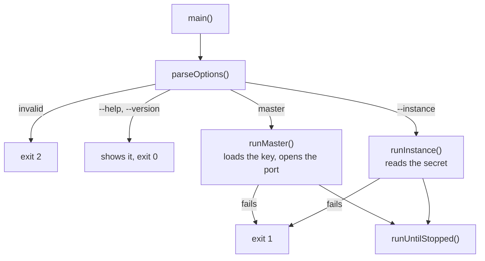
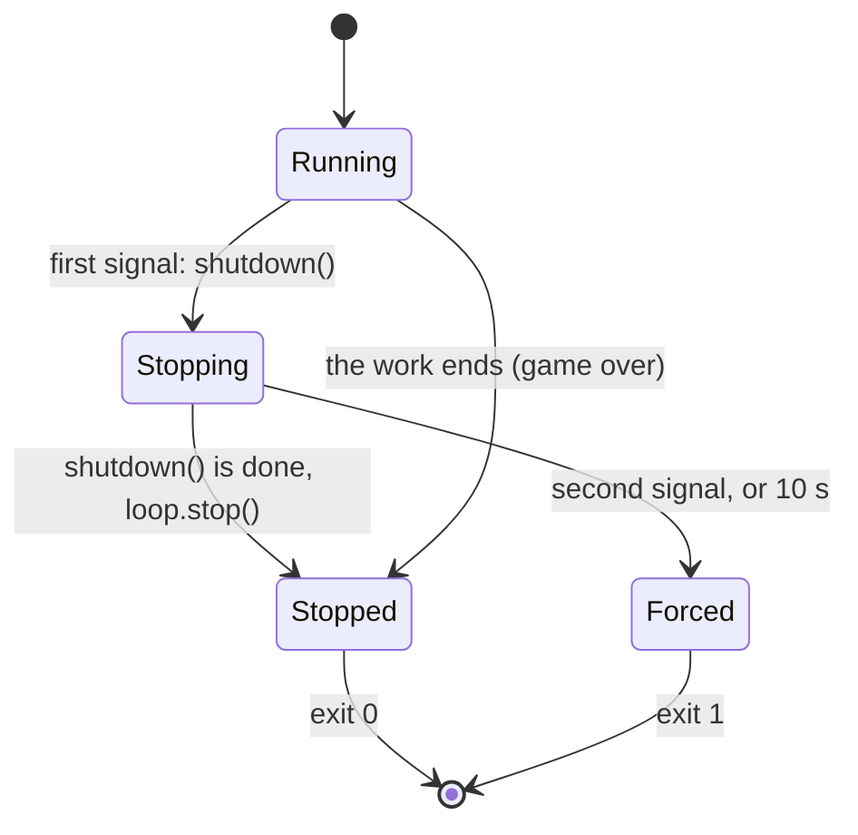

# Server

`r-type_server` is one binary with two modes ([ADR 0013](../decisions/0013-one-process-per-game.md)): the
**master**, started by whoever hosts the server, runs the lobby; each **instance**, started by the master with
`--instance`, runs one game. This page describes how the program starts, what it is given, and how it stops.
The lobby and the game come in the next steps of the "Server & networking" work.

To run a server, see [Run a server](../guides/run-a-server.md).

## Code layout

```
apps/server/src/
  main.cpp                 reads the environment, then calls run()
  Server.cpp               run(): the options, then the master or an instance
  Common/                  what both modes share
    Options.cpp            the command line of both modes, the exit codes
    Lifecycle.cpp          runUntilStopped(): the event loop and the stop signals
    Secret.cpp             the secret the master gives to its instances
  Master/                  the master: the lobby, and the instances it starts
    Master.cpp             runMaster()
    Process.cpp            Process: starts a program and stops it, on Linux and Windows
  Instance/                an instance: one game
    Instance.cpp           runInstance()
```

Everything but `main.cpp` is the library `r-type_server_core`, so that the tests can call it
(`tests/server_options.cpp`, `tests/server_lifecycle.cpp`, `tests/process.cpp`). Includes are written from `src/`, like in the client:
`#include "Common/Options.hpp"`. The next steps add their files to the folder of their mode: the lobby and the
supervision of the instances in `Master/`, the game loop in `Instance/`, the messages between them in `Common/`.

## Starting



*The options are checked first; then each mode does everything that can fail before it starts running, so that
a server that cannot work stops at once with the reason.*

### Master

| Option | Default | Meaning |
|---|---|---|
| `-p`, `--port <port>` | 4242 | TCP port of the lobby; 0 lets the system choose |
| `--bind <ip>` | `0.0.0.0` | Address to listen on: every interface by default, `127.0.0.1` for this machine only |
| `--game-ports <first>-<last>` | 4243–4299 | UDP ports of the games, one per game: their number is the most games at once |
| `-k`, `--key <file>` | `server.key` | Private key of the server ([Generate the server keys](../guides/generate-the-server-keys.md)) |
| `--check` | | Loads the key and opens the port, then exits: checks a configuration without running it |

The master loads its key (`ServerIdentity::load()`) and opens its port before anything else, and logs both:

```
INFO  master   Lobby on TCP 0.0.0.0:4242, games on UDP 4243-4299 (57 at most)
INFO  master   Server key 4026de0635ae89391bff98b7b9ddc0689fa8529f9804e4c4721eadce94d92dff
INFO  master   Master started: Ctrl+C to stop
```

The fingerprint is the one the clients pin: compare it with `r-type_keygen --fingerprint server.pub` when
something looks wrong.

### Instance

The master starts each instance with these arguments ([instances protocol](../protocol/instances.md#1-starting-an-instance)),
never by hand:

| Option | Meaning |
|---|---|
| `--instance` | The instance mode |
| `--id <id>` | Id of the game, from 1 |
| `--udp-port <port>` | UDP port of the game |
| `--master-port <port>` | Port where the master listens for its instances, on `127.0.0.1` |

It then writes the **secret** on the instance's standard input: 64 hexadecimal digits and a line feed. The
instance reads it before anything else (`readSecret()`), and stops with code 1 without it. The secret proves to
the master that the process connecting is the one it started; it is never an argument, since every user of the
machine can read the arguments of a process (`ps`).

**Standalone mode.** `r-type_server --instance --standalone --udp-port 4242` runs a game without a master, with a
fixed test key, for the tests, the measures and the fuzzing. It only exists in **debug builds**
(`RTYPE_STANDALONE_INSTANCE`): a released server refuses it.

### Common options

| Option | Meaning |
|---|---|
| `--log-level <level>` | `trace`, `debug`, `info`, `warning` or `error`; wins over `RTYPE_LOG_LEVEL` ([Logging](logging.md)) |
| `-h`, `--help` | Shows the usage |
| `--version` | Shows the version, the one of the project |

The options of one mode are refused in the other (`--key` with `--instance`, `--id` without it), as are unknown
options: a typo never goes unnoticed.

## Stopping

Both modes end in `runUntilStopped(loop, shutdown)`, which runs the event loop on the main thread and handles
the **stop signals**: Ctrl+C (`SIGINT`), `SIGTERM` (sent by `kill`, systemd or `docker stop`), and on Windows
Ctrl+Break and the closing of the console.



*The first signal starts a proper stop; a second one, or the grace period, cuts it.*

1. **The first signal** calls `shutdown`, which ends the work properly and calls `loop.stop()` once done. For
   now the master closes its port; later it sends `SHUTDOWN` to its instances and waits for them, and an
   instance sends `DISCONNECT (SHUTDOWN)` to its players.
2. **A second signal** stops at once: the person who pressed Ctrl+C twice does not want to wait.
3. **After 10 seconds** (`GracePeriod`) without the loop stopped, the server stops at once too: a stop that
   hangs never blocks a restart.

```
INFO  server   SIGINT received: stopping (again to stop at once)
INFO  master   Master stopped
```

Under the hood, `StopSignals` (`libs/network`) receives the signals on the loop's thread, and a `Timer` counts
the grace period ([Networking](networking.md#timers-and-stop-signals)). A signal handler of the C library could
only set a flag: here the shutdown is ordinary code, which may close sockets and log.

## Processes

The master starts its instances with `Process` (`Master/Process.hpp`), which wraps
[reproc](https://github.com/DaanDeMeyer/reproc) ([ADR 0013](../decisions/0013-one-process-per-game.md)). It is
the only part of the server that knows the processes of the system, on Linux and Windows.

```cpp
const std::vector<std::string> arguments = {"--instance", "--id", "7", "--udp-port", "4251", "--master-port", "5000"};
rtype::server::Process instance(rtype::server::currentExecutable(), arguments,
                                {.input = formatSecret(secret) + "\n", .stopGrace = std::chrono::seconds(5)});

instance.exitCode(); // its exit code once it has exited, nothing while it runs: never waits
instance.stop();     // asks it to stop, waits stopGrace, kills it if it still runs
```

- **Its own executable.** `currentExecutable()` asks the system for the path of the program running
  (`/proc/self/exe` on Linux, `GetModuleFileNameW()` on Windows): `argv[0]` can be relative or a name found in
  the `PATH`, and the instance must be the same build as its master.
- **The arguments arrive unchanged**: there is no shell, so a space, a quote or a `;` is just a character.
  reproc does the quoting of the command line of Windows, where a backslash before a quote is a trap.
- **The secret goes through the standard input**, written before the program starts (`input`), which is then
  closed. Nothing can be written later: writing to an instance that has already died would raise `SIGPIPE`
  and stop the master.
- **Its output is the master's**: the logs of the instances go to the same terminal, or the same journal.
- **Stopping** comes in two steps. `terminate()` asks: `SIGTERM` on Linux, Ctrl+Break on Windows, which
  `runUntilStopped()` of the instance receives like Ctrl+C, so that it can tell its players. `kill()` stops at
  once. `stop()` does both: it asks, waits `stopGrace`, then kills. On Windows, Ctrl+Break needs a console:
  without one, `stop()` kills at once.
- **No program left behind**: destroying a `Process` that still runs calls `stop()`, even when an exception
  goes through the master.

| Exit code | Meaning |
|---|---|
| `0`, `1`, `2` | The [exit codes](#exit-codes) of `r-type_server` |
| `Process::Terminated` (143) | Stopped by `terminate()` without handling it: 128 + `SIGTERM`, as a shell shows it |
| `Process::Killed` (137) | Stopped by `kill()`: 128 + `SIGKILL`, the same value on Windows |

`exitCode()` never blocks, so the master can check its instances from a `Timer` of its event loop; `wait()` and
`stop()` block, for the tests and the end of the master. The supervision of the instances itself comes with the
lobby.

## Exit codes

| Code | When |
|---|---|
| `0` | Stopped properly: after a stop signal, after `--help`, `--version` or `--check`, or at the end of its game for an instance |
| `1` | Could not start (key missing or invalid, port in use, no secret), stopped on an unexpected error, or stop forced |
| `2` | Invalid arguments |

The master reads the exit code of its instances: anything but 0 is a crash, which it reports to the players
([instances protocol](../protocol/instances.md#3-life-and-death-of-an-instance)).

## Tests

- `tests/server_options.cpp` (tag `[server]`): the defaults, every option of both modes, every invalid
  combination, `--help` and `--version` first, the standalone mode refused in release, the exit codes of
  `run()`, a master without its key, an instance without a secret, and the secret itself.
- `tests/server_lifecycle.cpp` (tag `[server]`): `SIGINT` and `SIGTERM`, sent to the test process itself, call
  the shutdown once; a second signal and the grace period force the stop; a server whose work ends stops
  properly.
- `tests/process.cpp` (tag `[process]`): real programs started and stopped. A helper,
  `tests/helpers/process_child.cpp`, does what its arguments say: exits with a code, checks its standard input
  and its end, writes its arguments to a file, waits, or ignores the requests to stop. The tests check the
  exit codes, arguments with spaces, quotes and backslashes, the input then its end, a program that does not
  exist, `terminate()`, `kill()`, `stop()` killing a program that ignores it, the destructor and the moves.
  They also start `r-type_server --instance` itself: with its secret it runs until asked to stop, then exits
  with 0; without it, it exits with 1.
- The smoke tests of CTest run `r-type_server --help`, refuse an unknown argument, and run `--check` with a key
  made by `r-type_keygen` for the occasion.

## Limits and next steps

- **No lobby yet**: the master opens its port but does not accept the clients; the lobby comes with
  `server: master and lobby`.
- **No game yet**: an instance reads its secret, then waits; the connection to the master, its UDP port and its
  game come with `server: instance mode`.
- **No configuration file**: everything is on the command line, which suits a service (systemd, Docker). A file
  can come if the options multiply.
