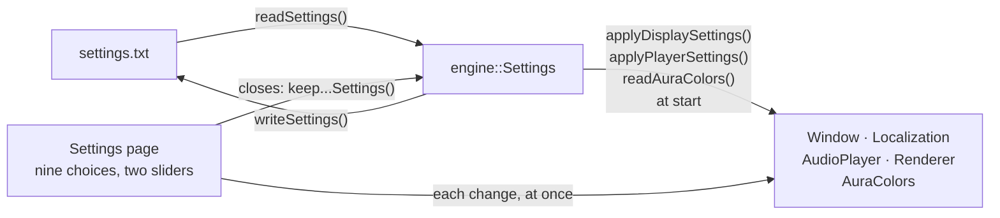

# Settings

`rtype::engine::Settings` lives in `libs/engine` (`rtype/engine/Settings/Settings.hpp`) and uses neither the ECS nor raylib. It keeps values from one run of the client to the next, each under a key: the settings of the player, and the servers it trusts ([Playing online](client-online.md#trusted-servers)). The `Engine` owns one, reached with `engine.getSettings()`.

The values live in memory. `readFile()` replaces them with the content of the file given to the constructor or to `setPath()`; a missing file leaves no value, as on a first run. `writeFile()` writes them, creating the directories of the file. It writes to `<file>.tmp` first and then renames it, so a crash while writing keeps the previous settings. On Unix, the file is readable and writable by its owner only (mode `0600`), set before anything is written: it holds the session tokens of the accounts. On Windows, the data directory of the player is already its own.

```cpp
rtype::engine::Settings &settings = engine.getSettings();
settings.setInt("audio.volume", 80);
const int volume = settings.getInt("audio.volume").value_or(100);
settings.writeFile();
```

Values are set and read as `String`, `Int`, `Float` or `Bool`. They are stored as text, so a getter returns `std::nullopt` when the key is missing or when its value is not of the requested type: `value_or()` gives the default. `hasKey()`, `removeKey()` and `keys(prefix)` (the keys that start with a prefix, sorted: the servers met, for instance) complete the API.

## The file

The client reads `settings.txt` from the data directory of the player when it starts (`rtype::render::userDataDirectory()`: `%APPDATA%\R-Type` on Windows, `$XDG_DATA_HOME/r-type` or `~/.local/share/r-type` elsewhere). A file that cannot be read is logged, and the client starts without it.

The file is text, one `key=value` line per value, sorted by key. A backslash, `=` and line breaks in a key or a value are escaped with a backslash. Lines without `=` are ignored, and Windows line ends are accepted.

Name keys by domain with dots, so that the file stays readable:

| Keys | Written by |
|---|---|
| `audio.effects_volume` | The Settings page (`keepPlayerSettings()`): the volume of the sound effects, from 0 to 1 |
| `audio.music_volume` | The Settings page: the volume of the music, from 0 to 1 |
| `display.color_filter` | The Settings page: the colour filter of the image, `none`, `protanopia`, `deuteranopia`, `tritanopia` or `high_contrast` |
| `controls.<action>` | The Controls page (`keepControlSettings()`): the keyboard keys of an action of `GameActions`, by name, such as `controls.move_up=Up,W` or `controls.fire=Space`; empty for no key |
| `display.fps_limit` | The Settings page: the limit of frames per second, `0` for none (60 by default) |
| `display.monitor` | The Settings page (`keepDisplaySettings()`): the screen of the game, by its index, from 0 for the primary screen |
| `display.resolution` | The Settings page: `fullscreen`, or the size of the window, such as `1600x900` |
| `display.vsync` | The Settings page: the vertical synchronisation, `true` (by default) or `false` |
| `game.aura.allies` | The Settings page (`keepAuraColors()`): the colour of the aura around the ships of the other players and of their allies, `off`, `blue` (by default), `cyan`, `green`, `yellow`, `orange`, `red`, `purple` or `white` |
| `game.aura.enemies` | The Settings page: the colour of the aura around the Bydos, as above (`red` by default) |
| `game.aura.own` | The Settings page: the colour of the aura around the ship of the player, as above (`green` by default) |
| `interface.language` | The Settings page: the language of the interface, `en` or `fr` |
| `servers.known.<host>:<port>` | `KnownServers`: the fingerprint of the key the player trusted for that server |
| `servers.session.<host>:<port>` | `SessionTokens`: the session token of the account signed in on that server, 64 hexadecimal digits, sent in the next `HELLO` ([Accounts](client-online.md#accounts)). A secret: never logged |
| `servers.profile.<host>:<port>` | `KnownProfiles`: the account signed in on that server, shown in the Online menu: `<1 if Discord, else 0>:<version of its picture>:<username>`; the picture itself in `pictures/<version>.png` beside the settings ([Profiles](client-online.md#profiles)) |
| `ship.equipped` | The hangar (`writeEquippedShip()`): the code of the ship the player equipped last, such as `VX-03`, on which the hangar opens at the next run |

## The Settings page

The Settings page of the main menu (`apps/client/src/MainMenu/SettingsMenu.cpp`) sets the language, the
volumes of the music and of the sound effects, the colour filter of the image
([Rendering](rendering.md#colour-filters)), the colours of the auras around the ships in the game
([Auras](client-game.md#auras)), the screen the game is on and its resolution. Three files of
`apps/client/src/Settings/` keep them: `PlayerSettings.hpp` the language, the volumes and the filter,
`AuraSettings.hpp` the auras, `DisplaySettings.hpp` the screen and the resolution.



*The choices are read and applied when the client starts, applied at once on the page, and written when the
page closes.*

The page is two columns of named groups ([Pages of settings](scenes-and-interface.md#pages-of-settings)): on the
left *General*, *Audio* and *Accessibility*, on the right *Display* and *Controls*. Each row shows its caption on
the left and its value on the right, on a column shared by every row; Right, the wheel, Enter and a click go to
the next value, Left to the previous one (`stepValue()`, `apps/client/src/Settings/NextValue.hpp`). Under the
right column, a note explains the row that has the focus (`settings.hint.*` in the translations).

| Group | Row | Widget | What it changes |
|---|---|---|---|
| General | Language | Choice: English, French | `Localization::setLanguage()`, and the captions of the sliders |
| Audio | Music, Sound effects | Sliders, by steps of 5% | `AudioPlayer::setMusicVolume()`, `setEffectsVolume()` |
| Accessibility | Colour filter | Choice: none, protanopia, deuteranopia, tritanopia, high contrast (`PlayerColorFilters`) | `Renderer::setColorFilter()` |
| Display | Screen | Choice: "2 · DELL U2720Q", the connected screens (`moveToMonitor()`) | `Window::moveToMonitor()` |
| Display | Resolution | Choice: fullscreen, then the window sizes smaller than the screen (`resolutionsFor()`) | `Window::setFullscreen()`, `setSize()` |
| Display | Frame rate | Choice: 60, 120, 144, 165, 240, unlimited (`FpsLimits`) | `Window::setTargetFps()` |
| Display | VSync | Choice: on, off | `Window::setVsync()` |
| Controls | Keyboard and gamepad | Opens the Controls page, to choose the key of each action ([Input](input.md#choosing-the-keys)) | `assignKey()` |

- **At start**, right after the settings are read, `applyDisplaySettings()` moves the window to the kept
  screen and gives it the kept resolution; then, once the translations are loaded, `applyPlayerSettings()`
  gives the language and the volumes, and `readColorFilter()` the filter. A missing or wrong value leaves the
  default: English, both volumes at 100%, no filter, the screen the window opened on, fullscreen. A volume out
  of 0..1 is clamped; a screen no longer connected, or a window size too large for the screen, is ignored.
- **Fullscreen is the resolution of the screen.** In fullscreen the window covers the screen, which keeps its
  own video mode ([Rendering](rendering.md#window-options)). The other resolutions are
  the sizes of a window, from `WindowSizes` (1280 × 720 to 3840 × 2160), only those smaller than the screen;
  the image is scaled to any size. A window moved to a screen too small for it goes fullscreen.
- **The frame rate needs VSync off above the refresh rate of the screen.** With the vertical synchronisation
  on, the frames wait for the screen: a 60 Hz screen stays at 60 frames per second, whatever the limit.
- **The filters that simulate a colour blindness** are for the team, and not offered on the page.
- **The page reads over the 3D background**: a veil darkens the left of the screen under it, and the captions
  and values are bright on it, rather than grey on the planet of the main menu.
- **When the page closes** (its back button or Escape), `keepPlayerSettings()` and `keepDisplaySettings()` keep
  the values, and `writeSettings()` writes the file, once, rather than at every step of a slider. A file that
  cannot be written is logged: the choices then last until the client closes.

The tests are in `tests/player_settings.cpp` and `tests/display_settings.cpp` (tag `[settings]`). Moving the
window needs a screen, and is not tested there.

## Not the data of the server

The settings are the client's, on the machine of the player. The data a server keeps is a separate system, with
its own library, and shares no code with them.
