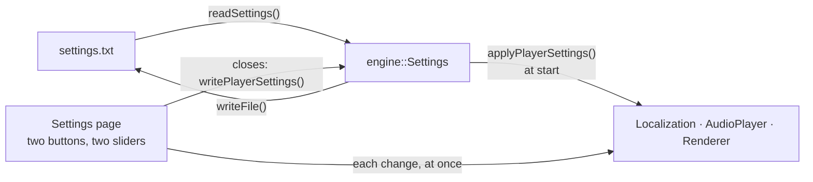

# Settings

`rtype::engine::Settings` lives in `libs/engine` (`rtype/engine/Settings/Settings.hpp`) and uses neither the ECS nor raylib. It keeps values from one run of the client to the next, each under a key: the settings of the player, and the servers it trusts ([Playing online](client-online.md#trusted-servers)). The `Engine` owns one, reached with `engine.getSettings()`.

The values live in memory. `readFile()` replaces them with the content of the file given to the constructor or to `setPath()`; a missing file leaves no value, as on a first run. `writeFile()` writes them, creating the directories of the file. It writes to `<file>.tmp` first and then renames it, so a crash while writing keeps the previous settings.

```cpp
rtype::engine::Settings &settings = engine.getSettings();
settings.setInt("audio.volume", 80);
const int volume = settings.getInt("audio.volume").value_or(100);
settings.writeFile();
```

Values are set and read as `String`, `Int`, `Float` or `Bool`. They are stored as text, so a getter returns `std::nullopt` when the key is missing or when its value is not of the requested type: `value_or()` gives the default. `hasKey()` and `removeKey()` complete the API.

## The file

The client reads `settings.txt` from the data directory of the player when it starts (`rtype::render::userDataDirectory()`: `%APPDATA%\R-Type` on Windows, `$XDG_DATA_HOME/r-type` or `~/.local/share/r-type` elsewhere). A file that cannot be read is logged, and the client starts without it.

The file is text, one `key=value` line per value, sorted by key. A backslash, `=` and line breaks in a key or a value are escaped with a backslash. Lines without `=` are ignored, and Windows line ends are accepted.

Name keys by domain with dots, so that the file stays readable:

| Keys | Written by |
|---|---|
| `audio.effects_volume` | The Settings page (`writePlayerSettings()`): the volume of the sound effects, from 0 to 1 |
| `audio.music_volume` | The Settings page: the volume of the music, from 0 to 1 |
| `display.color_filter` | The Settings page: the colour filter of the image, `none`, `protanopia`, `deuteranopia`, `tritanopia` or `high_contrast` |
| `interface.language` | The Settings page: the language of the interface, `en` or `fr` |
| `servers.known.<host>:<port>` | `KnownServers`: the fingerprint of the key the player trusted for that server |
| `ship.equipped` | The hangar (`writeEquippedShip()`): the code of the ship the player equipped last, such as `VX-03`, on which the hangar opens at the next run |

## The Settings page

The Settings page of the main menu (`apps/client/src/MainMenu/Submenus.cpp`) sets the language, the
volumes of the music and of the sound effects, and the colour filter of the image
([Rendering](rendering.md#colour-filters)). `apps/client/src/Settings/PlayerSettings.hpp` keeps them:



*The choices are read and applied when the client starts, applied at once on the page, and written when the
page closes.*

- **At start**, right after the translations are loaded, `applyPlayerSettings()` gives the kept language to the
  `Localization` and the volumes to the `AudioPlayer`, and `readColorFilter()` gives the filter to the
  `Renderer`. A missing or wrong value (a language not loaded, a volume that is not a number, an unknown
  filter) leaves the default: English, both volumes at 100%, no filter. A volume out of 0..1 is clamped.
- **On the page**, the language button, the two sliders and the colour filter button change the translations,
  the audio and the image at once, so that the player hears the new volume while dragging and sees the
  filter. The filter button goes through `PlayerColorFilters`: none, protanopia, deuteranopia, tritanopia,
  high contrast. The filters that simulate a colour blindness are for the team, and not offered there.
- **When the page closes** (its back button or Escape), `writePlayerSettings()` keeps the four values and
  writes the file, once, rather than at every step of a slider. A file that cannot be written is logged: the
  choices then last until the client closes.

The tests are in `tests/player_settings.cpp` (tag `[settings]`).

## Not the data of the server

The settings are the client's, on the machine of the player. The data a server keeps is a separate system, with
its own library, and shares no code with them.
