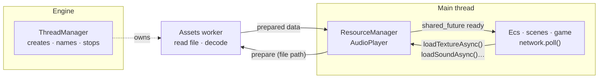
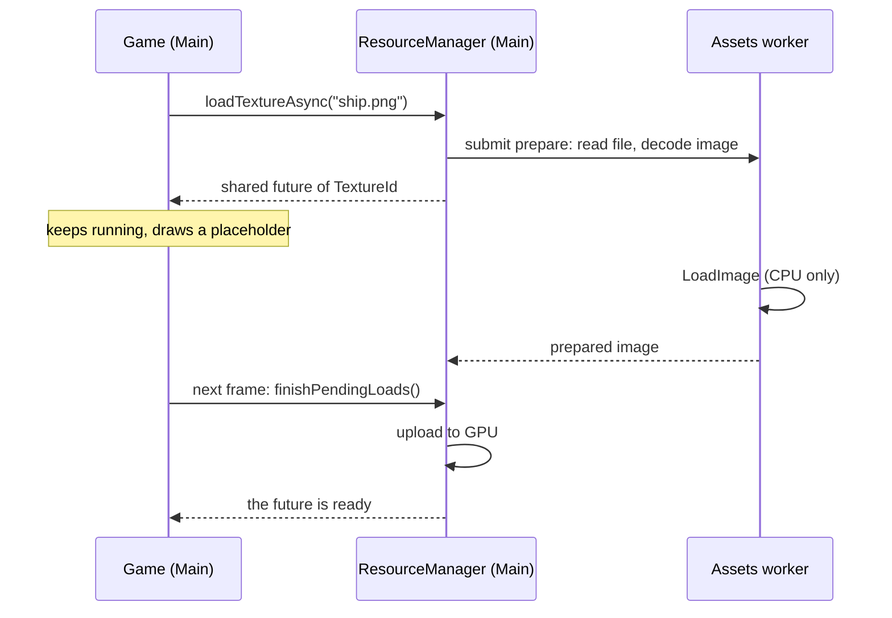
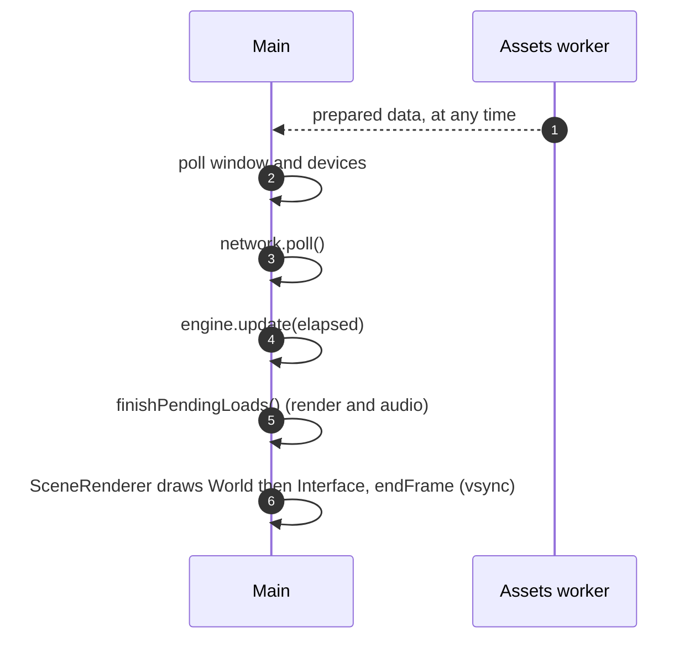
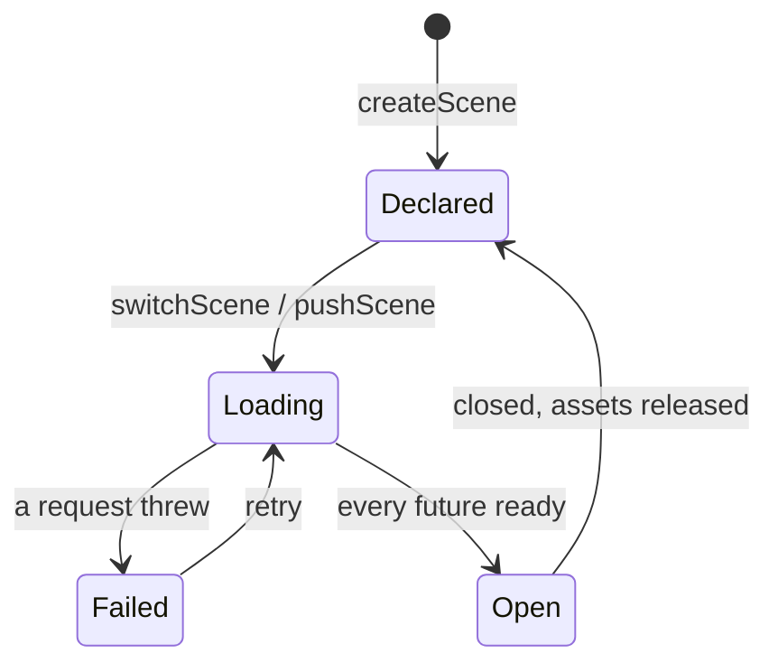
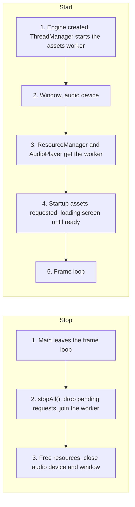

# Threads

!!! note "Status: partially implemented"
    [ADR 0022](../decisions/0022-engine-thread-manager.md) records the worker ownership and shutdown design
    and supersedes ADR 0017. Scene asset manifests and automatic loading are implemented in #225. The render
    and logic threads of #117 and #118 were not merged.

## Why change

Today each feature starts its own thread wherever it needs one:

- the logic thread of #118 is a `std::thread` written in `apps/client/src/main.cpp`, with its own stop flag,
  its own error handling and its own join;
- the asset worker is created lazily by `AssetLoadingService`, and every `ResourceManager`, `AudioPlayer` or
  `AsyncResourceRequests` built without a loader silently starts **another** `BackgroundLoader`;
- to make concurrent access safe, mutexes were added inside `Ecs::defer` and the engine events (#118), so the
  ECS stops being single-owner and pure.

Nobody knows the full list of threads, the order they stop in, or which thread may touch what.

The new design puts a **`ThreadManager` inside the `Engine`**: the only place that creates threads, names
them and stops them. **In the game, it runs a single worker: asset loading.** Everything else stays on the
main thread.

## The threads

| Thread     | Owns (only this thread touches it)                                                                                                               | Work                                                                                     |
| ---------- | ------------------------------------------------------------------------------------------------------------------------------------------------ | ---------------------------------------------------------------------------------------- |
| **Main**   | window, raylib (graphics, input, audio), `Renderer`, `ResourceManager`, `AudioPlayer`, `Ecs`, scenes, events, game systems, `network::EventLoop`, `discord::Session` | the frame loop: input, `network.poll()`, `discordSession.poll()`, `engine.update()`, finishing the loads, drawing |
| **Assets** | nothing persistent                                                                                                                               | reads asset files and decodes them in CPU memory, one request at a time                  |

Why nothing else gets a thread:

- **Rendering and logic**: the logic costs a fraction of a millisecond per frame for a few hundred entities.
  Splitting it from the rendering would mean copying every frame for the renderer, a mailbox for the input,
  cross-thread text measurements and one more frame of latency, for almost no gain. The `SceneRenderer`
  keeps reading the ECS directly.
- **Audio**: raylib (miniaudio) already mixes on its own internal thread, and captures the microphone of the
  voice on another ([The audio threads](#the-audio-threads)).
- **Network**: the sockets never block, `EventLoop::poll()` handles what is ready and returns at once, and the
  sessions are written to run on the game's thread without locks ([Client online](client-online.md)). A
  network thread would only copy each message into a queue that Main reads at the start of the frame, which
  is what `poll()` already does. Timeouts (5 s) are far above a slow frame.

The **only work that blocks for long is reading and decoding files**: it is the only one moved off Main.

raylib is not thread safe and its graphics context belongs to the thread that opened the window: every raylib
call that touches the GPU, the window or the audio device happens on Main. The Assets thread only calls
CPU-only functions (`LoadImage`, `LoadFileData`, `LoadWave`…).

## Overview



## Rules

1. **Only the `ThreadManager` creates threads.** `ResourceManager`, `AudioPlayer` and `AsyncResourceRequests`
   receive the engine's assets worker; they no longer create one by default.
2. **One owner per object.** The worker never sees the ECS, a resource handle or a raylib object that needs
   the GPU or the audio device. No mutex protects game state: the locks added in #118 go away.
3. **The worker only exchanges values**: a file path and options in, decoded data (an `Image`, a `Wave`, file
   bytes) out.
4. **Main never blocks on the worker.** It checks a request with `wait_for(0)`, never `get()` while it is
   pending, and draws a placeholder or a loading screen meanwhile.

## Loading an asset

The prepare/finish split of #116 is kept: **prepare** on the worker, **finish** on Main. Main finishes at most
one ready request per asset type each frame (`finishPendingLoads()`), so a burst of loads does not make one
frame stall.



| Asset   | Assets worker                    | Main thread                                            |
| ------- | -------------------------------- | ------------------------------------------------------ |
| Texture | read, decode image               | upload, mipmaps                                        |
| Font    | read, decode glyphs, build atlas | upload atlas                                           |
| Model   | read bytes                       | parse and upload (raylib has no CPU-only model loader) |
| Sound   | read, decode wave                | create the audio buffer                                |
| Music   | read                             | create the stream                                      |

Requests for the same path and options share their future; a failed request reports its exception through
it and can be retried (ADR 0017).

## One frame



## The audio threads

miniaudio, compiled into raylib, runs threads of its own, which call back into the client. The voice of the
games online ([Voice](voice.md#the-devices)) uses two of them:

| Thread | Calls | Shares with Main |
|---|---|---|
| **Output** of raylib | the callback of each `AudioStream` of `audio::VoiceStreams`, while it mixes | a `RingBuffer` of 200 ms per player: Main writes the voice decoded, the callback reads it, silence when it is empty |
| **Output** of raylib, while the microphone is open | the processor of `audio::OutputLoopback`, once the mix is done | a `RingBuffer` of one second: the callback writes what is played, in mono, Main reads it as the reference of the echo cancellation |
| **Capture** of `voice::Microphone`, while it is open | its data callback, every 10 ms | a `RingBuffer` of one second: the callback writes the samples, Main reads them by frames of 20 ms |
| The audio thread of **Discord**, while its call is connected | the received callback of `StartCallWithAudioCallbacks`, with the voice of a member | a `RingBuffer` of 500 ms per slot in the `Inbox` of `discord::DiscordVoice`, and the id of the member of each slot, an `atomic<uint64_t>` that Main writes: the callback finds the slot of the member, mixes down and resamples to 48 kHz mono, writes; Main reads in `poll()` and writes to the `VoiceStreams`. The `Inbox` is shared with the callback (`shared_ptr`), which may run a little after the call ends |
| The same thread of **Discord** | the captured callback of `StartCallWithAudioCallbacks`, with the microphone of the player | in the same `Inbox`: an `atomic<bool>` that Main sets while the `GameVoice` reads it, in a mixed game (`DiscordVoice::capture()`), a `RingBuffer` of 500 ms, and an `atomic<uint64_t>` that counts every sample captured, read by Main to tell whether Discord gives the microphone at all. The callback mixes down and resamples to 48 kHz mono, and writes only while open; Main reads it as the microphone of the `GameVoice` |
| A thread of ours, detached, each time a microphone closes | `ma_device_uninit()` of the device closed, which it owns | nothing: the device, its ring buffer and its flags are its own, the context of miniaudio shared (`shared_ptr`) and uninitialised after the last device. Main never waits for it: with a Bluetooth headset on PipeWire whose profile Discord just changed, `ma_device_uninit()` can block for ever, which froze the game loop |
| A thread of miniaudio, while the microphone is open | its notification callback, when the device stops | an `atomic<bool>`: the device was lost (unplugged), and Main opens a microphone again at its next `read()`. A stop asked by Main sets another flag first, so that it is not taken for a loss |

- **Without a lock.** Each `RingBuffer` (`libs/voice`) has one producer and one consumer, and two counters
  that only grow, atomic: neither thread ever waits on the other. An audio callback that waited on Main would
  be heard as a click; Main that waited on a callback would drop a frame.
- **What does not fit is dropped**: the producer writes what fits, never waits for room. A stream full is a
  stream 200 ms behind; a microphone not read for a second loses its oldest samples.
- **Nothing else crosses.** The callbacks touch their ring buffer only, and the notification its flag: the decoding, the encoding and the
  jitter buffer run on Main, in `GameVoice::poll()`. They find their buffer without a lock: the user pointer of
  the device for the capture; for the streams, whose callbacks of raylib take no pointer, one function per slot
  and a variable of `VoiceStreams.cpp`, set before the first stream opens and cleared after the last closes; for
  the loopback, a variable of `OutputLoopback.cpp`, set before `AttachAudioMixedProcessor()` and cleared after
  `DetachAudioMixedProcessor()`. The sound processing of the microphone (the echo cancellation, the noise
  suppression and the gain control of WebRTC) runs on Main too, in `GameVoice::poll()`, never in a callback
  ([Voice](voice.md#the-sound-processing)).
- **They stop before their buffer goes.** `UnloadAudioStream()` and `DetachAudioMixedProcessor()` take the
  lock of the output thread, and
  `ma_device_uninit()` waits for the capture callback: no callback runs after either, so the ring buffers can
  be freed. In `main.cpp`, the game played stops before the devices of the voice (`StopSessions`).

Its tests carry 200,000 items from one thread to another, every one in order (`tests/voice_jitter.cpp`).

## Scene loading (dynamic)

The assets worker is what makes loading the next scene in the background possible. Each scene declares the
assets it needs, and `switchScene()` / `pushScene()` load them by themselves: there is no separate call to
load a scene ahead.

```cpp
engine.createScene("level2", {
    .assets = {
        {AssetType::Model, RTYPE_MODEL_BOSS},
        {AssetType::Sound, RTYPE_SOUND_LASER},
    },
}, buildLevel2);

engine.switchScene("level2"); // requests the missing assets, shows "loading" until they are ready, then opens
```



- `switchScene()` / `pushScene()` request every asset of the scene that is not loaded yet. If none is
  missing, the scene opens at the next update, as today.
- Otherwise the engine pushes the `"loading"` scene (an ordinary named scene chosen by the client) and checks
  the futures at each update with `wait_for(0)`. When all are ready, it pops it and applies the switch.
- `SceneAssets` counts the open scenes using each asset. At zero, it is unloaded. A memory budget with LRU eviction can come
  later.
- `SceneSettings::assets` holds a type and path for each resource. The client also distinguishes smooth
  textures with `AssetType::SmoothTexture`; other textures use the default filtering.
- The client registers its `SceneAssetLoader` with the engine and pumps `ResourceManager` and `AudioPlayer`
  after every update. The worker prepares files; the main thread creates and frees graphics and audio
  resources.
- A failed request keeps the loading scene visible. The client displays the error and retries when R is
  pressed. A new scene request cancels the pending transition.
- Resource handles are stable while loaded. Unloading a resource invalidates its old handle; reopening the
  scene loads it again and assigns a new handle. Game scene handles are rebuilt when the scene opens.

## API sketch

Explicit members, no generic registry: adding a thread later means adding a member.

```cpp
namespace rtype::engine
{
/// Creates and stops every thread of the engine. For now: the assets worker.
class ThreadManager
{
    std::thread::id _main = std::this_thread::get_id();
    std::shared_ptr<core::BackgroundLoader> _assets = std::make_shared<core::BackgroundLoader>();

public:
    ThreadManager() = default;
    ThreadManager(const ThreadManager &) = delete;
    ThreadManager &operator=(const ThreadManager &) = delete;
    ~ThreadManager();                       // stopAll()

    /// The worker that reads and decodes asset files. Given to ResourceManager and AudioPlayer.
    [[nodiscard]] std::shared_ptr<core::BackgroundLoader> getAssetsWorker() const;
    /// For asserts: assert(engine.getThreads().isMainThread()).
    [[nodiscard]] bool isMainThread() const;
    /// Drops the requests not started, waits for the running one and joins. Idempotent.
    void stopAll();
};
}
```

```cpp
// apps/client/src/main.cpp
rtype::engine::Engine engine;
ResourceManager resources(window, assetsDirectory, engine.getThreads().getAssetsWorker());
AudioPlayer audio(device, assetsDirectory, engine.getThreads().getAssetsWorker());
// ... frame loop ...
engine.getThreads().stopAll(); // before the resources, the audio device and the window are freed
```

`BackgroundLoader` stays the worker itself (FIFO queue, `submit()` returning a future); it gains the ability to
drop pending requests on stop, which then report a cancellation through their future.

## Start and stop



The worker stops before anything is freed, so no prepared data arrives for a manager that is gone.

## What changes in the current code

| Kept                                                                         | Changed                                                               | Dropped                                                                                                |
| ---------------------------------------------------------------------------- | --------------------------------------------------------------------- | ------------------------------------------------------------------------------------------------------ |
| `BackgroundLoader`, `AsyncResourceRequests`, the prepare/finish split (#116) | `AssetLoadingService` becomes `ThreadManager` (`engine.getThreads()`) | the default private `BackgroundLoader` of `ResourceManager`, `AudioPlayer` and `AsyncResourceRequests` |
| `finishPendingLoads()` pumped by Main                                        | `BackgroundLoader` drops pending requests on stop                     | #117 (render thread: `RenderCommands`, `InputMailbox`, `RenderQueries`)                                |
| `network.poll()` on Main                                                     |                                                                       | #118 (logic thread, mutexes in `Ecs` and engine events)                                                |

## Migration plan

Each step is one PR that builds without warnings and keeps the tests green.

1. **engine**: `ThreadManager` replaces `AssetLoadingService`; `BackgroundLoader` can stop with pending
   requests; tests (one worker, stop with pending requests, `isMainThread()`).
2. **render, audio, core**: the loader becomes a required argument; the client and the tests pass the
   engine's worker; explicit `stopAll()` at shutdown.
3. **Scenes**: asset manifests loaded by `switchScene()` / `pushScene()`, `"loading"` scene, reference
   counting.
4. **ADR** recording this design, superseding 0017. PR #221 (#117, #118) is closed without merging.

## Server

The server does not link the engine and keeps its own threads ([Server](server.md)): the master runs its
network loop, its database thread ([Database](database.md#the-database-thread)) and the two threads of its web
server ([Web server](web.md#responses-from-the-loop)), each instance its network loop and its game thread.

The web threads never touch the lobby, the games or the administration: a request that needs them posts its
work to the loop, which replies, and the reply is sent back by the web thread of the connection. Neither waits
for the other. The live events go the other way: the loop hands each frame of a WebSocket to the web thread of
its connection, under the lock that keeps the connection alive meanwhile
([Web server](web.md#the-websocket)). The administration records its actions through the database thread, and
gets their ids back on the loop ([Administration](administration.md)).

The accounts add the two threads of the `PasswordHasher` ([Accounts](accounts.md#passwords)), which the master
starts when its settings enable `[accounts]`: each hashes or
checks a password, a few tens of milliseconds of Argon2, and posts its result to the loop. They touch nothing
of the loop; a full queue refuses at once rather than make the loop wait.

The mails of the accounts go through one more thread, the one of the `CurlMailer`
([Accounts](accounts.md#the-mailer)): the loop queues a mail and goes on, the thread talks to the mail server,
up to 30 seconds a mail, and tries again later. Nothing comes back to the loop: whether a mail left only the
logs tell. A full queue, or an address with its mails of the hour, refuses at once.

The requests of the accounts are answered on the loop by the `AccountService`
([Accounts](accounts.md#in-the-lobby)), which hands their work to the database thread, the hasher and the
mailer, and gets the results back on the loop: it holds no lock, and no thread of its own. The administrators of
the panel are signed in the same way, by `PanelAccounts` on the loop ([Web server](web.md#accounts)): a request
of the web server posted to the loop waits there for the database thread, the hasher or Discord, without
blocking either side.

The master runs one more thread, the one of its relay ([Server](server.md#the-relay)): its
own `EventLoop`, the one public UDP socket of the games and a socket on the loopback for the instances. It copies
every datagram of every game, so it never waits on the lobby, its TLS or its database. The loop of the master
posts it every change of its table (an instance ready, a session added or released, an instance gone) and a
copy of the bans; nothing comes back but its counters, which are atomic. The master stops it once every instance
has exited, before its own loop. Its tests also run under ThreadSanitizer.
