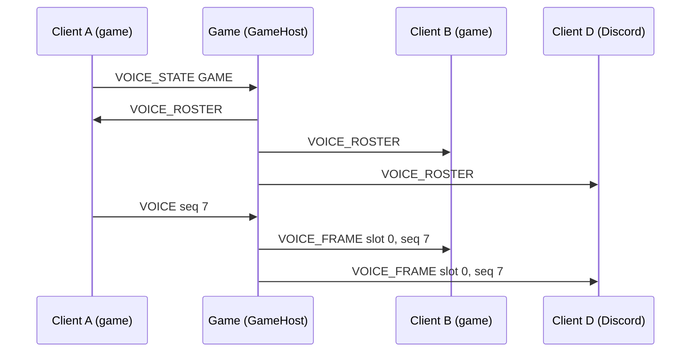
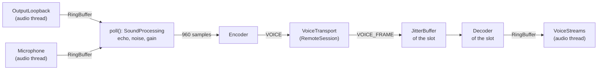
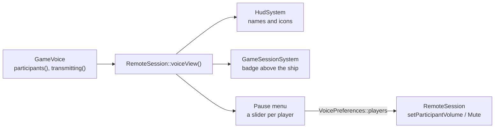

# Voice

!!! warning "In progress"

    The voice chat is being built. This page describes what exists: the interface, the rule of the backends,
    the codec, the messages of the game protocol, the devices, the voice of the game, the sound processing of
    the microphone, the talk modes, the keys, the Voice page, and the voice in the HUD and in the pause menu.
    The spatial voice comes with the next steps.

The players of an online game talk to each other. Each player's voice is carried by one **backend**: the voice
of the game, in its UDP session, or Discord; both in the same game
([ADR 0032](../decisions/0032-voice-chat-in-the-game-session.md)).

The voice library (`libs/voice`, namespace `rtype::voice`) holds what the client knows of the voice, in four
targets:

| Target | Header | Content |
|---|---|---|
| `rtype::voice` | `rtype/voice/VoiceChannel.hpp` | `VoiceChannel`, the voice of one game for the player of this client; `Participant`, `Join`, `Position`, `Slot` |
| `rtype::voice` | `rtype/voice/Backend.hpp` | `Backend` (`None`, `Game`, `Discord`), `carriedByGame()` and `name()` |
| `rtype::voice` | `rtype/voice/Status.hpp` | `Status`: what a player tells about its voice, muted, deafened, without a microphone |
| `rtype::voice` | `rtype/voice/Format.hpp` | `SampleRate`, `FrameSamples`, `FramesPerSecond`, `MaxFrameBytes`: what the codec, the protocol and the devices agree on |
| `rtype::voice` | `rtype/voice/Devices.hpp` | `Capture`, `Playback` and `Loopback`: the microphone, the voices played and what the speakers play, as interfaces |
| `rtype::voice` | `rtype/voice/RingBuffer.hpp` | `RingBuffer`: what an audio thread and the game loop share, without a lock |
| `rtype::voice_codec` | `rtype/voice/Codec.hpp` | `Encoder`, `Decoder`, `isValidFrame()`: the voice in Opus |
| `rtype::voice_processing` | `rtype/voice/Processing.hpp` | `SoundProcessing`, `ProcessingSettings`: the echo cancellation, the noise suppression and the gain control of the microphone, by WebRTC |
| `rtype::voice_client` | `rtype/voice/JitterBuffer.hpp` | `JitterBuffer`: the frames of one player put back in order and in time |
| `rtype::voice_client` | `rtype/voice/GameVoice.hpp` | `GameVoice`, the `VoiceChannel` of the voice of the game, and the `VoiceTransport` it goes through |
| `rtype::voice_client` | `rtype/voice/Talk.hpp` | `TalkMode`, `PushToTalk`, `VoiceActivity`, `LevelMeter`, `levelOf()`: how the player talks, pure |
| `rtype::voice_client` | `rtype/voice/Microphone.hpp` | `Microphone`: the `Capture` of a microphone of the system, the default one or one chosen |

`rtype::voice` is header only, without dependency: `libs/game` (the messages) and the server know the backends
and the format without Opus.
`rtype::voice_codec` is built on libopus, a private dependency: no Opus type in its header.
`rtype::voice_processing` is built on webrtc-audio-processing and abseil, private dependencies: neither in
its headers.
`rtype::voice_client` links the codec and the processing, and raylib for its miniaudio, privately: no
miniaudio in its headers.
The voices are played by `audio::VoiceStreams` of `libs/audio` ([Audio](audio.md#the-voices)), the `Playback`
of the client; what the speakers play is taken by its `audio::OutputLoopback`, the `Loopback` of the client.

## The backends

Every player of a game has a backend, which the game knows and tells every client.

| Backend | The player talks and hears |
|---|---|
| `None` | Not at all: voice off, no device, or a game without voice |
| `Game` | Through the game: its voice goes to the game, which forwards it |
| `Discord` | Through the lobby of the game in Discord, and through the game for the players on `Game` |

**The game carries a voice unless both players are on Discord**, and never from or to a player on `None`:

| From → to | `Game` | `Discord` | `None` |
|---|---|---|---|
| `Game` | the game | the game | — |
| `Discord` | the game | Discord | — |
| `None` | — | — | — |

```cpp
rtype::voice::carriedByGame(Backend::Discord, Backend::Game);    // true
rtype::voice::carriedByGame(Backend::Discord, Backend::Discord); // false: Discord carries it
```

So in a game of two players on Discord and two on the game, each hears the three others once: the test
`In a game of two players on Discord and two on the game, each hears the three others once` checks every pair.

## The voice channel

The client knows one `VoiceChannel` per online game, whatever carries each voice. Every call is made on the
thread of the game loop.

```cpp
voice.join({.self = accepted.slot});
voice.addParticipant(joined.slot);                // PLAYER_JOINED
voice.setBackend(slot, roster.backend(slot));     // VOICE_ROSTER
// In the game loop, every frame
voice.setTalking(actions.isActive(Action::PushToTalk));
voice.poll();
for (const rtype::voice::Participant &player : voice.participants()) {
    hud.setSpeaking(player.slot, player.speaking);
}
voice.leave();                                     // LEFT_GAME, or the session lost
```

| Call | Effect |
|---|---|
| `join(Join)` / `leave()` | Joins the voice of the game this client joined; leaves it, closing the devices |
| `addParticipant(slot)` / `removeParticipant(slot)` | Another player came in, or left; a new one is on `None` until the roster says otherwise |
| `setBackend(slot, backend)` | What carries the voice of a player |
| `setStatus(slot, Status)` | What a player tells about its voice ([The status of each player](#the-status-of-each-player)) |
| `setSelfMute(bool)` / `setTalking(bool)` | Nobody hears the player of this client; it talks now (push-to-talk held or voice detected) |
| `setParticipantVolume(slot, v)` / `setParticipantMute(slot, bool)` | For this client only; the volume from 0 to `MaxVolume` (2), 1 by default |
| `setParticipantPosition(slot, Position)` | Where the ship of a player is, for the spatial voice; a 3D vector, `z` 0 in the 2D game |
| `participants()` | The other players: slot, backend, speaking, its status, muted by me, volume |
| `poll()` | Once per frame: what came since the last call |

A device that cannot be opened is not an error, as for the [audio](audio.md): the player hears nothing or is
heard by nobody, and the game goes on.

## The codec

The voice is encoded with [Opus](https://opus-codec.org/) 1.6.1, through CPM from the release archive of
Xiph, with its hash. Its license (BSD) is installed with the client, in `licenses/opus.txt`.

| | |
|---|---|
| Samples | 48 kHz (`SampleRate`), mono, signed 16 bits |
| Frame | 20 ms, 960 samples (`FrameSamples`); 1 to 160 bytes encoded (`MaxFrameBytes`) |
| Mode | `OPUS_APPLICATION_VOIP`, `OPUS_SIGNAL_VOICE`, variable bit rate |
| Bit rate | 24 kbit/s by default (`EncoderSettings::bitrate`): about 60 bytes per frame |
| Losses | In-band FEC on, for 10 % of frames lost (`EncoderSettings::expectedLoss`; 0 turns it off) |
| Silence | DTX (`EncoderSettings::discontinuous`): after 200 ms of silence, frames of 1 or 2 bytes and an update of the noise every 400 ms (`EncodedFrame::discontinued`), none of them sent (`EncodedFrame::silence()`) |

```cpp
rtype::voice::Encoder encoder;
const rtype::voice::EncodedFrame frame = encoder.encode(samples);   // 960 samples
if (!frame.silence()) {
    session.sendVoice(frame.data());
}
```

The encoder never gives more than 160 bytes: Opus lowers the quality of a frame that would not fit.

**One decoder per player**, since it keeps what it heard to make up what it did not. For each frame, in
order:

| The frame | Call |
|---|---|
| Received | `decode(frame, samples)` |
| Lost, the next one received | `decodeFec(next, samples)`: the copy of the lost frame that the next one carries, then `decode(next, …)` as usual |
| Lost, with nothing after it | `conceal(samples)`: made up from the frames before, fading to silence |

A frame comes from the network: `decode()` and `decodeFec()` refuse, and return false for, anything but a valid
Opus packet of 20 ms of 1 to 160 bytes (`isValidFrame()`), and leave the samples as they were. A packet of
another length (10 ms, 40 ms) is refused, so that every frame is the same 960 samples.

## In the game session

The voice travels in the UDP session of the game
([game protocol, section 9.4](../protocol/game.md#94-the-voice)), in six messages of `libs/game`
(`rtype/game/Messages.hpp`):

| Message | Direction | Content |
|---|---|---|
| `VOICE` (`0x41`) | Client → game, unreliable | `VoiceMessage`: sequence, last of a talk spurt, 1 to 160 bytes of Opus |
| `VOICE_STATE` (`0x42`) | Client → game, reliable | `VoiceStateMessage`: the backend of the player |
| `VOICE_FRAME` (`0x84`) | Game → client, unreliable | `VoiceFrameMessage`: the slot of the player who talks, then as `VOICE` |
| `VOICE_ROSTER` (`0x85`) | Game → client, reliable | `VoiceRosterMessage`: the backend of each slot |
| `VOICE_STATUS` (`0x43`) | Client → game, reliable | `VoiceStatusMessage`: the `Status` of the player, one byte of flags |
| `VOICE_STATUSES` (`0x86`) | Game → client, reliable | `VoiceStatusesMessage`: the `Status` of each slot |

These are new types, which an older client or game would ignore. Game protocol 3 adds the account of each
player to `PLAYER_JOINED`, so that a client keeps its choices for another player under it
([In the HUD and the pause menu](#in-the-hud-and-the-pause-menu)).



*A player on the game talks: the game forwards its frame to every other player with a voice, on the game or on
Discord. A frame of D, on Discord, would go to A and B, never to another player on Discord, who hears D there.*

- **The game** (`GameHost`, [Server](server.md)) keeps the backend of each player, sends the roster at every
  change, and forwards each frame to the others, within the rate of a `VoiceRate`: 60 frames per second, bursts
  of 10.
- **The client** (`RemoteSession`, [The client online](client-online.md#remotesession)) tells its backend,
  sends the frames it is given in the datagram of the next `INPUT`, and keeps the frames of the others and the
  roster. Given the devices of the voice, it runs a [`GameVoice`](#the-voice-of-the-game) through them.

## The status of each player

Each player tells the others what it does with its voice (`voice::Status`), so that their HUD shows it:

| Flag | Set while |
|---|---|
| `muted` | Muted by itself: its mute key, deafened, or its voice turned off (`GameVoice::selfMuted()`) |
| `deafened` | Deafened by its key (`GameVoice::deafened()`) |
| `noMicrophone` | Its microphone could not be opened the last time it was unmuted (`GameVoice::microphoneMissing()`): it listens only |

`RemoteSession` sends `VOICE_STATUS` once accepted, then at every change; the game keeps the status of each
player and sends `VOICE_STATUSES` to everyone at every change, and to a newcomer at its connection; the client
gives each status to its `GameVoice` (`setStatus()`), which keeps it in the `Participant`. The status only
informs: a player muted by itself sends no voice, whatever it says.

## The devices

The voice has three devices, interfaces of `rtype/voice/Devices.hpp`, called on the game loop only: a
`Capture` (`open()`, `close()`, `read()` the samples captured), a `Playback`, one stream per player
(`open(slot)`, `close(slot)`, `write(slot, samples)`, `setVolume(slot, volume)`, `available()`), and a
`Loopback`, what the speakers play (`open()`, `close()`, `read()` the samples played). All are 48 kHz mono,
signed 16 bits. The client gives the real ones; the tests give fakes (`tests/helpers/FakeVoiceDevices.hpp`).

| Device | Real one | How |
|---|---|---|
| Microphone | `voice::Microphone` | A `ma_device` of capture through the miniaudio raylib compiles: its callback writes to a `RingBuffer` of one second, which `read()` empties |
| Voices | `audio::VoiceStreams` | One `AudioStream` of raylib per slot, with a callback that reads a `RingBuffer` of 200 ms, silence when it is empty |
| What is played | `audio::OutputLoopback` | A processor of the mix of raylib (`AttachAudioMixedProcessor()`): its callback mixes the two channels down to one and writes them to a `RingBuffer` of one second, which `read()` empties |

- **One miniaudio.** raylib 6.0 compiles miniaudio 0.11.24 into itself, capture included. `Microphone.cpp`
  includes its `external/miniaudio.h` without the implementation, with the defines raylib compiles it with
  (`MA_NO_JACK`, `MA_NO_WAV`…, as `raudio.c`), so that `ma_device` has the same layout, and links the symbols
  of raylib. Neither a second copy nor a new dependency.
- **The microphone is open only while it can be heard**: in a game, in a mode other than off, neither muted
  nor deafened; or on the Voice page, to try it. The system shows it in use only then.
- **The microphone is chosen** on the Voice page, by its name (`Microphone::devices()`, from
  `ma_context_get_devices()`), the default of the system otherwise. A microphone unplugged while open is
  followed: its device stops, its notification callback says so, and the next `read()` opens the one chosen if
  it is back, the default of the system otherwise. A name not found at `open()` is the default too.
- **The output is the one of raylib**: the voices are mixed with the music and the effects, on the device
  raylib opened, the default of the system (`InitAudioDevice()` takes no device). Choosing another output for
  the voices would mean a second playback device of ours, beside raylib's.
- **The output runs at 48 kHz**, the rate of the voice, whatever the device: raylib is compiled with
  `AUDIO_DEVICE_SAMPLE_RATE=48000` (`libs/CMakeLists.txt`), and miniaudio converts when the device differs.
  The voices are played without being resampled, and what the speakers play is the reference of the echo
  cancellation sample for sample.
- **Without a device, no error**: no microphone, the player listens only; no audio output
  (`Playback::available()` false), the player has no voice, `NONE`.
- **The audio threads never wait**: each callback shares a `RingBuffer` with the game loop, one producer and
  one consumer, without a lock; what does not fit is dropped ([Threads](threads.md#the-audio-threads)).

## The voice of the game

`GameVoice` is the `VoiceChannel` of a player on `Backend::Game`. It goes through a `VoiceTransport`, the
session with the game (`send()` a frame, `receive()` those of the others), which `RemoteSession` is.



- **Out.** While the player talks and is not muted, each 960 samples of the microphone go through the
  [sound processing](#the-sound-processing) (`setProcessing()`), are given their volume
  (`setInputVolume()`), encoded and sent with their sequence. With the voice activity on
  (`setVoiceActivity(threshold)`), only the frames of the voice go ([The talk modes](#the-talk-modes)).
  Silence is not sent (DTX); when the player stops talking, the next frame goes with `last`.
  At most 60 ms of microphone wait for the next `poll()`: after a stall of the game loop, the oldest are
  dropped rather than sent late.
- **In.** The frames of a player go into its `JitterBuffer`, unless it has no voice (`carriedByGame()` false),
  is muted by this player, or this player is deafened (`setDeafened()`). The jitter buffer gives back 20 ms at a time, at their pace; each is decoded by
  the `Decoder` of its player and written to its stream: the frame, or the copy the next one carries
  (`decodeFec()`), or concealed. A player is `speaking` while its last frame played is less than 200 ms old.
- **The players** are those of `PLAYER_JOINED`, on `NONE` until the roster; each has its stream, open from
  `join()` to `removeParticipant()` or `leave()`, at its volume times the volume of the voices
  (`setOutputVolume()`), 0 while muted by this player or deafened.
- **The level** of the last frame of the microphone, after its processing and its volume, is `inputLevel()`,
  in dBFS. A microphone that gives only silence (under -85 dBFS, as it heard it: before the processing, whose
  noise suppression gives silence too) for 10 s while the player talks is `microphoneSilent()`: unplugged, or
  muted by a switch of its own. A frame with a sound clears it.

**The jitter buffer** (`JitterBuffer`, pure: the time is given, nothing is decoded) puts the frames of a player
back in order and plays them one every 20 ms:

| | |
|---|---|
| A talk spurt | Starts with a frame that comes while nothing plays; played from a delay after it |
| The delay | 40 ms at first; 20 ms more, up to 120 ms, at each frame that comes after its time; 20 ms less, down to 40 ms, after 5 s without one |
| A frame missing | From the next one if it is there (`Kind::Fec`), made up otherwise (`Kind::Conceal`) |
| The end | After 5 frames made up in a row, or after the frame `last`; the next frame starts another spurt |
| Dropped | A frame received twice, one of a spurt over; behind by more than 120 ms (the game loop stalled), the frames whose time passed |
| Far ahead | A frame 50 frames or more ahead of the one to play starts a new spurt |

**In the client**, `RemoteSession` runs a `GameVoice` when it is given the `VoiceDevices` of `main.cpp`
(`apps/client/src/Voice/VoiceDevices.hpp`: the `Microphone`, the `VoiceStreams`, the `OutputLoopback`, the
preferences of the Voice page, and the state of the keys): on `GAME` if the voices can be played, it joins at
`ACCEPTED`, gives it the players and the roster, polls it at each update, and leaves at the end. Before each
poll, `applyVoice()` gives it the mode, the keys, the volumes and the processing
([The talk modes](#the-talk-modes)); after it, the session tells `VoiceDevices::microphoneSilent`.

## In the HUD and the pause menu

From the Figma design, Série 16 (`Voix en jeu`): who talks shows at a glance, and each player sets how it hears
the others.



- **The icon of a pilot** (`VoiceIcon`, `apps/client/src/Voice/VoiceIcons.hpp`), from its `Participant`
  (`voiceIconOf()`): muted by me first, then speaking, then muted (or deafened) by itself, then without a
  microphone; nothing otherwise. For the player of this client: deafened, then muted, then its voice going out
  (`GameVoice::transmitting()`). The icons are white pictures of Lucide (ISC license, beside them in
  `assets/images/hud/voice/`), tinted: white while talking, grey for a choice, dark grey without a microphone.
- **The HUD** ([The game in the client](client-game.md#hud)): online, the line of each other pilot shows,
  from the right, its score, its name, its slot and its icon; its name turns white while it talks. The line of
  the player shows "1P · NAME" and its icon.
- **The badge** above the ship of another pilot while it talks: a microphone in a dark disc, right of its
  health bar, faded in and out over an eighth of a second (`GameSessionSystem::setVoiceBadgeLook()`).
- **The pause menu** shows, online with other players, a group *Player voices*: one slider per player, its
  name and its icon, its volume for this client from 0 to 100 % (Left and Right, by 5 %), muted or not with
  Confirm, which then reads *MUTED*.
- **The choices are kept** in `VoicePreferences::players`, under `playerVoiceKey()`: the address of the server
  as the player wrote it, then the id of the account of the other player (`PLAYER_JOINED`), or `guest/` and its
  name for a guest. The same account on another server is another player. `RemoteSession` applies them to the
  `GameVoice` at each update; the settings are written when the pause menu closes
  ([Settings](settings.md#the-file)). A player heard as by default is not kept.

## The sound processing

Without a headset, the speakers come back in the microphone, and the others hear themselves. Between the
microphone and the encoder, `GameVoice` puts each frame through a `SoundProcessing`
(`rtype/voice/Processing.hpp`), on the game loop, never in an audio callback. It is the audio processing of
WebRTC ([webrtc-audio-processing](https://gitlab.freedesktop.org/pulseaudio/webrtc-audio-processing) 2.1, the
one PipeWire and PulseAudio use), in two halves of 10 ms per frame:

| Step | By | Setting |
|---|---|---|
| 1. High-pass filter | Takes the hum and the rumble under 80 Hz out | None: always on |
| 2. Echo cancellation | AEC3, the reference being what the speakers play | None: on whenever something is played |
| 3. Noise suppression | The noise suppressor of WebRTC, at its level `kHigh`: the steady noises (a fan, a hum, a breath) | `noiseSuppression`, on by default |
| 4. Gain control | AGC2, its adaptive digital gain: the voice brought to about -12 dBFS (`headroom_db` 12), from +6 dB, raised by 30 dB at most, with a limiter | `gainControl`, on by default |

With nothing played and both settings off, the samples go out as they came.

**The reference** is the mix of everything played, the voices of the others, the music and the effects,
taken where raylib has mixed them, before the master volume (`audio::OutputLoopback`). It opens and closes with
the microphone, and is given to the canceller as it comes (`played()`, `ProcessReverseStream()`), before the
microphone of the same `poll()` (`captured()`, then `next()` and `ProcessStream()`). Without an audio output,
or a `Loopback` (`GameVoice` takes one or `nullptr`), there is no echo cancellation, and the rest of the chain
runs.

**AEC3 does what a filter alone cannot**:

- **The delay** between what is played and its echo, the latencies of the output and of the input and the
  way through the room, is estimated by AEC3 itself, and followed when it moves: a game loop that stalls and
  drops frames of the microphone (`drop()`), or two devices whose clocks drift.
- **From the start**: what its adaptive filter has not learnt yet is suppressed, so that an echo of the usual
  delays (20 to 100 ms) is cut from the first second. A long one, of a Bluetooth headset (250 ms), passes for
  about 400 ms, the time it finds the delay; a delay that moves, for 1 to 1.5 s.
- **What the filter cannot follow**, the echo of small speakers driven hard (not linear), and the moments where
  both ends talk at once, are left to its suppressor, which keeps the voice of the player.

**What it cannot cancel**:

- **The sounds of other programs** (a video, a music player, another voice chat): they do not go through the
  mix of raylib, so they are not in the reference, and a player on speakers sends them.
- **Another computer in the same room**: each client cancels only what its own speakers play. A player who
  talks into one computer while the other plays its voice beside it hears itself back, and the microphone of
  the second one hears the player itself. Two computers side by side test nothing of the echo cancellation.

The settings are two rows of the [Voice page](#the-voice-page), applied at each update by `applyVoice()`.

```cpp
rtype::voice::SoundProcessing processing({.noiseSuppression = true, .gainControl = true});
processing.played(loopbackSamples);      // what the speakers played since the last time, first
processing.captured(microphoneSamples);  // what the microphone heard since the last time
std::array<std::int16_t, rtype::voice::FrameSamples> frame;
while (processing.next(frame)) {
    encoder.encode(frame);
}
```

**The dependency.** webrtc-audio-processing is built only with meson: CPM downloads its release archive from
freedesktop (`DOWNLOAD_ONLY`, with its hash), and `libs/voice/cmake/WebRtcAudioProcessing.cmake` compiles the
sources its `meson.build` files list for x86 (about 250, the parts for SSE2 and AVX2 chosen at run time by the
CPU), so that neither meson nor its subproject is needed on Linux or Windows. The list is to be read again at
an update. abseil, which it is written against, comes through CPM too, at the release its meson wrap pins
(20240722.0). One header of WebRTC uses `uint8_t` without `<cstdint>`, which recent GCC no longer includes
through `<string>`: the build includes it before each of its C++ files (`-include cstdint`, `/FIcstdint`),
the sources left as they are. Its warnings are not ours (`-w`). Its license (BSD) is installed with the client
in `licenses/webrtc-audio-processing.txt`, the one of abseil (Apache 2.0) in `licenses/abseil.txt`. The whole
chain costs under 1 % of a core.

The first version of this step was built on speexdsp, for the echo and the gain, and RNNoise, for the noise,
with a measure of the delay of ours: the filter of speexdsp learnt slowly, and let the echo through for a
moment at each start and each new delay. AEC3 replaced both ([ADR 0033](../decisions/0033-webrtc-audio-processing.md)).

## The talk modes

The player chooses on the Voice page when it is heard (`TalkMode`, `rtype/voice/Talk.hpp`).
`applyVoice()` (`Game/RemoteSession.hpp`) turns it into calls of the `GameVoice` at each update:

| Mode | The microphone | Heard |
|---|---|---|
| **Push-to-talk**, the default | Open | While the key is held, and 200 ms after it is released (`PushToTalk::ReleaseDelay`), so that the last word is not cut |
| **Voice activity** | Open | The frames whose level is over the threshold, and the 15 after the last one, 300 ms (`VoiceActivity::Hold`), so that the quiet ends of words and the pauses are heard |
| **Off** | Closed | Never |

- **Push-to-talk by default**: the noise of the room, the keyboard and the television stay out until the
  player asks. The microphone is open all the same, so that the first word is not lost while it opens.
- **The voice activity is decided frame by frame**, in `GameVoice`, on the level of the frame about to be
  encoded (`levelOf()`, its mean power in dBFS): the first syllable is not cut by the latency of a frame of
  the game loop. The threshold goes from -70 dBFS (the breath of a quiet room) to -10 (a shout), -40 by
  default.
- **Muted or deafened** by its keys, the player is not heard in any mode, and its microphone is closed.
  Deafened, it hears no voice either. Both last until the client closes, and are not kept in the settings.

### The keys

Three controls of the virtual gamepad the game does not read carry the voice
(`apps/client/src/Settings/ControlSettings.hpp`), rebound on the Voice page as the actions of the game are on
the Controls page ([Input](input.md#choosing-the-keys)); a key does one thing among all of them:

| Action | Control | Keyboard | Gamepad |
|---|---|---|---|
| Push to talk, held | `PushToTalkControl`, `LeftTrigger` | ++v++ | LT |
| Mute and unmute | `MuteControl`, `FaceUp` | ++m++ | Y |
| Deafen and hear again | `DeafenControl`, `Select` | ++n++ | View |

`VoiceKeysSystem` (`apps/client/src/Voice/`) reads them each frame while a game online receives the input (no
menu over it): the push-to-talk key held goes to `VoiceDevices::pushToTalk`, released as soon as a menu covers
the game; the two others switch `muted` and `deafened`, each with a toast. Unmuting a deafened player lets it
hear again too; in the mode off, the mute key only says that the voice is off. A toast warns, once per
silence, when the microphone gives nothing while the player talks. Offline there is no voice, and the keys do
nothing.

### The Voice page

The Voice page (`apps/client/src/MainMenu/VoiceMenu.cpp`), opened from the *Voice* group of the Settings page,
is built as the other pages of settings ([Pages of settings](scenes-and-interface.md#pages-of-settings)):

| Column | Group | Row | What it changes |
|---|---|---|---|
| Left | Talk | Mode: push-to-talk, voice activity, off | `VoicePreferences::mode` |
| Left | Talk | Activation threshold, a slider, then the level of the microphone under it on the same scale | `threshold` |
| Left | Microphone | Microphone: the default of the system, then those it has | `inputDevice`, `Microphone::setDevice()` |
| Left | Microphone | Microphone volume, a slider | `inputVolume` |
| Left | Microphone | Noise suppression: on, off | `processing.noiseSuppression` |
| Left | Microphone | Automatic gain: on, off | `processing.gainControl` |
| Right | Listen | Voice volume, a slider, apart from the music and the effects | `voiceVolume` |
| Right | Keys | Push to talk, Mute, Deafen: a key each, chosen as on the Controls page | `assignKey()` |

- **The microphone is tried while the page is open**: it opens with the page and closes with it, and the
  level meter (`LevelMeter`: it rises at once and falls at 60 dB per second) shows its level, after its
  volume, under the threshold on the same scale (`levelFraction()`): the player sees where its voice goes
  over it. The page is reached from the main menu only, never during a game, so that the meter and the game
  never read the same microphone.
- **When the page closes**, `keepVoiceSettings()` and `keepControlSettings()` keep the choices, and the file is
  written ([Settings](settings.md#the-file)). At start, `applySavedSettings()` reads them back
  (`readVoiceSettings()`) and gives the microphone chosen.

## Rules

- **The voice is never stored nor logged**, by the game or the client, and a replay has no voice. The logs
  tell the microphone opened and closed, never what it heard.
- **The server never decodes**: it checks the sizes and rates of the frames and forwards them.
- **The tests open no device**: they use `testing::FakeVoiceChannel` (`tests/helpers/FakeVoiceChannel.hpp`),
  which keeps what it is told, `speak(slot, bool)` making a player talk, and the fake devices of
  `tests/helpers/FakeVoiceDevices.hpp`: a microphone that gives what the test says, a playback that keeps what
  it plays, a loopback that gives what the test plays, and a transport that links two `GameVoice` as the game
  would.

## Testing

`tests/voice.cpp` (tag `[voice]`): the rule of the backends for every pair, the mixed game of 2 + 2, and a
channel that knows the other players of its game, not its own.

The messages, in `tests/game_messages.cpp` (tags `[game][messages][voice]`): field by field, round trips with
frames of 1, 60 and 160 bytes, every malformed case, an unknown backend read as `NONE`, the reserved bits
dropped, random bytes. The game, in `tests/server_instance.cpp`, and two clients online, in
`tests/client_online.cpp`, both tag `[voice]`: see [Server](server.md#tests) and
[The client online](client-online.md#tests).

`tests/voice_jitter.cpp` (tag `[voice]`): the jitter buffer against frames reordered, late, received twice,
lost one by one or in a row, the end of a spurt, a game loop that stalls, sequences that go around; the delay
that grows and shrinks; the ring buffer, and every item carried in order from one thread to another.

`tests/voice_game.cpp` (tag `[voice]`), two `GameVoice` linked by fake transports, with real Opus: muted by
default and the microphone closed; a frame every 20 ms once on; the voice of one out of the stream of its slot
on the other, as loud, and speaking; silence not sent and the end of a spurt told; nothing heard from a player
without voice, muted, or gone; the backlog of a stall dropped; no microphone, and leaving; with the voice
activity, the frames of the voice and the hold only; the volume of the microphone before the level; deafened,
nothing heard, and the volume of the voices over the one of each player; a microphone silent for 10 s while
talking, and not while not; in voice activity, the echo of a noise played not sent once the room is learnt,
and sent without a loopback, the loopback open only with the microphone. These tests turn the noise
suppression and the gain control off: they check what `GameVoice` does with the samples, which the processing
would change. Two real clients with a real game, in `tests/client_online.cpp`: in push-to-talk,
the microphone of one heard from the stream of its slot on the other while the key is held, closed once
muted.

`tests/voice_talk.cpp` (tag `[voice]`): the names of the modes; the level of silence and of sines; the
push-to-talk key and its release delay; the voice activity and its hold; the level meter that falls; the scale
of the meter and the threshold. `tests/client_voice.cpp` (tags `[settings][voice]`): the preferences of a first
run, kept and read back (the processing included), wrong or out of range; each mode, muted and deafened,
through `applyVoice()`. The keys of the voice, in `tests/control_settings.cpp`: their defaults, and a key shared with an action of the game.
`tests/client_voice.cpp` also checks the choices for the other players: their keys by account or by name and
server, kept, read back, clamped, those heard as by default and those forgotten dropped; and a microphone
missing told.

The voice in the HUD, in `tests/client_game.cpp` (tags `[client][voice]`): no name and no icon offline; online,
the names, the icon of each pilot and of the player, the name lit while talking, the parts in their order; the
badge above the ship of a player who talks, faded out once muted by me; the icon of every state. The slider of
the pause menu, in `tests/engine.cpp`: its label instead of the percentage, and Confirm. The statuses, in
`tests/game_messages.cpp` and `tests/server_instance.cpp` (told at the connection, at every change, and when a
player leaves), and two clients online, in `tests/client_online.cpp`: the status of one told to the other, and
its volume and mute applied from the choices of the other.

`tests/voice_processing.cpp` (tag `[voice]`), without a device, on what a game plays (noise in bursts, louder and
quieter, with pauses) in a room of four reflections, and a voice-like sound in syllables: an echo of 20 and
60 ms cut by 20 dB at least from the first second, and one of 250 ms too; all of them by 40 dB at least after
it; an echo whose delay moves by 80 ms cut by 30 dB again two seconds after; the voice of the player kept
within 6 dB while the echo is cut; the noise of a room cut by 10 dB at least while the voice keeps its level
within 6 dB and each of its harmonics up to 2.9 kHz within 6 dB; a quiet voice raised by 6 dB at least by the
gain control, a loud one under clipping once it has adapted; the echo still cut after frames dropped; a second
of microphone kept at most; the microphone going out as it came with nothing played and the processing off.
The echo is synthetic there.

**By ear**, with two computers, the one tried on speakers, the other in a headset, in the same online game:
nobody talks, the computer on speakers sends all the time (voice activity with a low threshold, or the
push-to-talk key held). The music of the game it plays is not heard in the headset: it is cancelled. A video
played beside it in another program is heard: it is not in the reference. Both together show that the
microphone hears the speakers and that the echo of the game is taken out. Talking spoils the test when both
computers are in the same room: the microphone of the one on speakers hears the player itself. Tried on
2026-11-09, a tower on speakers and a laptop in a headset: the music of the game cut, a video heard.

`tests/voice_codec.cpp` (tag `[voice]`), on a voice-like sound (a pitch gliding from 140 to 220 Hz, with its
harmonics): its level within 3 dB and its pitch kept after the codec; about 60 bytes per frame; never more than
160, even for loud noise at the highest bit rate; silence not sent after 200 ms; a lost frame rebuilt from the
next one closer to the original than concealed, and only concealed without FEC; the frames refused (empty, too
big, 10 ms); 20,000 frames of random bytes without a crash, run under the sanitizers in the CI.
