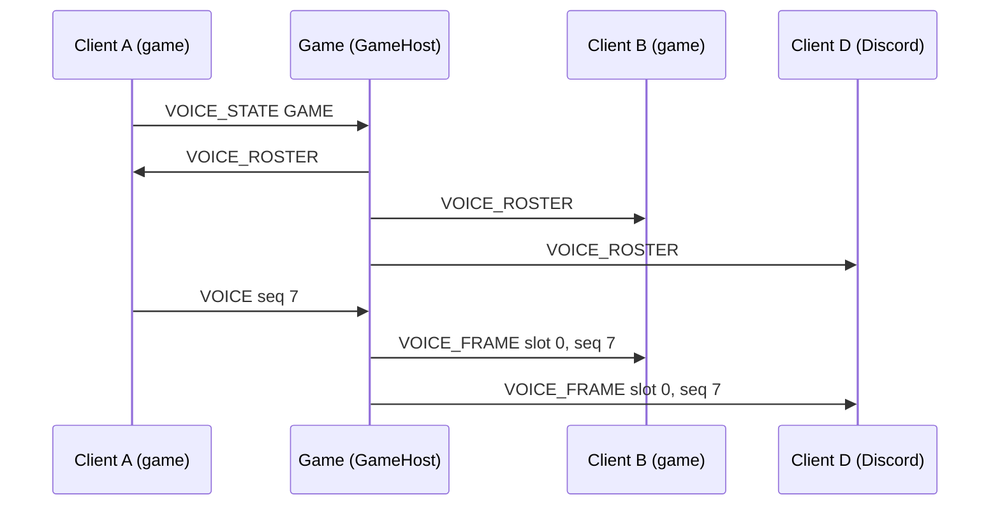

# Voice

!!! warning "In progress"

    The voice chat is being built. This page describes what exists: the interface, the rule of the backends,
    the codec and the messages of the game protocol. The devices come with the next steps.

The players of an online game talk to each other. Each player's voice is carried by one **backend**: the voice
of the game, in its UDP session, or Discord; both in the same game
([ADR 0032](../decisions/0032-voice-chat-in-the-game-session.md)).

The voice library (`libs/voice`, namespace `rtype::voice`) holds what the client knows of the voice, in two
targets:

| Target | Header | Content |
|---|---|---|
| `rtype::voice` | `rtype/voice/VoiceChannel.hpp` | `VoiceChannel`, the voice of one game for the player of this client; `Participant`, `Join`, `Position`, `Slot` |
| `rtype::voice` | `rtype/voice/Backend.hpp` | `Backend` (`None`, `Game`, `Discord`), `carriedByGame()` and `name()` |
| `rtype::voice` | `rtype/voice/Format.hpp` | `SampleRate`, `FrameSamples`, `FramesPerSecond`, `MaxFrameBytes`: what the codec, the protocol and the devices agree on |
| `rtype::voice_codec` | `rtype/voice/Codec.hpp` | `Encoder`, `Decoder`, `isValidFrame()`: the voice in Opus |

`rtype::voice` is header only, without dependency: `libs/game` (the messages) and the server know the backends
and the format without Opus.
`rtype::voice_codec` is built on libopus, a private dependency: no Opus type in its header.

## The backends

Every player of a game has a backend, which the game knows and tells every client.

| Backend | The player talks and hears |
|---|---|
| `None` | Not at all: voice off, no device, or a game without voice |
| `Game` | Through the game: its voice goes to the game, which forwards it |
| `Discord` | Through the lobby of the game in Discord, and through the game for the players on `Game` |

**The game carries a voice unless both players are on Discord**, and never from or to a player on `None`:

| From → to | `Game` | `Discord` | `None` |
|---|---|---|---|
| `Game` | the game | the game | — |
| `Discord` | the game | Discord | — |
| `None` | — | — | — |

```cpp
rtype::voice::carriedByGame(Backend::Discord, Backend::Game);    // true
rtype::voice::carriedByGame(Backend::Discord, Backend::Discord); // false: Discord carries it
```

So in a game of two players on Discord and two on the game, each hears the three others once: the test
`In a game of two players on Discord and two on the game, each hears the three others once` checks every pair.

## The voice channel

The client knows one `VoiceChannel` per online game, whatever carries each voice. Every call is made on the
thread of the game loop.

```cpp
voice.join({.self = accepted.slot});
voice.addParticipant(joined.slot);                // PLAYER_JOINED
voice.setBackend(slot, roster.backend(slot));     // VOICE_ROSTER
// In the game loop, every frame
voice.setTalking(actions.isActive(Action::PushToTalk));
voice.poll();
for (const rtype::voice::Participant &player : voice.participants()) {
    hud.setSpeaking(player.slot, player.speaking);
}
voice.leave();                                     // LEFT_GAME, or the session lost
```

| Call | Effect |
|---|---|
| `join(Join)` / `leave()` | Joins the voice of the game this client joined; leaves it, closing the devices |
| `addParticipant(slot)` / `removeParticipant(slot)` | Another player came in, or left; a new one is on `None` until the roster says otherwise |
| `setBackend(slot, backend)` | What carries the voice of a player |
| `setSelfMute(bool)` / `setTalking(bool)` | Nobody hears the player of this client; it talks now (push-to-talk held or voice detected) |
| `setParticipantVolume(slot, v)` / `setParticipantMute(slot, bool)` | For this client only; the volume from 0 to `MaxVolume` (2), 1 by default |
| `setParticipantPosition(slot, Position)` | Where the ship of a player is, for the spatial voice; a 3D vector, `z` 0 in the 2D game |
| `participants()` | The other players: slot, backend, speaking, muted by itself or by me, volume |
| `poll()` | Once per frame: what came since the last call |

A device that cannot be opened is not an error, as for the [audio](audio.md): the player hears nothing or is
heard by nobody, and the game goes on.

## The codec

The voice is encoded with [Opus](https://opus-codec.org/) 1.6.1, through CPM from the release archive of
Xiph, with its hash. Its license (BSD) is installed with the client, in `licenses/opus.txt`.

| | |
|---|---|
| Samples | 48 kHz (`SampleRate`), mono, signed 16 bits |
| Frame | 20 ms, 960 samples (`FrameSamples`); 1 to 160 bytes encoded (`MaxFrameBytes`) |
| Mode | `OPUS_APPLICATION_VOIP`, `OPUS_SIGNAL_VOICE`, variable bit rate |
| Bit rate | 24 kbit/s by default (`EncoderSettings::bitrate`): about 60 bytes per frame |
| Losses | In-band FEC on, for 10 % of frames lost (`EncoderSettings::expectedLoss`; 0 turns it off) |
| Silence | DTX (`EncoderSettings::discontinuous`): after 200 ms of silence, frames of 1 or 2 bytes, which need not be sent (`EncodedFrame::silence()`), and one frame every 400 ms |

```cpp
rtype::voice::Encoder encoder;
const rtype::voice::EncodedFrame frame = encoder.encode(samples);   // 960 samples
if (!frame.silence()) {
    session.sendVoice(frame.data());
}
```

The encoder never gives more than 160 bytes: Opus lowers the quality of a frame that would not fit.

**One decoder per player**, since it keeps what it heard to make up what it did not. For each frame, in
order:

| The frame | Call |
|---|---|
| Received | `decode(frame, samples)` |
| Lost, the next one received | `decodeFec(next, samples)`: the copy of the lost frame that the next one carries, then `decode(next, …)` as usual |
| Lost, with nothing after it | `conceal(samples)`: made up from the frames before, fading to silence |

A frame comes from the network: `decode()` and `decodeFec()` refuse, and return false for, anything but a valid
Opus packet of 20 ms of 1 to 160 bytes (`isValidFrame()`), and leave the samples as they were. A packet of
another length (10 ms, 40 ms) is refused, so that every frame is the same 960 samples.

## In the game session

The voice travels in the UDP session of the game
([game protocol, section 9.4](../protocol/game.md#94-the-voice)), in four messages of `libs/game`
(`rtype/game/Messages.hpp`):

| Message | Direction | Content |
|---|---|---|
| `VOICE` (`0x41`) | Client → game, unreliable | `VoiceMessage`: sequence, last of a talk spurt, 1 to 160 bytes of Opus |
| `VOICE_STATE` (`0x42`) | Client → game, reliable | `VoiceStateMessage`: the backend of the player |
| `VOICE_FRAME` (`0x84`) | Game → client, unreliable | `VoiceFrameMessage`: the slot of the player who talks, then as `VOICE` |
| `VOICE_ROSTER` (`0x85`) | Game → client, reliable | `VoiceRosterMessage`: the backend of each slot |

These are new types, which an older client or game ignores: the game protocol stays at version 2.



*A player on the game talks: the game forwards its frame to every other player with a voice, on the game or on
Discord. A frame of D, on Discord, would go to A and B, never to another player on Discord, who hears D there.*

- **The game** (`GameHost`, [Server](server.md)) keeps the backend of each player, sends the roster at every
  change, and forwards each frame to the others, within the rate of a `VoiceRate`: 60 frames per second, bursts
  of 10.
- **The client** (`RemoteSession`, [The client online](client-online.md#remotesession)) tells its backend,
  sends the frames it is given in the datagram of the next `INPUT`, and keeps the frames of the others and the
  roster for the voice channel. It neither captures nor plays.

## Rules

- **The voice is never stored nor logged**, by the game or the client, and a replay has no voice.
- **The server never decodes**: it checks the sizes and rates of the frames and forwards them.
- **The tests open no device**: they use `testing::FakeVoiceChannel` (`tests/helpers/FakeVoiceChannel.hpp`),
  which keeps what it is told; `speak(slot, bool)` makes a player talk.

## Testing

`tests/voice.cpp` (tag `[voice]`): the rule of the backends for every pair, the mixed game of 2 + 2, and a
channel that knows the other players of its game, not its own.

The messages, in `tests/game_messages.cpp` (tags `[game][messages][voice]`): field by field, round trips with
frames of 1, 60 and 160 bytes, every malformed case, an unknown backend read as `NONE`, the reserved bits
dropped, random bytes. The game, in `tests/server_instance.cpp`, and two clients online, in
`tests/client_online.cpp`, both tag `[voice]`: see [Server](server.md#tests) and
[The client online](client-online.md#tests).

`tests/voice_codec.cpp` (tag `[voice]`), on a voice-like sound (a pitch gliding from 140 to 220 Hz, with its
harmonics): its level within 3 dB and its pitch kept after the codec; about 60 bytes per frame; never more than
160, even for loud noise at the highest bit rate; silence not sent after 200 ms; a lost frame rebuilt from the
next one closer to the original than concealed, and only concealed without FEC; the frames refused (empty, too
big, 10 ms); 20,000 frames of random bytes without a crash, run under the sanitizers in the CI.
