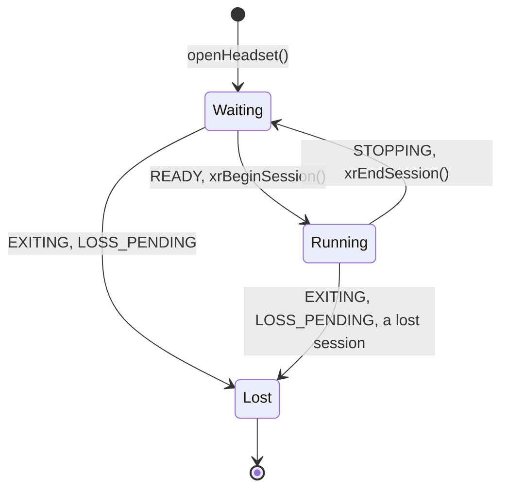

# VR

The game can be played in a VR headset ([ADR 0037](../decisions/0037-vr-through-openxr.md)). The player sits
in a cockpit, and the game is a board floating in space outside its canopy: the gameplay keeps its plane, and
the server, the protocol and the replays do not know whether a player is in a headset.

!!! warning "In progress"

    The player sits in the cockpit, the sky of the scene around them, and the game is on a flat board outside
    the canopy; the window shows the left eye. The game is played with the keyboard or a gamepad, and `F9`
    recentres. The interface on the screens of the cockpit and the controllers come next: see
    [Next steps](#next-steps).

How to start the game in a headset: [Play in VR](../guides/play-in-vr.md).

## The VR library

The VR library (`libs/xr`, namespace `rtype::xr`) wraps [OpenXR](https://www.khronos.org/openxr/), the
standard API of VR headsets. Its public headers have no OpenXR type:

| Header       | Role                                                                                              |
| ------------ | ------------------------------------------------------------------------------------------------- |
| `Headset.hpp` | `Headset`, the interface of a headset; `openHeadset()`, which opens the one of the active runtime. |
| `Math.hpp`   | `Vector3`, `Quaternion`, `Pose`, `Matrix`, `FieldOfView`, the matrices of a pose and of an eye, and `levelled()`, a pose kept to its heading. |

Inside, `openHeadset()` builds three parts, destroyed in the reverse order:

| Part          | Holds                                                                                                         |
| ------------- | ------------------------------------------------------------------------------------------------------------- |
| `Session`     | The OpenXR instance, the system (the headset), the session on the OpenGL context of the window, its space, its states and its frames. |
| `Eyes`        | A swapchain per eye, the images the runtime gives, and a framebuffer with its depth buffer that draws into the image of the frame. |
| `Controllers` | The actions of the controllers and the bindings suggested for each profile (Touch, Touch Plus, simple controller). |

The bindings are made with the session even though nothing reads the controllers yet: OpenXR takes them once,
before the session starts.

### Built with OpenXR or not

`RTYPE_OPENXR` (CMake, on by default on Linux and Windows, off on macOS, which has no OpenXR runtime) builds the
library with OpenXR. Off, it keeps the same interface, and `openHeadset()` always says that this build has no
VR: the client has no case of its own for it. `isOpenXrBuilt()` tells which build it is.

The OpenXR loader (OpenXR-SDK 1.1.60) is built by CPM and linked **statically**, on Linux too. A client linked
to the `libopenxr_loader.so` of the system would not start at all on a computer that does not have it, headset
or not. The loader finds the active runtime by itself: `active_runtime.json` on Linux (in
`~/.config/openxr/1/` or `/etc/xdg/openxr/1/`, written by the runtime), the registry on Windows.

### The OpenGL context

OpenXR draws into the images of the eyes with the OpenGL context of the window, which raylib opened through
GLFW: the session is created on the context that is current, so the headset is opened **after** the window,
from the main thread, and destroyed **before** it.

| System  | Binding                         | Context                                                            |
| ------- | ------------------------------- | ------------------------------------------------------------------ |
| Windows | `XrGraphicsBindingOpenGLWin32KHR` | `wglGetCurrentDC()`, `wglGetCurrentContext()`                       |
| Linux   | `XrGraphicsBindingOpenGLXlibKHR`  | `glXGetCurrentDisplay()`, `glXGetCurrentContext()`, its framebuffer configuration and visual |

On Linux the client runs on X11, through XWayland under Wayland: raylib builds GLFW without its Wayland backend
(`GLFW_BUILD_WAYLAND` off), which is what makes the GLX binding the one needed.

The sources include `rlgl.h` only, never `raylib.h`: `windows.h` and Xlib define names (`Rectangle`, `Font`,
`near`, `far`, `None`...) that clash with those of raylib. `src/Platform.hpp` includes them in an order that
works and removes the macros of Xlib that would break the code after it. On Windows it also includes
`<unknwn.h>`: `openxr_platform.h` declares Microsoft extensions that take an `IUnknown`, and
`WIN32_LEAN_AND_MEAN` leaves COM out of `windows.h`.

### The eyes

The images of the eyes are in sRGB when the headset offers it, RGBA8 otherwise. The renderer writes colours with
their gamma already applied and leaves `GL_FRAMEBUFFER_SRGB` off, so the values are stored as they are and the
runtime reads them as sRGB, as the screen does. Each eye has the size the runtime recommends.

`Headset::beginEye()` acquires the image of the eye, binds its framebuffer, clears it to the background colour
(`HeadsetSettings::background`) with an empty depth buffer, and gives an `EyeView`: the view matrix (the
inverse of the pose of the eye), the projection of its field of view, which is asymmetric (wider towards the
outside), its position and its size. The eyes see from 5 cm to 200 m.

## The session



_The states of a headset (`HeadsetState`), and the events of the runtime that move it._

| State     | Means                                                                                                          |
| --------- | -------------------------------------------------------------------------------------------------------------- |
| `Waiting` | The runtime has not started the session, or has paused it: no headset worn, the headset asleep, its own menu in front. Nothing is drawn. |
| `Running` | The headset shows the game: it gets a frame each time, and paces them.                                          |
| `Lost`    | The session is over: the player quit from the runtime, the runtime stopped, the headset was unplugged. It never comes back. |

The space of reference is `LOCAL`: its origin is the head of the player when the session starts, which the
runtime moves back when the player recentres. The player is seated in a cockpit, so `STAGE`, the floor of a
room, is not used.

### Recentring

`Headset::recenter()` puts the origin back at the head of the player, at the next frame: the session locates the
head (a `VIEW` space) in `LOCAL` at the time the frame will be shown, keeps only its heading (`levelled()`: no
pitch, no roll, so the cockpit stays level whatever the tilt of the head), and creates the space it draws in
again, `LOCAL` moved to that pose. If the head is not tracked at that moment, it tries again at the next frame.

The runtime can recentre too, from its own menu: it then sends `XR_TYPE_EVENT_DATA_REFERENCE_SPACE_CHANGE_PENDING`
for `LOCAL`, whose origin is already at the head. The space drawn in goes back to `LOCAL` itself, instead of
keeping a move that the runtime has made obsolete.

## In the client

`VrMode` (`apps/client/src/Vr/`) drives the headset. It is created after the window and before the loading
screen, and opens the headset when VR is asked:

- `--xr` on the command line, or
- `vr.enabled=true` in the [settings](settings.md) file.

Once per frame, after the frame of the window, `VrMode::update()` reads the events of the runtime and, while
the headset shows the game, gives it a frame:

```cpp
headset.pollEvents();
if (headset.state() == HeadsetState::Running && headset.beginFrame()) {   // waits for the headset
    for (int eye = 0; eye < headset.eyeCount(); ++eye) {
        const EyeView view = headset.beginEye(eye);
        // ... draw with view.view and view.projection
        headset.endEye(eye);
    }
}
headset.endFrame();   // always, even when beginFrame() returned false
```

### Who paces the frames

While the headset shows the game, it waits for its own refresh at each frame (`xrWaitFrame()`, 72 to 120 Hz): it
paces the game. The window then must not wait as well, for the screen (vertical synchronisation) or for its
limit of frames per second, or the headset would miss its frames. `VrMode` calls
`Window::setPacedElsewhere(true)` when the headset starts showing the game, and `false` when it stops: the
vertical synchronisation and the limit the player chose are kept, still shown on the Settings page, and applied
again.

### In the headset

While the headset shows the game (`VrMode::isShowing()`), a frame of the client goes:

1. into the **board**, an image of 2560 × 1440 (`Renderer::beginFrame(ImageId)`): the frame of the screen, World
   and Interface layers, glow and smoothing, without the vignette;
2. into **each eye**, through `VrHooks::drawEye`: `VrView::drawEye()` starts the eye in the renderer with the view
   and the projection of the headset (`Renderer::beginEye()`), draws the scene of the headset
   ([The cockpit](#the-cockpit)), and ends the eye (`endEye()`), which copies it into the image of the headset
   through the colour filter;
3. into the **window**: the left eye, cropped to the shape of the window (`Renderer::showMirror()`), so that the
   people around see what the player sees. `F11`, the size of the window and its screen still work.

The image of the board has mipmaps, remade after each frame, so that it stays smooth though an eye shows it
smaller than it is.

The frame is drawn before the headset waits for its next refresh, and the eyes after: the board shows the game
of the frame being drawn. When the headset gives no frame to draw (its menu in front, the tracking lost for a
moment), the window keeps the last left eye.

### The cockpit

During a game, the player is seated in `cockpit.glb` (`RTYPE_MODEL_COCKPIT`); in the menus, the board floats
alone in the sky of the scene (`VrScene::playing`, a session of `GameSessionSystem` running, the pause menu
included). The cockpit is loaded on the assets worker the first time the headset shows the game, menus
included, so that it is ready when a game starts and a game out of the headset never loads it; until it is
ready, the board floats alone. What was measured on the model is in `Vr/CockpitLook.hpp`; where things are in the headset, in
`Vr/VrLayout.hpp`, pure functions without a renderer.

```text
                 sky of the scene, at infinity

        ┌───────────────────────────────────────┐
        │               THE BOARD               │   2.7 m wide, 2 m ahead, its centre 40 cm over
        │                                       │   the eyes, tilted to face them: 67° wide
        └───────────────────────────────────────┘
               \        canopy (glass)        /
                \  [Aux] [Nav] [Holo] [Ship] /      dashboard: its top 11 to 13° under the eyes
                 \__________________________/
                         (  the seat  )             eye point: the origin of LOCAL
```

_The scene in the headset, seen from the side of the pilot._

- **The eye point** (`CockpitEyePoint`): 9 cm in front of the headrest of `Cockpit_Seat`, a little under its top,
  73 cm over its cushion. The model has its nose towards +x; `placeCockpit()` turns it a quarter around y, nose
  ahead (-z), and moves it so that the eye point is at the origin of the space of the headset, the head of the
  player.
- **The board** (`VrLayout`, `boardTransform()`): 2.7 m wide, 2 m ahead, its centre 40 cm over the eyes, tilted
  to face them. It is just outside the canopy, whose nose is 1.5 m ahead of the eyes: near, so that the game is
  felt close, rather than a screen far away; 3 m was too far. It is seen whole without turning the head, about
  67° wide, inside the field of view of a Quest 2, and
  its bottom, 9° under the eyes, stays over the top of the dashboard (`CockpitDashboardTop`, the nose of the hull
  and its sides, 11 to 13° under the eyes): the player looks a little up at it. The thin parts of the canopy (its
  arch, the arch around the hologram) are seen in front of its edges, as in a real cockpit; the player sees past
  them by moving the head.
- **The light**: the cockpit is lit by the light of the scene shown (`SceneRenderer::light()`), the sun of the
  game, the light of the menus; its screens and its glows emit their own light whatever it is.
- **The sky**: the picture at the back of the sky of the scene (`SceneRenderer::sky()`) is wrapped around the
  player (`Renderer::drawSky()`), so that they are in space rather than in a dark room with a screen. It does not
  scroll, as the camera never moves on its own; without a sky, space is plain.
- **The screens**: the animation `Screens` of the model plays at half speed, posed 15 times per second only
  (`CockpitScreensRate`): posing it moves its vertices on the processor, once for both eyes.

Each eye is drawn in this order:

| # | What | How |
| - | ---- | --- |
| 1 | The sky | `drawSky()`, without depth: everything else is in front of it. |
| 2 | The board | `drawImageQuad()` with the image of the frame. |
| 3 | The opaque cockpit | `drawModel()`, without its transparent meshes: it hides the parts of the board behind it. |
| 4 | The transparent meshes | `drawTransparentModel()`, one at a time from the farthest from the eye point (`farToNear()`): the hologram, then the canopy. They write no depth, so the board stays sharp through them. |

The meshes are found by their names (`ResourceManager::getModelMeshes()`), not by their index in the file.

### Recentring in the client

`F9` (`RecenterKey`) calls `VrMode::recenter()`, which asks the headset to recentre: the cockpit is around the
player again, the board ahead. The controllers will do it too ([Next steps](#next-steps)).

### Without a headset

VR never stops the game. Without a runtime, without a headset, or with a build without OpenXR, `VrMode::start()`
logs why, and the client goes on on the screen; the main menu shows a toast "No VR headset found". If the
session is lost while playing, the headset is closed, the window paces the frames again, and a toast says
that the game goes on on the screen. Starting the client again opens the headset again.

The OpenXR loader writes on the error output what it looked for when it finds no runtime: that is the place to
look when the headset does not start.

### Tests

The tests never open a runtime. `testing::FakeHeadset` (`tests/helpers/FakeHeadset.hpp`) counts what it is
asked and changes state when a test says so: `tests/client_vr.cpp` checks the option and the setting, a
headset that does not open, the pacing given and taken back, the frames always ended, and a session lost
between two frames or during one, and each eye drawn between its begin and its end; it also checks where the
board is (ahead, over the eyes, facing them), that it is seen whole with the field of view of a Quest 2,
over the dashboard and just outside the canopy, where the cockpit is placed, the order of its transparent meshes, a recentre asked of the
headset, and what an eye gives to the renderer. `tests/xr_math.cpp` checks the matrices of the poses, the
projections of asymmetric fields of view, and the pose a recentre keeps. In `libs/render`, `tests/render_passes.cpp` checks the order of the
frames and the eyes, and `tests/viewport.cpp` the crop of the mirror.

## Next steps

| Step | What it brings |
| ---- | -------------- |
| Interface in the cockpit | The HUD on the screens of the cockpit, the menus on a holographic panel, fades between the scenes. |
| Controllers | The controllers as a virtual gamepad, a pointer for the menus, haptics. |
| Board in relief | The world drawn in 3D for each eye on the plane of the board. |
| Experience and settings | A VR page in the settings, a cockpit that reacts to the game, an arrival sequence. |
