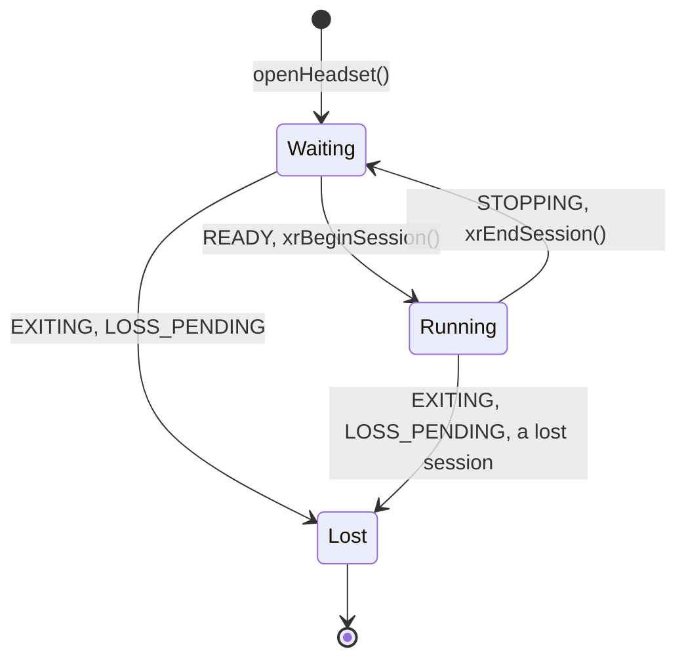

# VR

The game can be played in a VR headset ([ADR 0037](../decisions/0037-vr-through-openxr.md)). The player sits
in a cockpit, and the game is a board floating in space outside its canopy: the gameplay keeps its plane, and
the server, the protocol and the replays do not know whether a player is in a headset.

!!! warning "In progress"

    The client opens the headset, runs its session and gives it its frames, which show a plain colour for now.
    The cockpit, the board, the interface and the controllers come next: see [Next steps](#next-steps).

How to start the game in a headset: [Play in VR](../guides/play-in-vr.md).

## The VR library

The VR library (`libs/xr`, namespace `rtype::xr`) wraps [OpenXR](https://www.khronos.org/openxr/), the
standard API of VR headsets. Its public headers have no OpenXR type:

| Header       | Role                                                                                              |
| ------------ | ------------------------------------------------------------------------------------------------- |
| `Headset.hpp` | `Headset`, the interface of a headset; `openHeadset()`, which opens the one of the active runtime. |
| `Math.hpp`   | `Vector3`, `Quaternion`, `Pose`, `Matrix`, `FieldOfView`, and the matrices of a pose and of an eye. |

Inside, `openHeadset()` builds three parts, destroyed in the reverse order:

| Part          | Holds                                                                                                         |
| ------------- | ------------------------------------------------------------------------------------------------------------- |
| `Session`     | The OpenXR instance, the system (the headset), the session on the OpenGL context of the window, its space, its states and its frames. |
| `Eyes`        | A swapchain per eye, the images the runtime gives, and a framebuffer with its depth buffer that draws into the image of the frame. |
| `Controllers` | The actions of the controllers and the bindings suggested for each profile (Touch, Touch Plus, simple controller). |

The bindings are made with the session even though nothing reads the controllers yet: OpenXR takes them once,
before the session starts.

### Built with OpenXR or not

`RTYPE_OPENXR` (CMake, on by default on Linux and Windows, off on macOS, which has no OpenXR runtime) builds the
library with OpenXR. Off, it keeps the same interface, and `openHeadset()` always says that this build has no
VR: the client has no case of its own for it. `isOpenXrBuilt()` tells which build it is.

The OpenXR loader (OpenXR-SDK 1.1.60) is built by CPM and linked **statically**, on Linux too. A client linked
to the `libopenxr_loader.so` of the system would not start at all on a computer that does not have it, headset
or not. The loader finds the active runtime by itself: `active_runtime.json` on Linux (in
`~/.config/openxr/1/` or `/etc/xdg/openxr/1/`, written by the runtime), the registry on Windows.

### The OpenGL context

OpenXR draws into the images of the eyes with the OpenGL context of the window, which raylib opened through
GLFW: the session is created on the context that is current, so the headset is opened **after** the window,
from the main thread, and destroyed **before** it.

| System  | Binding                         | Context                                                            |
| ------- | ------------------------------- | ------------------------------------------------------------------ |
| Windows | `XrGraphicsBindingOpenGLWin32KHR` | `wglGetCurrentDC()`, `wglGetCurrentContext()`                       |
| Linux   | `XrGraphicsBindingOpenGLXlibKHR`  | `glXGetCurrentDisplay()`, `glXGetCurrentContext()`, its framebuffer configuration and visual |

On Linux the client runs on X11, through XWayland under Wayland: raylib builds GLFW without its Wayland backend
(`GLFW_BUILD_WAYLAND` off), which is what makes the GLX binding the one needed.

The sources include `rlgl.h` only, never `raylib.h`: `windows.h` and Xlib define names (`Rectangle`, `Font`,
`near`, `far`, `None`...) that clash with those of raylib. `src/Platform.hpp` includes them in an order that
works and removes the macros of Xlib that would break the code after it. On Windows it also includes
`<unknwn.h>`: `openxr_platform.h` declares Microsoft extensions that take an `IUnknown`, and
`WIN32_LEAN_AND_MEAN` leaves COM out of `windows.h`.

### The eyes

The images of the eyes are in sRGB when the headset offers it, RGBA8 otherwise. The renderer writes colours with
their gamma already applied and leaves `GL_FRAMEBUFFER_SRGB` off, so the values are stored as they are and the
runtime reads them as sRGB, as the screen does. Each eye has the size the runtime recommends.

`Headset::beginEye()` acquires the image of the eye, binds its framebuffer, clears it to the background colour
(`HeadsetSettings::background`) with an empty depth buffer, and gives an `EyeView`: the view matrix (the
inverse of the pose of the eye), the projection of its field of view, which is asymmetric (wider towards the
outside), its position and its size. The eyes see from 5 cm to 200 m.

## The session



_The states of a headset (`HeadsetState`), and the events of the runtime that move it._

| State     | Means                                                                                                          |
| --------- | -------------------------------------------------------------------------------------------------------------- |
| `Waiting` | The runtime has not started the session, or has paused it: no headset worn, the headset asleep, its own menu in front. Nothing is drawn. |
| `Running` | The headset shows the game: it gets a frame each time, and paces them.                                          |
| `Lost`    | The session is over: the player quit from the runtime, the runtime stopped, the headset was unplugged. It never comes back. |

The space of reference is `LOCAL`: its origin is the head of the player when the session starts, which the
runtime moves back when the player recentres. The player is seated in a cockpit, so `STAGE`, the floor of a
room, is not used.

## In the client

`VrMode` (`apps/client/src/Vr/`) drives the headset. It is created after the window and before the loading
screen, and opens the headset when VR is asked:

- `--xr` on the command line, or
- `vr.enabled=true` in the [settings](settings.md) file.

Once per frame, after the frame of the window, `VrMode::update()` reads the events of the runtime and, while
the headset shows the game, gives it a frame:

```cpp
headset.pollEvents();
if (headset.state() == HeadsetState::Running && headset.beginFrame()) {   // waits for the headset
    for (int eye = 0; eye < headset.eyeCount(); ++eye) {
        const EyeView view = headset.beginEye(eye);
        // ... draw with view.view and view.projection
        headset.endEye(eye);
    }
}
headset.endFrame();   // always, even when beginFrame() returned false
```

### Who paces the frames

While the headset shows the game, it waits for its own refresh at each frame (`xrWaitFrame()`, 72 to 120 Hz): it
paces the game. The window then must not wait as well, for the screen (vertical synchronisation) or for its
limit of frames per second, or the headset would miss its frames. `VrMode` calls
`Window::setPacedElsewhere(true)` when the headset starts showing the game, and `false` when it stops: the
vertical synchronisation and the limit the player chose are kept, still shown on the Settings page, and applied
again.

### Without a headset

VR never stops the game. Without a runtime, without a headset, or with a build without OpenXR, `VrMode::start()`
logs why, and the client goes on on the screen; the main menu shows a toast "No VR headset found". If the
session is lost while playing, the headset is closed, the window paces the frames again, and a toast says
that the game goes on on the screen. Starting the client again opens the headset again.

The OpenXR loader writes on the error output what it looked for when it finds no runtime: that is the place to
look when the headset does not start.

### Tests

The tests never open a runtime. `testing::FakeHeadset` (`tests/helpers/FakeHeadset.hpp`) counts what it is
asked and changes state when a test says so: `tests/client_vr.cpp` checks the option and the setting, a
headset that does not open, the pacing given and taken back, the frames always ended, and a session lost
between two frames or during one. `tests/xr_math.cpp` checks the matrices of the poses and the projections of
asymmetric fields of view.

## Next steps

| Step | What it brings |
| ---- | -------------- |
| Rendering in the eyes | The renderer draws the frame of the game into an image, and 3D passes into the eyes with the matrices of the headset; the colour filter in the headset; the window shows the left eye. |
| Cockpit and board | `cockpit.glb` around the player, at the headrest of its seat; the board outside the canopy; the sky of the scene all around; a recenter action. |
| Interface in the cockpit | The HUD on the screens of the cockpit, the menus on a holographic panel, fades between the scenes. |
| Controllers | The controllers as a virtual gamepad, a pointer for the menus, haptics. |
| Board in relief | The world drawn in 3D for each eye on the plane of the board. |
| Experience and settings | A VR page in the settings, a cockpit that reacts to the game, an arrival sequence. |
