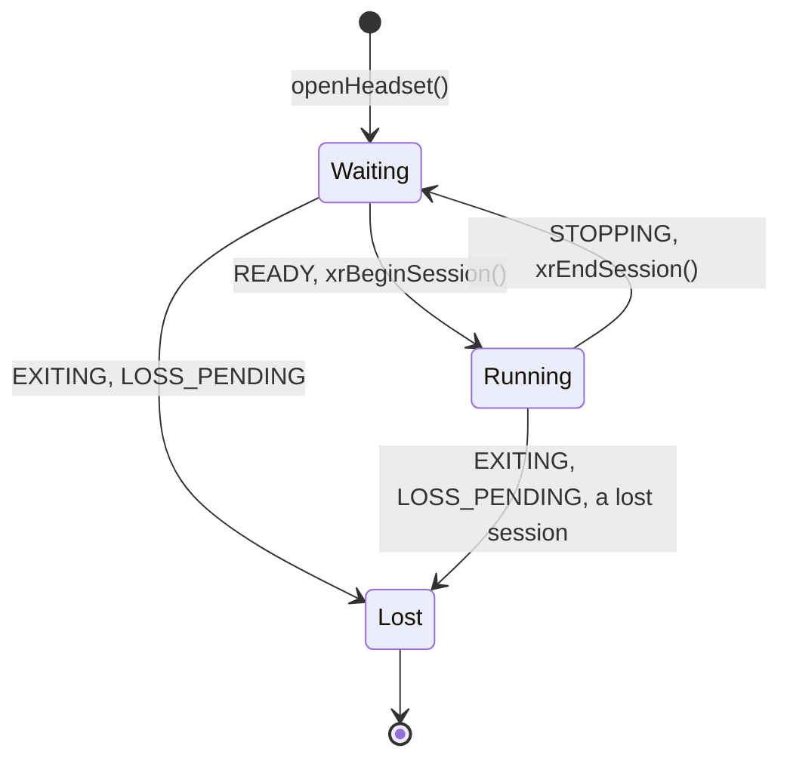

# VR

The game can be played in a VR headset ([ADR 0037](../decisions/0037-vr-through-openxr.md)). The player sits
in a cockpit, and the game is a board floating in space outside its canopy: the gameplay keeps its plane, and
the server, the protocol and the replays do not know whether a player is in a headset.

!!! warning "In progress"

    The player sits in the cockpit, the sky of the scene around them, and the game is on a flat board outside
    the canopy; the HUD is on the screens of the cockpit and the menus on a holographic panel; the window shows
    the left eye. The game is played with the controllers, a keyboard or a gamepad; the controllers point at the
    panel and vibrate. The board is still flat: see [Next steps](#next-steps).

How to start the game in a headset: [Play in VR](../guides/play-in-vr.md).

## The VR library

The VR library (`libs/xr`, namespace `rtype::xr`) wraps [OpenXR](https://www.khronos.org/openxr/), the
standard API of VR headsets. Its public headers have no OpenXR type:

| Header       | Role                                                                                              |
| ------------ | ------------------------------------------------------------------------------------------------- |
| `Headset.hpp` | `Headset`, the interface of a headset, its eyes, the state of each hand (`HandState`) and its vibrations (`Vibration`); `openHeadset()`, which opens the one of the active runtime. |
| `Math.hpp`   | `Vector3`, `Quaternion`, `Pose`, `Matrix`, `FieldOfView`, the matrices of a pose and of an eye, and `levelled()`, a pose kept to its heading. |

Inside, `openHeadset()` builds three parts, destroyed in the reverse order:

| Part          | Holds                                                                                                         |
| ------------- | ------------------------------------------------------------------------------------------------------------- |
| `Session`     | The OpenXR instance, the system (the headset), the session on the OpenGL context of the window, its space, its states and its frames. |
| `Eyes`        | A swapchain per eye, the images the runtime gives, and a framebuffer with its depth buffer that draws into the image of the frame. |
| `Controllers` | The actions of the controllers, the bindings suggested for each profile (Touch, Touch Plus, Valve Index, HTC Vive, simple controller), what they give each frame, and their vibrations. |

The bindings are made with the session: OpenXR takes them once, before the session starts. A profile the
runtime refuses is logged, not an error.

### The controllers in the library

`Headset::beginFrame()` reads the controllers after it waited for the frame (`xrSyncActions()`), where they will
be when the frame is shown, as the eyes: `Headset::hand(Hand)` gives a `HandState`, the grip pose (where the hand
holds the controller) and the aim pose (where it points, along its -z), the trigger, the grip, the thumbstick and
whether it is pushed in, the two face buttons and menu. Everything is released and nothing is tracked while the
session is not focused (the runtime shows its menu over the game, `XR_SESSION_NOT_FOCUSED`), before the first
frame, and while the headset does not show the game. `Headset::vibrate(Hand, Vibration)` vibrates a controller
at once (`xrApplyHapticFeedback()`): an amplitude, a duration, a frequency, or the ones of the runtime.

| Action | Touch, Touch Plus | Valve Index | HTC Vive | Simple |
| ------ | ----------------- | ----------- | -------- | ------ |
| trigger | trigger | trigger | trigger | select |
| squeeze (grip) | squeeze | squeeze | squeeze (a click) | — |
| thumbstick | thumbstick | thumbstick | trackpad | — |
| thumbstick click | thumbstick click | right thumbstick click | — | — |
| primary | A, X | A | trackpad click | — |
| secondary | B, Y | B | right menu | — |
| menu | left menu | left thumbstick click | left menu | menu |

### Built with OpenXR or not

`RTYPE_OPENXR` (CMake, on by default on Linux and Windows, off on macOS, which has no OpenXR runtime) builds the
library with OpenXR. Off, it keeps the same interface, and `openHeadset()` always says that this build has no
VR: the client has no case of its own for it. `isOpenXrBuilt()` tells which build it is.

The OpenXR loader (OpenXR-SDK 1.1.60) is built by CPM and linked **statically**, on Linux too. A client linked
to the `libopenxr_loader.so` of the system would not start at all on a computer that does not have it, headset
or not. The loader finds the active runtime by itself: `active_runtime.json` on Linux (in
`~/.config/openxr/1/` or `/etc/xdg/openxr/1/`, written by the runtime), the registry on Windows.

### The OpenGL context

OpenXR draws into the images of the eyes with the OpenGL context of the window, which raylib opened through
GLFW: the session is created on the context that is current, so the headset is opened **after** the window,
from the main thread, and destroyed **before** it.

| System  | Binding                         | Context                                                            |
| ------- | ------------------------------- | ------------------------------------------------------------------ |
| Windows | `XrGraphicsBindingOpenGLWin32KHR` | `wglGetCurrentDC()`, `wglGetCurrentContext()`                       |
| Linux   | `XrGraphicsBindingOpenGLXlibKHR`  | `glXGetCurrentDisplay()`, `glXGetCurrentContext()`, its framebuffer configuration and visual |

On Linux the client runs on X11, through XWayland under Wayland: raylib builds GLFW without its Wayland backend
(`GLFW_BUILD_WAYLAND` off), which is what makes the GLX binding the one needed.

The sources include `rlgl.h` only, never `raylib.h`: `windows.h` and Xlib define names (`Rectangle`, `Font`,
`near`, `far`, `None`...) that clash with those of raylib. `src/Platform.hpp` includes them in an order that
works and removes the macros of Xlib that would break the code after it. On Windows it also includes
`<unknwn.h>`: `openxr_platform.h` declares Microsoft extensions that take an `IUnknown`, and
`WIN32_LEAN_AND_MEAN` leaves COM out of `windows.h`.

### The eyes

The images of the eyes are in sRGB when the headset offers it, RGBA8 otherwise. The renderer writes colours with
their gamma already applied and leaves `GL_FRAMEBUFFER_SRGB` off, so the values are stored as they are and the
runtime reads them as sRGB, as the screen does. Each eye has the size the runtime recommends.

`Headset::beginEye()` acquires the image of the eye, binds its framebuffer, clears it to the background colour
(`HeadsetSettings::background`) with an empty depth buffer, and gives an `EyeView`: the view matrix (the
inverse of the pose of the eye), the projection of its field of view, which is asymmetric (wider towards the
outside), its position and its size. The eyes see from 5 cm to 200 m.

## The session



_The states of a headset (`HeadsetState`), and the events of the runtime that move it._

| State     | Means                                                                                                          |
| --------- | -------------------------------------------------------------------------------------------------------------- |
| `Waiting` | The runtime has not started the session, or has paused it: no headset worn, the headset asleep, its own menu in front. Nothing is drawn. |
| `Running` | The headset shows the game: it gets a frame each time, and paces them.                                          |
| `Lost`    | The session is over: the player quit from the runtime, the runtime stopped, the headset was unplugged. It never comes back. |

The space of reference is `LOCAL`: its origin is the head of the player when the session starts, which the
runtime moves back when the player recentres. The player is seated in a cockpit, so `STAGE`, the floor of a
room, is not used.

### Recentring

`Headset::recenter()` puts the origin back at the head of the player, at the next frame: the session locates the
head (a `VIEW` space) in `LOCAL` at the time the frame will be shown, keeps only its heading (`levelled()`: no
pitch, no roll, so the cockpit stays level whatever the tilt of the head), and creates the space it draws in
again, `LOCAL` moved to that pose. If the head is not tracked at that moment, it tries again at the next frame.

The runtime can recentre too, from its own menu: it then sends `XR_TYPE_EVENT_DATA_REFERENCE_SPACE_CHANGE_PENDING`
for `LOCAL`, whose origin is already at the head. The space drawn in goes back to `LOCAL` itself, instead of
keeping a move that the runtime has made obsolete.

## In the client

`VrMode` (`apps/client/src/Vr/`) drives the headset. It is created after the window and before the loading
screen, and opens the headset when VR is asked:

- `--xr` on the command line, or
- `vr.enabled=true` in the [settings](settings.md) file.

Once per frame, after the frame of the window, `VrMode::update()` reads the events of the runtime and, while
the headset shows the game, gives it a frame:

```cpp
headset.pollEvents();
if (headset.state() == HeadsetState::Running && headset.beginFrame()) {   // waits for the headset
    for (int eye = 0; eye < headset.eyeCount(); ++eye) {
        const EyeView view = headset.beginEye(eye);
        // ... draw with view.view and view.projection
        headset.endEye(eye);
    }
}
headset.endFrame();   // always, even when beginFrame() returned false
```

### Who paces the frames

While the headset shows the game, it waits for its own refresh at each frame (`xrWaitFrame()`, 72 to 120 Hz): it
paces the game. The window then must not wait as well, for the screen (vertical synchronisation) or for its
limit of frames per second, or the headset would miss its frames. `VrMode` calls
`Window::setPacedElsewhere(true)` when the headset starts showing the game, and `false` when it stops: the
vertical synchronisation and the limit the player chose are kept, still shown on the Settings page, and applied
again.

### In the headset

While the headset shows the game (`VrMode::isShowing()`), a frame of the client goes:

1. into the **surfaces** of the interface, each an image of its own (`VrView::drawFrames()`,
   [The interface in the cockpit](#the-interface-in-the-cockpit)): during a game, the screens of the cockpit;
   the panel while it is unfolded; the **board** last, an image of 2560 × 1440 (`Renderer::beginFrame(ImageId)`):
   the World layer and what of the interface is on the board, glow and smoothing, without the vignette;
2. into **each eye**, through `VrHooks::drawEye`: `VrView::drawEye()` starts the eye in the renderer with the view
   and the projection of the headset (`Renderer::beginEye()`), draws the scene of the headset
   ([The cockpit](#the-cockpit)), and ends the eye (`endEye()`), which copies it into the image of the headset
   through the colour filter;
3. into the **window**: the left eye, cropped to the shape of the window (`Renderer::showMirror()`), so that the
   people around see what the player sees. `F11`, the size of the window and its screen still work.

The images have mipmaps, remade after each frame, so that it stays smooth though an eye shows it
smaller than it is.

The frame is drawn before the headset waits for its next refresh, and the eyes after: the board shows the game
of the frame being drawn. When the headset gives no frame to draw (its menu in front, the tracking lost for a
moment), the window keeps the last left eye.

### The cockpit

During a game, the player is seated in `cockpit.glb` (`RTYPE_MODEL_COCKPIT`); in the menus, the board floats
alone in the sky of the scene (`VrScene::playing`, a session of `GameSessionSystem` running, the pause menu
included). The cockpit is loaded on the assets worker the first time the headset shows the game, menus
included, so that it is ready when a game starts and a game out of the headset never loads it; until it is
ready, the board floats alone. What was measured on the model is in `Vr/CockpitLook.hpp`; where things are in the headset, in
`Vr/VrLayout.hpp`, pure functions without a renderer.

```text
                 sky of the scene, at infinity

        ┌───────────────────────────────────────┐
        │               THE BOARD               │   2.7 m wide, 2 m ahead, its centre 40 cm over
        │                                       │   the eyes, tilted to face them: 67° wide
        └───────────────────────────────────────┘
               \        canopy (glass)        /
                \  [Aux] [Nav] [Holo] [Ship] /      dashboard: its top 11 to 13° under the eyes
                 \__________________________/
                         (  the seat  )             eye point: the origin of LOCAL
```

_The scene in the headset, seen from the side of the pilot._

- **The eye point** (`CockpitEyePoint`): 9 cm in front of the headrest of `Cockpit_Seat`, a little under its top,
  73 cm over its cushion. The model has its nose towards +x; `placeCockpit()` turns it a quarter around y, nose
  ahead (-z), and moves it so that the eye point is at the origin of the space of the headset, the head of the
  player.
- **The board** (`VrLayout`, `boardTransform()`): 2.7 m wide, 2 m ahead, its centre 40 cm over the eyes, tilted
  to face them. It is just outside the canopy, whose nose is 1.5 m ahead of the eyes: near, so that the game is
  felt close, rather than a screen far away; 3 m was too far. It is seen whole without turning the head, about
  67° wide, inside the field of view of a Quest 2, and
  its bottom, 9° under the eyes, stays over the top of the dashboard (`CockpitDashboardTop`, the nose of the hull
  and its sides, 11 to 13° under the eyes): the player looks a little up at it. The thin parts of the canopy (its
  arch, the arch around the hologram) are seen in front of its edges, as in a real cockpit; the player sees past
  them by moving the head.
- **The light**: the cockpit is lit by the light of the scene shown (`SceneRenderer::light()`), the sun of the
  game, the light of the menus; its screens and its glows emit their own light whatever it is.
- **The sky**: the picture at the back of the sky of the scene (`SceneRenderer::sky()`) is wrapped around the
  player (`Renderer::drawSky()`), so that they are in space rather than in a dark room with a screen. It does not
  scroll, as the camera never moves on its own; without a sky, space is plain. During a game, it is the starry
  sky of the main menu (`RTYPE_IMAGE_STARFIELD`), not the deep layer of the sky of the board, a dark nebula: the
  cockpit flies among the stars, and the board feels less like a screen.
- **The screens**: the animation `Screens` of the model plays at half speed, posed 15 times per second only
  (`CockpitScreensRate`): posing it moves its vertices on the processor, once for both eyes.

Each eye is drawn in this order:

| # | What | How |
| - | ---- | --- |
| 1 | The sky | `drawSky()`, without depth: everything else is in front of it. |
| 2 | The board | `drawImageQuad()` with the image of the frame. |
| 3 | The opaque cockpit | `drawModel()`, without its transparent meshes: it hides the parts of the board behind it. |
| 4 | The transparent meshes | `drawTransparentModel()`, one at a time from the farthest from the eye point (`farToNear()`): the hologram, then the canopy. They write no depth, so the board stays sharp through them. |
| 5 | The panel, while unfolded | `drawImageQuad()` curved and on top (`ImageQuadLook::onTop`): nothing of the cockpit hides the menus. |

The screens of the cockpit are not drawn apart: they are meshes of the model, which shows the images of the HUD
as the emission maps of their materials.

The meshes are found by their names (`ResourceManager::getModelMeshes()`), not by their index in the file.

### The interface in the cockpit

In the headset, the interface leaves the screen (Figma, Série 17, `Cockpit VR`, section 221:1772): the HUD is
on the screens of the cockpit, the menus on a holographic panel in front of the seat. Each part of the interface
is on a surface (`engine::Surface`, `engine::OnSurface`, [Surfaces](scenes-and-interface.md#surfaces-in-a-vr-headset)),
drawn into an image of its own, with an area of its own in game units, where the anchors place it. On the
screen, nothing changes: everything is drawn as before, whatever its surface.

| Surface | Where | Area, game units | Image, pixels | Shows |
| ------- | ----- | ---------------- | ------------- | ----- |
| `Panel` (the default) | The holographic panel, 1.6 × 0.9 m, 1.1 m ahead | 1920 × 1080 | 1920 × 1080 | The menus, the dialogs, the console, the loading; the toasts while it is open. |
| `Board` | The board, outside the canopy | 1920 × 1080 | 2560 × 1440 | The world, and what belongs to the game: the curtain of the main menu, the prompt of the rescue; the toasts while the panel is folded. |
| `HudShip` | `CP_ScreenShip`, on the right | 480 × 360 | 640 × 480 | The pilot, its lives, its score ([HUD](client-game.md#in-the-cockpit)). |
| `HudNav` | `CP_ScreenNav`, in the middle | 480 × 310 | 640 × 412 | The wave, the boss, the kind of game, the ping. |
| `HudAux` | `CP_ScreenAux`, the four small screens of the sides | 420 × 300 | 560 × 400 | The other pilots and who talks. |
| `Holo` | `CP_Holo`, the hologram over the dashboard | 480 × 330 | 640 × 440 | A radar of the board. |

While the headset shows the game, the client calls `RendererMetrics::separateSurfaces(surfaceAreas())` before
the update of the engine, so that the `AnchorSystem` places each entity in the area of its surface, and the
`HudSystem` lays the HUD out for the screens of the cockpit; once it stops, `separateSurfaces(std::nullopt)`
puts everything back on the screen.

- **The screens.** Their sizes are in `CockpitScreens` (`Vr/CockpitLook.hpp`), of the shape of each screen of
  the model, so that nothing is stretched. Once the cockpit is loaded, `Renderer::setModelMaterialImage()` puts
  the image of each surface on the material of its screen in place of its emission map: the screens of the
  artist keep their texture coordinates, which cover their whole map, their frame and their glow. They are drawn
  during a game only, in black before the HUD.
- **The panel.** A curved holographic pane between the dashboard and the board (`VrLayout::panelWidth`,
  `panelDistance`, `panelBend`), read without moving the head, about 72° wide. It opens while something is shown
  on it (`SceneRenderer::hasContent(Surface::Panel)`, toasts apart): in the menus, always; during a game, when
  the pause, the death screen or the results open, and it folds back when they close. It unfolds from the
  hologram in 0.25 s (`PanelUnfoldTime`, `panelTransform()`): a line of light rises to its place, then opens in
  height and in width. In the menus, it is a clear hologram without a frame (`VrView::PanelGlass`):
  transparent where nothing is drawn on it, the world of the scene (the planet of the main menu, the hangar) seen
  through it on the board, as bright as on the screen. During a game, its image is nearly opaque
  (`VrView::PanelBackground`) with a light along its edges, and the board dims behind it, down to 35 % (`boardBrightness()`), so that the
  pause, the death screen and the results are read over the battle.
- **The toasts** go on the panel while it is open, on the board otherwise (`SceneRenderer::setToastSurface()`,
  `VrView::toastSurface()`): a toast during a game does not open the panel.
- **The fade between scenes.** When the scenes are switched (`Scenes::bottom()` changes), the board, the panel
  and the sky fade to black in 0.1 s, still showing the scene left, whose images are kept, then the new scene
  fades in in 0.1 s (`SceneFade`): a cut that changes all that the player sees at once is harsh in a headset.
  The cockpit stays lit.
- **The lore** is drawn in the World layer: on the board, larger than on the panel. The loading screen is a
  scene of the interface: on the panel.

### The controllers

`VrControllers` (`Vr/VrControllers.hpp`) turns the controllers into what the rest of the client already reads:
a gamepad and a mouse. The game reads an `input::VirtualInput` ([Input](input.md#the-controllers-of-a-vr-headset)),
the devices with a virtual gamepad and a pointer over them; while the headset shows the game, the client gives
it, before each update of the engine, the gamepad and the pointer of `VrControllers`. Every `ActionMap`, of the
menus and of the game, works with the controllers without a case of its own, with the gamepad bindings; the
keyboard and the real gamepads keep working at the same time.

Each frame, in two steps: `VrControllers::update()` before the engine reads the input, from what the headset gave
at its last frame; then, once the headset located the controllers for the frame it shows (`VrHooks::located`,
before its eyes), `VrControllers::place()` takes where they are and where their rays meet the panel, for the eyes
drawn now and for the next update.

**The virtual gamepad** is gamepad 0: a button is held when it is held on it or on the real one, an axis is the
one pushed the farthest.

| Controller | Gamepad | In the game, by default | In the menus |
| ---------- | ------- | ----------------------- | ------------ |
| Left thumbstick | Left stick | Move | Move between the widgets |
| Right trigger | FaceDown (A), during a game only | Fire, held to fire again | Clicks where the ray points |
| A | FaceDown (A) | Fire | Confirm |
| B | FaceRight (B) | — | Back |
| X, Y | FaceLeft, FaceUp (X, Y) | Y: mute the voice | — |
| Left, right grip | LeftBumper, RightBumper | Aim up, aim down | — |
| Left trigger | LeftTrigger (LT), during a game only | Push to talk | Clicks where the ray points |
| Menu | Start | The pause menu | Back |
| Right thumbstick | Right stick | — | Scrolls (the wheel) |
| Thumbsticks pushed in | LeftThumb, RightThumb | — | — |

**The pointer.** While the panel is open (`VrView::panelSurface()`, once it is unfolded and no fade hides it),
each tracked controller casts a ray from its aim pose (`aimRay()`), and `hitPanel()` finds where it meets the
curved panel, as `drawImageQuad()` bends it: the point, and the same point in game units of the frame drawn on
the panel. The hand that points is the one whose trigger was pulled last on the panel, or the other one once it
leaves it. Its hit is the position of the mouse, its trigger the left button, the right thumbstick the wheel
(one notch, then one every 0.15 s while held): hovering, clicking, dragging a slider and scrolling work as with
the mouse. While the surfaces are apart, `RendererMetrics::windowToGame()` keeps the positions as they are,
already in game units of the panel. A few details:

- A hand is never still: the pointer moves only when the hit moves by 3 game units or more
  (`PointerSteadiness`), so that a ray resting on a widget does not take the focus back from the thumbstick.
- While the panel is open, the triggers only click on it: pulled off the panel, they do nothing, rather than
  confirm a widget the player does not look at. A click lasts until the trigger is released; a slider dragged
  off the panel stays where it was left.
- While the headset shows the game, there is always a pointer: off the panel when no ray meets it
  (`PointerOff`), so that the mouse of the window, which shows the mirror, points at nothing.
- `engine::InterfaceSystem::hovered()` gives the widget under the pointer: the ray of the hand that points is
  brighter on a widget, and ticks in the hand (`HoverTick`) each time it reaches another one.

**In the cockpit**, `VrView::drawEye()` draws each tracked controller last, over the panel: a small box in the
hand (`controllerTransform()`, `Renderer::drawBox()`), and while the panel is open its ray, a beam of light that
nothing hides (`Renderer::drawBeam()`), dim, brighter for the hand that points, brighter still on a widget, and a
dot where it meets the panel (`Renderer::drawDot()`). The controllers are hidden while the player plays with a
real gamepad (`isGamepadUsed()`), until one of their buttons is used again.

### The haptics

`VrHaptics` (`Vr/VrHaptics.hpp`) reads what the game shows of the ship of the player each frame, the shots of the
player (`GameSessionSystem::localShots()`) and their hit points (`localHealth()`), and vibrates:

| When | Where | Vibration |
| ---- | ----- | --------- |
| A shot of the player appears | The right hand, which fires | A tick, 15 ms (`ShotTick`) |
| Their ship is hit | Both hands | A pulse, 120 ms (`HitPulse`) |
| Their ship is destroyed | Both hands | A long one, 600 ms (`DeathRumble`) |
| The pointer reaches a widget | The hand that points | A light tick, 10 ms (`HoverTick`) |

Held, the fire repeats, and so do the ticks: the rhythm of the fire. The game has no charged shot yet; when it
has one, its charge will get a rhythm of its own. A game that starts, or a ship that comes back, does not
vibrate. `VrMode::vibrate()` does nothing while the headset does not show the game.

### Recentring in the client

`F9` (`RecenterKey`), or the right thumbstick held in for a second (`RecenterHold`), calls `VrMode::recenter()`,
which asks the headset to recentre: the cockpit is around the player again, the board ahead.

### Without a headset

VR never stops the game. Without a runtime, without a headset, or with a build without OpenXR, `VrMode::start()`
logs why, and the client goes on on the screen; the main menu shows a toast "No VR headset found". If the
session is lost while playing, the headset is closed, the window paces the frames again, and a toast says
that the game goes on on the screen. Starting the client again opens the headset again.

The OpenXR loader writes on the error output what it looked for when it finds no runtime: that is the place to
look when the headset does not start.

### Tests

The tests never open a runtime. `testing::FakeHeadset` (`tests/helpers/FakeHeadset.hpp`) counts what it is
asked and changes state when a test says so: `tests/client_vr.cpp` checks the option and the setting, a
headset that does not open, the pacing given and taken back, the frames always ended, and a session lost
between two frames or during one, and each eye drawn between its begin and its end; it also checks where the
board is (ahead, over the eyes, facing them), that it is seen whole with the field of view of a Quest 2,
over the dashboard and just outside the canopy, where the cockpit is placed, the order of its transparent meshes, a recentre asked of the
headset, and what an eye gives to the renderer; the area of each surface and the shape of the images of the
screens, the open panel between the dashboard and the board, seen whole and curved, its unfolding from the
hologram, the board dimmed behind it, and the fade between two scenes. `tests/engine.cpp` checks the anchors in
the area of a surface, the content of a surface, the toasts that do not open the panel, and `Scenes::bottom()`;
`tests/client_game.cpp` the HUD and the radar in the cockpit. `tests/client_vr_controllers.cpp` checks the ray of
a controller, where it meets the curved panel in game units, the sides met before a flat panel would be, the rays
that meet nothing, the virtual gamepad during a game, the pointer and its button on the panel, the triggers that
do nothing off it, the hand that points, the steadiness of the pointer, a slider dragged off the panel, the
wheel, the tick of each widget, the recentre held, the controllers hidden while a gamepad is used, and the
vibrations of the shots, the hits and a death; `tests/client_vr.cpp` the controllers located before the eyes and
the vibrations only while the headset shows the game; `tests/virtual_input.cpp` the virtual gamepad held with the
real one and the pointer that replaces the mouse. `tests/xr_math.cpp` checks the matrices of the poses, the
projections of asymmetric fields of view, and the pose a recentre keeps. In `libs/render`, `tests/render_passes.cpp` checks the order of the
frames and the eyes, and `tests/viewport.cpp` the crop of the mirror.

## Next steps

| Step | What it brings |
| ---- | -------------- |
| Board in relief | The world drawn in 3D for each eye on the plane of the board. |
| Experience and settings | A VR page in the settings, a cockpit that reacts to the game, an arrival sequence. |
