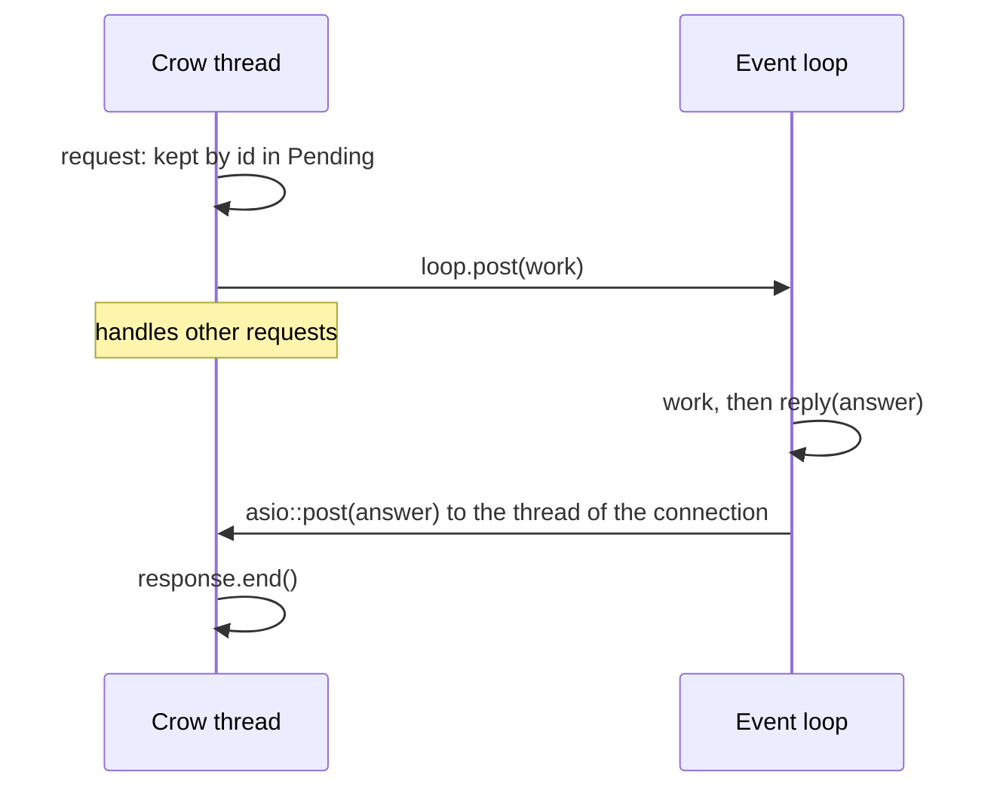

# Web server

The master serves HTTP for its administration panel ([ADR 0025](../decisions/0025-server-administration.md)):
the static files of the panel, `/api/health`, the local access token traded for a session, the
[administration API](../protocol/admin-api.md) and its WebSocket, and the headers of security of every
response. `WebServer` (`apps/server/src/Web/WebServer.hpp`) runs it on threads of its own, beside the event loop
of the master. What the API shows and does lives in the master: [Administration](administration.md). The panel
it serves: [The panel](panel.md).

To configure it, see the `[web]` section of [Configure a server](../guides/configure-a-server.md).

| | |
|---|---|
| Library | [Crow](https://crowcpp.org) 1.3.4, header-only, through CPM with a hash, given the Asio of `libs/network`: one Asio in the binary. A private dependency, behind `Web/WebServer.hpp`, patched ([Responses from the loop](#responses-from-the-loop)) |
| Listens | `127.0.0.1:8080` by default, `[web] listen`. Without accounts, a loopback address only |
| Threads | Two of Crow: one accepts the connections, one handles them |
| Code | `Web/WebServer.cpp` (Crow, the routes, the files, the sessions, the WebSocket), `Web/AdminJson.cpp` (the JSON of the API), `Web/LocalAccess.cpp` (the token, `admin-url.txt`), `Web/Visitor.cpp` (the address of the visitor behind the proxies) |
| Tests | `tests/server_web.cpp`, tag `[web]`; the API in `tests/server_admin.cpp`, tag `[admin]` |

## Routes

| Route | Needs | Answer |
|---|---|---|
| `GET /api/health` | nothing | `200 {"status":"ok"}`, answered by the event loop of the master: a master whose loop is stuck is not healthy. `r-type_server --health` asks it, for the health check of the Docker image |
| `GET /api/session` | a session | `200 {"csrfToken": "…"}` with a session, `401` without |
| `GET /api/server`, `/api/games`, `/api/games/{id}`, `/api/players`, `/api/actions`, `/api/bans` | a session | The [administration API](../protocol/admin-api.md#3-reading), answered by the loop |
| `POST /api/players/{id}/kick`, `/api/games/{id}/end`, `/api/messages`, `/api/bans`, `/api/bans/lift` | a session and its CSRF token | The [actions](../protocol/admin-api.md#4-acting), done on the loop |
| `GET /api/events` | a session, from a page of the panel | The WebSocket of the [live events](../protocol/admin-api.md#5-events) |
| other `/api/...` | a session | `401` without a session, `404` with one |
| `GET /?token=<64 hex digits>` | the local access token | `303` to `/` with the session cookie; `403` for a wrong token, without a cookie |
| `GET /<file>` | nothing | The file of the panel, with its `Content-Type` |
| `GET /<page>` | nothing | `index.html` of the panel, for a path without an extension: the panel routes it itself. A missing file with an extension is `404` |
| other methods | | `405`, `Allow: GET` |

The files of the panel are served from `[web] panel_dir`, by default `admin/` next to the executable. Without the
folder, or without its `index.html`, every page of the panel says it is not built: the game builds without
Node, and a host who has no panel still sees why. A `panel_dir` given in the settings that does not exist stops
the master at start. A path is decoded, then refused when one of its segments is `..`, or when it holds a `\`
or a NUL: no address reaches a file out of the folder.

The panel holds no secret: its files are served to anyone who reaches the port. What it shows comes from the
API, which needs a session.

## Responses from the loop

A request that needs the master, its games or its lobby, is answered on the event loop, the only thread that may
touch them ([Threads](threads.md#server)). Neither side waits for the other:



*The loop computes the answer; Crow's thread of the connection sends it.*

- The response is ended on Crow's thread of its connection, never on the loop: Crow is not thread-safe.
- The requests waiting are kept by id, not by response: a connection reuses its response for its next request.
- A route of the API whose work needs the administration answers `503` until the master gives it
  (`setAdministration()`), and after it takes it away, on the way out.
- `stop()`, called by the shutdown of the master and by the destructor, first answers `503` to the requests
  still waiting, on Crow's threads, then stops Crow and waits for its threads. A reply that comes later is
  dropped. The web server stops first, before the lobby and the games, and is destroyed before the loop.

Crow does not support a response ended after its handler has returned (CrowCpp/Crow#843): the closure that
completes the request holds the last reference to its connection, and clears itself while it runs, which frees
the connection in the middle. `apps/server/patches/crow-deferred-response.patch`, applied by CPM, calls a copy
of it instead. The test that answers after the loop has worked fails without it.

Crow's empty `request()` leaves `keep_alive`, `close_connection`, `upgrade` and the HTTP version
uninitialized, and its parser resets its request with one after each response: the copy reads those values,
which is undefined behavior. UndefinedBehaviorSanitizer stops on it whenever the memory does not hold a 0 or a
1, so a test of the API failed now and then in the build with the sanitizers.
`apps/server/patches/crow-request-initialized.patch` gives them a value.

Crow ends the response of its catch-all route itself, after the handler, which serves the files of the panel:
that handler only fills the response. Ended twice, the response stayed completed once sent, and the next request
on the same connection got Crow's bare `404` without reaching any handler, which a browser, keeping its
connections alive, hit on its second page. The test of a connection kept alive fails without it.

## Local access

There are no accounts yet: the panel is opened from the machine of the server, with a token.

1. At each start, the master makes a new token of 256 random bits (`newAccessToken()`), never logged.
2. It writes the address of the panel with it to `admin-url.txt`, beside its key, readable by its owner only
   (`0600` on Unix), the file of the previous start replaced, and logs the path of the file, never its content:

    ```
    INFO  master   Panel on HTTP 127.0.0.1:8080
    INFO  master   Panel at http://127.0.0.1:8080: open the address written in /data/admin-url.txt
    ```

3. `GET /?token=…` with that token gives a session cookie, then redirects to `/`, so that the token leaves the
   address bar and the history:

    ```
    Set-Cookie: rtype_session=<64 hex digits>; Path=/; Max-Age=43200; HttpOnly; SameSite=Strict
    Location: /
    ```

The session lasts 12 hours, in the memory of the master: a restart ends it, as it changes the token. Each
opening makes a new session, 64 at most, the oldest dropped. The session is not the token: a cookie that leaks
does not give the token. Tokens and sessions are compared in constant time.

## Requests from other sites

The cookie is `SameSite=Strict`: a browser does not send it with a request that another site starts. Two more
rules close what it leaves open, such as a page of a sibling domain (`*.example.org`), which is the same site:

- **Every `POST` of the API carries the CSRF token of its session** in `X-CSRF-Token`. Each session has its own,
  256 random bits, given by `GET /api/session` to the panel, which a page of another origin cannot read. A
  `POST` without it, or with another session's, is `403`, before its body is read; the session is checked
  first, so a visitor without one learns nothing about a route.
- **The WebSocket of `/api/events` is refused when its `Origin` is not the panel's**: the address the browser
  asked (`http://<Host>`, `https://<Host>`), or the origin of `[web] public_url`. A browser always sends the
  origin of the page that opens a WebSocket, which the page cannot change; the cookie alone would let a sibling
  domain read the events, addresses of the players included. Refused, the upgrade gets `401` or `403` and no
  event, and is logged:

    ```
    WARN  web      A WebSocket was refused: it was opened by a page of http://evil.example.org
    ```

## The WebSocket

Crow accepts the WebSocket on its threads; the events come from the loop.

1. On the upgrade, Crow's thread checks the session and the origin.
2. Once open, the connection is kept with a token of its own, never reused, and the loop is asked to
   subscribe it to the administration: the snapshot goes first, then each event, from the loop.
3. Sending from the loop takes the lock of the connections and checks the connection is still there with its
   token: Crow removes it in its close handler, under the same lock, before it frees it. `send_text()` hands the
   frame to Crow's thread of the connection, which writes it.
4. Closed, the connection is forgotten under the lock, then unsubscribed on the loop.

`stop()` forgets every connection first: Crow then closes them, and may free them without calling the close
handler.

**The token is accepted wherever the panel listens**, not only from this machine. It is as strong as a session,
and whoever can read `admin-url.txt` already controls the server. No access is ever decided by the address of
the peer: behind a local nginx or Caddy, every request comes from `127.0.0.1`, the proxy's address.

**Without accounts, the panel listens on a loopback address only**, or the master does not start: the settings
file refuses another `listen`, and `runMaster()` checks it again. From another machine, the panel is reached
through an SSH tunnel. With accounts, it will be allowed to listen elsewhere, behind a proxy.

## The proxy

The address of a visitor, for the logs, is read by `visitorAddress()`:

- From a peer that is not in `[web] trusted_proxies`, the peer is the visitor, and its `X-Forwarded-For` is
  ignored: anyone can write one.
- From a trusted proxy, `X-Forwarded-For` is read **from right to left**: each proxy appends the address it was
  reached from, so the first address that is not a trusted proxy is the visitor. What is on its left was written
  by the visitor and is never read. An entry that is not an address stops at the proxy that wrote it.
- A request with two `X-Forwarded-For` headers: the order between them is lost, so neither is believed.

```
X-Forwarded-For: 6.6.6.6, 203.0.113.9        from 172.17.0.2, trusted
                 ^ written by the visitor     ^ appended by the proxy: the visitor
```

An IPv4 address seen by a listener on `[::]`, `::ffff:172.17.0.2`, is compared as `172.17.0.2`.

## The headers

Every response of the master carries:

```
Content-Security-Policy: default-src 'self'; script-src 'self'; style-src 'self' 'unsafe-inline'; img-src 'self' data:; font-src 'self'; connect-src 'self'; base-uri 'none'; form-action 'self'; frame-ancestors 'none'
X-Content-Type-Options: nosniff
Referrer-Policy: no-referrer
```

- Scripts come from the panel only: no inline script, no other host, no `eval`.
- Styles allow inline styles: Chakra UI, the components of the panel, inserts its styles at run time.
- Fonts and images come from the panel too, which serves its own fonts.
- `frame-ancestors 'none'`: no other site shows the panel in a frame, to make it click.
- `no-referrer`: no address of the panel leaves in a `Referer`.

The routes of the API add `Cache-Control: no-store`, and `index.html` `Cache-Control: no-cache`, as it names the
files of each build. A response is given these headers by `Guard`, the middleware of Crow, after its handler: only
Crow's own `400` to a request without `Host` does not go through it.

## Logs

Crow logs through our logger, `web`: its `Info`, a line per request and per response, is our `Debug`, its
`Debug` our `Trace`. The query strings are cut from its lines, `GET /?...`, so that no token reaches a log,
at any level. `Guard` logs each request with its path only, its status and its visitor:

```
DEBUG web      GET / 303 from 127.0.0.1
INFO  web      The panel was opened with the local access token, from 127.0.0.1
WARN  web      A wrong access token was given to the panel, from 127.0.0.1
```

## Starting and stopping

The master starts the web server after the port of its lobby, and before it runs: a port taken, or an address
of another machine, stops it with exit code 1, `--check` included, as the port of the lobby does. `--check` opens
the port, then closes it, and writes no `admin-url.txt`.

```
ERROR master   Cannot serve the panel on 127.0.0.1:8080: Address already in use
```

Port 0 takes a free port, written in `admin-url.txt`: the tests give it to every master they run, which would
otherwise all take 8080.

## libcurl

libcurl 8.23.0 arrives with this web server, through CPM with a hash: the HTTP client of the tests
(`tests/helpers/Http.hpp`), the mails of the accounts ([Accounts](accounts.md#the-mails)), and the requests to Discord ([Accounts](accounts.md#discord)). Its protocols are limited to HTTP(S) and
SMTP(S); its TLS is OpenSSL on Linux, which is a prerequisite of the build there (`libssl-dev`), and the system's
(Schannel) on Windows.
