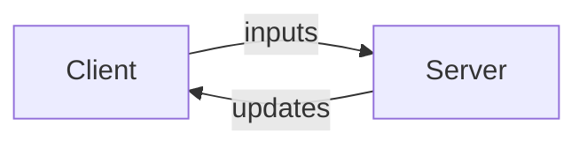

# Writing documentation

The documentation is written in **English**, in Markdown files under `docs/`, and built with
[Zensical](https://zensical.org). The C++ API reference is generated by Doxygen from source comments.
Both are published to GitHub Pages when `main` changes.

## Adding a page

1. Create a Markdown file in the right folder of `docs/`. Start from a [template](templates.md) when one
   fits.
2. Add it to the `nav` list in `zensical.toml`, where it should appear in the menu:

    ```toml
    { "Architecture" = [
      "architecture/index.md",
      "architecture/networking.md",   # new page
    ] },
    ```

3. Open a pull request. The *Documentation* workflow builds the site in strict mode and fails if a link is
   broken or if a page is missing from `nav`.

!!! tip "Quick fixes"

    Every page has an :lucide-pencil: **Edit this page** button that opens the file in the GitHub editor:
    no clone needed for a typo.

## Previewing locally

```sh
python3 -m venv .venv && source .venv/bin/activate   # once
pip install -r requirements-docs.txt                 # once
zensical serve
```

The site is served on <http://localhost:8000> and reloads on every save. The API reference is not part of
this preview; to build the complete site like the CI does (requires `doxygen`):

```sh
git submodule update --init      # once: Doxygen theme (doxygen/doxygen-awesome-css)
python3 scripts/check_docs_nav.py
zensical build --clean --strict
doxygen doxygen/Doxyfile         # after Zensical, which cleans site/
```

The result is in `site/`.

## Useful syntax

### Admonitions

```markdown
!!! warning "Title"

    Indented content.
```

Types: `note`, `tip`, `info`, `warning`, `danger`, `question`. Use `???` instead of `!!!` for a collapsible
block.

### Tabs

```markdown
=== "Linux"

    Linux instructions.

=== "Windows"

    Windows instructions.
```

### Diagrams

Diagrams are written as [Mermaid](https://mermaid.js.org/) code blocks, so they are reviewed like code:

````markdown

````

### Accessibility rules

- Every image has an alternative text: ``.
- Every diagram is followed by a sentence that summarises what it shows.
- Do not convey information by colour only.

## Documenting C++ code

Public classes and functions are documented with Doxygen comments in headers. They appear in the
[API reference](../reference/index.md) at the next deployment, with no configuration to change.

```cpp
/// Fixed-size UDP datagram received from the network.
class Packet {
public:
    /// Reads the payload as the given message type.
    /// @param offset Position of the first byte to read in the payload.
    /// @return The decoded message, or std::nullopt if the payload is too short.
    template <typename T>
    std::optional<T> read(std::size_t offset) const;
};
```

- Use `///` comments. The first sentence is the summary shown in lists.
- Document every parameter (`@param`), the return value (`@return`) and errors (`@throws`) when relevant.
- Explain *what* and *why*; the code already shows *how*.
