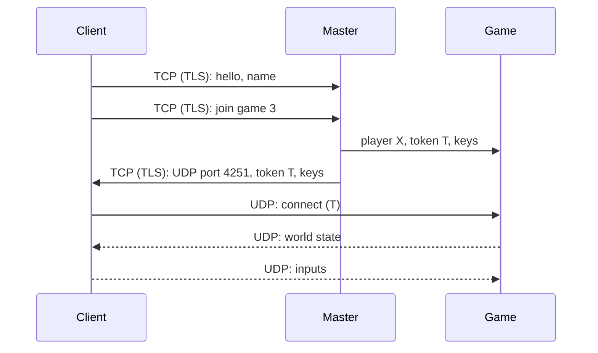

# 0012 — TCP for the lobby, UDP for the game

| | |
|---|---|
| **Status** | Accepted |
| **Date** | 2026-10-15 |

## Context

The server hosts several games at once, and a player has to reach one before playing: connect to the server,
choose a name, list the games, create or join one. Later come a chat, accounts and administration commands.
Then, inside a game, the client sends its inputs and the server sends the state of the world many times per
second.

These two kinds of traffic have opposite needs:

| | Outside a game (lobby) | Inside a game |
|---|---|---|
| Examples | Connection, game list, create or join a game, chat, accounts | Inputs, positions of the entities, spawns, deaths, shots |
| Every message must arrive | Yes, all of them | Positions: no, the next one replaces a lost one. Spawns, deaths: yes |
| Order | Must be kept | Each message carries its own tick |
| Latency | A few tens of milliseconds unnoticed | Every millisecond is felt |
| Size | Sometimes large (a list of 50 games, a scoreboard) | Small, many per second |

What the subject requires:

- The protocol is **binary**.
- **All in-game communications (entities, movements, events) MUST use UDP.**
- A second connection using TCP is tolerated for specific cases, with a strong justification.

See [Networking concepts](../architecture/networking-concepts.md) for the difference between a stream (TCP)
and datagrams (UDP).

## Options

| | A. UDP only | B. TCP only | C. TCP for the lobby, UDP for the game |
|---|---|---|---|
| Allowed by the subject | Yes | No: in-game traffic must be UDP | Yes, with this justification |
| Lobby messages | Need our reliability, ordering and fragmentation layer over UDP | Native | Native |
| Messages larger than a datagram | Fragmentation to write | Native | Native for the lobby; the game only sends small messages |
| In-game latency | Good | A lost packet delays everything after it (head-of-line blocking) | Good |
| Encryption | One scheme to design for datagrams | Standard TLS | Standard TLS for the lobby; the keys of the datagrams are exchanged over it ([ADR 0014](0014-encryption.md)) |
| Client crash detection | Timeout only | Connection closed by the system | Connection closed, and timeout for silent network failures |
| Ports to open on the server | One | One | One TCP port, plus UDP ports for the games |
| Code | One transport, but our reliability layer must also do ordering and fragmentation | One transport | Two transports, linked by a token |

## Decision

**C: a TCP connection between the client and the master server for everything outside a game, and UDP
between the client and its game for everything inside it.**

Justification of the TCP connection:

1. **It carries no in-game traffic.** Joining a game, the game list, the chat or the accounts happen outside
   the game simulation. Everything a game does goes through UDP, as the subject requires.
2. **These messages need TCP's guarantees.** Every message must arrive, in order. Over UDP, the reliability
   layer would also have to keep the order and split large messages: it would be rewriting TCP, worse.
3. **Some messages are larger than a datagram.** TCP splits and reassembles them without any work from us.
4. **TLS works on it.** TLS 1.3 is the standard, audited way to encrypt a connection and to authenticate the
   server. It protects the keys of the datagrams and, later, the passwords of the accounts.
5. **A closed connection reveals a crashed client at once.** When the process of a client dies, its system
   closes the connection, and the server knows immediately.

Rules:

- **Both protocols are binary**, described in the [protocol specification](../protocol/index.md).
- **TCP is a stream**: each message starts with its size, and the receiver reads exactly that many bytes. A
  size above the maximum closes the connection.
- **UDP keeps a reliability layer** (sequence numbers and acknowledgements): in-game messages that must arrive
  (a player dies, a client leaves) are sent over UDP and resent until acknowledged.
- **A token links the two.** When a player joins a game, the master gives the client, over TCP, the UDP
  address of the game and a secret token. The client sends this token in its first datagram, and the game
  knows which player it is.
- **The UDP heartbeat stays.** A connection can stay open while the network is down (a cable unplugged, a
  router failure). The game sends and expects at least one datagram per second, and drops a player after a
  few seconds of silence.

*The client talks to the master over TCP until it joins a game, then to the game over UDP with the token the
master gave it.*

## Consequences

- The lobby, the chat and the accounts reuse TCP's guarantees and TLS instead of rebuilding them.
- Two transports to write and to test in `libs/network`, and a token to link a player's two connections.
- The host opens one TCP port for the master and a range of UDP ports for the games
  ([ADR 0013](0013-one-process-per-game.md)).
- A client blocked by a firewall that lets TCP through but not UDP reaches the lobby and then fails to join a
  game: the client must report it clearly instead of waiting forever.
- If a lobby message ever has to be sent during a game, it still goes through the TCP connection, which stays
  open during the game, as long as it does not concern the game simulation.
