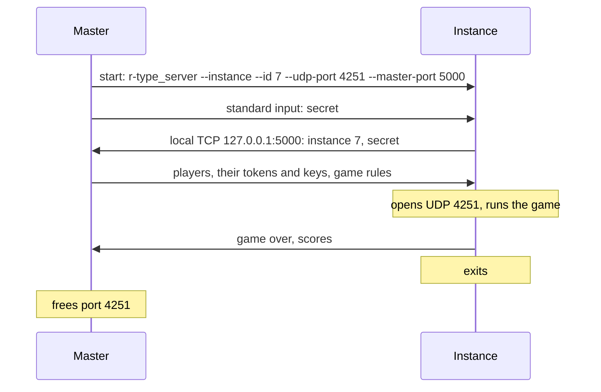

# 0013 — One process per game

| | |
|---|---|
| **Status** | Accepted; its "Ports" amended by [0027](0027-one-udp-port-relay.md) |
| **Date** | 2026-10-15 |

## Context

The server hosts several games at once: players connect to it, see the games, and join different ones. Each
game simulates its own world in an ECS, at a fixed rate, whatever its clients do.

Requirements:

- **The server is multithreaded**: it never blocks waiting for a client message.
- **The server is robust**: it keeps running "regardless of what's wrong might happen". A client that crashes
  is reported to the other players of its game.
- **The ECS is not thread-safe**: a world must only be touched by one thread.
- **The subject names two binaries**: `r-type_server` and `r-type_client`.
- **Linux and Windows.**
- **Later**: games on other machines than the lobby, if one machine is not enough.

## Options

### Where the games run

| | A. One process, one thread per game | B. One process per game |
|---|---|---|
| A game crashes (bug, assertion, segmentation fault) | The whole server dies, every game with it | Only that game dies; the lobby sees it and tells its players |
| Memory shared between games | Possible, so concurrency bugs are possible | Impossible: games only exchange messages with the lobby |
| Games on other machines | Needs a rewrite | Start the process elsewhere, the messages are already network messages |
| Communication with the lobby | Queues in memory | Local TCP connection, with our network library |
| Ports | One UDP port can serve every game | One UDP port per game |
| Start a game | Create a thread | Start a process (a few milliseconds) |
| Debugging | One process | One process per game to attach to |

### How the games are started

| | B1. One binary, `--instance` mode | B2. A second binary |
|---|---|---|
| Versions | The lobby and its games always come from the same build | Both must be deployed together |
| Subject | Keeps the two names it requires | A third binary to justify |
| Package | One file | Two files |
| Readability | The two roles are separated in two folders | Separated in two programs |

### How a process is started on Linux and Windows

| | Our own code | reproc | Boost.Process |
|---|---|---|---|
| What it is | `posix_spawn` on Linux, `CreateProcess` on Windows | Small C/C++ library (MIT), CMake | Part of Boost |
| Standard input, waiting, killing | To write for both systems, including Windows command-line quoting and pipes | Included | Included |
| Dependency | None | Small, through CPM | Boost |

## Decision

**B1: a master process (the lobby) that starts one process per game, from the same binary run with
`--instance`.** Processes are started with **reproc**, wrapped in our own `Process` class.

### The two modes of `r-type_server`

```cpp
int main(int argc, char **argv)
{
    const auto options = parseOptions(argc, argv);
    if (options.instance) {
        return runInstance(options); // one game
    }
    return runMaster(options);       // the lobby
}
```

The code of each mode lives in its own folder, `apps/server/src/master/` and `apps/server/src/instance/`.
What they share (options, the internal protocol) stays at the root of `src/`.

### The life of a game



*The master starts the instance, which proves who it is with the secret, receives its players, runs the game
and reports the result before exiting.*

1. The master starts the instance with its own executable (found by the system, not by `argv[0]`), a game
   id, a UDP port and the port of the master's local listener.
2. The master writes a random **secret** to the instance's standard input. Command-line arguments are visible
   to every user of the machine (`ps`), the standard input is not.
3. The instance connects to the master on `127.0.0.1` and presents its id and the secret. The master's local
   listener only accepts connections from the machine itself, and drops any connection without the right
   secret.
4. The master sends the players expected in the game, their tokens and encryption keys
   ([ADR 0014](0014-encryption.md)), and the rules of the game. It sends new players the same way while the
   game runs.
5. The instance opens its UDP port, accepts the players with their tokens, and runs the game.
6. When the game is over or empty, the instance sends the result to the master and exits. The master frees
   the UDP port.

### Ports

- The master listens on one public TCP port (4242 by default) for the clients, and on one local port for its
  instances.
- Each instance got a UDP port from a range set in the configuration, whose size was the maximum number of
  games, and the host opened the whole range. **Amended by [ADR 0027](0027-one-udp-port-relay.md)**: every game
  is now served on one UDP port, 4242 by default, through a relay in the master that forwards each datagram to
  its instance over the loopback. The host opens 4242/tcp and 4242/udp, and the maximum number of games is a
  setting.
- The client talked to its game directly, without going through the master. Since ADR 0027 its datagrams go
  through the relay: one hop on the loopback, still encrypted end to end.

### Threads

- **Master**: one thread runs the Asio event loop (client connections, local connections, timers). Process
  supervision goes through the same loop.
- **Instance**: one network thread runs the Asio event loop (receives, decrypts, decodes; encodes, encrypts,
  sends), and one simulation thread runs the ECS at a fixed rate. They only share two thread-safe queues: the
  messages received, and the messages to send. The simulation never waits for the network.

### Crashes

| What dies | Who sees it | How | What happens |
|---|---|---|---|
| A client | Its game | No datagram for a few seconds | The game removes the player and tells the other players |
| A client | The master | The TCP connection is closed | The master removes it from the lobby and tells its game |
| A game | The master | The process has exited, and the local connection is closed | The master frees the port and tells the players of that game |
| The master | Its games | The local connection is closed | Each game ends and exits: no orphan processes |

### Standalone mode, for tests

`r-type_server --instance --standalone --udp-port 4242` runs a game without a master, accepting clients with a
fixed test key. It only exists in debug builds. It serves the automated tests, the measurements and the fuzzing
of the game's decoder.

## Consequences

- A bug in one game no longer stops the others. The master is small and has no game code, so it is less
  likely to crash.
- Games only communicate through messages, so moving them to other machines later changes the address they
  connect to, not their code.
- The master/instance protocol is a protocol of its own, binary like the others, documented in the
  [protocol specification](../protocol/index.md).
- One more dependency (reproc), hidden behind `Process`.
- The host opened a range of UDP ports instead of one, and Docker published the same range, until
  [ADR 0027](0027-one-udp-port-relay.md) put every game on one port.
- Debugging a game means attaching to its process, or running it in standalone mode.
- The engine's events and scenes live in `libs/engine`, which depends on raylib: neither mode can use them.
  If the server needs them, the parts without raylib move to a library the server can link, in a separate
  change.
