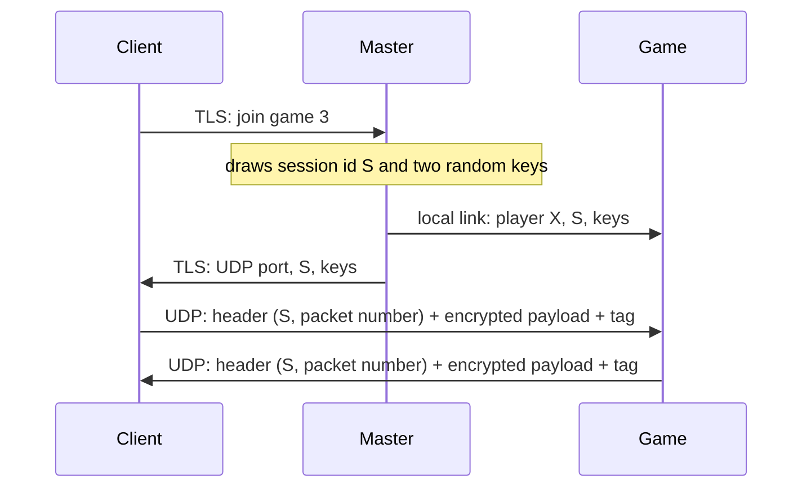

# 0014 — Encryption of the client/server traffic

| | |
|---|---|
| **Status** | Accepted |
| **Date** | 2026-10-15 |

## Context

The server is hosted on the Internet, and the clients reach it through networks we do not control. Whoever
sits between them (a public Wi-Fi, a compromised router, an operator) must not be able to read or change the
traffic, nor pretend to be the server.

The traffic is a TCP connection between the client and the master for the lobby, and UDP datagrams between
the client and its game ([ADR 0012](0012-tcp-lobby-udp-game.md)). Both must be protected, with three
properties:

| Property | Means | Without it |
|---|---|---|
| **Confidentiality** | Nobody else can read the traffic | Anyone on the path reads it, with Wireshark for instance |
| **Integrity** | Nobody can change it without being detected | An attacker changes or forges messages |
| **Authentication of the server** | The client is sure it talks to our server | **Man-in-the-middle**: the attacker sets up encryption with each side, decrypts, reads, re-encrypts |

Encryption alone only gives the first one: if the client and the server simply agree on a key, an attacker in
the middle agrees on one key with each of them, and both sides believe they are safe. The client must be able
to **check the identity of the server**.

Other requirements:

- **In-game latency**: no handshake per game, and a small cost per datagram (at most 1200 bytes, sent 20 to 60
  times per second).
- **Lost and reordered datagrams**: each datagram must be decryptable alone.
- **Documented**: someone must be able to write a compatible client from the
  [protocol specification](../protocol/index.md), so only standard algorithms.
- **Linux and Windows, fetched by CPM**, nothing installed on the system.
- **Never design our own cryptographic algorithms or handshakes.** Only assemble standard, audited pieces.

See [Networking concepts](../architecture/networking-concepts.md#security) for the vocabulary.

## Options

### How the traffic is protected

| | A. Nothing | B. TLS on TCP, DTLS on UDP | C. TLS on TCP, keys of the datagrams given over TLS | D. QUIC for everything | E. Our own handshake on UDP |
|---|---|---|---|---|---|
| Lobby (TCP) | In clear | TLS 1.3 | TLS 1.3 | QUIC streams | Same handshake |
| Game (UDP) | In clear | A DTLS handshake per game, then encrypted records | Each datagram encrypted with keys received over TLS, no handshake | QUIC datagrams | Our handshake, then encrypted datagrams |
| Man-in-the-middle | Possible | Prevented by the server certificate | Prevented: the keys never travel outside the authenticated TLS connection | Prevented | Depends on our design: the classic place for mistakes |
| Cost when joining a game | None | A full handshake | None | None | A handshake |
| Fits our protocol | — | DTLS adds its own records, retransmission and reordering on top of ours | Our header, our sequence numbers, one encrypted block | Replaces our reliability layer and TCP: the work the networking track evaluates disappears | Yes |
| Precedent | — | WebRTC | netcode.io (Glenn Fiedler), for action games | HTTP/3 | — |

### Which library

| | OpenSSL | Mbed TLS | wolfSSL | BoringSSL | libsodium / Monocypher |
|---|---|---|---|---|---|
| TLS 1.3 | Yes | Yes | Yes | Yes | No: cryptographic primitives only |
| Encryption of single datagrams (AEAD) | Yes | Yes | Yes | Yes | Yes |
| Built by CPM on Windows | Hard: Perl and NASM, no CMake | Easy: plain C, CMake | Possible | Possible | Easy |
| Licence | Apache 2.0 | Apache 2.0 | GPL (or commercial) | Own, no stable API promised | ISC / BSD |
| With Asio | `asio::ssl`, built on OpenSSL | Small adapter | Small adapter | Small adapter | — |

## Decision

**C: TLS 1.3 on the TCP connection, with the server's public key pinned in the client; each UDP datagram
encrypted and authenticated with ChaCha20-Poly1305, with per-player keys the master sends over TLS. The
library is Mbed TLS, for both.**

### TCP: TLS 1.3, server key pinned

- Only TLS 1.3 is accepted, no older version.
- The server has a key pair (ECDSA P-256). The **private key** is a file on the server, given with `--key`,
  readable only by the server's user and never in the repository. The **public key** is shipped with the
  client, in a file next to the executable.
- The client accepts the connection only if the key presented by the server is the pinned one (compared by
  its SHA-256 fingerprint). This is **key pinning**, the same idea as SSH's `known_hosts`: no certificate
  authority and no domain name are needed. An attacker cannot present our key, since proving ownership of
  it requires the private key.
- Asio moves the bytes, Mbed TLS encrypts and decrypts them, behind our own `TlsConnection` class in
  `libs/network` ([ADR 0011](0011-networking-library.md)).

### UDP: keys given by the master

*The keys of the datagrams only travel inside the authenticated TLS connection and the master's local link,
so an attacker on the path never sees them.*

1. When a player joins a game, the master draws a **session id** and **two random 256-bit keys**: one for the
   client-to-game direction, one for the game-to-client direction.
2. It sends them to the game over its local link ([ADR 0013](0013-one-process-per-game.md)), and to the client
   over TLS.
3. Each datagram is made of:
    - a **header in clear**: protocol version, message type, session id, **packet number** (64 bits, starting at
      0 in each direction, incremented on every datagram);
    - the **payload, encrypted**;
    - a 16-byte **tag** computed over the header and the payload.
4. The algorithm is **ChaCha20-Poly1305** (RFC 8439), an **AEAD**: it encrypts the payload and authenticates
   the payload and the header in one operation. The header is passed as associated data: it stays readable,
   but changing one bit of it makes the tag wrong.
5. The **nonce** is the packet number, padded to 96 bits. A nonce must never be used twice with the same key:
   the number only grows, each direction has its own key, and new keys are drawn for every game the player
   joins. A sender that would wrap its counter closes the session instead.
6. The receiver finds the keys with the session id, checks the packet number against a **replay window** (the
   highest number received and a bitmap of the 256 previous ones), then decrypts. A wrong tag, an unknown
   session or a number already seen: the datagram is dropped silently, and counted. The window is updated
   only after a successful decryption.
7. Possessing the key is the proof of identity: the first datagram a game decrypts with a player's key comes
   from that player. The session id only selects the key and is not a secret.

ChaCha20-Poly1305 is chosen over AES-GCM because it is fast and runs in constant time in software on every
processor, with or without AES instructions. It is the algorithm of WireGuard.

### Master ↔ instance link

The link stays on the machine (`127.0.0.1`) and is not encrypted: no traffic leaves the machine. The instance
proves who it is with the secret received on its standard input. If games ever run on other machines, this
link gets TLS too, in a new record.

### Keys in practice

| Where | What |
|---|---|
| Server | Private key file, given with `--key`. `*.key` files are ignored by git. |
| Client | Server public key next to the executable. Changing server means changing this file. |
| Development | A script generates a local key pair, documented in a guide. |
| Standalone instance (debug builds only) | A fixed test key, so that tests and fuzzing can talk to a game without a master. |

### What this does not protect

- **The sizes and the timing** of the datagrams stay visible.
- **Flooding**: handled separately, by limiting the number of clients and of datagrams per second and per
  address. A datagram with a wrong tag is rejected before any expensive work.
- **A modified client** (cheating): the server is authoritative and only accepts inputs, never positions.
- **Who the player is**: anyone with the client can connect. Accounts and passwords, protected by TLS, come
  later.

## Consequences

- Nobody on the path can read, change, forge or replay the traffic, nor impersonate the server.
- Joining a game costs no handshake; each datagram costs 16 bytes of tag and a negligible encryption time.
- Forged datagrams without the key are rejected by the tag. This replaces the cookie handshake that would
  otherwise protect against spoofed source addresses.
- Wireshark no longer shows the content: a debug build can log the decrypted messages at the `trace` level.
- The specification describes the header, the nonce, the associated data and the replay window, so that
  another client can be written.
- Mbed TLS is one more dependency, wrapped in `libs/network`. The **latest release** is used (4.2.0 when this
  record was written), not an LTS branch: every 4.x release keeps the same API, so following new releases is a
  version bump.
- Mbed TLS 4 moved its cryptography to the PSA Crypto API and to a separate repository, TF-PSA-Crypto, included
  as a git submodule. CPM fetches the **release archive** (`mbedtls-4.2.0.tar.bz2`, with its SHA-256), which
  contains the submodules, not the archive GitHub generates from the tag, which does not.
- Its [security advisories](https://mbed-tls.readthedocs.io/en/latest/security-advisories/) are followed: a fix
  means bumping the pinned version and hash in CPM.
- The private key must be protected on the host. If it leaks, a new key pair is generated and a new client
  configuration distributed.
