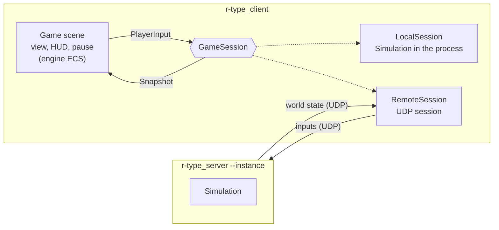

# 0015 — One game scene, fed by a local or a remote session

| | |
|---|---|
| **Status** | Proposed |
| **Date** | 2026-10-16 |

## Context

The client needs its game scene (issue #124). The main menu leads to it two ways:

- **Play**: a game alone, offline, without a server.
- **Online**: the lobby, then a game hosted by an instance of the server ([ADR 0012](0012-tcp-lobby-udp-game.md),
  [ADR 0013](0013-one-process-per-game.md)).

Both games must look and feel the same: same ships, same Bydos, same HUD, same pause menu. Only who decides
what happens changes.

Requirements:

- **The server is authoritative online.** The client sends its inputs and draws the world it receives; it never
  decides a collision, a death or a spawn.
- **The rules of the game are written once.** The server instance simulates them, and the offline client must
  simulate the same ones: a Bydo must not behave differently offline.
- **The rules cannot live in `libs/engine`**, which depends on raylib and is client-only, nor in `libs/ecs`,
  which stays pure ([ADR 0006](0006-ecs-component-storage.md)). The server links neither raylib nor the engine.
- **The simulation runs at a fixed tick** (60 per second, the tick rate of
  [`ACCEPTED`](../protocol/game.md#accepted-0x02)), like the physics ([ADR 0010](0010-physics-engine.md)),
  whatever the frame rate of the client.
- **The pause differs**: offline, the pause menu stops the game; online, the game goes on under it.
- **Later**: prediction of the local ship online, and the game logic on its own thread (issue #118).

## Options

| | A. Two game scenes | B. One scene, rules in the client's world offline | C. One scene, fed by a session | D. One scene, a local server process offline |
|---|---|---|---|---|
| Idea | `game_offline` and `game_online`, each with its own systems | Offline, the rules' systems run in the engine's ECS on the drawn entities; online, replication systems write them | The scene draws snapshots and sends inputs; a local session simulates in the client process, a remote session talks to the server | Offline, the client starts `r-type_server --instance --standalone` and connects to it over UDP on `127.0.0.1` |
| Rules written once | Yes, if both share a library | Yes, shared library | Yes, shared library | Yes, it is the server |
| Code of the scene (view, HUD, pause) | Twice, or factored out by hand | Once | Once | Once |
| Paths of the world state in the client | Two | Two: the rules write the entities offline, the replication online | **One**: snapshots in both modes | One |
| Replication tested offline | No | No | **Yes**: an offline game goes through it | Yes |
| Authoritative state apart from the drawing | Depends | No: the rules see the drawing components, and could start depending on them | Yes: the simulation has its own ECS, like on the server | Yes |
| Pause offline | Easy | The scene stops updating | The local session stops stepping | A message to the server process |
| What offline needs at runtime | Nothing | Nothing | Nothing | The server binary next to the client, a free UDP port, encryption keys, a firewall that lets it through |
| Logic on its own thread later | To redo for each scene | Hard: the rules share the world of the drawing | The local session runs the simulation on a thread, like the instance | Already another process |
| Cost | Duplicated code | Nothing extra | A copy of the world state per tick (a few hundred entities) | A process, encryption and the network for a game alone |

A duplicates what makes both games feel the same. B mixes the authoritative state with the drawn entities:
offline and online then go through different code, and a replication bug only shows online. D works, but a
game alone depends on a second binary, a port and a firewall, and the standalone mode only exists in debug
builds ([ADR 0013](0013-one-process-per-game.md#standalone-mode-for-tests)).

## Decision

**C: one game scene, fed by a `GameSession`. Offline, a `LocalSession` runs the simulation in the client
process; online, a `RemoteSession` talks to the instance. The rules live in a new library, `libs/game`,
shared by the server and the client.**



*The scene only exchanges inputs and snapshots with its session; offline the simulation runs in the client,
online in the server instance.*

### Who does what

```
libs/game/                rtype::game, rules of the R-Type; depends on ecs, physics, log; no raylib
  Component/              Player, Bydo, Missile, Health, Score...: the authoritative state
  System/                 player control, shots, waves, damage, score...
  Input/PlayerInput       what one player does during one tick: direction, buttons
  Snapshot/Snapshot       the world at one tick: the state of each entity, the events of the tick
  Simulation/Simulation   owns an ECS and the systems; takes inputs, steps one tick, gives a snapshot

apps/server/src/instance/ Simulation + the UDP sessions of the players
apps/client/src/Game/
  GameSession             the interface below
  LocalSession            owns a Simulation
  RemoteSession           the UDP session with the instance (game protocol)
  GameScene               builds the scene: background, HUD; the pause menu over it
  GameSessionSystem       Controls → PlayerInput → session; snapshots → drawn entities
```

- **`Simulation` is the game.** It owns its own `Ecs`, registers the rules' systems and the physics
  (`PhysicsStep` with the tick as its step), and knows neither the network nor the drawing. The instance and the
  `LocalSession` use the same class.

    ```cpp
    rtype::game::Simulation simulation(rules);
    simulation.addPlayer(0);
    simulation.setInput(0, input);        // input of slot 0 for the next tick
    simulation.step();                    // exactly one tick
    const rtype::game::Snapshot &state = simulation.getSnapshot();
    ```

- **`GameSession` is all the scene knows.** The names below are a sketch, to be settled with the code:

    ```cpp
    class GameSession {
    public:
        virtual ~GameSession() = default;
        /// The local player's input, sent with the next tick.
        virtual void sendInput(const game::PlayerInput &input) = 0;
        /// Steps the local simulation, or handles the datagrams received.
        virtual void update(float elapsed) = 0;
        /// The snapshots received since the last call, oldest first.
        [[nodiscard]] virtual std::vector<game::Snapshot> takeSnapshots() = 0;
        /// Offline, stops the game; online, the game goes on.
        virtual void setPaused(bool paused) = 0;
        [[nodiscard]] virtual bool isOver() const = 0;
    };
    ```

    `LocalSession::update` accumulates `elapsed` and steps the simulation once per tick, like `PhysicsStep`.
    `RemoteSession::update` polls the network, decodes the game messages into the same `Snapshot`, and closes
    the session as the [protocol](../protocol/game.md#7-session) says.

- **The game scene is the view.** Its entities only carry what is drawn (`Sprite`, `Model`, `Drawable`, HUD
  texts) and a `Replicated{id}` linking each one to an entity of the snapshots. The `GameSessionSystem` turns
  the `Controls` of the engine into a `PlayerInput`, then applies the snapshots: it creates the drawn entity of a
  new id from its kind (player ship, Bydo, missile), moves the existing ones (interpolated between the last two
  snapshots), and destroys those that disappeared. Effects that change nothing in the game (explosions,
  star-field, sounds) are created by the client from the events of the snapshots.

### Choosing the mode

The session is created before the scene opens, and the scene does not know which one it gets:

| | Offline | Online |
|---|---|---|
| Started from | Play | `GAME_JOINED` received in the online menu |
| Session | `LocalSession`, one player in slot 0 | `RemoteSession`: UDP port, session id and keys from the master |
| The scene opens | At once | On `ACCEPTED`; until then, "Connecting…" in the online menu |
| Pause menu | Pushed over the game, `setPaused(true)` | Pushed over the game, the game goes on; the ship receives no input |
| End | `isOver()`: game over | `isOver()`: game over, `DISCONNECT`, timeout |
| Back to | The main menu | The online menu (the TCP connection to the lobby stays open) |

The client owns the current session (one at a time) and gives it to the scene's build function and to the
`GameSessionSystem`; it destroys the session when the game scene closes. The game scene keeps
`updatesWhenCovered`, so the session is still updated under the pause menu.

## Consequences

- The rules are written and tested once, in `libs/game`, without a window or a network: the `[game]` tests step a
  `Simulation` with inputs and check its snapshots.
- An offline game goes through the same snapshots, interpolation and drawn entities as an online game, with no
  latency: most replication bugs show offline.
- The client has two worlds offline: the simulation's ECS and the engine's. The state of a few hundred entities
  is copied each tick, which is negligible.
- The rules cannot use the engine (scenes, events, `Controls`): inputs reach them as `PlayerInput`, and their
  results leave as `Snapshot`. The ECS is not modified.
- The game messages of the protocol (types `0x40`–`0xFF`, "defined in a later version") must carry
  `PlayerInput` and `Snapshot`: full or delta snapshots, and how often they are sent, are the next decisions.
- Prediction of the local ship online can reuse the movement of `libs/game` inside `RemoteSession`, without
  touching the scene.
- `LocalSession` can later run its `Simulation` on its own thread with two queues, like the instance
  (issue #118), without touching the scene either.
- Local co-op (two players on one machine) would be a `LocalSession` with two slots and two `PlayerInput`s.
