# Play the game

What the game offers to a player, from the main menu to the final boss, and where each feature is described.
To build the game first, see [Building the project](build.md).

## Starting

| To play | Do |
|---|---|
| Alone | `./build/bin/r-type_client`, then **Play → Solo** |
| Online | Start a server ([Run a server](../guides/run-a-server.md)), then **Online** in each client ([Play online](../guides/play-online.md)) |
| In VR | `./build/bin/r-type_client --xr`, or **VR** on the Settings page ([Play in VR](../guides/play-in-vr.md)) |
| Orbit Breaker | `./build/bin/orbit_breaker` ([Orbit Breaker](../architecture/minigame.md)) |

## Controls

| Action | Keyboard | Gamepad |
|---|---|---|
| Move | ++arrow-up++ ++arrow-down++ ++arrow-left++ ++arrow-right++, or WASD (ZQSD on AZERTY) | Left stick, D-pad |
| Fire | ++space++ | South button, right trigger |
| Aim up, aim down (30°) | ++q++, ++e++ (++a++, ++e++ on AZERTY) | Left bumper, right bumper |
| Take the other weapon | ++left-shift++ | West button (X) |
| Pause | ++escape++ | Start |
| Fullscreen | ++f11++ | — |
| Console | ++f8++ | — |

Every key of the game, and those of the voice, can be changed on **Settings → Controls**
([Choosing the keys](../architecture/input.md#choosing-the-keys)). The menus work with the keyboard, a gamepad
or the mouse.

## The main menu

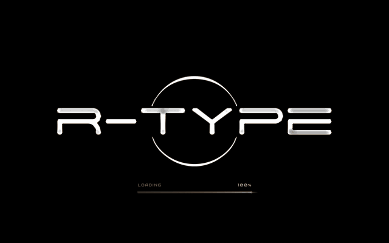

*The intro, then the main menu over the ringed planet and its station.*

The client loads its assets behind the logo, then flies the camera over a ringed planet, its asteroid belt and
a station with ships around it, and shows the menu: **Play** (Solo, Hangar, Story, Quests), **Online**,
**Settings**, **Quit**. The submenus come with transitions
([Transitions of the main menu](../architecture/scenes-and-interface.md#transitions-of-the-main-menu)).

## The hangar

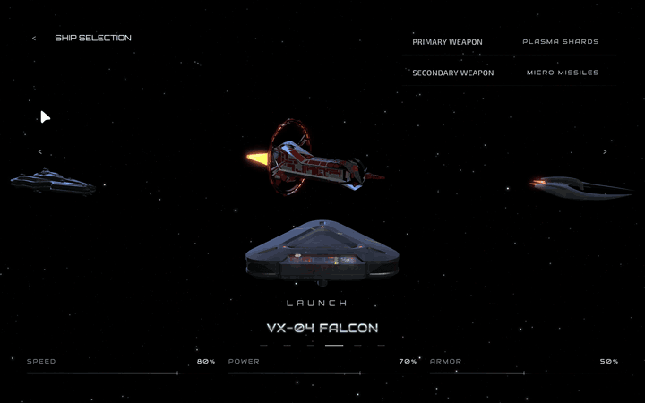

*Six ships, each with its speed, power and armour; a locked one shows the level it needs.*

The hangar opens before each game, on the ship equipped last. **Launch** starts the game with the ship looked
at. In the top right corner, the player chooses its two weapons, the primary and the secondary, among those its
level opens ([A game in the client](../architecture/client-game.md),
[The ships and the weapons of the hangar](../guides/configure-enemies-and-weapons.md#the-ships-and-the-weapons-of-the-hangar-confighangarlua)).

## A game

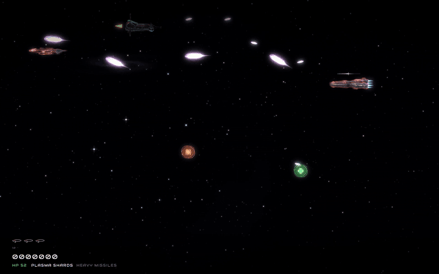

*A wave of Bydos, the HUD at the bottom and the kills in the top right corner.*

- **Waves of Bydos** come one after the other: five difficulties, then the final boss, offline; endless waves
  online, until every player is out of lives ([Waves](../architecture/game.md#waves)). Some waves place their
  enemies on the beats of their music.
- **20 kinds of Bydos**, each with its model, its weapon and its behaviour, scripted in Lua
  ([Enemies](../architecture/game.md#enemies)).
- **Four firing mechanics**: bullets, missiles that speed up, lasers, plasma that zigzags
  ([Projectiles](../architecture/game.md#projectiles), [Weapons](../architecture/game.md#weapons)).
- **Power-ups**: a repair kit, an extra life, rapid fire, a shield, and a Bydo mine, which is a trap
  ([Items](../guides/configure-enemies-and-weapons.md#items-configitems)).
- **What the player sees**: impacts, explosions, the damage above the Bydos hit, health bars, an aura around
  each ship in the colour of its side, the HUD and the kills in a corner
  ([What it looks like](../architecture/client-game.md#what-it-looks-like)).

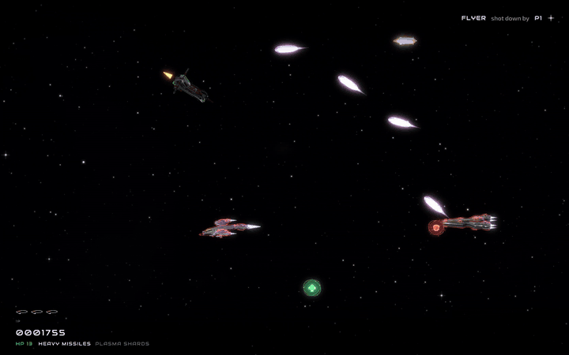

*The laser of a Bydo crosses the screen.*

### Lives

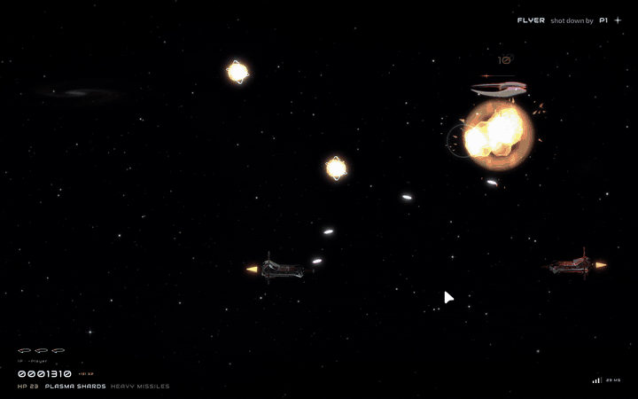

*The death screen: the lives left and the countdown to the next ship.*

Each player has three lives. A ship lost with lives left comes back three seconds later, invulnerable for a while
([Death screen](../architecture/client-game.md#death-screen)).

### The final boss

The Shogun ends a game offline: several phases, dashes of its blade across the screen, and its own music. The
last life lost against it calls the squadron to the rescue, with a cinematic camera, then a combined attack on
++space++ ([The rescue against the final boss](../architecture/client-game.md#the-rescue-against-the-final-boss)).
The console command `boss` starts a game that goes straight to it.

## Online

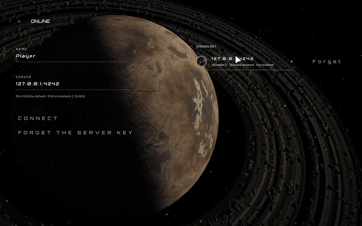

*From the sign-in to the first wave of an online game.*

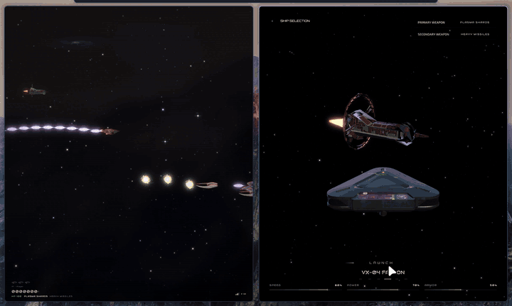

*Two clients in the same game.*

- **A server, by its address**: its key is trusted at the first connection, as with SSH
  ([Trusted servers](../architecture/client-online.md#trusted-servers)).
- **An account, Discord, or a guest**: an account keeps the experience and the level; a guest plays without one
  ([Accounts](../architecture/client-online.md#accounts)).
- **The list of games** of the server: create one, or join one, up to four players
  ([From the menu to the game](../architecture/client-online.md#from-the-menu-to-the-game)).
- **Experience and levels**: each wave cleared earns experience, multiplied by a streak; the levels open ships
  and weapons in the hangar. The results screen counts it at the end of the game
  ([Results screen](../architecture/client-game.md#results-screen)).
- **Voice chat**, through the game or Discord, in push-to-talk, on voice activity, or off
  ([Voice](../architecture/voice.md)).
- **Discord**: the activity of the player in its profile, the invitations, and its friends in the lobby
  ([Discord](../architecture/client-online.md#discord)).

## Story and quests

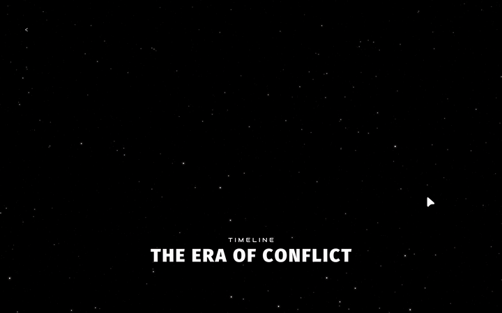

*The story of the game, in English or French.*

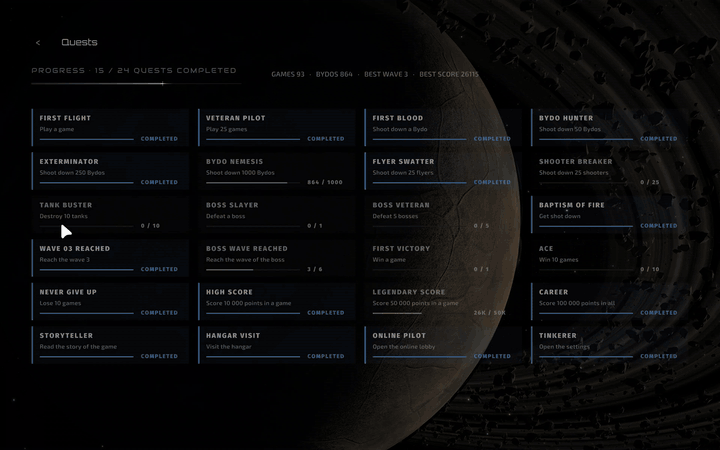

*24 quests and the stats kept from one run to the next.*

**Story** tells the war against the Bydos in a crawl with its own music. **Quests** lists 24 quests, from the
first flight to 100 000 points in all, with their progress; a toast pops when one is completed
([Quests](../architecture/client-game.md#quests)).

## Settings

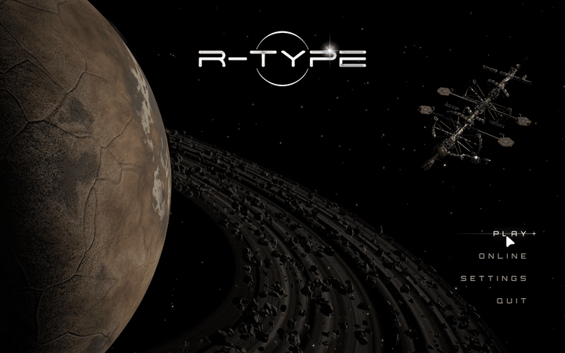

*The Settings page.*

The language (English, French), the volumes, the colour filters for colour blindness and a high-contrast mode,
the colours of the auras, the screen, the resolution, the frame rate and the vertical synchronisation, the
controls, the voice, VR and the activity on Discord. Everything is kept from one run to the next
([Settings](../architecture/settings.md), [Accessibility](../accessibility.md)).

## Orbit Breaker

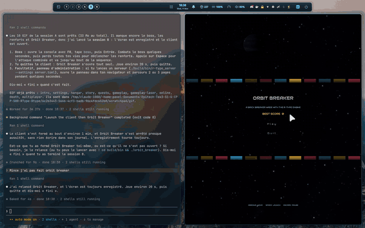

*Orbit Breaker, a brick breaker made with the engine alone.*

A brick breaker built with the same engine and nothing of the R-Type: levels, a best score kept from one run to
the next ([Orbit Breaker](../architecture/minigame.md)).

## The console

++f8++ opens a console: `boss` starts a game against the final boss, `hitboxes` shows the colliders (also ++f3++),
`fps` the frame rate, `profile` logs the time of each frame, `scene <name>` opens a scene, `toast` shows a
notification, `quit` quits ([Drawing](../architecture/scenes-and-interface.md#drawing)).
