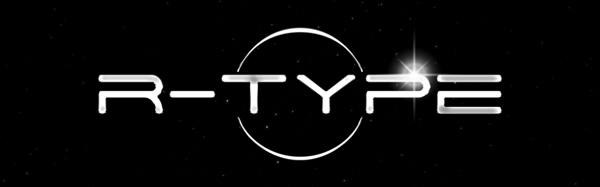
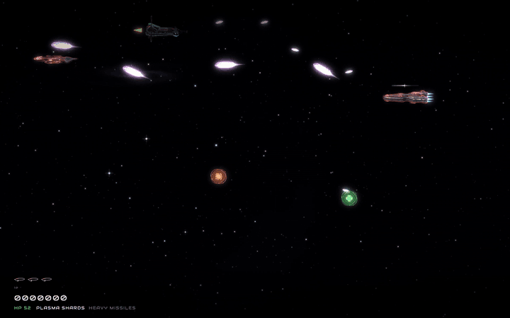

# R-Type

**A networked remake of the classic horizontal shoot'em up, built on our own C++ game engine.**

Up to four players connect to an authoritative server and fight the Bydos together, in 3D, online or offline,
with voice chat, accounts, a web administration panel, and a VR cockpit. The project is split into a graphical
client, a multithreaded server, and the engine they both rely on.

The project ran from **28 September 2026, 08:00** to **8 November 2026, 23:42**.

*A wave of Bydos against the plasma shards of the player.*

New to the game? [Play the game](getting-started/play.md) lists everything it offers, with its controls.

-   :lucide-rocket: **Getting started**

    ---

    Build the client and the server on Linux or Windows, run them, and play.

    [:octicons-arrow-right-24: Build and run](getting-started/index.md)

-   :lucide-layers: **Architecture**

    ---

    How the engine is organised: rendering, networking and game logic as decoupled layers.

    [:octicons-arrow-right-24: Architecture](architecture/index.md)

-   :lucide-radio-tower: **Network protocol**

    ---

    The binary UDP protocol between clients and server, precise enough to write your own client.

    [:octicons-arrow-right-24: Protocol specification](protocol/index.md)

-   :lucide-scale: **Technical decisions**

    ---

    Why we chose each library and tool, compared with the alternatives.

    [:octicons-arrow-right-24: Decision records](decisions/index.md)

-   :lucide-accessibility: **Accessibility**

    ---

    What the game and its documentation offer to players with disabilities.

    [:octicons-arrow-right-24: Accessibility](accessibility.md)

-   :lucide-git-pull-request: **Contributing**

    ---

    Git workflow, coding conventions, and how to add a page to this documentation.

    [:octicons-arrow-right-24: Contributing](contributing/index.md)

## At a glance

| | |
|---|---|
| **Binaries** | `r-type_client`, `r-type_server`, `orbit_breaker` |
| **Language** | C++20 |
| **Build** | CMake ≥ 3.25, dependencies fetched by [CPM.cmake](https://github.com/cpm-cmake/CPM.cmake) |
| **Platforms** | Linux (GCC, Clang), Windows (MSVC) |
| **Client library** | [raylib](https://www.raylib.com/) 6.0 |
| **Game data** | [Lua](https://www.lua.org/) 5.4, in `config/` |
| **Server** | Master and one process per game, SQLite or PostgreSQL, web panel, Docker image |
| **VR** | [OpenXR](https://www.khronos.org/openxr/) |
| **Source code** | [github.com/Akinator31/Rtype](https://github.com/Akinator31/Rtype) |
