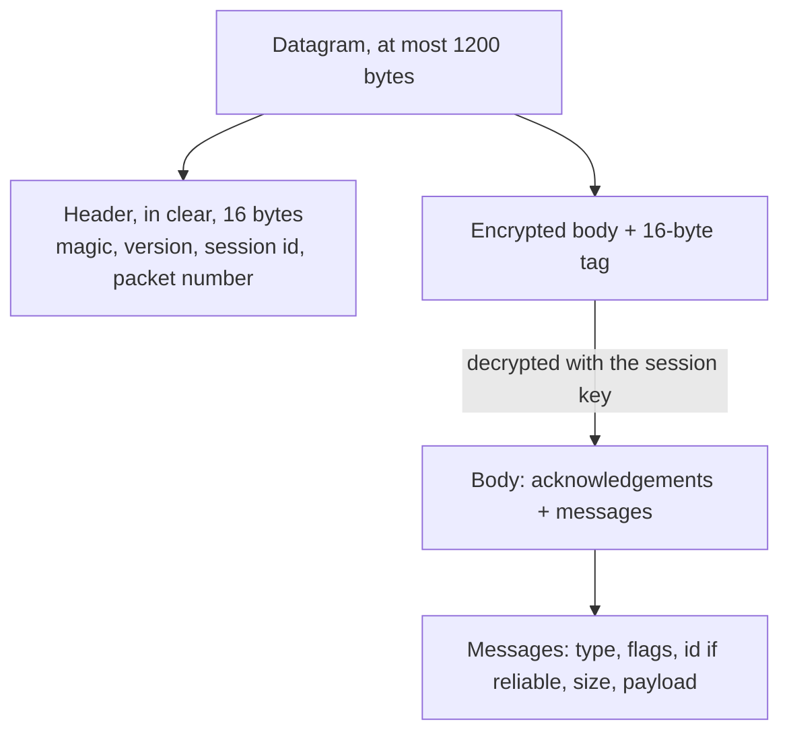
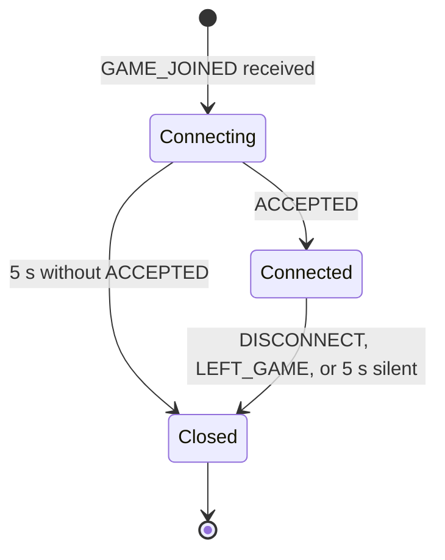

# Game (UDP)

The datagrams between a client and its game: layout, encryption, reliability, session messages and game
messages.
Conventions and types are defined in the [overview](index.md#2-conventions). The client receives the UDP
port, the session id and the keys from the master, in [`GAME_JOINED`](lobby.md#game_joined-0x83).

## 1. Layers of a datagram



*A datagram is a clear header followed by an encrypted body; once decrypted, the body carries the
acknowledgements and the messages.*

## 2. Datagram layout

| Offset | Field | Type | Description |
|---|---|---|---|
| 0 | Magic | `u16` | `0x5254` (`"RT"`) |
| 2 | Version | `u8` | Protocol version, 1 |
| 3 | Reserved | `u8` | 0 |
| 4 | Session id | `u32` | Session given by the master, never 0 |
| 8 | Packet number | `u64` | Number of this datagram in its direction, from 1 |
| 16 | Ciphertext | | The encrypted body, n bytes |
| 16 + n | Tag | `bytes[16]` | Authentication tag |

- A datagram is at least **32 bytes** (empty body) and at most **1200 bytes**, so the body is at most 1168
  bytes.
- The first 16 bytes are the **header**. They are sent in clear, but authenticated by the tag.

Example of a header: session 42, packet 1:

```
52 54                     magic "RT"
01                        version 1
00                        reserved
00 00 00 2A               session id: 42
00 00 00 00 00 00 00 01   packet number: 1
```

## 3. Encryption

The body is encrypted with **AEAD_CHACHA20_POLY1305** as defined in
[RFC 8439](https://www.rfc-editor.org/rfc/rfc8439):

| Input | Value |
|---|---|
| Key | The client key for datagrams sent by the client, the server key for datagrams sent by the game (32 bytes each, from `GAME_JOINED`) |
| Nonce | 12 bytes: `00 00 00 00` followed by the packet number as a big-endian `u64` |
| Associated data | The 16 bytes of the header |
| Plaintext | The body ([section 5](#5-body)) |
| Output | The ciphertext (same size as the body) and the 16-byte tag |

### Packet numbers

- Each side keeps its own packet number per session. It starts at **1** and increases by one for every
  datagram sent, resends included: a resent message travels in a new datagram with a new number.
- A packet number MUST NEVER be used twice with the same key. If a sender would exceed `2^64 − 1`, it closes
  the session instead.

### Receiving a datagram

A receiver processes a datagram in this order, and drops it silently at the first failed step:

1. The size is between 32 and 1200 bytes.
2. The magic is `0x5254`, the version is 1, the reserved byte is 0.
3. The session id is a known session.
4. The source address has not sent more than 200 datagrams in the last second.
5. The packet number is accepted by the replay window ([section 4](#4-replay-window)).
6. The tag is valid, and decryption succeeds.
7. The body is well formed ([section 5](#5-body)).

Only then does the receiver mark the packet number in the replay window, record the time (for the timeout),
apply the acknowledgements, and deliver the messages.

**Peer address.** The game learns the client's address (IP and port) from the first datagram that passes these
steps. If a later datagram passes them from another address with a higher packet number, the game sends to
the new address from then on: a home router may change the client's port.

## 4. Replay window

Each side remembers, per session:

- **H**, the highest packet number accepted, 0 at the start;
- a bitmap of the **256** packet numbers before H, marking those already accepted.

A packet number `n` is accepted if:

- `n > H`, or
- `H − n ≤ 256`, `n ≠ H`, and `n` is not marked.

Otherwise the datagram is a duplicate, a replay or too old, and is dropped. After a successful decryption,
`n` is marked; if `n > H`, H becomes `n` and the bitmap shifts.

## 5. Body

| Offset | Field | Type | Description |
|---|---|---|---|
| 0 | Ack | `u64` | Highest packet number received from the peer, 0 if none |
| 8 | Ack bits | `u32` | Bit i (bit 0 is the least significant) set: packet `Ack − 1 − i` was received |
| 12 | Count | `u8` | Number of messages that follow |
| 13 | Messages | | Count messages, one after the other |

Each message:

| Offset | Field | Type | Description |
|---|---|---|---|
| 0 | Type | `u8` | Message type |
| 1 | Flags | `u8` | Bit 0: reliable. Other bits: 0. |
| 2 | Message id | `u16` | Only if reliable ([section 6](#6-reliability)) |
| 2 or 4 | Size | `u16` | Size of the payload |
| 4 or 6 | Payload | | Size bytes |

- The body MUST end exactly after the last message. Extra bytes, a size going past the end, or a reserved flag
  set make the body malformed, and the whole datagram is dropped.
- A body with no message is a **heartbeat**: it still carries the acknowledgements.
- Message types `0x01`–`0x3F` are the session messages of [section 8](#8-messages). Types `0x40`–`0xFF` are the
  game messages of [section 9](#9-game-messages). A receiver skips a message of an unknown type, using its
  size.

## 6. Reliability

A message is either **unreliable** (sent once, may be lost) or **reliable** (resent until acknowledged,
delivered once, in order). The sender chooses per message; each message type below says which it is.

### Acknowledgements

Every datagram acknowledges the packets received from the peer: `Ack` is the highest packet number received,
and `Ack bits` mark the 32 before it. A packet is **acknowledged** as soon as one datagram from the peer
marks it.

### Sending reliable messages

- Each reliable message gets a **message id**, per session and per direction, starting at 0 and increasing
  by one, wrapping from 65535 to 0.
- The sender remembers which packets carried each reliable message. When one of them is acknowledged, the
  message is delivered and forgotten.
- A reliable message not acknowledged after the **resend delay** SHOULD be added to the next datagram. The
  recommended delay is `max(1.5 × RTT, 100 ms)`, where the RTT is measured from the acknowledgements, and
  taken as 100 ms until the first measure.
- At most **256** reliable messages may wait for an acknowledgement. A sender that would exceed this closes the
  session: the peer no longer answers.

### Receiving reliable messages

The receiver keeps the next expected id `E`, 0 at the start. For a reliable message of id `m`, with
`d = (m − E) mod 65536`:

| Case | Action |
|---|---|
| `d = 0` | Deliver it, increase `E`, then deliver the buffered messages that follow without a gap |
| `0 < d < 256` | Buffer it, unless it is already buffered |
| Otherwise | Already delivered, or out of the window: ignore it |

Reliable messages are therefore delivered **exactly once and in order**. Unreliable messages are delivered at
most once (the replay window drops duplicate datagrams), in the order they arrive, which may differ from the
order they were sent.

### Round-trip time

The sender records when it sent each packet. When a packet is acknowledged for the first time, the elapsed
time is a sample of the round-trip time. The RTT SHOULD be smoothed (`rtt = 0.9 × rtt + 0.1 × sample`); it is
used for the resend delay and shown to the player as the ping.

## 7. Session



*The client state of a session: it connects, plays, and ends on a disconnection, a notification of the master,
or a timeout.*

1. **Connecting.** The client sends `CONNECT` (reliable, so resent until acknowledged). The game, which
   received the session from the master, answers `ACCEPTED`, sends the client one `PLAYER_JOINED` per player
   already connected, and sends `PLAYER_JOINED` for the new player to the others.
2. **Connected.** Both sides exchange messages. Each side sends at least one datagram per second, a heartbeat
   if it has nothing else to send. The client MUST NOT send game messages before `ACCEPTED`; the game ignores
   them.
3. **Closing.** A side that closes the session sends `DISCONNECT` in three consecutive datagrams, then forgets
   the session. A side that receives no valid datagram for **5 seconds** closes the session; it MAY skip
   `DISCONNECT` then, since the peer is probably gone.

If the client gets no `ACCEPTED` within 5 seconds, it gives up and tells the player that the game cannot be
reached: a firewall probably blocks UDP. It sends `LEAVE_GAME` to the master.

When a session closes on the game's side, the game sends `PLAYER_LEFT` to the other players and, unless the
master asked for it with [`REMOVE_PLAYER`](instances.md#remove_player-0x83), tells the master with
[`PLAYER_DISCONNECTED`](instances.md#player_disconnected-0x04).

## 8. Messages

### CONNECT (`0x01`)

| | |
|---|---|
| **Direction** | Client → Game |
| **Reliability** | Reliable |
| **Sent when** | First message of the session. |

No payload. The key proves who the client is: only the player who received it in `GAME_JOINED` can produce a
valid tag.

**Receiver behaviour:** the game marks the session as connected, records the client's address, and answers
`ACCEPTED`.

### ACCEPTED (`0x02`)

| | |
|---|---|
| **Direction** | Game → Client |
| **Reliability** | Reliable |
| **Sent when** | Reply to `CONNECT`. |

| Offset | Field | Type | Description |
|---|---|---|---|
| 0 | Player slot | `u8` | 0 to 3: the player's place in the game, which sets the colour of its ship |
| 1 | Tick rate | `u8` | Ticks per second of the simulation, 60 |
| 2 | Tick | `u32` | Current tick of the game |

**Receiver behaviour:** the client moves to the connected state. A slot above 3 or a tick rate of 0 makes the
message malformed.

### DISCONNECT (`0x03`)

| | |
|---|---|
| **Direction** | Client → Game, Game → Client |
| **Reliability** | Unreliable, sent in three consecutive datagrams |
| **Sent when** | A side closes the session. |

| Offset | Field | Type | Description |
|---|---|---|---|
| 0 | Reason | `u8` | See below |

| Reason | Value | Meaning |
|---|---|---|
| `QUIT` | 0 | The player left |
| `GAME_OVER` | 1 | The game ended |
| `SHUTDOWN` | 2 | The game process stops |
| `PROTOCOL_ERROR` | 3 | The peer broke this specification (for instance, too many unacknowledged messages) |

**Receiver behaviour:** the receiver closes the session. Unknown reasons are treated as `QUIT`.

### PLAYER_JOINED (`0x04`)

| | |
|---|---|
| **Direction** | Game → Client |
| **Reliability** | Reliable |
| **Sent when** | A player connects to the game, and once per player already there when a client connects. |

| Offset | Field | Type | Description |
|---|---|---|---|
| 0 | Player slot | `u8` | 0 to 3 |
| 1 | Player id | `u32` | Id given by the master |
| 5 | Name | `str8` | 1 to 16 bytes |

### PLAYER_LEFT (`0x05`)

| | |
|---|---|
| **Direction** | Game → Client |
| **Reliability** | Reliable |
| **Sent when** | A player's session closes. |

| Offset | Field | Type | Description |
|---|---|---|---|
| 0 | Player slot | `u8` | 0 to 3 |
| 1 | Reason | `u8` | See below |

| Reason | Value | Meaning |
|---|---|---|
| `QUIT` | 0 | The player left the game |
| `TIMED_OUT` | 1 | Nothing received from the player for 5 seconds: its client crashed or lost the network |
| `LOBBY_CLOSED` | 2 | The player's connection to the master closed |

**Receiver behaviour:** the client removes the player and tells the local player, for instance "Pavel lost the
connection" for `TIMED_OUT`. Unknown reasons are treated as `QUIT`.

## 9. Game messages

The messages of the game itself: the inputs of the players and the world they play in. How they were chosen is
explained in [ADR 0016](../decisions/0016-replication.md). The game is authoritative: a client sends what its
player does, and draws the world the game sends back.

| Type | Message | Direction | Reliability |
|---|---|---|---|
| `0x40` | [`INPUT`](#input-0x40) | Client → Game | Unreliable, sent again in the next datagrams |
| `0x80` | [`SNAPSHOT`](#snapshot-0x80) | Game → Client | Unreliable, replaced by the next one |
| `0x81` | [`ENTITIES_DESTROYED`](#entities_destroyed-0x81) | Game → Client | Reliable |
| `0x82` | [`WAVE_STARTED`](#wave_started-0x82) | Game → Client | Reliable |
| `0x83` | [`GAME_OVER`](#game_over-0x83) | Game → Client | Reliable |

Types `0x40`–`0x7F` are sent by the client, `0x80`–`0xFF` by the game. The client MUST NOT send game messages
before `ACCEPTED`, and the game sends them only to connected sessions.

### 9.1 The world

**Game area.** The world is a fixed area of **1920 × 1080 units**, the area the client shows whatever the size
of its window. The origin is the top left corner, x goes to the right and y downwards. Entities may be outside
the area, for instance a Bydo arriving from the right.

**Positions and velocities** are fixed-point numbers, in eighths of a unit:

| Value | Type | Meaning | Range |
|---|---|---|---|
| Position | `i16` | `value / 8` units | −4096 to 4095.875 |
| Velocity | `i16` | `value / 8` units per second | −4096 to 4095.875 |

The game MUST keep its entities in the range of the positions, and destroy those that leave it (cause
`REMOVED`). Example: x = 200.0 is sent as `1600` (`06 40`), y = 540.5 as `4324` (`10 E4`), a velocity of −300
units per second as `−2400` (`F6 A0`).

**Ticks.** The game simulates the world in **ticks**, 60 per second (the tick rate of
[`ACCEPTED`](#accepted-0x02)), numbered by a `u32` from the start of the game.

**Entities.** Each entity has an **id**, a `u32` drawn by the game: never 0, and never reused within a game,
so that a late message about a destroyed entity cannot be mistaken for a new one. Its **kind** says what it is,
hence what the client draws:

| Kind | Value | Owner | Health |
|---|---|---|---|
| `PLAYER_SHIP` | `0x01` | Its player slot | Hit points left |
| `PLAYER_SHOT` | `0x02` | Slot of the player who fired | 0 |
| `PLAYER_CHARGED_SHOT` | `0x03` | Slot of the player who fired | 0 |
| `BYDO_FLYER` | `0x10` | None | Hit points left |
| `BYDO_SHOOTER` | `0x11` | None | Hit points left |
| `BYDO_TANK` | `0x12` | None | Hit points left |
| `BYDO_BOSS` | `0x1F` | None | Hit points left |
| `BYDO_SHOT` | `0x40` | None | 0 |

- Ranges: `0x01`–`0x0F` players and their shots, `0x10`–`0x3F` Bydos, `0x40`–`0x5F` Bydo shots, `0x60`–`0xFF`
  reserved for later kinds (power-ups, the Force, obstacles). Kind `0x00` is invalid.
- The **owner** is a player slot (0 to 3), or `0xFF` for none.
- A client MUST skip the entities of a kind it does not know: adding a kind does not change the protocol
  version ([versioning](index.md#4-versioning)).

### 9.2 Inputs

An input is the state of the player's controls during one tick, one byte:

| Bit | Control |
|---|---|
| 0 | Up |
| 1 | Down |
| 2 | Left |
| 3 | Right |
| 4 | Fire (held: the game decides what holding it does, for instance charging a shot) |
| 5–7 | Reserved: senders set them to 0, receivers ignore them |

Up and down together, or left and right together, cancel each other.

**Client.** Once per tick, the client samples its controls and sends `INPUT` with the inputs of the last
**8** ticks, newest first: a lost datagram loses no input, since the next ones carry it again. It stamps each
input with the tick at which it expects the game to receive it, which it SHOULD estimate as:

```
tick of the latest snapshot received
  + (time since it was received + RTT) × tick rate
  + 2                                       margin, so that the input arrives before its tick
```

**Game.** For each player, the game keeps the inputs received for the ticks to come, at most **60** ticks
ahead; it ignores inputs for ticks already simulated, and those further ahead. At each tick it applies the
input of that tick, or, if it has none, the last input it applied: a lost input continues the previous
movement. After **30** ticks without any input from a player, it applies an empty input (nothing pressed), so
that a ship whose player lost the connection stops.

### 9.3 Snapshots

**Sending.** Every **2** ticks (30 times per second), after simulating the tick, the game sends each connected
client a snapshot: the players' scores and lives, and the state of every entity. When the entities do not fit
in one datagram, the snapshot is split in **parts** (at most 16), each in its own datagram, each with the tick
and the players. With four players, a part holds up to 69 entities.

**Receiving.** The client keeps the tick `L` of the latest snapshot it applied, and for each part received:

1. A part with a tick lower than `L` is late: it is ignored. Parts with the tick `L` are still applied.
2. The players replace the scores and lives shown.
3. Each entity of a known kind is created if its id is unknown, or updated otherwise. An entity missing from
   a snapshot is **not** destroyed: its part may have been lost.
4. An entity is destroyed only by [`ENTITIES_DESTROYED`](#entities_destroyed-0x81). The client remembers the
   ids it destroyed, with the tick of their destruction, and ignores their states in snapshots older than that
   tick (a reliable message can arrive before an older unreliable one). It can forget an id once `L` reaches
   that tick.

**Drawing.** The client SHOULD draw the world **100 ms** in the past, interpolating each entity between the two
snapshots around that time: the movement stays smooth when a snapshot is lost. The velocity lets it
extrapolate when no newer snapshot is there.

### INPUT (`0x40`)

| | |
|---|---|
| **Direction** | Client → Game |
| **Reliability** | Unreliable, sent once per tick, with the inputs of the last ticks |
| **Sent when** | Every tick, once connected. |

| Offset | Field | Type | Description |
|---|---|---|---|
| 0 | Tick | `u32` | Tick of the first input, the newest |
| 4 | Count | `u8` | Number of inputs, 1 to 32; 8 is recommended |
| 5 | Inputs | `bytes[Count]` | The input of `Tick`, then of `Tick − 1`, and so on ([section 9.2](#92-inputs)) |

**Receiver behaviour:** the game keeps the inputs as [section 9.2](#92-inputs) says. A count of 0 or above 32,
or more inputs than `Tick + 1`, makes the message malformed.

### SNAPSHOT (`0x80`)

| | |
|---|---|
| **Direction** | Game → Client |
| **Reliability** | Unreliable |
| **Sent when** | Every 2 ticks, in one or more parts ([section 9.3](#93-snapshots)). |

| Offset | Field | Type | Description |
|---|---|---|---|
| 0 | Tick | `u32` | Tick of the world described |
| 4 | Last input | `u32` | Tick of the last input of this client that the game applied, 0 if none |
| 8 | Part | `u8` | Number of this part, from 0 |
| 9 | Parts | `u8` | Number of parts of this snapshot, 1 to 16 |
| 10 | Player count | `u8` | 0 to 4 |
| 11 | Players | | Player count times the fields below |
| 11 + 6p | Entity count | `u8` | Number of entities in this part |
| 12 + 6p | Entities | | Entity count times the fields below |

Each player:

| Offset | Field | Type | Description |
|---|---|---|---|
| 0 | Slot | `u8` | 0 to 3 |
| 1 | Lives | `u8` | Lives left, 0 once out of the game |
| 2 | Score | `u32` | |

Each entity, 16 bytes:

| Offset | Field | Type | Description |
|---|---|---|---|
| 0 | Id | `u32` | Never 0 |
| 4 | Kind | `u8` | [Section 9.1](#91-the-world), never 0 |
| 5 | Owner | `u8` | Player slot, or `0xFF` for none |
| 6 | X | `i16` | Position, eighths of a unit |
| 8 | Y | `i16` | |
| 10 | Velocity X | `i16` | Eighths of a unit per second |
| 12 | Velocity Y | `i16` | |
| 14 | Health | `u8` | Hit points left, for health bars; 0 for kinds without |
| 15 | Flags | `u8` | Bit 0: invulnerable (just respawned, drawn blinking). Bit 1: charging a shot. Bit 2: hit since the last snapshot. Bits 3–7: reserved, set to 0 and ignored |

**Receiver behaviour:** the client applies the part as [section 9.3](#93-snapshots) says. A part number not below
the number of parts, a number of parts of 0 or above 16, more than 4 players, a slot above 3 or given twice, an
entity id or kind of 0, or a size that does not match the counts makes the message malformed.

### ENTITIES_DESTROYED (`0x81`)

| | |
|---|---|
| **Direction** | Game → Client |
| **Reliability** | Reliable |
| **Sent when** | After a tick in which entities were destroyed: one message for all the entities of that tick, or several with the same tick when they do not fit in one datagram (228 entities at most per message). |

| Offset | Field | Type | Description |
|---|---|---|---|
| 0 | Tick | `u32` | Tick of the destruction |
| 4 | Count | `u8` | Number of entities, 1 to 255 |
| 5 | Entities | | Count times the fields below |

Each entity:

| Offset | Field | Type | Description |
|---|---|---|---|
| 0 | Id | `u32` | Never 0 |
| 4 | Cause | `u8` | See below |

| Cause | Value | Meaning |
|---|---|---|
| `REMOVED` | 0 | Removed without effect: it left the game area, or its time was over |
| `KILLED` | 1 | Destroyed in the game: the client draws an explosion |

**Receiver behaviour:** the client removes the entities and remembers their ids
([section 9.3](#93-snapshots)). Unknown ids are remembered too: their first snapshot may still be on its way.
Unknown causes are treated as `REMOVED`. A count of 0, an id of 0, or a size that does not match the count
makes the message malformed.

### WAVE_STARTED (`0x82`)

| | |
|---|---|
| **Direction** | Game → Client |
| **Reliability** | Reliable |
| **Sent when** | A new wave of Bydos starts, and once to a client that connects during a wave. |

| Offset | Field | Type | Description |
|---|---|---|---|
| 0 | Wave | `u16` | Number of the wave, from 1 |

**Receiver behaviour:** the client shows the number, for instance "Wave 3". A wave of 0 makes the message
malformed.

### GAME_OVER (`0x83`)

| | |
|---|---|
| **Direction** | Game → Client |
| **Reliability** | Reliable |
| **Sent when** | The game ends. |

| Offset | Field | Type | Description |
|---|---|---|---|
| 0 | Outcome | `u8` | See below |

| Outcome | Value | Meaning |
|---|---|---|
| `DEFEAT` | 0 | Every player lost all its lives |
| `VICTORY` | 1 | The players finished the level |

The game stops simulating, waits until every client acknowledged `GAME_OVER` (or 2 seconds at most), then
closes the sessions with [`DISCONNECT`](#disconnect-0x03) (`GAME_OVER`).

**Receiver behaviour:** the client shows the outcome with the last scores it received. Unknown outcomes are
treated as `DEFEAT`.

## 10. Example

A client sends its input at tick 1000: up and fire held for the last two ticks, up only the tick before. It has
received the game's packets up to number 41, all of them. The decrypted body:

```
00 00 00 00 00 00 00 29   ack: packet 41
FF FF FF FF               ack bits: the 32 packets before were received
01                        count: 1 message
40                        type: INPUT
00                        flags: unreliable
00 08                     size: 8 bytes
00 00 03 E8                 tick: 1000
03                          count: 3 inputs
11                          tick 1000: up (bit 0) + fire (bit 4)
11                          tick 999: up + fire
01                          tick 998: up
```

The body is 25 bytes; once sealed ([section 3](#3-encryption)), the datagram is 57 bytes.

The game answers with a snapshot of tick 1000, in one part: player 0 has 3 lives and 1500 points, and its ship
(entity 7) is at (200, 540.5), going up at 300 units per second, invulnerable:

```
80                        type: SNAPSHOT
00                        flags: unreliable
00 22                     size: 34 bytes
00 00 03 E8                 tick: 1000
00 00 03 E6                 last input applied: tick 998
00                          part 0
01                          of 1 part
01                          1 player
00 03 00 00 05 DC             slot 0, 3 lives, score 1500
01                          1 entity
00 00 00 07                   id 7
01                            kind: PLAYER_SHIP
00                            owner: slot 0
06 40                         x: 1600 / 8 = 200
10 E4                         y: 4324 / 8 = 540.5
00 00                         velocity x: 0
F6 A0                         velocity y: −2400 / 8 = −300 units per second
03                            health: 3
01                            flags: invulnerable
```
