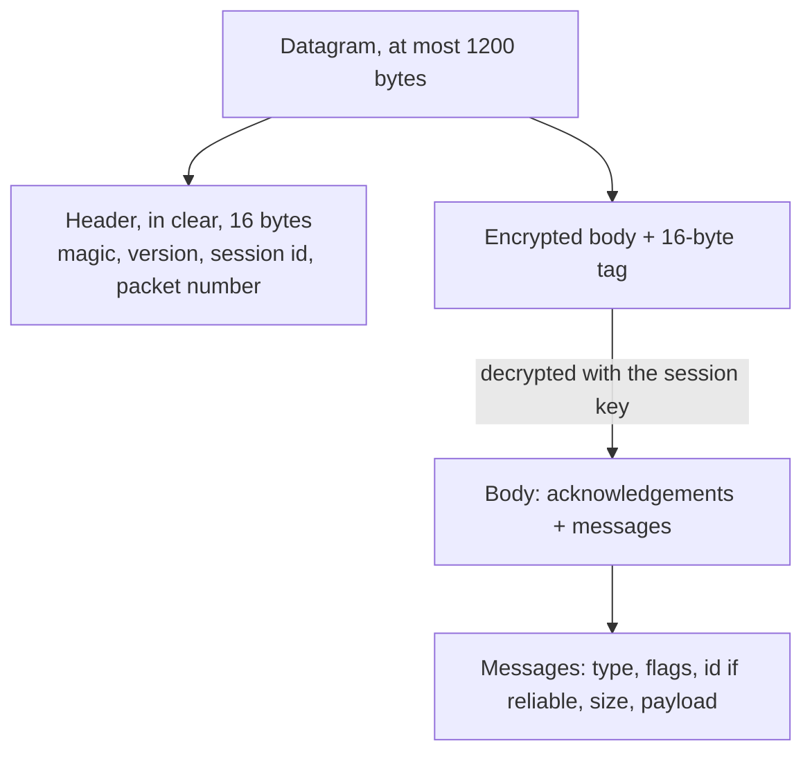
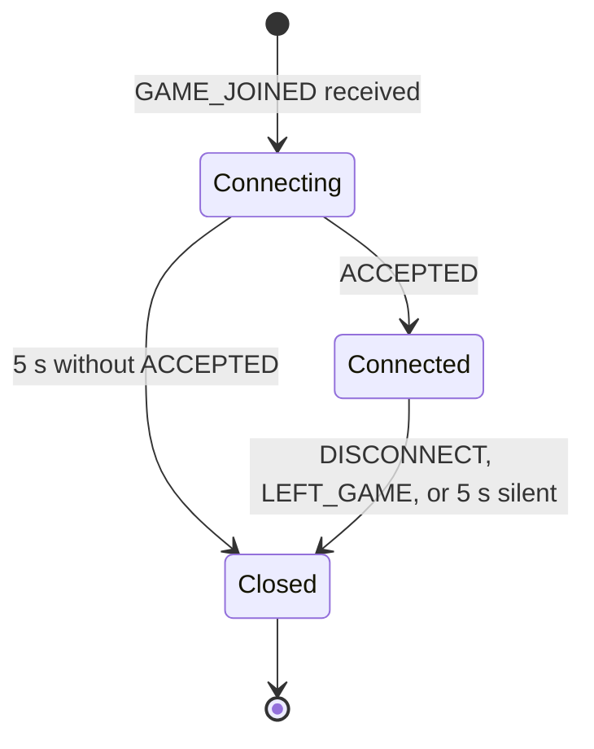

# Game (UDP)

The datagrams between a client and its game: layout, encryption, reliability and session messages.
Conventions and types are defined in the [overview](index.md#2-conventions). The client receives the UDP
port, the session id and the keys from the master, in [`GAME_JOINED`](lobby.md#game_joined-0x83).

## 1. Layers of a datagram



*A datagram is a clear header followed by an encrypted body; once decrypted, the body carries the
acknowledgements and the messages.*

## 2. Datagram layout

| Offset | Field | Type | Description |
|---|---|---|---|
| 0 | Magic | `u16` | `0x5254` (`"RT"`) |
| 2 | Version | `u8` | Protocol version, 1 |
| 3 | Reserved | `u8` | 0 |
| 4 | Session id | `u32` | Session given by the master, never 0 |
| 8 | Packet number | `u64` | Number of this datagram in its direction, from 1 |
| 16 | Ciphertext | | The encrypted body, n bytes |
| 16 + n | Tag | `bytes[16]` | Authentication tag |

- A datagram is at least **32 bytes** (empty body) and at most **1200 bytes**, so the body is at most 1168
  bytes.
- The first 16 bytes are the **header**. They are sent in clear, but authenticated by the tag.

Example of a header: session 42, packet 1:

```
52 54                     magic "RT"
01                        version 1
00                        reserved
00 00 00 2A               session id: 42
00 00 00 00 00 00 00 01   packet number: 1
```

## 3. Encryption

The body is encrypted with **AEAD_CHACHA20_POLY1305** as defined in
[RFC 8439](https://www.rfc-editor.org/rfc/rfc8439):

| Input | Value |
|---|---|
| Key | The client key for datagrams sent by the client, the server key for datagrams sent by the game (32 bytes each, from `GAME_JOINED`) |
| Nonce | 12 bytes: `00 00 00 00` followed by the packet number as a big-endian `u64` |
| Associated data | The 16 bytes of the header |
| Plaintext | The body ([section 5](#5-body)) |
| Output | The ciphertext (same size as the body) and the 16-byte tag |

### Packet numbers

- Each side keeps its own packet number per session. It starts at **1** and increases by one for every
  datagram sent, resends included: a resent message travels in a new datagram with a new number.
- A packet number MUST NEVER be used twice with the same key. If a sender would exceed `2^64 − 1`, it closes
  the session instead.

### Receiving a datagram

A receiver processes a datagram in this order, and drops it silently at the first failed step:

1. The size is between 32 and 1200 bytes.
2. The magic is `0x5254`, the version is 1, the reserved byte is 0.
3. The session id is a known session.
4. The source address has not sent more than 200 datagrams in the last second.
5. The packet number is accepted by the replay window ([section 4](#4-replay-window)).
6. The tag is valid, and decryption succeeds.
7. The body is well formed ([section 5](#5-body)).

Only then does the receiver mark the packet number in the replay window, record the time (for the timeout),
apply the acknowledgements, and deliver the messages.

**Peer address.** The game learns the client's address (IP and port) from the first datagram that passes these
steps. If a later datagram passes them from another address with a higher packet number, the game sends to
the new address from then on: a home router may change the client's port.

## 4. Replay window

Each side remembers, per session:

- **H**, the highest packet number accepted, 0 at the start;
- a bitmap of the **256** packet numbers before H, marking those already accepted.

A packet number `n` is accepted if:

- `n > H`, or
- `H − n ≤ 256`, `n ≠ H`, and `n` is not marked.

Otherwise the datagram is a duplicate, a replay or too old, and is dropped. After a successful decryption,
`n` is marked; if `n > H`, H becomes `n` and the bitmap shifts.

## 5. Body

| Offset | Field | Type | Description |
|---|---|---|---|
| 0 | Ack | `u64` | Highest packet number received from the peer, 0 if none |
| 8 | Ack bits | `u32` | Bit i (bit 0 is the least significant) set: packet `Ack − 1 − i` was received |
| 12 | Count | `u8` | Number of messages that follow |
| 13 | Messages | | Count messages, one after the other |

Each message:

| Offset | Field | Type | Description |
|---|---|---|---|
| 0 | Type | `u8` | Message type |
| 1 | Flags | `u8` | Bit 0: reliable. Other bits: 0. |
| 2 | Message id | `u16` | Only if reliable ([section 6](#6-reliability)) |
| 2 or 4 | Size | `u16` | Size of the payload |
| 4 or 6 | Payload | | Size bytes |

- The body MUST end exactly after the last message. Extra bytes, a size going past the end, or a reserved flag
  set make the body malformed, and the whole datagram is dropped.
- A body with no message is a **heartbeat**: it still carries the acknowledgements.
- Message types `0x01`–`0x3F` are the session messages of [section 8](#8-messages). Types `0x40`–`0xFF` are the
  game messages, defined in a later version. A receiver skips a message of an unknown type, using its size.

## 6. Reliability

A message is either **unreliable** (sent once, may be lost) or **reliable** (resent until acknowledged,
delivered once, in order). The sender chooses per message; each message type below says which it is.

### Acknowledgements

Every datagram acknowledges the packets received from the peer: `Ack` is the highest packet number received,
and `Ack bits` mark the 32 before it. A packet is **acknowledged** as soon as one datagram from the peer
marks it.

### Sending reliable messages

- Each reliable message gets a **message id**, per session and per direction, starting at 0 and increasing
  by one, wrapping from 65535 to 0.
- The sender remembers which packets carried each reliable message. When one of them is acknowledged, the
  message is delivered and forgotten.
- A reliable message not acknowledged after the **resend delay** SHOULD be added to the next datagram. The
  recommended delay is `max(1.5 × RTT, 100 ms)`, where the RTT is measured from the acknowledgements.
- At most **256** reliable messages may wait for an acknowledgement. A sender that would exceed this closes the
  session: the peer no longer answers.

### Receiving reliable messages

The receiver keeps the next expected id `E`, 0 at the start. For a reliable message of id `m`, with
`d = (m − E) mod 65536`:

| Case | Action |
|---|---|
| `d = 0` | Deliver it, increase `E`, then deliver the buffered messages that follow without a gap |
| `0 < d < 256` | Buffer it, unless it is already buffered |
| Otherwise | Already delivered, or out of the window: ignore it |

Reliable messages are therefore delivered **exactly once and in order**. Unreliable messages are delivered at
most once (the replay window drops duplicate datagrams), in the order they arrive, which may differ from the
order they were sent.

### Round-trip time

The sender records when it sent each packet. When a packet is acknowledged for the first time, the elapsed
time is a sample of the round-trip time. The RTT SHOULD be smoothed (`rtt = 0.9 × rtt + 0.1 × sample`); it is
used for the resend delay and shown to the player as the ping.

## 7. Session



*The client state of a session: it connects, plays, and ends on a disconnection, a notification of the master,
or a timeout.*

1. **Connecting.** The client sends `CONNECT` (reliable, so resent until acknowledged). The game, which
   received the session from the master, answers `ACCEPTED`, sends the client one `PLAYER_JOINED` per player
   already connected, and sends `PLAYER_JOINED` for the new player to the others.
2. **Connected.** Both sides exchange messages. Each side sends at least one datagram per second, a heartbeat
   if it has nothing else to send. The client MUST NOT send game messages before `ACCEPTED`; the game ignores
   them.
3. **Closing.** A side that closes the session sends `DISCONNECT` in three consecutive datagrams, then forgets
   the session. A side that receives no valid datagram for **5 seconds** closes the session.

If the client gets no `ACCEPTED` within 5 seconds, it gives up and tells the player that the game cannot be
reached: a firewall probably blocks UDP. It sends `LEAVE_GAME` to the master.

When a session closes on the game's side, the game sends `PLAYER_LEFT` to the other players and, unless the
master asked for it with [`REMOVE_PLAYER`](instances.md#remove_player-0x83), tells the master with
[`PLAYER_DISCONNECTED`](instances.md#player_disconnected-0x04).

## 8. Messages

### CONNECT (`0x01`)

| | |
|---|---|
| **Direction** | Client → Game |
| **Reliability** | Reliable |
| **Sent when** | First message of the session. |

No payload. The key proves who the client is: only the player who received it in `GAME_JOINED` can produce a
valid tag.

**Receiver behaviour:** the game marks the session as connected, records the client's address, and answers
`ACCEPTED`.

### ACCEPTED (`0x02`)

| | |
|---|---|
| **Direction** | Game → Client |
| **Reliability** | Reliable |
| **Sent when** | Reply to `CONNECT`. |

| Offset | Field | Type | Description |
|---|---|---|---|
| 0 | Player slot | `u8` | 0 to 3: the player's place in the game, which sets the colour of its ship |
| 1 | Tick rate | `u8` | Ticks per second of the simulation, 60 |
| 2 | Tick | `u32` | Current tick of the game |

**Receiver behaviour:** the client moves to the connected state. A slot above 3 or a tick rate of 0 makes the
message malformed.

### DISCONNECT (`0x03`)

| | |
|---|---|
| **Direction** | Client → Game, Game → Client |
| **Reliability** | Unreliable, sent in three consecutive datagrams |
| **Sent when** | A side closes the session. |

| Offset | Field | Type | Description |
|---|---|---|---|
| 0 | Reason | `u8` | See below |

| Reason | Value | Meaning |
|---|---|---|
| `QUIT` | 0 | The player left |
| `GAME_OVER` | 1 | The game ended |
| `SHUTDOWN` | 2 | The game process stops |
| `PROTOCOL_ERROR` | 3 | The peer broke this specification (for instance, too many unacknowledged messages) |

**Receiver behaviour:** the receiver closes the session. Unknown reasons are treated as `QUIT`.

### PLAYER_JOINED (`0x04`)

| | |
|---|---|
| **Direction** | Game → Client |
| **Reliability** | Reliable |
| **Sent when** | A player connects to the game, and once per player already there when a client connects. |

| Offset | Field | Type | Description |
|---|---|---|---|
| 0 | Player slot | `u8` | 0 to 3 |
| 1 | Player id | `u32` | Id given by the master |
| 5 | Name | `str8` | 1 to 16 bytes |

### PLAYER_LEFT (`0x05`)

| | |
|---|---|
| **Direction** | Game → Client |
| **Reliability** | Reliable |
| **Sent when** | A player's session closes. |

| Offset | Field | Type | Description |
|---|---|---|---|
| 0 | Player slot | `u8` | 0 to 3 |
| 1 | Reason | `u8` | See below |

| Reason | Value | Meaning |
|---|---|---|
| `QUIT` | 0 | The player left the game |
| `TIMED_OUT` | 1 | Nothing received from the player for 5 seconds: its client crashed or lost the network |
| `LOBBY_CLOSED` | 2 | The player's connection to the master closed |

**Receiver behaviour:** the client removes the player and tells the local player, for instance "Pavel lost the
connection" for `TIMED_OUT`. Unknown reasons are treated as `QUIT`.
