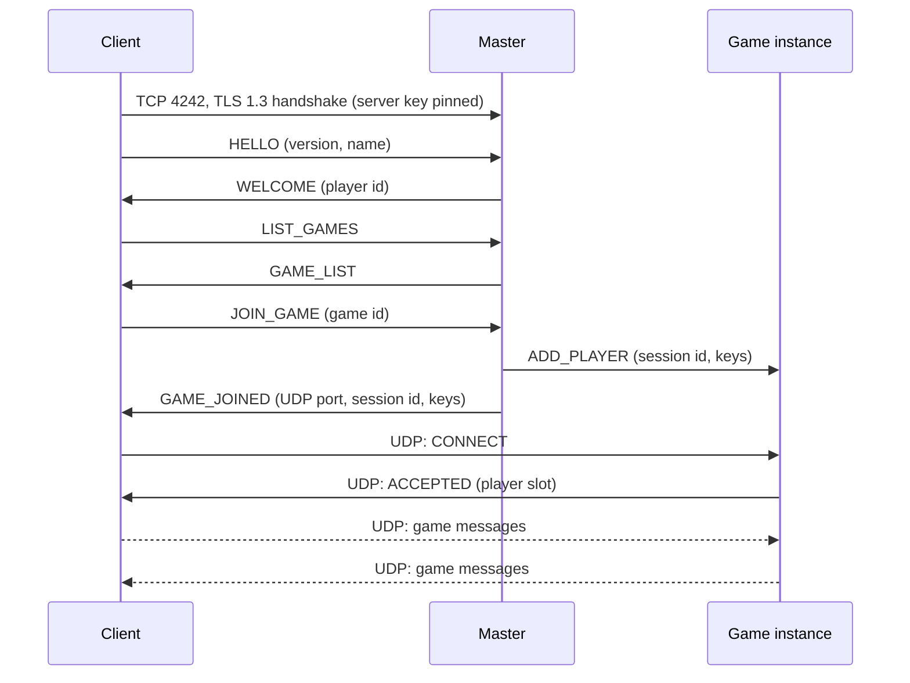

# Network protocol

| | |
|---|---|
| **Status** | Version 1, specified, not yet implemented |
| **Version** | Lobby 2, game 1, instances 4 ([section 4](#4-versioning)) |
| **Transport** | TCP with TLS 1.3 for the lobby, encrypted UDP for the games ([ADR 0012](../decisions/0012-tcp-lobby-udp-game.md), [ADR 0014](../decisions/0014-encryption.md)) |

## 1. Introduction

This specification defines the binary protocol between `r-type_client` and `r-type_server`, and between the
master server and its game instances. Anyone MUST be able to write a compatible client or server by reading
it only.

It is split into five pages:

| Page | Content |
|---|---|
| This page | Conventions, overview, constants, error handling, security |
| [Lobby (TCP)](lobby.md) | The connection between a client and the master: TLS, framing, lobby messages |
| [Game (UDP)](game.md) | The datagrams between a client and its game: encryption, reliability, sessions, inputs and snapshots |
| [Master and instances](instances.md) | The local connection between the master and the game processes it starts |
| [Administration API (HTTP)](admin-api.md) | The JSON API and the WebSocket through which the panel sees a server and acts on it |

Version 1 defines how to reach a game, how to exchange messages with it securely and reliably, and the
messages of the game itself: the players' inputs, the snapshots of the world and the events
([game, section 9](game.md#9-game-messages)).

The words used here are explained in [Networking concepts](../architecture/networking-concepts.md).

## 2. Conventions

The key words **MUST**, **MUST NOT**, **SHOULD**, **SHOULD NOT** and **MAY** are to be interpreted as
described in [RFC 2119](https://www.rfc-editor.org/rfc/rfc2119).

- All multi-byte integers are transmitted in **network byte order** (big-endian).
- Sizes are given in bytes. Offsets start at 0.
- Fields are written one after the other, with no padding.

### 2.1 Types

| Type | Size | Description |
|---|---|---|
| `u8`, `u16`, `u32`, `u64` | 1, 2, 4, 8 | Unsigned integers |
| `i16`, `i32` | 2, 4 | Signed integers, two's complement |
| `bool` | 1 | `0` is false, `1` is true. Any other value is invalid. |
| `bytes[N]` | N | N raw bytes |
| `str8` | 1 + n | A `u8` length n, then n bytes of UTF-8 text, without a terminating zero |
| `str16` | 2 + n | A `u16` length n, then n bytes of UTF-8 text: for a text that can pass 255 bytes, such as a password |

A `str8` or a `str16` is invalid if its bytes are not valid UTF-8, or if they contain a control character
(`0x00`–`0x1F` or `0x7F`). Each text field gives its allowed length range.

### 2.2 Message tables

Each message is described by a table of its fields. The offset is counted from the start of the message
payload, after the header of the transport. Example of the layout of the bytes `00 01 05 50 61 76 65 6C`:

| Offset | Field | Type | Value |
|---|---|---|---|
| 0 | Version | `u16` | `00 01`: 1 |
| 2 | Name | `str8` | `05 50 61 76 65 6C`: `"Pavel"` |

## 3. Overview

*The client authenticates the master with TLS, joins a game through it, and receives the UDP port and the
keys of the game. It then talks to the game directly, over encrypted datagrams.*

1. The client opens a TCP connection to the master and runs a TLS 1.3 handshake. It checks that the server's
   public key is one it trusts ([lobby, section 2](lobby.md#2-tls)).
2. Inside TLS, the client and the master exchange framed lobby messages: the client says hello, lists the
   games, creates or joins one ([lobby](lobby.md)).
3. When the client joins a game, the master draws a session id and two keys, gives them to the game process
   ([instances](instances.md)), then to the client with the UDP port of the game.
4. The client sends datagrams to that port, on the same IP address as the master. Each datagram is encrypted
   with the keys of the session. The first message is `CONNECT`; the game answers `ACCEPTED`
   ([game](game.md)).
5. The TCP connection stays open while the client plays: the master uses it to tell the client when it leaves
   the game, or when the game ends or crashes.

## 4. Versioning

The lobby protocol has its version, a `u16` sent by the client in `HELLO`, currently **3** (version 2 adds the
messages of the administrators, version 3 those of the player accounts, [lobby](lobby.md)). The game protocol has its own, in the header of every
datagram (as a `u8`), currently **2** (version 2 adds the `Ack delay` of the body, and to `SNAPSHOT` the input
lead, the weapon of the ship of the client and the age of the shots). The instances have a version of their own, sent in `INSTANCE_HELLO`,
currently **4**
([master and instances](instances.md)): master and instances come from the same build, so it changes without
the clients.

- A server MUST refuse a `HELLO` with another version, with the error `UNSUPPORTED_VERSION`, then close the
  connection.
- A receiver MUST drop a datagram whose version is not the one of its session.
- Any change to the layout or meaning of an existing message increases the version. Adding a new message type
  that older receivers can ignore does not.

## 5. Constants

| Name | Value | Description |
|---|---|---|
| Master port | 4242 (default) | TCP port of the master, configurable |
| Game port | 4242 (default) | UDP port of every game, the same number as the master port, configurable ([ADR 0027](../decisions/0027-one-udp-port-relay.md)) |
| Maximum TCP frame | 16384 | Largest TCP frame, size prefix included ([lobby](lobby.md#3-framing)) |
| Maximum datagram | 1200 | Largest UDP datagram, all fields included ([game](game.md#2-datagram-layout)) |
| Lobby ping interval | 10 s | A client sends `PING` if it sent nothing for this long |
| Lobby timeout | 30 s | The master closes a connection silent for this long |
| Game heartbeat interval | 1 s | Each side sends a datagram at least this often |
| Game timeout | 5 s | A session silent for this long is closed |
| Connect timeout | 5 s | A client without `ACCEPTED` after this long gives up |
| Tick rate | 60 per second | Steps of the simulation ([game](game.md#91-the-world)) |
| Game area | 1920 × 1080 units | The world the client shows; positions in eighths of a unit |
| Snapshot interval | 2 ticks | 30 snapshots per second ([game](game.md#93-snapshots)) |
| Snapshot parts | 16 at most | Datagrams of one snapshot |
| Inputs per `INPUT` | 8 (recommended), 32 at most | The inputs of the last ticks, sent again ([game](game.md#92-inputs)) |
| Input lead | 60 ticks | The game ignores inputs further ahead |
| Target lead | 2 to 3 ticks | The smallest lead of the last 0.5 s a client keeps its inputs at ([game](game.md#92-inputs)) |
| Input hold | 30 ticks | Without inputs for this long, the game applies an empty input |
| Interpolation delay | 100 ms, or measured: 50–250 ms | How far in the past the client draws the world ([game](game.md#93-snapshots)) |
| Players per game | 1–4 | |

## 6. Error handling

A receiver MUST NOT crash, block, or allocate memory according to a size read from the network beyond the
limits of this specification, whatever it receives.

| What is received | TCP (lobby, instances) | UDP (game) |
|---|---|---|
| A frame or datagram larger than the maximum | Close the connection | Drop the datagram |
| A datagram that fails authentication (wrong tag, unknown session, replayed packet number) | — | Drop it silently |
| A message too short or too long for its type, or with an invalid value | Answer `ERROR (MALFORMED)`, then close | Drop the whole datagram |
| An unknown message type | Answer `ERROR (UNKNOWN_MESSAGE)`, keep the connection | Skip the message, using its size |
| A message that is valid but not allowed now (for instance `JOIN_GAME` before `HELLO`) | Answer `ERROR` with the matching code, keep the connection | Ignore the message |

"Drop silently" means no answer is sent: answering an unauthenticated datagram could be used to flood a third
party.

## 7. Security considerations

The decisions behind this section are in [ADR 0014](../decisions/0014-encryption.md).

| Threat | Mitigation |
|---|---|
| Eavesdropping | TLS 1.3 on TCP; ChaCha20-Poly1305 on every datagram payload |
| Tampering, forged messages | TLS records are authenticated; each datagram carries a tag over its header and payload |
| Man-in-the-middle, impersonating the server | The client pins the server's public key ([lobby, section 2](lobby.md#2-tls)); the datagram keys only travel inside TLS |
| Replay of recorded datagrams | Replay window on packet numbers ([game, section 4](game.md#4-replay-window)) |
| Spoofed source addresses | A datagram without a valid tag is dropped before anything else |
| Amplification | The game never answers a datagram that failed authentication; TCP needs a handshake before any data |
| Flooding, resource exhaustion | Limits on connections, frames, datagrams and pending messages (table below) |
| Malformed messages | Strict validation of every field ([section 6](#6-error-handling)); the decoders are fuzzed |
| Modified client (cheating) | The server is authoritative: clients send inputs, never positions or results |
| Stolen server private key | Generate a new key pair and distribute a new client configuration |

Limits a server MUST enforce, with configurable values:

| Limit | Default |
|---|---|
| Lobby connections at the same time | 256 |
| Lobby connections per IP address | 8 |
| TLS handshake duration | 10 s, then close |
| Time to send `HELLO` after the handshake | 10 s, then close |
| Games at the same time | Size of the game port range |
| Datagrams per second and per source address, before decryption | 200, the excess is dropped |
| Reliable messages waiting for an acknowledgement, per session and direction | 256, then the session is closed |
| Inputs kept per player | 60 ticks ahead, the others are ignored |
| Requests of the accounts per IP address | 10 a minute, then `TOO_MANY_ATTEMPTS` |
| Wrong passwords of one account in a row | 10, then 15 minutes without a password checked |
| `RESEND_CODE` per login | Once a minute |

What the protocol does not hide: the sizes and timing of the datagrams and frames, and the IP addresses of
the players.
