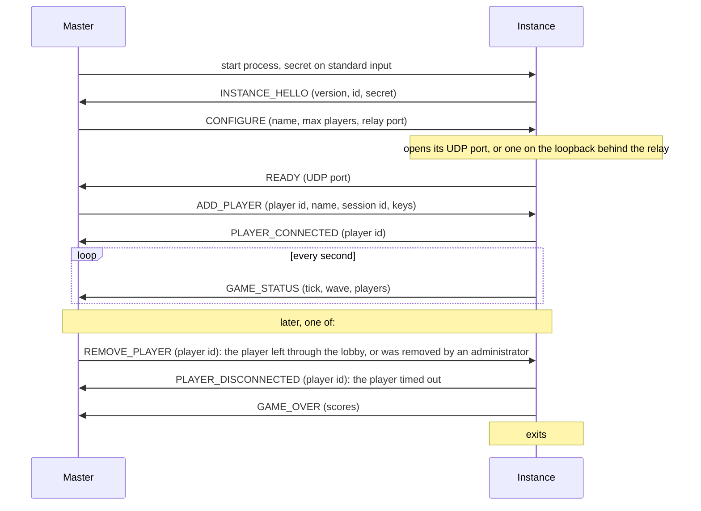

# Master and instances

The local connection between the master and the game processes it starts
([ADR 0013](../decisions/0013-one-process-per-game.md)). Clients never see this protocol. Conventions and types
are defined in the [overview](index.md#2-conventions).

This page describes **version 4**. Master and instances come from the same build, so a master refuses an
`INSTANCE_HELLO` of another version.

| Version | Change |
|---|---|
| 1 | First version |
| 2 | `GAME_STATUS`: the instance tells the master where its game stands, every second |
| 3 | The actions of the administrators ([administration](../architecture/administration.md)): `REMOVE_PLAYER` reason `KICKED`, `SHUTDOWN` reason `ENDED_BY_ADMIN` |
| 4 | The relay of the master: `CONFIGURE` carries the port of the relay, `READY` the port on the loopback the relay sends to, and the [relay frame](#5-the-relay-frame) |

## 1. Starting an instance

The master starts an instance with its own executable and these arguments:

```
r-type_server --instance --id <instance id> --master-port <port>
```

| Argument | Description |
|---|---|
| `--id` | Id of the instance, a `u32` other than 0. It is also the game id shown to the clients. |
| `--master-port` | TCP port on which the master listens for its instances, on `127.0.0.1` |

A master gives no UDP port: since version 4 the instance receives its datagrams from the relay of the master,
whose port `CONFIGURE` gives. `--udp-port <port>`, which a master no longer passes, gives the port an instance
opens itself when `CONFIGURE` has no relay (the tests of an instance alone, and the standalone mode).

The master then writes the **secret** to the instance's standard input: 32 random bytes, as 64 lowercase
hexadecimal characters followed by a line feed (`\n`). The secret is never passed as an argument: the
arguments of a process are visible to every user of the machine.

## 2. Connection

- The instance connects to `127.0.0.1` on the master port within 10 seconds, and sends `INSTANCE_HELLO`.
- The master listens on `127.0.0.1` only. The connection is not encrypted: it never leaves the machine.
- Frames use the same layout as the lobby ([lobby, section 3](lobby.md#3-framing)), without TLS. Types
  `0x01`–`0x7F` are sent by the instance, `0x80`–`0xFF` by the master.
- There is no error message. A side that receives an invalid frame, or a message it does not expect, closes
  the connection.



*The instance proves it was started by the master, receives its configuration, opens its port, then receives
its players and reports their connections and the state of the game until the game is over.*

## 3. Life and death of an instance

| Event | What happens |
|---|---|
| No valid `INSTANCE_HELLO` within 10 s, wrong secret or id | The master closes the connection and kills the process |
| No `READY` within 10 s of the start | The master kills the process and answers the client `ERROR (GAME_START_FAILED)` |
| The UDP port cannot be opened | The instance exits with a non-zero code; the master answers `ERROR (GAME_START_FAILED)` |
| The game has no player left | The master sends `SHUTDOWN (EMPTY)` |
| An administrator ends the game | The master sends `SHUTDOWN (ENDED_BY_ADMIN)`, and `LEFT_GAME (ENDED_BY_ADMIN)` to its players |
| The instance exits, or the connection closes, without `GAME_OVER` | The master considers the game crashed: it sends `LEFT_GAME (GAME_CRASHED)` to its players and frees the port |
| The connection to the master closes | The instance sends `DISCONNECT (SHUTDOWN)` to its clients and exits |

An instance exits with code 0 after `GAME_OVER` or `SHUTDOWN`, and with a non-zero code on any error.

## 4. Messages

### 4.1 Instance to master

#### INSTANCE_HELLO (`0x01`)

| | |
|---|---|
| **Direction** | Instance → Master |
| **Sent when** | Once, first, right after connecting. |

| Offset | Field | Type | Description |
|---|---|---|---|
| 0 | Version | `u16` | Protocol version, 4 |
| 2 | Instance id | `u32` | The `--id` argument |
| 6 | Secret | `bytes[32]` | The secret read on the standard input |

**Receiver behaviour:** the master checks that it started an instance with this id, that this instance has
not presented itself yet, and that the secret matches, comparing it in constant time. It then sends
`CONFIGURE`.

#### READY (`0x02`)

| | |
|---|---|
| **Direction** | Instance → Master |
| **Sent when** | Once, after `CONFIGURE`, when the UDP port is open. |

| Offset | Field | Type | Description |
|---|---|---|---|
| 0 | UDP port | `u16` | The port opened: behind a relay, the port on `127.0.0.1` the system chose, where the relay sends its frames (version 4); without a relay, `--udp-port`, or the one the system chose without it |

**Receiver behaviour:** the game appears in `GAME_LIST`, and the master sends it the players waiting to join.

#### PLAYER_CONNECTED (`0x03`)

| | |
|---|---|
| **Direction** | Instance → Master |
| **Sent when** | A player's session receives `CONNECT`. |

| Offset | Field | Type | Description |
|---|---|---|---|
| 0 | Player id | `u32` | |

#### PLAYER_DISCONNECTED (`0x04`)

| | |
|---|---|
| **Direction** | Instance → Master |
| **Sent when** | A player's session closes on the game's side. |

| Offset | Field | Type | Description |
|---|---|---|---|
| 0 | Player id | `u32` | |
| 4 | Reason | `u8` | `QUIT` (0) or `TIMED_OUT` (1) |

**Receiver behaviour:** the master removes the player from the game. For `TIMED_OUT`, it sends the client
`LEFT_GAME (TIMED_OUT)` if its lobby connection is still open.

#### GAME_OVER (`0x05`)

| | |
|---|---|
| **Direction** | Instance → Master |
| **Sent when** | The game ends, just before the instance exits. |

| Offset | Field | Type | Description |
|---|---|---|---|
| 0 | Count | `u8` | Number of entries that follow, at most 4 |
| 1 | Scores | | Count entries: player id (`u32`), then score (`u32`) |

**Receiver behaviour:** the master sends `LEFT_GAME (GAME_OVER)` to the players of the game and frees its
port.

#### GAME_STATUS (`0x06`)

| | |
|---|---|
| **Direction** | Instance → Master |
| **Sent when** | Every second after `READY`, until the game is over or the instance stops. Since version 2. |

| Offset | Field | Type | Description |
|---|---|---|---|
| 0 | Tick | `u32` | The last tick simulated |
| 4 | Wave | `u16` | The wave under way, from 1; 0 before the first |
| 6 | Count | `u8` | Number of entries that follow, at most 4 |
| 7 | Players | | Count entries of 11 bytes, below |

Each entry, for a player whose client connected (`PLAYER_CONNECTED`); a player added but not connected yet is
not listed. A player id appears once.

| Offset | Field | Type | Description |
|---|---|---|---|
| 0 | Player id | `u32` | |
| 4 | Score | `u32` | |
| 8 | Alive | `u8` | 1 while the player has lives left, 0 once out of the game; any other value is malformed |
| 9 | Latency | `u16` | Round-trip time to its client in milliseconds, at most 65534; `0xFFFF` while not measured yet |

**Receiver behaviour:** the master keeps the last status of the game and when it came. A running game without
`GAME_STATUS` for 3 seconds is shown as stale: its instance, or its game thread, is stuck. The master does not
stop it for that; a process that dies is still detected by its exit. A malformed `GAME_STATUS` is a crash of
the game, like any malformed message.

### 4.2 Master to instance

#### CONFIGURE (`0x81`)

| | |
|---|---|
| **Direction** | Master → Instance |
| **Sent when** | Once, after a valid `INSTANCE_HELLO`. |

| Offset | Field | Type | Description |
|---|---|---|---|
| 0 | Name | `str8` | Name of the game, 1 to 32 bytes |
| 1 + n | Max players | `u8` | 1 to 4 |
| 2 + n | Relay port | `u16` | Port of the relay of the master on `127.0.0.1` (version 4), which a master always gives; 0: no relay |

**Receiver behaviour:** without a relay, the instance opens its UDP port, `--udp-port` (a port of the system
without it), for its clients. With a relay, it opens a UDP port on `127.0.0.1` chosen by the system instead, takes there only the
[relay frames](#5-the-relay-frame) that come from `127.0.0.1:<relay port>`, and sends every datagram of the
game back as a frame to the relay. Either way it answers `READY` with the port it opened.

#### ADD_PLAYER (`0x82`)

| | |
|---|---|
| **Direction** | Master → Instance |
| **Sent when** | A client creates or joins the game, before the master answers it `GAME_JOINED`. |

| Offset | Field | Type | Description |
|---|---|---|---|
| 0 | Player id | `u32` | |
| 4 | Session id | `u32` | Random, never 0, unique across the master: never given twice while this instance runs, nor to another running instance |
| 8 | Client key | `bytes[32]` | |
| 40 | Server key | `bytes[32]` | |
| 72 | Name | `str8` | 1 to 16 bytes |

**Receiver behaviour:** the instance expects a `CONNECT` on this session. If none arrives within 10 seconds,
it forgets the session and sends `PLAYER_DISCONNECTED (TIMED_OUT)`.

#### REMOVE_PLAYER (`0x83`)

| | |
|---|---|
| **Direction** | Master → Instance |
| **Sent when** | A player sends `LEAVE_GAME`, its lobby connection closes, or an administrator removes it. |

| Offset | Field | Type | Description |
|---|---|---|---|
| 0 | Player id | `u32` | |
| 4 | Reason | `u8` | `LEFT` (0): `LEAVE_GAME`; `LOBBY_CLOSED` (1): lobby connection closed; `KICKED` (2): removed by an administrator (version 3) |

**Receiver behaviour:** the instance sends `DISCONNECT (QUIT)` to the player if connected, closes its session,
and sends `PLAYER_LEFT` to the others with the reason `QUIT` (for `LEFT` and `KICKED`) or `LOBBY_CLOSED`: the
game protocol has no reason for a removal, which the lobby tells the player itself. It does not answer
`PLAYER_DISCONNECTED`: the master already knows.

#### SHUTDOWN (`0x84`)

| | |
|---|---|
| **Direction** | Master → Instance |
| **Sent when** | The game has no player left, the master stops, or an administrator ends the game. |

| Offset | Field | Type | Description |
|---|---|---|---|
| 0 | Reason | `u8` | `EMPTY` (0), `MASTER_STOPPING` (1) or `ENDED_BY_ADMIN` (2, version 3) |

**Receiver behaviour:** the instance sends `DISCONNECT (SHUTDOWN)` to its clients and exits with code 0.

## 5. The relay frame

Behind the relay of the master, the datagrams of the game travel between the relay and the instance on the
loopback, over UDP, one datagram of the game in each relay frame. The frame adds the address of the client:
the instance sees the real address of each client, to follow it and limit its rate, as with a port of its own.
The same layout goes both ways: from the relay, the client the datagram comes from; to the relay, the client it
goes to.

| Offset | Field | Type | Description |
|---|---|---|---|
| 0 | Family | `u8` | 4 (IPv4) or 6 (IPv6) |
| 1 | Address | `bytes[16]` | IPv4 in the first 4 bytes, the other 12 zero; or the 16 bytes of an IPv6 address |
| 17 | Port | `u16` | Port of the client, never 0 |
| 19 | Datagram | rest | The datagram of the game ([game](game.md)), unchanged, 1 to 1200 bytes |

The relay never holds the keys of the sessions: it reads only the clear header of a datagram, and the
encryption stays end to end between the client and the instance.

**Receiver behaviour:** a frame is dropped silently if it comes from another address than the relay (for the
instance), or if it does not decode: shorter than 20 bytes, a family other than 4 or 6, a non-zero byte after
an IPv4 address, port 0, or a datagram longer than 1200 bytes. The datagram it carries is then checked as any
datagram of the game, by its session.

The relay of the master (`--game-port`, [Server](../architecture/server.md#the-relay)) drops, on its side, a
frame from an address that is not one of its instances, one that does not decode or whose datagram has no valid
header, and one whose session belongs to another instance: an instance only speaks for its own players.
