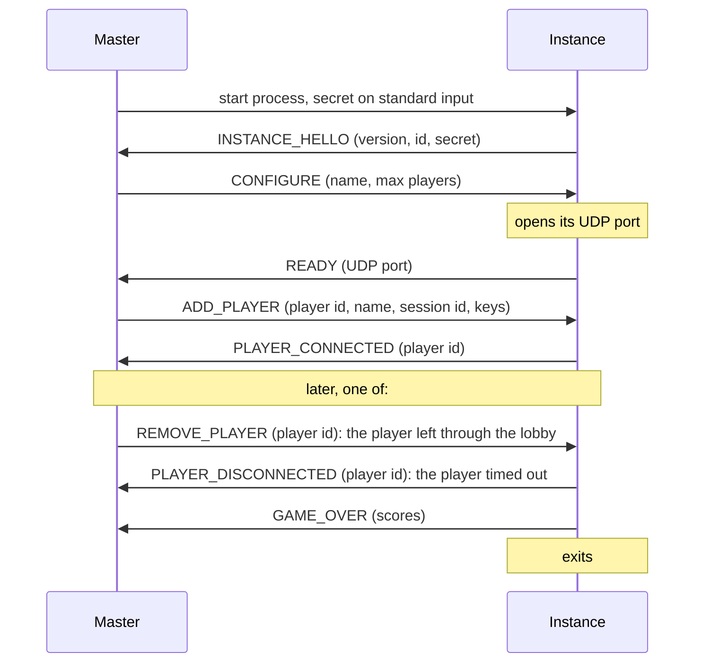

# Master and instances

The local connection between the master and the game processes it starts
([ADR 0013](../decisions/0013-one-process-per-game.md)). Clients never see this protocol. Conventions and types
are defined in the [overview](index.md#2-conventions).

## 1. Starting an instance

The master starts an instance with its own executable and these arguments:

```
r-type_server --instance --id <instance id> --udp-port <port> --master-port <port>
```

| Argument | Description |
|---|---|
| `--id` | Id of the instance, a `u32` other than 0. It is also the game id shown to the clients. |
| `--udp-port` | UDP port the instance opens for its clients |
| `--master-port` | TCP port on which the master listens for its instances, on `127.0.0.1` |

The master then writes the **secret** to the instance's standard input: 32 random bytes, as 64 lowercase
hexadecimal characters followed by a line feed (`\n`). The secret is never passed as an argument: the
arguments of a process are visible to every user of the machine.

## 2. Connection

- The instance connects to `127.0.0.1` on the master port within 10 seconds, and sends `INSTANCE_HELLO`.
- The master listens on `127.0.0.1` only. The connection is not encrypted: it never leaves the machine.
- Frames use the same layout as the lobby ([lobby, section 3](lobby.md#3-framing)), without TLS. Types
  `0x01`–`0x7F` are sent by the instance, `0x80`–`0xFF` by the master.
- There is no error message. A side that receives an invalid frame, or a message it does not expect, closes
  the connection.



*The instance proves it was started by the master, receives its configuration, opens its port, then receives
its players and reports their connections until the game is over.*

## 3. Life and death of an instance

| Event | What happens |
|---|---|
| No valid `INSTANCE_HELLO` within 10 s, wrong secret or id | The master closes the connection and kills the process |
| No `READY` within 10 s of the start | The master kills the process and answers the client `ERROR (GAME_START_FAILED)` |
| The UDP port cannot be opened | The instance exits with a non-zero code; the master answers `ERROR (GAME_START_FAILED)` |
| The game has no player left | The master sends `SHUTDOWN (EMPTY)` |
| The instance exits, or the connection closes, without `GAME_OVER` | The master considers the game crashed: it sends `LEFT_GAME (GAME_CRASHED)` to its players and frees the port |
| The connection to the master closes | The instance sends `DISCONNECT (SHUTDOWN)` to its clients and exits |

An instance exits with code 0 after `GAME_OVER` or `SHUTDOWN`, and with a non-zero code on any error.

## 4. Messages

### 4.1 Instance to master

#### INSTANCE_HELLO (`0x01`)

| | |
|---|---|
| **Direction** | Instance → Master |
| **Sent when** | Once, first, right after connecting. |

| Offset | Field | Type | Description |
|---|---|---|---|
| 0 | Version | `u16` | Protocol version, 1 |
| 2 | Instance id | `u32` | The `--id` argument |
| 6 | Secret | `bytes[32]` | The secret read on the standard input |

**Receiver behaviour:** the master checks that it started an instance with this id, that this instance has
not presented itself yet, and that the secret matches, comparing it in constant time. It then sends
`CONFIGURE`.

#### READY (`0x02`)

| | |
|---|---|
| **Direction** | Instance → Master |
| **Sent when** | Once, after `CONFIGURE`, when the UDP port is open. |

| Offset | Field | Type | Description |
|---|---|---|---|
| 0 | UDP port | `u16` | The port opened, equal to `--udp-port` |

**Receiver behaviour:** the game appears in `GAME_LIST`, and the master sends it the players waiting to join.

#### PLAYER_CONNECTED (`0x03`)

| | |
|---|---|
| **Direction** | Instance → Master |
| **Sent when** | A player's session receives `CONNECT`. |

| Offset | Field | Type | Description |
|---|---|---|---|
| 0 | Player id | `u32` | |

#### PLAYER_DISCONNECTED (`0x04`)

| | |
|---|---|
| **Direction** | Instance → Master |
| **Sent when** | A player's session closes on the game's side. |

| Offset | Field | Type | Description |
|---|---|---|---|
| 0 | Player id | `u32` | |
| 4 | Reason | `u8` | `QUIT` (0) or `TIMED_OUT` (1) |

**Receiver behaviour:** the master removes the player from the game. For `TIMED_OUT`, it sends the client
`LEFT_GAME (TIMED_OUT)` if its lobby connection is still open.

#### GAME_OVER (`0x05`)

| | |
|---|---|
| **Direction** | Instance → Master |
| **Sent when** | The game ends, just before the instance exits. |

| Offset | Field | Type | Description |
|---|---|---|---|
| 0 | Count | `u8` | Number of entries that follow, at most 4 |
| 1 | Scores | | Count entries: player id (`u32`), then score (`u32`) |

**Receiver behaviour:** the master sends `LEFT_GAME (GAME_OVER)` to the players of the game and frees its
port.

### 4.2 Master to instance

#### CONFIGURE (`0x81`)

| | |
|---|---|
| **Direction** | Master → Instance |
| **Sent when** | Once, after a valid `INSTANCE_HELLO`. |

| Offset | Field | Type | Description |
|---|---|---|---|
| 0 | Name | `str8` | Name of the game, 1 to 32 bytes |
| 1 + n | Max players | `u8` | 1 to 4 |

**Receiver behaviour:** the instance opens its UDP port and answers `READY`.

#### ADD_PLAYER (`0x82`)

| | |
|---|---|
| **Direction** | Master → Instance |
| **Sent when** | A client creates or joins the game, before the master answers it `GAME_JOINED`. |

| Offset | Field | Type | Description |
|---|---|---|---|
| 0 | Player id | `u32` | |
| 4 | Session id | `u32` | Unique in this instance, never 0 |
| 8 | Client key | `bytes[32]` | |
| 40 | Server key | `bytes[32]` | |
| 72 | Name | `str8` | 1 to 16 bytes |

**Receiver behaviour:** the instance expects a `CONNECT` on this session. If none arrives within 10 seconds,
it forgets the session and sends `PLAYER_DISCONNECTED (TIMED_OUT)`.

#### REMOVE_PLAYER (`0x83`)

| | |
|---|---|
| **Direction** | Master → Instance |
| **Sent when** | A player sends `LEAVE_GAME`, or its lobby connection closes. |

| Offset | Field | Type | Description |
|---|---|---|---|
| 0 | Player id | `u32` | |
| 4 | Reason | `u8` | `LEFT` (0): `LEAVE_GAME`; `LOBBY_CLOSED` (1): lobby connection closed |

**Receiver behaviour:** the instance sends `DISCONNECT (QUIT)` to the player if connected, closes its session,
and sends `PLAYER_LEFT` to the others with the reason `QUIT` or `LOBBY_CLOSED`. It does not answer
`PLAYER_DISCONNECTED`: the master already knows.

#### SHUTDOWN (`0x84`)

| | |
|---|---|
| **Direction** | Master → Instance |
| **Sent when** | The game has no player left, or the master stops. |

| Offset | Field | Type | Description |
|---|---|---|---|
| 0 | Reason | `u8` | `EMPTY` (0) or `MASTER_STOPPING` (1) |

**Receiver behaviour:** the instance sends `DISCONNECT (SHUTDOWN)` to its clients and exits with code 0.
