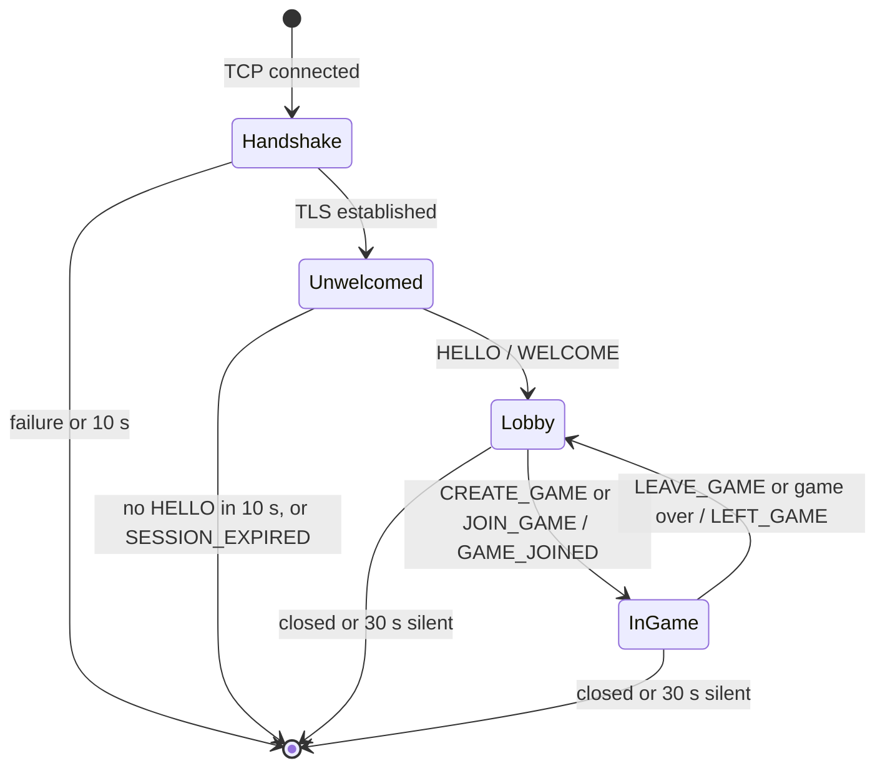
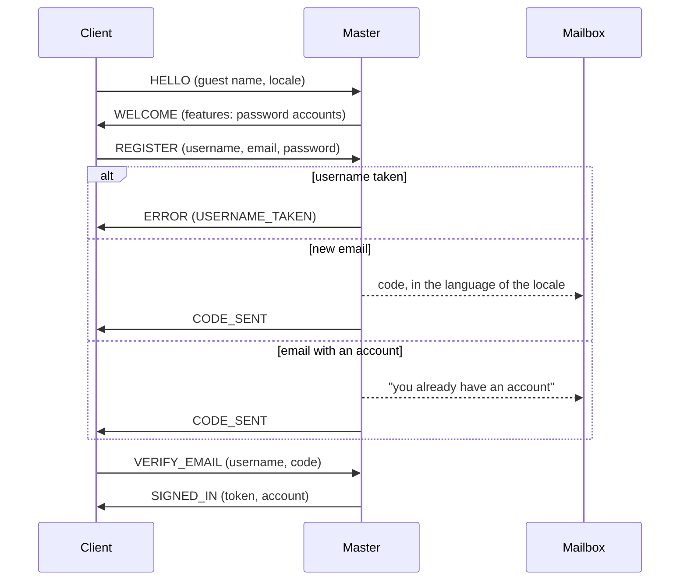
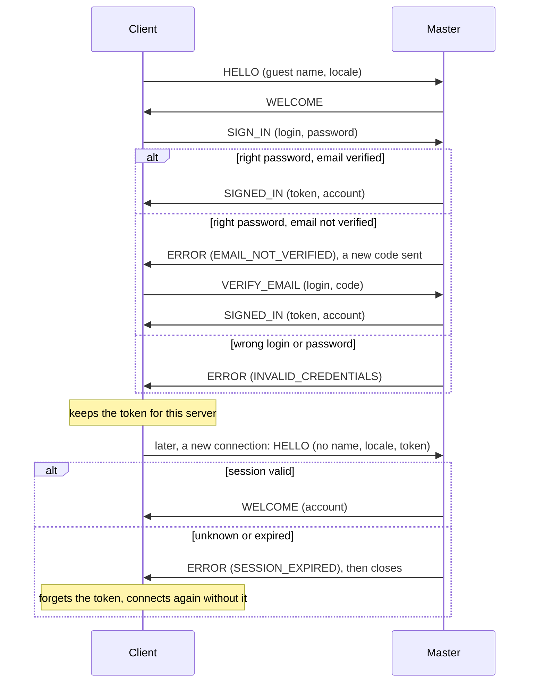
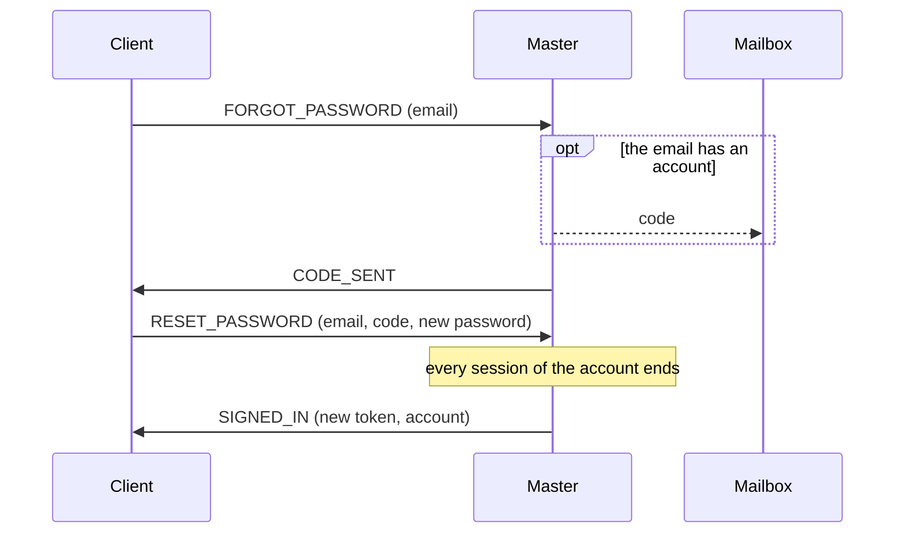
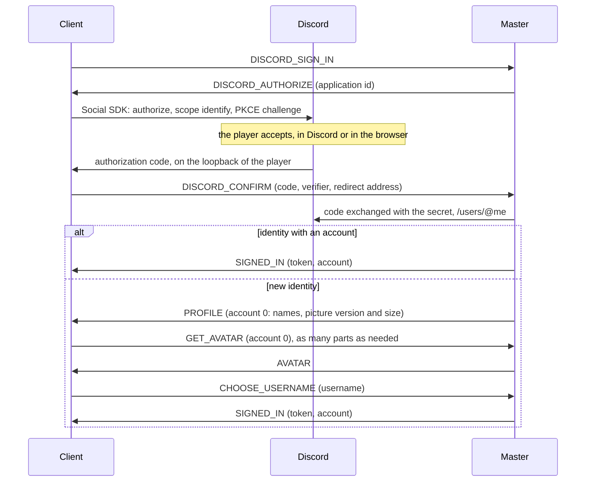
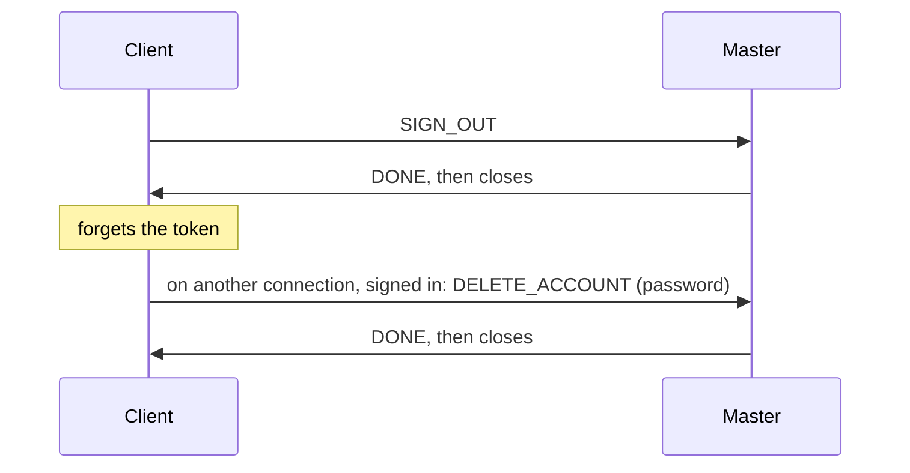
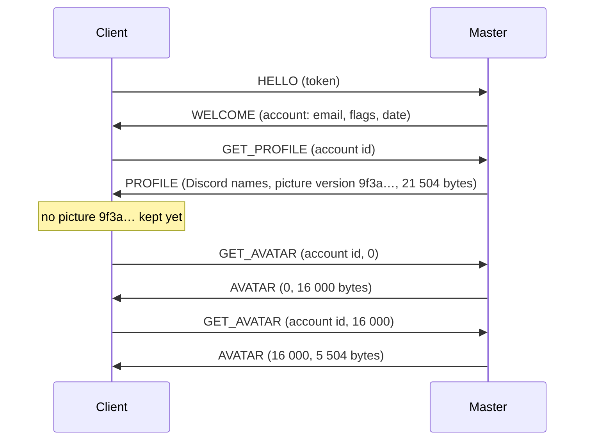
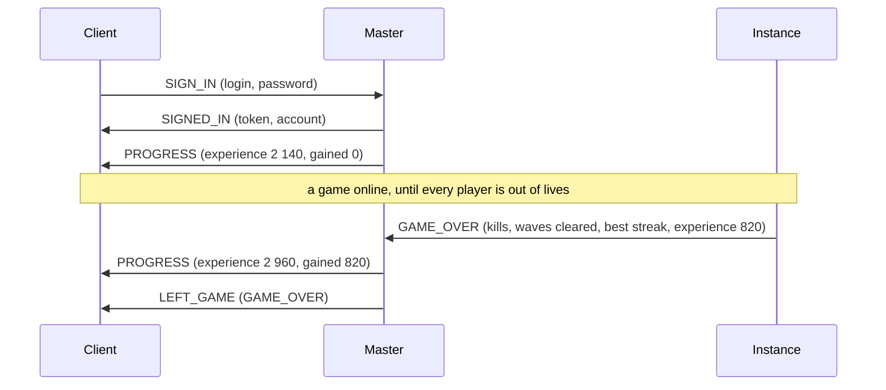
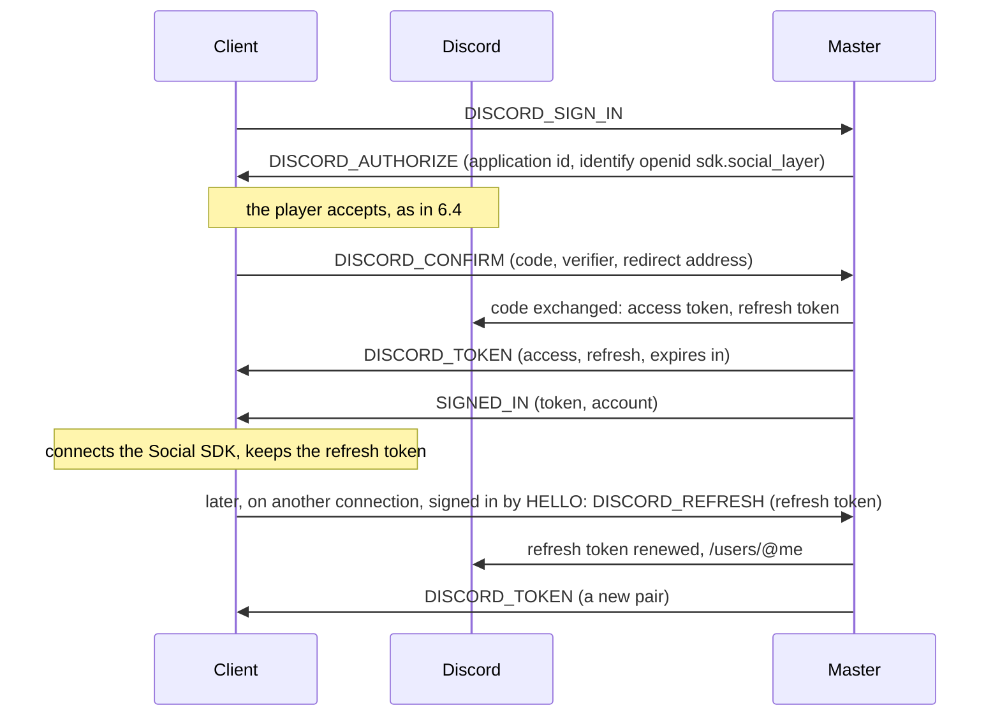

# Lobby (TCP)

The connection between a client and the master: TLS, framing, the messages to list, create, join and leave
games, and those of the player accounts. Conventions and types are defined in the
[overview](index.md#2-conventions).

This page describes **version 7**. The client and the master ship together: a master refuses a `HELLO` of
another version with `UNSUPPORTED_VERSION`, and the client tells the player to update.

| Version | Change |
|---|---|
| 1 | First version |
| 2 | The administrators of the server ([administration API](admin-api.md)): `SERVER_MESSAGE`; `LEFT_GAME` reasons `KICKED` and `ENDED_BY_ADMIN`; `ERROR` codes `KICKED` and `BANNED`, sent before the master closes the connection |
| 3 | The player accounts ([section 6](#6-accounts)): `HELLO` carries a locale and an optional session token; `WELCOME` carries the features of the server and the account signed in; the requests `REGISTER` to `DELETE_ACCOUNT`, the replies `SIGNED_IN`, `CODE_SENT`, `DISCORD_AUTHORIZE` and `DONE`, and their error codes |
| 5 | The progression of the accounts ([section 6.7](#67-progression)): `PROGRESS`, sent once signed in and after each game online |
| 4 | The profiles ([section 6.6](#66-profiles)): an account carries its email, whether it has a password, and its date; `GET_PROFILE` and `PROFILE`, the Discord profile of an account; `GET_AVATAR` and `AVATAR`, its picture in parts; `DISCORD_CONFIRM` answers `PROFILE` for a new Discord user; the error `NOT_FOUND` |
| 6 | The Discord token of the player ([section 6.8](#68-the-discord-token), [ADR 0034](../decisions/0034-discord-token-in-the-client.md)): `DISCORD_AUTHORIZE` carries the scopes; `DISCORD_TOKEN`, before the reply of a sign-in with Discord on a master with the social features; `DISCORD_REFRESH`; the error `DISCORD_TOKEN_REFUSED` |
| 7 | The voice of Discord ([Voice](../architecture/voice.md#the-voice-of-discord)): `GAME_JOINED` carries the secret of the Discord lobby of the game, on a master with the social features |

The version is the first field of `HELLO` in every version, so that a master reads it from a client of any
version and answers `UNSUPPORTED_VERSION`, never `MALFORMED`.

## 1. Connection

1. The client opens a TCP connection to the master, on port 4242 by default.
2. The client and the master run a TLS 1.3 handshake ([section 2](#2-tls)).
3. The client sends `HELLO` within 10 seconds. The master answers `WELCOME`.
4. The client sends requests; the master answers each of them and may send notifications.
5. The connection stays open while the client plays a game. Either side closes it with a TLS `close_notify`
   alert, then closes the TCP connection.



*A connection is welcomed with `HELLO`, then moves between the lobby and a game, and is closed on failure or
silence. In the lobby and in a game, it is either a guest or signed in to an account ([section 6](#6-accounts)).*

| State | Messages accepted from the client |
|---|---|
| Unwelcomed | `HELLO`, `PING` |
| Lobby | `LIST_GAMES`, `CREATE_GAME`, `JOIN_GAME`, `PING`, the requests of the accounts |
| In game | `LIST_GAMES`, `LEAVE_GAME`, `PING` |

Any other message is answered with `ERROR`: `HELLO_REQUIRED` before `HELLO`, `ALREADY_WELCOMED` for a second
`HELLO`, `ALREADY_IN_GAME` or `NOT_IN_GAME` otherwise. The requests of the accounts are answered
`ALREADY_IN_GAME` in a game: a player signs in, out, or deletes the account from the lobby only.

## 2. TLS

- Only **TLS 1.3** ([RFC 8446](https://www.rfc-editor.org/rfc/rfc8446)) is allowed. A peer MUST refuse older
  versions.
- Cipher suites: the master MUST support `TLS_CHACHA20_POLY1305_SHA256` and `TLS_AES_128_GCM_SHA256`.
- Key exchange groups: `x25519` and `secp256r1`.
- The master presents an X.509 certificate holding an **ECDSA P-256** public key, signed with
  `ecdsa_secp256r1_sha256`. The certificate may be self-signed.
- No client certificate, no early data (0-RTT), no session resumption: the master does not issue session
  tickets.

### Key pinning

The client knows the **fingerprints** of the public keys it trusts for the master: the SHA-256 hash of the DER
encoding of the `SubjectPublicKeyInfo` of the certificate, 32 bytes, written as 64 hexadecimal characters.

- The client MUST compute the fingerprint of the certificate the master presents, and abort the handshake if
  it is not one it trusts for that server. It MUST NOT send any lobby message before the handshake succeeded
  with a trusted key.
- A client MAY trust a master it never met on first use: it aborts the handshake, shows the fingerprint to the
  user, and if the user trusts it, remembers it for that server and connects again. Once a key is remembered,
  a different key MUST be refused, not offered to the user again in the same way.
- The client MUST NOT rely on certificate authorities, host names or validity dates: the pinned key replaces
  them.

The fingerprint of a certificate, of a public key or of a private key in PEM can be computed with OpenSSL:

```sh
openssl x509 -in server.crt -pubkey -noout | openssl pkey -pubin -outform DER | sha256sum
openssl pkey -pubin -in server.pub -outform DER | sha256sum
openssl pkey -in server.key -pubout -outform DER | sha256sum
```

## 3. Framing

TCP carries a stream of bytes with no boundaries. Inside TLS, each message is a **frame**:

| Offset | Field | Type | Description |
|---|---|---|---|
| 0 | Size | `u16` | Number of bytes that follow this field: the type and the payload. From 1 to 16382. |
| 2 | Type | `u8` | Message type |
| 3 | Payload | | Size − 1 bytes, layout given by the type |

- A frame is at most **16384 bytes**, size field included. A receiver MUST close the connection when it reads
  a size of 0 or above 16382, without reading the rest.
- Types `0x01`–`0x7F` are sent by the client, types `0x80`–`0xFF` by the master.

Example: `HELLO` with version 7, the name `"Pavel"`, the locale `"fr"` and no session token:

```
00 0D   size: 13 bytes follow
01      type: HELLO
00 07   version: 7
05 50 61 76 65 6C   name: "Pavel"
02 66 72            locale: "fr"
00                  no session token
```

## 4. Requests, replies and notifications

- Every request from the client gets **exactly one reply**: its own reply message, or `ERROR`.
- The master answers requests **in the order it received them**. A client may send several requests without
  waiting, and match the replies in order.
- The master may also send **notifications** at any time, between replies: `LEFT_GAME` when the game ends or
  crashes, or an administrator removes the player from it or ends it; `SERVER_MESSAGE`; `PROGRESS` once signed
  in and after each game online; and `ERROR` with the
  request 0 and the code `KICKED` or `BANNED`, after which the master closes the connection. A notification is
  never a reply.

| Request | Reply |
|---|---|
| `HELLO` | `WELCOME` |
| `LIST_GAMES` | `GAME_LIST` |
| `CREATE_GAME` | `GAME_JOINED` |
| `JOIN_GAME` | `GAME_JOINED` |
| `LEAVE_GAME` | `LEFT_GAME` |
| `PING` | `PONG` |
| `REGISTER` | `CODE_SENT` |
| `VERIFY_EMAIL` | `SIGNED_IN` |
| `RESEND_CODE` | `CODE_SENT` |
| `SIGN_IN` | `SIGNED_IN` |
| `SIGN_OUT` | `DONE` |
| `FORGOT_PASSWORD` | `CODE_SENT` |
| `RESET_PASSWORD` | `SIGNED_IN` |
| `DISCORD_SIGN_IN` | `DISCORD_AUTHORIZE` |
| `DISCORD_CONFIRM` | `SIGNED_IN`, `PROFILE` or `DONE` |
| `CHOOSE_USERNAME` | `SIGNED_IN` |
| `DELETE_ACCOUNT` | `DONE` |
| `GET_PROFILE` | `PROFILE` |
| `GET_AVATAR` | `AVATAR` |
| `DISCORD_REFRESH` | `DISCORD_TOKEN` |

## 5. Messages

### 5.1 Client to master

#### HELLO (`0x01`)

| | |
|---|---|
| **Direction** | Client → Master |
| **Sent when** | Once, first, right after the TLS handshake. |

| Offset | Field | Type | Description |
|---|---|---|---|
| 0 | Version | `u16` | Protocol version, 6 |
| 2 | Name | `str8` | Name of a guest, 1 to 16 bytes; empty with a session token |
| 3 + n | Locale | `str8` | Language of the player, 2 to 16 of `A-Z a-z 0-9 - _`: `en`, `fr-FR`, `fr_CA` |
| 4 + n + m | Has token | `bool` | Whether a session token follows |
| 5 + n + m | Session token | `bytes[32]` | Only if *has token*: the token of `SIGNED_IN`, to resume the session of an account |

**Receiver behaviour:** the master reads the version first. If it is not supported, the master answers
`ERROR (UNSUPPORTED_VERSION)` and closes the connection, without reading the rest, whose layout may be another.
If the address of the client is banned, it answers `ERROR (BANNED)` and closes the connection. A locale that
does not fit its field, a token flag other than 0 or 1, or a name beside a token is `MALFORMED`.

- **With a token**: if the token is unknown, expired, or the master keeps no account, it answers
  `ERROR (SESSION_EXPIRED)` and closes the connection: the client forgets the token and connects again without
  it. A ban ends every session of the account, so the token of a banned account gets `SESSION_EXPIRED` too.
  Otherwise the connection is signed in to the account, whose username is the name of the player, and the master
  answers `WELCOME` with the account.
- **Without a token**, a guest: if the name is empty, too long or invalid, the master answers
  `ERROR (INVALID_NAME)`; if it is the username of an account, ignoring case, `ERROR (NAME_RESERVED)`. Otherwise
  it answers `WELCOME`. The names of guests do not have to be unique. On a master with accounts, a guest carries
  `~` before its name, which no username has, where the others see it: the other players, the panel. A master that accepts no guest welcomes
  the connection all the same, so that it can sign in, and answers `GUESTS_DISABLED` to its `CREATE_GAME` and
  `JOIN_GAME` until it does.

The master writes its emails in the language of the locale (English when it does not know it), and keeps the
token out of its logs. Each welcomed connection gets a new player id.

#### LIST_GAMES (`0x02`)

| | |
|---|---|
| **Direction** | Client → Master |
| **Sent when** | The player opens or refreshes the list of games. |

No payload.

**Receiver behaviour:** the master answers `GAME_LIST`.

#### CREATE_GAME (`0x03`)

| | |
|---|---|
| **Direction** | Client → Master |
| **Sent when** | The player creates a game. |

| Offset | Field | Type | Description |
|---|---|---|---|
| 0 | Name | `str8` | Name of the game, 1 to 32 bytes |
| 1 + n | Max players | `u8` | 1 to 4 |

**Receiver behaviour:** the master starts a game instance ([instances](instances.md)), waits until it is
ready, adds the player to it and answers `GAME_JOINED`. Errors: `INVALID_NAME`, `MALFORMED` (max players out
of range), `SERVER_FULL` (the server runs its most games at once, `max_games`), `GAME_START_FAILED` (the instance did not start within 10
seconds).

#### JOIN_GAME (`0x04`)

| | |
|---|---|
| **Direction** | Client → Master |
| **Sent when** | The player chooses a game in the list. |

| Offset | Field | Type | Description |
|---|---|---|---|
| 0 | Game id | `u32` | Id from `GAME_LIST` |

**Receiver behaviour:** the master adds the player to the game and answers `GAME_JOINED`. Errors:
`GAME_NOT_FOUND`, `GAME_FULL`. Players may join a game that has already started.

#### LEAVE_GAME (`0x05`)

| | |
|---|---|
| **Direction** | Client → Master |
| **Sent when** | The player quits the game, before closing the UDP session. |

No payload.

**Receiver behaviour:** the master removes the player from the game and answers `LEFT_GAME` with the reason
`REQUESTED`.

#### PING (`0x06`)

| | |
|---|---|
| **Direction** | Client → Master |
| **Sent when** | The client sent nothing for 10 seconds. |

No payload.

**Receiver behaviour:** the master answers `PONG`. A master closes a connection on which it received nothing
for 30 seconds.

#### Requests of the accounts (`0x07`–`0x14`)

Version 3, `GET_PROFILE` and `GET_AVATAR` in version 4, `DISCORD_REFRESH` in version 6. A master without the feature a request needs (`WELCOME` tells which it has) answers
`ERROR (ACCOUNTS_DISABLED)` to it, after the check of the state (`HELLO_REQUIRED`) and without reading its
payload. The flows they make are in [section 6](#6-accounts).

The fields of these requests are checked for their length and their text: a field that does not fit is
`MALFORMED`. What they hold is checked by the master, with an error of its own: a username that is not 3 to 16
of `A-Z a-z 0-9 _ -` is `INVALID_NAME`, an email that is not an address `INVALID_EMAIL`, a new password that is
not 10 to 128 characters, or that is the username or the email, `WEAK_PASSWORD`.

A **password** is only ever in `REGISTER`, `SIGN_IN`, `RESET_PASSWORD` and `DELETE_ACCOUNT`, inside TLS. A
password, a code, a code verifier, a session token and a Discord token MUST NOT be written to any log, at any
level, by the client or the master.

| Field | Type | Range |
|---|---|---|
| Username | `str8` | 1 to 16 bytes |
| Email | `str8` | 1 to 254 bytes, the longest address SMTP carries |
| Login | `str8` | 1 to 254 bytes: a username or an email |
| Password | `str16` | 1 to 512 bytes (128 characters of up to 4 bytes); 0 to 512 in `DELETE_ACCOUNT` |
| Email code | `str8` | Exactly 6 digits `0`–`9`: anything else is `MALFORMED` |
| Discord code | `str8` | 1 to 255 bytes: the authorization code Discord gave the client |
| Code verifier | `str8` | 43 to 128 of `A-Z a-z 0-9 - . _ ~`, the code verifier of PKCE ([RFC 7636](https://www.rfc-editor.org/rfc/rfc7636#section-4.1)): anything else is `MALFORMED` |
| Redirect address | `str16` | 1 to 2048 bytes |
| Discord token | `str16` | 1 to 1024 printable ASCII characters (`!` to `~`), no space (version 6): anything else is `MALFORMED` |

##### REGISTER (`0x07`)

| Offset | Field | Type |
|---|---|---|
| 0 | Username | `str8` |
| 1 + u | Email | `str8` |
| 2 + u + e | Password | `str16` |

**Receiver behaviour:** a username taken, ignoring case, is `USERNAME_TAKEN`. Otherwise the master answers
`CODE_SENT`, **whether the email has an account or not**: a new email gets an account not verified and a code;
an email that has an account gets an email telling its holder, and no account is created. The answer tells
nothing of the accounts of others. Errors: `INVALID_NAME`, `INVALID_EMAIL`, `WEAK_PASSWORD`, `BUSY`,
`MAIL_UNAVAILABLE`, `TOO_MANY_ATTEMPTS`, `ALREADY_SIGNED_IN`.

##### VERIFY_EMAIL (`0x08`)

| Offset | Field | Type |
|---|---|---|
| 0 | Login | `str8` |
| 1 + n | Code | `str8`, email code |

**Receiver behaviour:** the code that `REGISTER`, `RESEND_CODE` or `SIGN_IN` sent verifies the email, and signs
the connection in: `SIGNED_IN`. Errors: `INVALID_CODE` (a wrong code, or no account with this login),
`CODE_EXPIRED`, `TOO_MANY_ATTEMPTS`, `ALREADY_SIGNED_IN`.

##### RESEND_CODE (`0x09`)

| Offset | Field | Type |
|---|---|---|
| 0 | Login | `str8` |

**Receiver behaviour:** a new code to verify the email, at most once a minute: `CODE_SENT`, whether the
account exists or not. Errors: `TOO_MANY_ATTEMPTS`, `MAIL_UNAVAILABLE`, `ALREADY_SIGNED_IN`.

##### SIGN_IN (`0x0A`)

| Offset | Field | Type |
|---|---|---|
| 0 | Login | `str8` |
| 1 + n | Password | `str16` |

**Receiver behaviour:** `SIGNED_IN`. Errors: `INVALID_CREDENTIALS` (no such account, or a wrong password: the
same answer), `EMAIL_NOT_VERIFIED` (only after the right password: a new code was sent), `BANNED` (then
closed), `BUSY`, `TOO_MANY_ATTEMPTS`, `ALREADY_SIGNED_IN`.

##### SIGN_OUT (`0x0B`)

No payload.

**Receiver behaviour:** the session of the token of this connection ends; the master answers `DONE`, then
closes the connection. The client forgets the token, and connects again as a guest if the player wants.
Error: `NOT_SIGNED_IN`.

##### FORGOT_PASSWORD (`0x0C`)

| Offset | Field | Type |
|---|---|---|
| 0 | Email | `str8` |

**Receiver behaviour:** `CODE_SENT`, whether the email has an account or not; if it has one, it gets a code to
choose a new password. Errors: `INVALID_EMAIL`, `TOO_MANY_ATTEMPTS`, `MAIL_UNAVAILABLE`, `ALREADY_SIGNED_IN`.

##### RESET_PASSWORD (`0x0D`)

| Offset | Field | Type |
|---|---|---|
| 0 | Email | `str8` |
| 1 + e | Code | `str8`, email code |
| 2 + e + 6 | Password | `str16`, the new one |

**Receiver behaviour:** the new password replaces the old one, every session of the account ends, the email
counts as verified (the code proved it), and the connection is signed in with a new session: `SIGNED_IN`.
Errors: `INVALID_CODE`, `CODE_EXPIRED`, `TOO_MANY_ATTEMPTS`, `WEAK_PASSWORD`, `BUSY`, `BANNED` (then closed),
`ALREADY_SIGNED_IN`.

##### DISCORD_SIGN_IN (`0x0E`)

No payload.

**Receiver behaviour:** `DISCORD_AUTHORIZE`, the Discord application of the master. It starts an attempt on
this connection, valid ten minutes, for one `DISCORD_CONFIRM`; a new `DISCORD_SIGN_IN` starts another. Signed
in, it starts the link of a Discord identity to the account, or the confirmation `DELETE_ACCOUNT` needs.

##### DISCORD_CONFIRM (`0x0F`)

| Offset | Field | Type |
|---|---|---|
| 0 | Code | `str8`, Discord code |
| 1 + c | Code verifier | `str8` |
| 2 + c + v | Redirect address | `str16` |

**Receiver behaviour:** what the client got from Discord once the player accepted the application, through
the Discord Social SDK ([ADR 0026](../decisions/0026-discord-social-sdk.md)). The master exchanges the code,
with the verifier, the redirect address and the secret of its application, for a token of Discord, then asks
who the user is, and drops the token, or, with the social features, gives it to the client in `DISCORD_TOKEN`
before the reply that signs in or links ([section 6.8](#68-the-discord-token)). It needs a `DISCORD_SIGN_IN` of this connection
less than ten minutes old, which it uses up. Only this request signs in or links anything. Then:

- not signed in, an identity that has an account: `SIGNED_IN`;
- not signed in, a new identity: `PROFILE` with the account id 0, the profile Discord gave (version 4; `DONE` in
  version 3), and the client sends `CHOOSE_USERNAME` within ten minutes;
- signed in, an identity without account: linked to the account, `DONE`; the account's own identity: confirmed
  for `DELETE_ACCOUNT` for five minutes, `DONE`.

Errors: `INVALID_CODE` (Discord refused the code: wrong, used already, or not made for this verifier or this
address), `CODE_EXPIRED` (the `DISCORD_SIGN_IN` is older than ten minutes), `TOO_MANY_ATTEMPTS` (Discord refused
5 codes since the `DISCORD_SIGN_IN`: a new one is needed), `DISCORD_NOT_CONFIRMED` (no `DISCORD_SIGN_IN` on
this connection, or used already), `DISCORD_UNAVAILABLE` (the master cannot reach Discord: the attempt is kept),
`BUSY`, `DISCORD_TAKEN` (signed in, an identity of another account), `BANNED` (then closed).

##### CHOOSE_USERNAME (`0x10`)

| Offset | Field | Type |
|---|---|---|
| 0 | Username | `str8` |

**Receiver behaviour:** creates the account of the new Discord identity this connection confirmed, with this
username, and signs it in: `SIGNED_IN`. Errors: `DISCORD_NOT_CONFIRMED` (no new identity confirmed on this
connection, or more than ten minutes ago), `INVALID_NAME`, `USERNAME_TAKEN`, `ALREADY_SIGNED_IN`. With the
social features, `DISCORD_TOKEN` comes before the `SIGNED_IN`.

##### DELETE_ACCOUNT (`0x11`)

| Offset | Field | Type |
|---|---|---|
| 0 | Password | `str16`, 0 to 512 bytes |

**Receiver behaviour:** with the password of the account, or, empty, for an account without one, after a
Discord confirmation on this connection less than five minutes old: the account, its sessions and its codes
are deleted; its administration actions stay, without its name, email or address. The master answers `DONE`,
then closes the connection. Errors: `INVALID_CREDENTIALS`, `DISCORD_NOT_CONFIRMED`, `BUSY`,
`TOO_MANY_ATTEMPTS`, `NOT_SIGNED_IN`.

##### DISCORD_REFRESH (`0x14`)

| Offset | Field | Type |
|---|---|---|
| 0 | Refresh token | `str16`, Discord token |

**Receiver behaviour:** version 6. A new Discord token from the refresh token of the last `DISCORD_TOKEN`, which
the master renews with the secret of its application (`grant_type=refresh_token`): `DISCORD_TOKEN`, if the token
belongs to the Discord identity of the account signed in. The refresh token is single use: the new one replaces
it. Errors: `NOT_SIGNED_IN`, `DISCORD_TOKEN_REFUSED` (Discord refused it, it is the token of another identity,
or the master has no social features: the client forgets it), `DISCORD_UNAVAILABLE`, `BUSY`,
`TOO_MANY_ATTEMPTS` (more than five on this connection).

### 5.2 Master to client

##### GET_PROFILE (`0x12`)

| Offset | Field | Type |
|---|---|---|
| 0 | Account id | `u64`, never 0 |

**Receiver behaviour:** version 4. The master answers `PROFILE`, the Discord profile of the account as of its
last sign-in with Discord, empty for an account without Discord; `NOT_FOUND` if there is no such account. Any
player may ask it, of any account: the names and the picture of Discord are those its owner shows. It does not
count against the requests of an address.

##### GET_AVATAR (`0x13`)

| Offset | Field | Type |
|---|---|---|
| 0 | Account id | `u64`; 0 for the new Discord user confirmed on this connection, who has no account yet |
| 8 | Offset | `u32` |

**Receiver behaviour:** version 4. The master answers `AVATAR`, the part of the picture of the account that
starts at the offset, at most 16000 bytes so that it fits in a frame; `NOT_FOUND` if the account has no
picture, or from the end of it on. The client asks from 0, then from the end of each part, until it has the
size `AVATAR` gives, and starts again if its version changed meanwhile. It does not count against the requests
of an address.

#### WELCOME (`0x81`)

| | |
|---|---|
| **Direction** | Master → Client |
| **Sent when** | Reply to `HELLO`. |

| Offset | Field | Type | Description |
|---|---|---|---|
| 0 | Player id | `u32` | Id of the player on this master, never 0 |
| 4 | Features | `u8` | What the master offers, bits below; the other bits are 0 |
| 5 | Signed in | `bool` | Whether an account follows: the one the token of `HELLO` signed in |
| 6 | Account | | Only if *signed in*: an account, see below |

| Feature bit | Value | Meaning |
|---|---|---|
| Guests | `0x01` | Players can play without an account |
| Password accounts | `0x02` | `REGISTER`, `VERIFY_EMAIL`, `RESEND_CODE`, `SIGN_IN`, `FORGOT_PASSWORD`, `RESET_PASSWORD` |
| Discord | `0x04` | `DISCORD_SIGN_IN`, `DISCORD_CONFIRM`, `CHOOSE_USERNAME` |

An **account**, in `WELCOME` and `SIGNED_IN`:

| Offset | Field | Type | Description |
|---|---|---|---|
| 0 | Account id | `u64` | Never 0 |
| 8 | Username | `str8` | 1 to 16 bytes, the name of the player |
| 9 + n | Role | `u8` | `0` player, `1` administrator; any other value is malformed |
| 10 + n | Flags | `u8` | `0x01` the email is verified, `0x02` it signs in with a password; the other bits are 0 (version 4) |
| 11 + n | Email | `str8` | 0 to 254 bytes: empty for an account made with Discord (version 4) |
| 12 + n + e | Created | `u64` | When the account was made, in milliseconds since 1970, UTC (version 4) |

**Receiver behaviour:** the client offers what the master offers: sign in, create an account, play as a guest.
A master without accounts sends only the guests bit, and the client looks as it did before accounts.

#### GAME_LIST (`0x82`)

| | |
|---|---|
| **Direction** | Master → Client |
| **Sent when** | Reply to `LIST_GAMES`. |

| Offset | Field | Type | Description |
|---|---|---|---|
| 0 | Count | `u16` | Number of games that follow, at most 256 |
| 2 | Games | | Count entries, sorted by game id |

Each entry:

| Offset | Field | Type | Description |
|---|---|---|---|
| 0 | Game id | `u32` | Never 0 |
| 4 | Name | `str8` | 1 to 32 bytes |
| 5 + n | Players | `u8` | Players currently in the game |
| 6 + n | Max players | `u8` | 1 to 4 |

**Receiver behaviour:** a client MUST check that the entries fit exactly in the frame, and treat the frame as
malformed otherwise.

#### GAME_JOINED (`0x83`)

| | |
|---|---|
| **Direction** | Master → Client |
| **Sent when** | Reply to `CREATE_GAME` or `JOIN_GAME`. |

| Offset | Field | Type | Description |
|---|---|---|---|
| 0 | Game id | `u32` | |
| 4 | UDP port | `u16` | The UDP port of the server, on the same IP address as the master: the same for every game, 4242 by default, where the relay of the master forwards each datagram to its game by its session ([ADR 0027](../decisions/0027-one-udp-port-relay.md)) |
| 6 | Session id | `u32` | Identifies the player's session in the game, never 0. Random: the client assumes nothing about its value |
| 10 | Client key | `bytes[32]` | Key of the datagrams sent by the client |
| 42 | Server key | `bytes[32]` | Key of the datagrams sent by the game |
| 74 | Secret length | `u8` | Version 7: 0, or 32 on a master with the social features of Discord (`[discord] social`). Any other length is `MALFORMED` |
| 75 | Voice secret | `bytes[Secret length]` | The secret of the Discord lobby of the game, the same for all its players |

**Receiver behaviour:** the client opens the UDP session described in [Game (UDP)](game.md). A client
connected to Discord joins the lobby whose secret is the lowercase hexadecimal of the voice secret, with the
player id of `WELCOME` as its member metadata `player`, and talks there once its call is connected
([Voice](../architecture/voice.md#the-voice-of-discord)). The keys and the voice secret are secret: a client
MUST NOT write them to its logs.

#### LEFT_GAME (`0x84`)

| | |
|---|---|
| **Direction** | Master → Client |
| **Sent when** | Reply to `LEAVE_GAME`, or notification when the player is no longer in the game. |

| Offset | Field | Type | Description |
|---|---|---|---|
| 0 | Game id | `u32` | |
| 4 | Reason | `u8` | See below |

| Reason | Value | Meaning |
|---|---|---|
| `REQUESTED` | 0 | Reply to `LEAVE_GAME` |
| `GAME_OVER` | 1 | The game ended normally |
| `GAME_CRASHED` | 2 | The game process stopped unexpectedly |
| `TIMED_OUT` | 3 | The game received nothing from the client for 5 seconds |
| `KICKED` | 4 | An administrator removed the player: `ERROR (KICKED)` follows, then the connection closes (version 2) |
| `ENDED_BY_ADMIN` | 5 | An administrator ended the game (version 2) |

**Receiver behaviour:** the client closes its UDP session and goes back to the lobby. For `GAME_CRASHED`,
`KICKED` and `ENDED_BY_ADMIN`, it tells the player why.

#### PONG (`0x85`)

| | |
|---|---|
| **Direction** | Master → Client |
| **Sent when** | Reply to `PING`. |

No payload.

#### ERROR (`0x86`)

| | |
|---|---|
| **Direction** | Master → Client |
| **Sent when** | Reply to a request that cannot be honoured; for `KICKED` and `BANNED`, a notification too. |

| Offset | Field | Type | Description |
|---|---|---|---|
| 0 | Request | `u8` | Type of the request that failed; 0 if it could not be read, or if the error answers no request |
| 1 | Code | `u16` | See below |

| Code | Value | Meaning | Connection |
|---|---|---|---|
| `MALFORMED` | 1 | Invalid frame or field | Closed after the error |
| `UNKNOWN_MESSAGE` | 2 | Unknown message type | Kept |
| `UNSUPPORTED_VERSION` | 3 | Protocol version not supported | Closed after the error |
| `HELLO_REQUIRED` | 4 | Request sent before `HELLO` | Kept |
| `ALREADY_WELCOMED` | 5 | Second `HELLO` | Kept |
| `INVALID_NAME` | 6 | Empty, too long, or invalid name | Kept |
| `GAME_NOT_FOUND` | 7 | No game with this id | Kept |
| `GAME_FULL` | 8 | The game has its maximum number of players | Kept |
| `ALREADY_IN_GAME` | 9 | `CREATE_GAME`, `JOIN_GAME` or a request of the accounts while in a game | Kept |
| `NOT_IN_GAME` | 10 | `LEAVE_GAME` while not in a game | Kept |
| `SERVER_FULL` | 11 | No more games can be created | Kept |
| `GAME_START_FAILED` | 12 | The game process did not start | Kept |
| `KICKED` | 13 | An administrator removed the player from the server. Sent without a request (request 0) | Closed after the error |
| `BANNED` | 14 | The address of the client is banned for a time: the reply to `HELLO`, or sent without a request (request 0) when the ban comes while it is connected. From version 3, the account is banned: the reply to `SIGN_IN` after the right password, or sent without a request | Closed after the error |
| `ACCOUNTS_DISABLED` | 15 | The master does not offer this way of signing in (version 3, as all the codes below) | Kept |
| `USERNAME_TAKEN` | 16 | Another account has this username, ignoring case | Kept |
| `WEAK_PASSWORD` | 17 | Not 10 to 128 characters, or the username or the email | Kept |
| `INVALID_CREDENTIALS` | 18 | No account with this login and this password | Kept |
| `EMAIL_NOT_VERIFIED` | 19 | The password was right, the email is not verified: a new code was sent | Kept |
| `INVALID_CODE` | 20 | Wrong code | Kept |
| `CODE_EXPIRED` | 21 | The code is older than 15 minutes (a `DISCORD_SIGN_IN`, ten minutes): ask for a new one | Kept |
| `TOO_MANY_ATTEMPTS` | 22 | Too many tries: of this code (5), of codes for the account today (20), of wrong passwords, or of requests from this address | Kept |
| `SESSION_EXPIRED` | 23 | The token of `HELLO` is unknown or expired: the client forgets it and connects again without it | Closed after the error |
| `BUSY` | 24 | The master cannot check a password now: try again in a moment | Kept |
| `GUESTS_DISABLED` | 25 | The master accepts no guest: `CREATE_GAME` and `JOIN_GAME` need an account | Kept |
| `NAME_RESERVED` | 26 | The name of a guest is the username of an account | Kept |
| `MAIL_UNAVAILABLE` | 27 | The master cannot send emails now | Kept |
| `DISCORD_NOT_CONFIRMED` | 28 | No Discord confirmation on this connection, or too old | Kept |
| `INVALID_EMAIL` | 29 | Not an email address | Kept |
| `NOT_SIGNED_IN` | 30 | `SIGN_OUT` or `DELETE_ACCOUNT` without an account signed in | Kept |
| `ALREADY_SIGNED_IN` | 31 | A request to sign in, or to create an account, while signed in | Kept |
| `DISCORD_TAKEN` | 32 | This Discord identity belongs to another account | Kept |
| `DISCORD_UNAVAILABLE` | 33 | The master cannot reach Discord now, or Discord answers with an error: try again in a moment | Kept |
| `NOT_FOUND` | 34 | `GET_PROFILE` of no account, `GET_AVATAR` of an account without picture or beyond its end (version 4) | Kept |
| `DISCORD_TOKEN_REFUSED` | 35 | The refresh token of `DISCORD_REFRESH` is refused: the client forgets it (version 6) | Kept |

**Receiver behaviour:** the client shows a message matching the code. Unknown codes are shown as a generic
error. An `ERROR` with the request 0 and the code `KICKED` or `BANNED` is not the reply to the request the
client waits for: the connection closes after it.

#### SERVER_MESSAGE (`0x87`)

| | |
|---|---|
| **Direction** | Master → Client |
| **Sent when** | Notification: the administrators of the server send a message to the game of the player, or to every player (version 2). |

| Offset | Field | Type | Description |
|---|---|---|---|
| 0 | Text | `str8` | 1 to 200 bytes of text, without control characters |

**Receiver behaviour:** the client shows the text to the player, as coming from the server. A message that
does not fit the field is malformed.

#### SIGNED_IN (`0x88`)

| | |
|---|---|
| **Direction** | Master → Client |
| **Sent when** | Reply to `VERIFY_EMAIL`, `SIGN_IN`, `RESET_PASSWORD`, `DISCORD_CONFIRM` or `CHOOSE_USERNAME` (version 3). |

| Offset | Field | Type | Description |
|---|---|---|---|
| 0 | Session token | `bytes[32]` | 256 random bits, to send in the next `HELLO` |
| 32 | Account | | The account signed in, as in `WELCOME` |

**Receiver behaviour:** the connection is signed in: the name of the player is now the username. The client
keeps the token for this server, and MUST NOT write it to its logs.

#### CODE_SENT (`0x89`)

| | |
|---|---|
| **Direction** | Master → Client |
| **Sent when** | Reply to `REGISTER`, `RESEND_CODE` or `FORGOT_PASSWORD` (version 3). |

No payload. "If this email has an account, a code was sent": the client asks for the code, valid 15 minutes.

#### DISCORD_AUTHORIZE (`0x8A`)

| | |
|---|---|
| **Direction** | Master → Client |
| **Sent when** | Reply to `DISCORD_SIGN_IN` (version 3). |

| Offset | Field | Type | Description |
|---|---|---|---|
| 0 | Application id | `u64` | The id (client id) of the Discord application of the master, never 0 |
| 8 | Scopes | `str8` | Version 6: 1 to 255 of `A-Z a-z 0-9 . _`, separated by single spaces: `identify`, or `identify openid sdk.social_layer` on a master with the social features |

**Receiver behaviour:** the client asks the player to accept this application through the Discord Social SDK,
with these scopes and the challenge of a code verifier of PKCE it keeps, then sends what Discord gave in
`DISCORD_CONFIRM`. An id of 0, or scopes that cannot be ones, are malformed.

#### DONE (`0x8B`)

| | |
|---|---|
| **Direction** | Master → Client |
| **Sent when** | Reply to `SIGN_OUT`, `DISCORD_CONFIRM` or `DELETE_ACCOUNT` (version 3). |

No payload. After `SIGN_OUT` and `DELETE_ACCOUNT`, the master closes the connection.

#### PROFILE (`0x8C`)

| | |
|---|---|
| **Direction** | Master → Client |
| **Sent when** | Reply to `GET_PROFILE`, and to `DISCORD_CONFIRM` for a new Discord user (version 4). |

| Offset | Field | Type | Description |
|---|---|---|---|
| 0 | Account id | `u64` | 0 in the reply to `DISCORD_CONFIRM`: the new user has no account yet |
| 8 | Discord | `bool` | Whether the account is linked to Discord; without, the texts are empty and the size 0 |
| 9 | Discord username | `str8` | 0 to 64 bytes: `@username` on Discord |
| 10 + u | Display name | `str8` | 0 to 128 bytes: the name it shows on Discord |
| 11 + u + d | Picture version | `str8` | 0 to 64 bytes: names the picture, empty for none |
| 12 + u + d + h | Picture size | `u32` | Its bytes, at most 262144 (256 KiB); 0 exactly when there is no version |

**Receiver behaviour:** the client shows the names, and asks the picture with `GET_AVATAR` only for a version it
does not keep already.

#### AVATAR (`0x8D`)

| | |
|---|---|
| **Direction** | Master → Client |
| **Sent when** | Reply to `GET_AVATAR` (version 4). |

| Offset | Field | Type | Description |
|---|---|---|---|
| 0 | Account id | `u64` | As in `GET_AVATAR` |
| 8 | Picture version | `str8` | 1 to 64 bytes |
| 9 + h | Total | `u32` | The size of the whole picture: 1 to 262144 |
| 13 + h | Offset | `u32` | Where this part starts: less than the total |
| 17 + h | Part | `u16` + bytes | 1 to 16000 bytes, ending at the total at most |

**Receiver behaviour:** the picture is a PNG, of 128 pixels for one of Discord. A part that does not fit the
picture is malformed.

#### PROGRESS (`0x8E`)

| | |
|---|---|
| **Direction** | Master → Client |
| **Sent when** | Notification (version 5): to a connection signed in, once signed in (`WELCOME` with an account, or `SIGNED_IN`), and after each game online that counted for its account. Never to a guest. |

| Offset | Field | Type | Description |
|---|---|---|---|
| 0 | Experience | `u64` | All the experience of the account |
| 8 | Gained | `u32` | The experience of the game that just ended; 0 when sent at the sign-in |
| 12 | Games played | `u32` | Games online that counted |
| 16 | Kills | `u32` | Bydos shot down in them |
| 20 | Best waves | `u16` | The most waves cleared in a game |
| 22 | Best streak | `u16` | The most waves cleared in a row |

**Receiver behaviour:** the client finds the level of the account from its experience: level 1 at 0, and
`round(500 × n^1.5)` more experience to go from level `n` to the next. A `PROGRESS` with experience gained
tells the player what the game gave, and whether the level went up.

#### DISCORD_TOKEN (`0x8F`)

| | |
|---|---|
| **Direction** | Master → Client |
| **Sent when** | Version 6, on a master with the social features: just before the `SIGNED_IN` or `DONE` of a `DISCORD_CONFIRM` that signs in or links, and before the `SIGNED_IN` of a `CHOOSE_USERNAME`; and as the reply to `DISCORD_REFRESH`. |

| Offset | Field | Type | Description |
|---|---|---|---|
| 0 | Access token | `str16` | Discord token, for the Social SDK (`Client::UpdateToken`, Bearer) |
| 2 + a | Refresh token | `str16` | Discord token, for the next `DISCORD_REFRESH` |
| 4 + a + r | Expires in | `u32` | Seconds before the access token expires |

**Receiver behaviour:** the client connects the Social SDK with the access token, and keeps the refresh token
for this server, beside its session token. Before a reply, it is not the reply: the client waits for the next
message. The master keeps neither token.

## 6. Accounts

Version 3. A master with accounts offers them in `WELCOME`; one without answers every request of the accounts
with `ACCOUNTS_DISABLED`, and a `HELLO` with a token with `SESSION_EXPIRED`. Each flow is made of the requests
above, one reply each, in order.

### 6.1 Create an account



*The answer to `REGISTER` is the same whether the email has an account or not: only its mailbox learns it.
`RESEND_CODE` sends another code, once a minute. An account not verified within 24 hours is deleted.*

### 6.2 Sign in, and come back signed in



*A session lasts 30 days; a new password, a ban or `SIGN_OUT` ends it before.*

### 6.3 Forgotten password



### 6.4 Sign in with Discord



*Nothing is signed in until `DISCORD_CONFIRM`, which needs a `DISCORD_SIGN_IN` of the same connection. Discord
sends the code to the loopback of the player who asked, and only the verifier that client keeps makes it
usable: someone who opens the page of another gives the code to that other, never to themselves. Signed in,
the same requests link a Discord identity to the account (`DONE`).*

### 6.5 Sign out, delete the account



*An account without password (created with Discord) confirms with Discord first: `DISCORD_SIGN_IN`, then
`DISCORD_CONFIRM` (`DONE`), then `DELETE_ACCOUNT` with an empty password, within five minutes.*

### 6.6 Profiles



*Version 4. The picture of Discord is kept by the master at each sign-in with Discord, and read in parts that
fit in a frame. The client keeps it under its version: it asks it again only when the version changes.*

### 6.7 Progression



*Version 5. Only a player connected to the game at its end, and signed in, earns its experience: a guest, or a
player who left before, gets nothing.*

### 6.8 The Discord token



*Version 6, `[discord] social` on the master. A new Discord user gets its token only once its account exists,
before the `SIGNED_IN` of `CHOOSE_USERNAME`; a master without the social features asks `identify` only, never
sends `DISCORD_TOKEN`, and refuses `DISCORD_REFRESH` with `DISCORD_TOKEN_REFUSED`.*

## 7. When the connection closes

- **The client closes it, or it times out:** the master removes the player from its game, if any. The game
  tells the other players ([game, `PLAYER_LEFT`](game.md#player_left-0x05)).
- **The master closes it:** the client closes its UDP session, if any, and tells the player that the
  connection to the server is lost, or, after `ERROR (KICKED)` or `ERROR (BANNED)`, why. After
  `ERROR (SESSION_EXPIRED)`, `SIGN_OUT` or `DELETE_ACCOUNT`, it forgets the session token.
